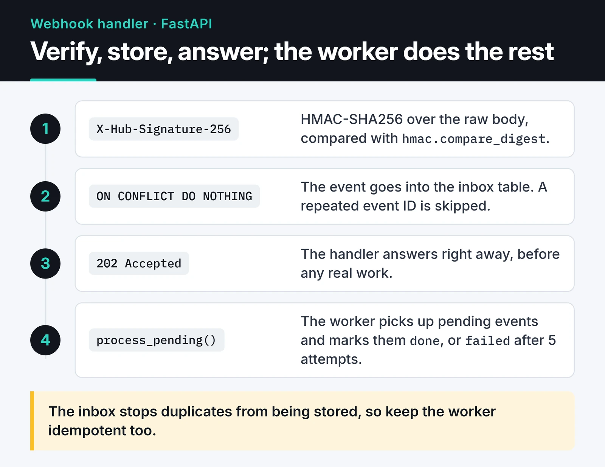

Instead of asking a payment provider "has the payment arrived?" every minute, you let the provider call you when it happens. That's a webhook, and it's where event-driven architecture meets the outside world. A webhook handler looks like a single POST endpoint until three questions show up: did the provider really send this, what happens if my server is down, and what if the same event arrives twice?

This post builds a webhook handler in Python and FastAPI that answers all three. The examples use GitHub webhooks, but the same pattern works for Stripe, Shopify or any other provider.

## The overall flow

The handler only verifies the request, writes it somewhere durable and responds. A separate worker does the real work:



## Signature verification: HMAC over the raw body

A webhook endpoint has to be public. Without a signature check, anyone can `curl` a fake "payment succeeded" event at it. Providers sign the body with HMAC-SHA256 using a secret you share with them and put the result in a header. For GitHub that's `X-Hub-Signature-256: sha256=<hex>`.

Two details matter. Compute the signature over the raw request body; parse and re-serialize the JSON and whitespace or key order changes, so the signature won't match. And compare with `hmac.compare_digest`, not `==`, because it runs in constant time and doesn't leak timing information.

```python {title="webhooks.py"}
import asyncio
import hashlib
import hmac
import json
import logging
import os
from contextlib import asynccontextmanager
from datetime import datetime

from fastapi import FastAPI, Header, HTTPException, Request
from sqlalchemy import JSON, DateTime, String, func, select
from sqlalchemy.dialects.sqlite import insert  # PostgreSQL: sqlalchemy.dialects.postgresql
from sqlalchemy.ext.asyncio import async_sessionmaker, create_async_engine
from sqlalchemy.orm import DeclarativeBase, Mapped, mapped_column

log = logging.getLogger(__name__)

WEBHOOK_SECRET = os.environ["GITHUB_WEBHOOK_SECRET"].encode()
engine = create_async_engine(os.getenv("DATABASE_URL", "sqlite+aiosqlite:///./webhooks.db"))
SessionLocal = async_sessionmaker(engine, expire_on_commit=False)


def verify_github_signature(body: bytes, signature: str | None) -> None:
    if not signature or not signature.startswith("sha256="):
        raise HTTPException(status_code=401, detail="Missing signature")
    expected = "sha256=" + hmac.new(WEBHOOK_SECRET, body, hashlib.sha256).hexdigest()
    if not hmac.compare_digest(expected, signature):
        raise HTTPException(status_code=401, detail="Invalid signature")
```

## Replay attacks: the timestamp must be signed

If an attacker captures a valid signed request and resends it an hour later, the signature still checks out. Two defenses help: a timestamp check, and deduplication by event ID.

A common mistake in the timestamp check is reading the timestamp from a separate header that isn't part of the signature. An attacker can then replace it with a fresh value and replay the old request. A timestamp only helps if it's inside the signed data.

Stripe does this with a `Stripe-Signature: t=<timestamp>,v1=<signature>` header and a signed string of the form `"{t}.{body}"`. For Stripe, don't hand-roll it; use `stripe.Webhook.construct_event` from the official SDK, which also enforces the tolerance. The [Standard Webhooks](https://www.standardwebhooks.com/) spec, adopted by a number of providers, uses the same idea. Verifying it by hand looks like this:

```python
import base64
import time


def verify_standard_webhook(secret: str, headers: dict, body: bytes, tolerance: int = 300) -> None:
    msg_id = headers["webhook-id"]
    timestamp = headers["webhook-timestamp"]
    if abs(time.time() - int(timestamp)) > tolerance:
        raise HTTPException(status_code=401, detail="Timestamp outside tolerance")

    key = base64.b64decode(secret.removeprefix("whsec_"))
    signed = f"{msg_id}.{timestamp}.".encode() + body
    expected = base64.b64encode(hmac.new(key, signed, hashlib.sha256).digest()).decode()

    for candidate in headers["webhook-signature"].split():
        version, _, signature = candidate.partition(",")
        if version == "v1" and hmac.compare_digest(signature, expected):
            return
    raise HTTPException(status_code=401, detail="Invalid signature")
```

GitHub's signature has no timestamp. There, the event ID in the next step is what stops duplicates.

## Acknowledge fast, work later

Providers are impatient. GitHub expects a response within 10 seconds and marks the delivery as failed otherwise. Stripe keeps retrying failed deliveries for days. Generate an invoice and send an email inside the handler, and you'll hit timeouts, the provider will resend, and you're now dealing with duplicates.

FastAPI's `BackgroundTasks` looks like the obvious place for this work, but it doesn't fit. `BackgroundTasks` keeps jobs in memory, so if the process restarts after responding but before the job finishes, the event is lost. And because you already returned 2xx, the provider won't send it again.

The fix is to persist the event before responding. I use an inbox table in the database. The event ID is the primary key, so when the same event arrives twice, `ON CONFLICT DO NOTHING` drops the second copy. GitHub puts a GUID in the `X-GitHub-Delivery` header, and a redelivery reuses the same GUID.

```python
class Base(DeclarativeBase):
    pass


class InboxEvent(Base):
    __tablename__ = "webhook_inbox"

    id: Mapped[str] = mapped_column(String(64), primary_key=True)  # X-GitHub-Delivery
    event_type: Mapped[str] = mapped_column(String(64))
    payload: Mapped[dict] = mapped_column(JSON)
    status: Mapped[str] = mapped_column(String(16), default="pending", index=True)
    attempts: Mapped[int] = mapped_column(default=0)
    received_at: Mapped[datetime] = mapped_column(DateTime(timezone=True), server_default=func.now())


@asynccontextmanager
async def lifespan(app: FastAPI):
    async with engine.begin() as conn:
        await conn.run_sync(Base.metadata.create_all)
    yield
    await engine.dispose()


app = FastAPI(lifespan=lifespan)


@app.post("/webhooks/github", status_code=202)
async def github_webhook(
    request: Request,
    x_github_event: str = Header(),
    x_github_delivery: str = Header(),
    x_hub_signature_256: str | None = Header(default=None),
):
    body = await request.body()  # raw bytes: verify first, parse second
    verify_github_signature(body, x_hub_signature_256)

    stmt = (
        insert(InboxEvent)
        .values(id=x_github_delivery, event_type=x_github_event, payload=json.loads(body))
        .on_conflict_do_nothing(index_elements=["id"])
    )
    async with SessionLocal() as session, session.begin():
        await session.execute(stmt)
    return {"status": "queued"}
```

The only I/O in the handler is a one-row `INSERT`. If that write fails, the handler returns 5xx and the provider retries, which is exactly what you want. You can build the same pattern by publishing to Celery, ARQ or RabbitMQ instead. The table's advantage is that you can query with plain SQL which events arrived, when, and what state they're in.

## The worker and idempotent processing

The worker picks up pending events, marks successes as `done` and moves repeated failures to `failed`:

```python
async def handle_event(event_type: str, payload: dict) -> None:
    log.info("processing %s for %s", event_type, payload.get("repository", {}).get("full_name"))


async def process_pending(batch_size: int = 50) -> int:
    async with SessionLocal() as session, session.begin():
        stmt = (
            select(InboxEvent)
            .where(InboxEvent.status == "pending")
            .order_by(InboxEvent.received_at)
            .limit(batch_size)
        )  # PostgreSQL: add .with_for_update(skip_locked=True) for multiple workers
        events = list(await session.scalars(stmt))
        for event in events:
            event.attempts += 1
            try:
                await handle_event(event.event_type, event.payload)
                event.status = "done"
            except Exception:
                log.exception("webhook %s failed", event.id)
                event.status = "failed" if event.attempts >= 5 else "pending"
    return len(events)


async def run_worker() -> None:
    while True:
        if await process_pending() == 0:
            await asyncio.sleep(1)
```

The inbox stops the same event from being stored twice, but it doesn't give you exactly-once processing. If the worker crashes after `handle_event` finishes and before `done` is committed, the event runs again. So `handle_event` itself has to be idempotent. In practice:

- Use the event ID as a key for side effects. A unique constraint on `source_event_id` in the invoices table means the same invoice can't be created twice.
- Pass the event ID as an idempotency key to downstream APIs. Stripe's `Idempotency-Key` header exists for exactly this.
- Don't trust event order. Providers don't guarantee it, and an "updated" event can arrive before "created". When an event just tells me something changed, I fetch the current state from the provider's API.

A common approach is to check a "processed" key in Redis and then take a lock. There is a gap between the check and the write, so it is racy, and the Redis lock can expire mid-job. A unique constraint in the database does the same job in one atomic step.

## Fanning events out to several services

As an app grows, one event starts to matter to several places. "Payment succeeded" might trigger billing, email and analytics. Do all of it inside one `handle_event` and a broken email service stops invoices too.

Instead, the worker publishes the event to a message broker, and each service reads from its own queue.

In RabbitMQ that's separate queues bound to a topic exchange. If you need to keep events for a long time and replay them, Kafka fits better. When one service fails, only its queue backs up and the rest keep going.

## Testing locally

The provider needs a tunnel to reach your localhost. `ngrok http 8000` or `cloudflared tunnel --url http://localhost:8000` gives you a temporary HTTPS URL. The Stripe CLI's `stripe listen --forward-to localhost:8000/webhooks/stripe` forwards events straight to your local endpoint and makes it easy to trigger test events. For GitHub, `gh webhook forward` comes with the `cli/gh-webhook` extension.

To test the handler itself you don't need a tunnel at all. Sign a test body with the same secret and send it through `TestClient`:

```python
import hashlib
import hmac
import json
import os

os.environ["GITHUB_WEBHOOK_SECRET"] = "test-secret"

from fastapi.testclient import TestClient

import webhooks


def test_duplicate_delivery_is_stored_once():
    body = json.dumps({"repository": {"full_name": "octo/repo"}}).encode()
    signature = "sha256=" + hmac.new(b"test-secret", body, hashlib.sha256).hexdigest()
    headers = {
        "X-GitHub-Event": "push",
        "X-GitHub-Delivery": "delivery-1",
        "X-Hub-Signature-256": signature,
        "Content-Type": "application/json",
    }
    with TestClient(webhooks.app) as client:
        assert client.post("/webhooks/github", content=body, headers=headers).status_code == 202
        assert client.post("/webhooks/github", content=body, headers=headers).status_code == 202
        assert client.portal.call(webhooks.process_pending) == 1
        assert client.portal.call(webhooks.process_pending) == 0
```

Tools like webhook.site are handy for seeing what a payload looks like, but don't point events carrying real customer data at a third-party site.

## What's next

My checklist is short: HMAC over the raw body, a signed timestamp, unique storage by event ID, a fast 2xx and an idempotent worker. To protect the endpoint from abuse, add the limiter from [API rate limiting in Python](/en/posts/python-rate-limiting-api-throttling/); for the rest of the auth story, see [API authentication strategies](/en/posts/api-authentication-strategies/). GitHub's side is documented in [validating webhook deliveries](https://docs.github.com/en/webhooks/using-webhooks/validating-webhook-deliveries).
