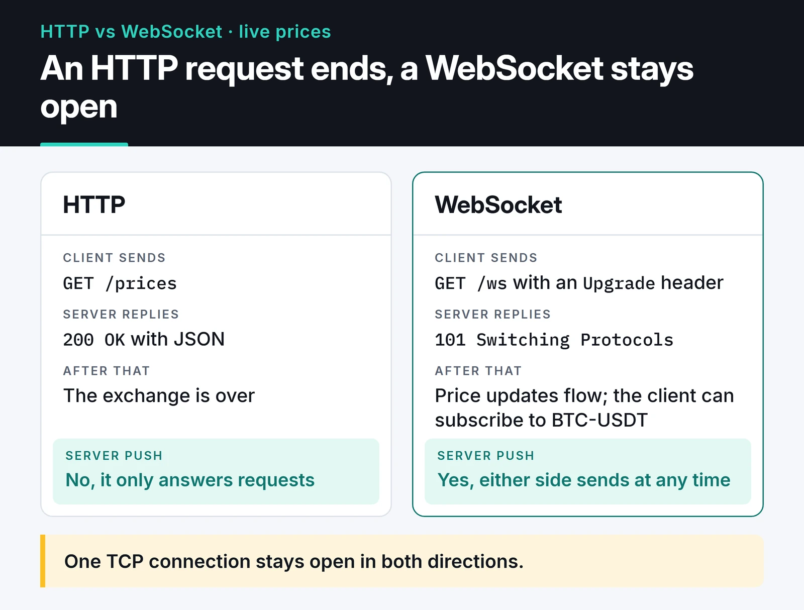
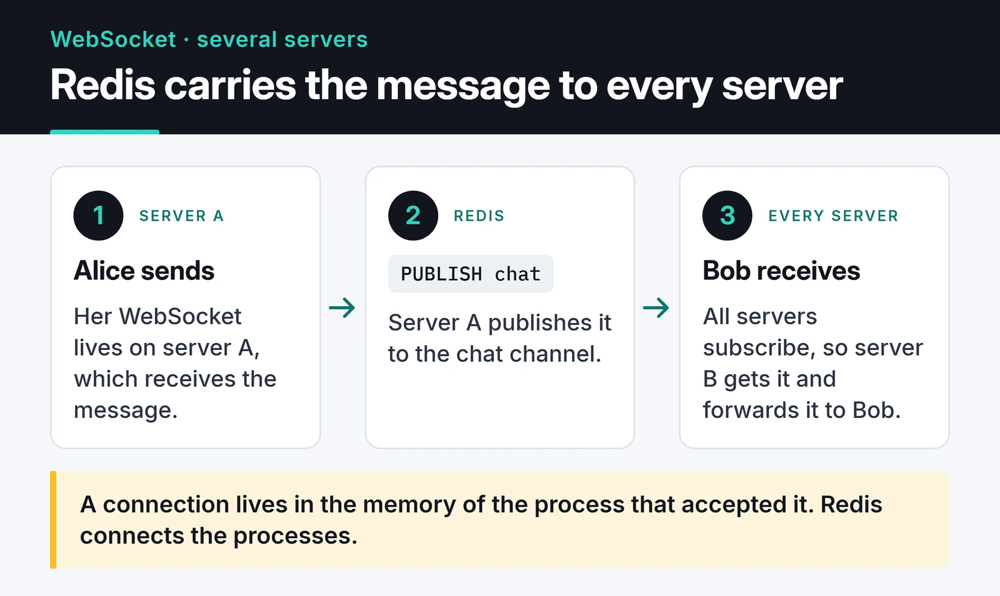

Chat apps, live scores, market tickers and the dashboard of a trading bot all need the server to push data without being asked. Plain HTTP can't do that: the server only answers requests. Real-time WebSocket communication fixes it with one TCP connection that stays open, so either side can send a message at any time.

In this post I build a WebSocket server with FastAPI, scale it to several instances with Redis Pub/Sub, and go through the connection, auth and proxy problems that show up in production.



## Polling, SSE or WebSocket?

WebSocket isn't always the right tool, so check the alternatives first:

- Polling: the client asks "anything new?" every few seconds. Simple, but most answers are empty and latency equals the polling interval.
- Server-Sent Events (SSE): a one-way stream from server to client over plain HTTP. The browser reconnects on its own. Good enough for notifications, log tails and streaming LLM output.
- WebSocket: two-way. Needed when the client also sends often, as in chat, games or live collaboration.

My rule: if the client only listens, use SSE. If both sides talk, use WebSocket.

## A single FastAPI server

FastAPI's WebSocket support (inherited from Starlette) fits naturally with async/await. Here's a simple hub that works on one server:

```python
from fastapi import FastAPI, WebSocket, WebSocketDisconnect

app = FastAPI()


class Hub:
    def __init__(self) -> None:
        self.sockets: set[WebSocket] = set()

    async def connect(self, ws: WebSocket) -> None:
        await ws.accept()
        self.sockets.add(ws)

    def disconnect(self, ws: WebSocket) -> None:
        self.sockets.discard(ws)

    async def broadcast(self, text: str) -> None:
        for ws in list(self.sockets):
            try:
                await ws.send_text(text)
            except Exception:
                self.disconnect(ws)


hub = Hub()


@app.websocket("/ws/{user}")
async def chat(ws: WebSocket, user: str) -> None:
    await hub.connect(ws)
    try:
        while True:
            text = await ws.receive_text()
            await hub.broadcast(f"{user}: {text}")
    except WebSocketDisconnect:
        hub.disconnect(ws)
```

Run it with `uvicorn main:app`, connect from two browser tabs and messages go back and forth. The problem starts when you add a second server.

## Several servers: Redis Pub/Sub

A WebSocket connection is stateful. The connection object lives in the memory of the process that accepted it. With two servers behind a load balancer, Alice on server A and Bob on server B, A's `hub.broadcast` never reaches Bob.

You need a message bus between the servers. Redis Pub/Sub is the easiest option: each server publishes incoming messages to a Redis channel, and every server subscribes to that channel and forwards messages to its own connections.



With redis-py's asyncio API:

```python
import asyncio
from contextlib import asynccontextmanager

import redis.asyncio as redis
from fastapi import FastAPI, WebSocket, WebSocketDisconnect

CHANNEL = "chat"
r = redis.from_url("redis://localhost:6379", decode_responses=True)
hub = Hub()  # the class from above


async def relay() -> None:
    """Listen on the Redis channel and forward every message to local sockets."""
    pubsub = r.pubsub()
    await pubsub.subscribe(CHANNEL)
    async for msg in pubsub.listen():
        if msg["type"] == "message":
            await hub.broadcast(msg["data"])


@asynccontextmanager
async def lifespan(app: FastAPI):
    task = asyncio.create_task(relay())
    yield
    task.cancel()
    await r.aclose()


app = FastAPI(lifespan=lifespan)


@app.websocket("/ws/{user}")
async def chat(ws: WebSocket, user: str) -> None:
    await hub.connect(ws)
    try:
        while True:
            text = await ws.receive_text()
            await r.publish(CHANNEL, f"{user}: {text}")  # no local broadcast
    except WebSocketDisconnect:
        hub.disconnect(ws)
```

The endpoint no longer broadcasts locally; it publishes to Redis. The message comes back through Redis to every server, including the one that sent it.

Pub/Sub has a catch: it's fire and forget. A server that isn't subscribed at that moment (say, it's restarting) never sees the message, and Redis doesn't keep it. If you need chat history, also write messages to a database or to Redis Streams. I cover other Redis patterns in my [Redis post](/en/posts/redis-caching-session-management/).

The `broadcast` loop also sends to sockets one after another, so one very slow client can hold up the rest. With thousands of connections, give each socket its own send queue or wrap sends in `asyncio.wait_for` with a timeout.

## Dropped and zombie connections

Mobile users go through tunnels and switch networks. Worse, a client can vanish without its TCP close ever reaching the server, and the server keeps treating the connection as live.

Protocol-level ping/pong solves that, and uvicorn does it for you. By default it sends a ping every 20 seconds and closes the connection if no pong arrives within 20 seconds (`--ws-ping-interval` and `--ws-ping-timeout`). Browsers answer pings automatically. You don't write anything in JavaScript for this, and the browser WebSocket API doesn't let you send pings anyway.

You only need an application-level "are you there?" message if you want to know whether the user is active.

## Authentication

The browser `WebSocket` API can't set custom headers, so `Authorization: Bearer ...` is out. In practice you have three options:

1. A cookie, if you're on the same site. The handshake is a normal HTTP request, so cookies are sent automatically.
2. A short-lived ticket in the query string. Don't put a long-lived JWT in the URL, since URLs end up in proxy and access logs. Fetch a single-use ticket valid for 30 seconds from a normal HTTP endpoint first, then send it when connecting.
3. Send the token in the first message after connecting and accept nothing else until it checks out.

Whichever you pick, also check the `Origin` header. Browsers don't apply CORS to WebSockets, so with cookie auth another site can open a connection as your user (cross-site WebSocket hijacking).

```python
from fastapi import Query, status

ALLOWED_ORIGINS = {"https://app.example.com"}


@app.websocket("/ws")
async def secure_ws(ws: WebSocket, ticket: str = Query(...)) -> None:
    if ws.headers.get("origin") not in ALLOWED_ORIGINS:
        await ws.close(code=status.WS_1008_POLICY_VIOLATION)
        return
    user = await redeem_ticket(ticket)  # validate and delete the ticket
    if user is None:
        await ws.close(code=status.WS_1008_POLICY_VIOLATION)
        return
    await hub.connect(ws)
    ...
```

`redeem_ticket` is yours to write; reading and deleting the ticket with Redis `GETDEL` is a simple way. Closing before `accept` makes the client's handshake fail with a 403.

## Nginx and load balancers

WebSocket starts with the HTTP/1.1 `Upgrade` mechanism. Nginx doesn't forward those headers by default and closes idle proxied connections after 60 seconds:

```nginx
location /ws {
    proxy_pass http://app_servers;
    proxy_http_version 1.1;
    proxy_set_header Upgrade $http_upgrade;
    proxy_set_header Connection "upgrade";
    proxy_set_header Host $host;
    proxy_read_timeout 1h;
}
```

With plain WebSockets you don't need sticky sessions: the handshake is a single HTTP request and the connection stays on that server afterwards. Libraries like Socket.IO that can fall back to long polling are different; their requests must reach the same server, so you need `ip_hash` or cookie-based routing. More on that in my [Nginx load balancing post](/en/posts/nginx-load-balancing-caching/).

On capacity: an idle connection costs little CPU, and one async process can hold tens of thousands of them. File descriptor limits (`ulimit -n`) and memory run out first, so raise the limits and load-test to find your own number.

## Client: reconnect with exponential backoff

However solid the server is, connections will drop. Retrying every 3 seconds means that when you redeploy, every client hits the server at the same moment. Double the delay each time and add jitter:

```javascript
function connect(url, onMessage, attempt = 0) {
  const ws = new WebSocket(url);

  ws.onopen = () => {
    attempt = 0;
  };

  ws.onmessage = (event) => onMessage(event.data);

  ws.onclose = (event) => {
    if (event.code === 1008) return; // auth failure: don't retry
    const base = Math.min(30000, 1000 * 2 ** attempt);
    const delay = base / 2 + Math.random() * (base / 2);
    setTimeout(() => connect(url, onMessage, attempt + 1), delay);
  };

  return ws;
}

connect("wss://app.example.com/ws?ticket=...", (data) => console.log(data));
```

In a real app you'd fetch a fresh ticket before each reconnect, since tickets are single-use. Also note that the browser only sees code 1008 if the server accepted the connection before closing it. A handshake rejected with 403 shows up as 1006, so put a cap on the number of attempts too.

## Where to go next

Run the Redis version on two ports (`uvicorn main:app --port 8001` and `--port 8002`), connect a tab to each, and watch messages cross between servers. A good next step is per-connection [rate limiting](/en/posts/python-rate-limiting-api-throttling/) against buggy or abusive clients. The [FastAPI WebSocket docs](https://fastapi.tiangolo.com/advanced/websockets/) and [uvicorn settings](https://uvicorn.dev/settings/) cover the rest.
