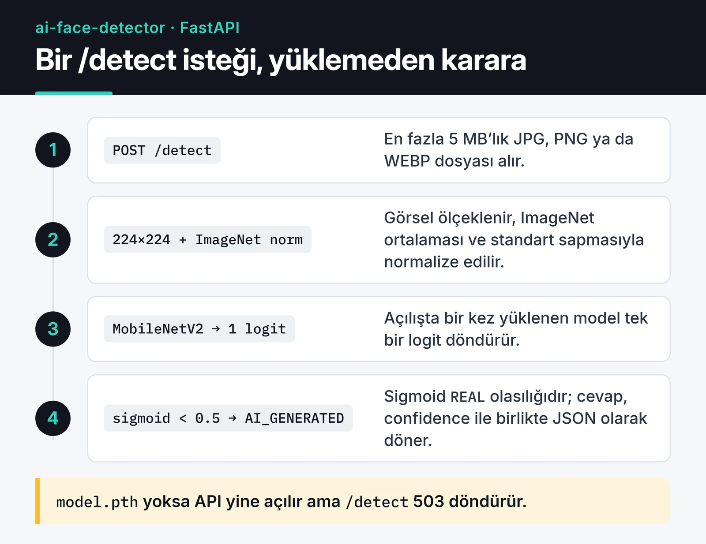

[AI Face Detector](https://github.com/furkankoykiran/ai-face-detector), bir yüz fotoğrafının gerçek mi yoksa yapay zekâyla üretilmiş mi olduğunu tahmin eden açık kaynak bir proje. İçinde PyTorch ile eğitilmiş bir MobileNetV2 sınıflandırıcısı, FastAPI ile yazılmış bir REST API ve Tailwind CSS'li basit bir sürükle bırak arayüzü var. Mart 2026'da yazdım ve MIT lisansıyla yayımladım.

Bu yazıda modeli nasıl eğittiğimi, API'nin nasıl çalıştığını ve en önemlisi modelin neyi bilip neyi bilmediğini anlatıyorum.

## Ne yapıyor, ne yapmıyor

Model, tek bir yüz görüntüsü için iki sınıftan birini veriyor: `REAL` ya da `AI_GENERATED`. Eğitim verisindeki gerçek yüzler FFHQ'dan, sahte yüzler ise StyleGAN'den geliyor. Bundan üç sonuç çıkıyor ve bunları baştan söylemek gerekiyor:

- Model StyleGAN tarzı, tamamen sentetik yüzleri tanımak üzere eğitildi. Stable Diffusion ya da Midjourney gibi diffusion modellerinin ürettiği görüntüler eğitim setinde yok. Repo açıklaması bunları da sayıyor ama bu modeller üzerinde ölçülmüş bir doğruluk yok.
- Videodaki yüz değiştirme (klasik deepfake) bu projenin kapsamında değil. Model tek bir fotoğrafa bakıyor.
- Bir sınıflandırıcının çıktısı olasılık. Kimlik doğrulama ya da haber teyidi gibi işlerde tek başına kanıt olarak kullanılmamalı.

Repo README'sinin başındaki banner, GAN'ların yanında diffusion modellerini de anıyor. Bu yazıdaki sınır geçerli: ölçülmüş sonuç yalnızca StyleGAN yüzleri için var.

## Mimari

Aşağıdaki kart bir isteğin yolunu gösteriyor: tarayıcıdan gelen dosya doğrulanıyor, 224×224'e ölçeklenip normalize ediliyor, modelden geçiyor ve JSON olarak geri dönüyor.



Model, API açılırken FastAPI'nin `lifespan` olayında bir kez yükleniyor. `model.pth` bulunamazsa API yine açılıyor ama `/detect` 503 döndürüyor. `/health` da modelin yüklenip yüklenmediğini söylüyor.

## Veri seti

Eğitim için Kaggle'daki [140k Real and Fake Faces](https://www.kaggle.com/datasets/xhlulu/140k-real-and-fake-faces) veri setini kullandım: 70.000 gerçek (FFHQ) ve 70.000 StyleGAN yüzü, hepsi 256×256. Hazır bölünmüş hâli 100.000 eğitim, 20.000 doğrulama ve 20.000 test görüntüsü. İki sınıfın eşit olması işi kolaylaştırıyor: model bir sınıfa kayarak yüksek doğruluk elde edemiyor.

## Model: transfer learning ile MobileNetV2

Sıfırdan bir CNN eğitmek yerine ImageNet üzerinde önceden eğitilmiş MobileNetV2'yi aldım. Özellik çıkaran katmanları dondurdum ve yalnızca son sınıflandırıcıyı değiştirip eğittim. Yaklaşık 3,5 milyon parametreli bu model CPU'da da hızlı çalışıyor, ağırlık dosyası 14 MB civarında.

`training/train.py` içindeki model kurulumu özünde şu:

```python
import torch.nn as nn
from torchvision import models
from torchvision.models import MobileNet_V2_Weights

def create_model() -> nn.Module:
    model = models.mobilenet_v2(weights=MobileNet_V2_Weights.IMAGENET1K_V1)

    for param in model.features.parameters():
        param.requires_grad = False  # gövde donuk, sadece baş eğitiliyor

    in_features = model.classifier[1].in_features  # 1280
    model.classifier = nn.Sequential(
        nn.Dropout(p=0.3),
        nn.Linear(in_features, 1),  # tek logit: 0 = AI, 1 = REAL
    )
    return model
```

Eğitimin geri kalanı:

- Kayıp fonksiyonu `BCEWithLogitsLoss`, optimizer `Adam` (öğrenme oranı 0.001, weight decay 1e-4).
- `ReduceLROnPlateau` doğrulama kaybı 3 epoch iyileşmezse öğrenme oranını 10'a bölüyor. 5 epoch iyileşme olmazsa eğitim erken duruyor. En fazla 15 epoch.
- Girdiler 224×224'e ölçekleniyor ve ImageNet ortalaması ile standart sapmasıyla normalize ediliyor. Veri artırma olarak yalnızca rastgele yatay çevirme kullanılıyor. Eğitimi hızlı tutmak için daha ağır dönüşümleri script'ten çıkardım.
- Kaggle'da iki T4 GPU ile `DataParallel`, mixed precision (`torch.amp`) ve 256'lık batch kullandım. Script ortamı (Kaggle, Colab ya da yerel) kendisi algılıyor.

## Sonuçlar

README'deki sonuçlar, veri setinin test bölümünde (20.000 görüntü) ölçüldü:

| Metrik | Değer |
| :--- | :--- |
| Doğruluk | %94,5 |
| Precision | %94,2 |
| Recall | %94,8 |
| F1 | 0,945 |
| AUC-ROC | 0,978 |
| Çıkarım süresi (CPU / GPU) | ~45 ms / ~8 ms |

Bu sayıları okurken şunu akılda tutmak gerekiyor: test seti, eğitim setiyle aynı dağılımdan geliyor. Aynı StyleGAN, aynı çözünürlük, aynı kırpma. Başka bir üreticiden gelen, sıkıştırılmış ya da yeniden boyutlandırılmış bir fotoğrafta doğruluğun düşmesini beklerim. Bunu ölçmek için ayrı bir test seti hazırlamak sıradaki işlerimden biri.

## API

Tek önemli endpoint `POST /detect`. JPG, PNG ya da WEBP formatında, en fazla 5 MB'lık bir dosya alıyor:

```bash
curl -X POST "http://localhost:8000/detect" -F "file=@yuz.jpg"
```

```json
{
  "status": "success",
  "result": "AI_GENERATED",
  "confidence": 0.98,
  "probabilities": { "AI_GENERATED": 0.98, "REAL": 0.02 },
  "inference_time_ms": 45.2,
  "image_size": "512x512"
}
```

Model tek bir logit üretiyor. Sigmoid'den geçen değer `REAL` olma olasılığı. 0.5'in altı `AI_GENERATED` olarak dönüyor ve `confidence` o sınıfın olasılığı oluyor.

## Kendi makinende çalıştırma

```bash
git clone https://github.com/furkankoykiran/ai-face-detector.git
cd ai-face-detector
python -m venv .venv && source .venv/bin/activate
pip install -r requirements.txt
```

Eğitilmiş ağırlıklar repoda yok. İki yol var: [Kaggle'daki model sayfasından](https://www.kaggle.com/models/furkankoykiran/ai-face-detector-mobilenetv2) indirmek ya da Kaggle'da GPU'lu bir notebook açıp veri setini ekledikten sonra `training/train.py`'yi çalıştırmak. README'ye göre iki T4 ile eğitim yaklaşık 43 dakika sürüyor. Çıkan `model.pth` dosyasını proje köküne koyun ve API'yi başlatın:

```bash
uvicorn app.main:app --reload --port 8000
```

Swagger arayüzü `http://localhost:8000/docs` adresinde. Web arayüzünü dosyayı doğrudan açarak değil, küçük bir sunucuyla açın. API'nin CORS listesinde `http://localhost:3000` var, `file://` yok:

```bash
python -m http.server 3000 --directory static
```

Hiçbir şey kurmadan denemenin en kısa yolu Kaggle'daki [demo notebook](https://www.kaggle.com/code/furkankoykiran/ai-face-detector-model-demo). Notebook, eğitilmiş modeli ve 140k veri setini girdi olarak bağlıyor ve iki T4 GPU'lu ortamda çalışıyor.


## Bilinen pürüzler

Repoyu yeniden okurken düzeltilmesi gereken üç şey gördüm:

- `app/model_loader.py` hâlâ eski `pretrained=True` parametresini kullanıyor. torchvision bu parametreyi 0.13'te kullanımdan kaldırdı. Üstelik zaten kendi ağırlıklarımızı yükleyeceğimiz için ImageNet ağırlıklarını her açılışta indirmeye gerek yok.
- İki GPU ile `DataParallel` kullanarak eğitince kaydedilen `state_dict` anahtarları `module.` önekiyle başlıyor. API bu öneki temizlemediği için böyle bir dosyayı yükleyemiyor.
- `requirements.txt` 2024 başındaki sürümlere sabitli (torch 2.1, FastAPI 0.109).

İlk ikisi için yükleyicinin olması gereken hâli şu:

```python
import torch
import torch.nn as nn
from torchvision import models

def create_model() -> nn.Module:
    model = models.mobilenet_v2(weights=None)  # ağırlıklar dosyadan gelecek
    in_features = model.classifier[1].in_features
    model.classifier = nn.Sequential(nn.Dropout(p=0.3), nn.Linear(in_features, 1))
    return model

def load_model(path: str, device: torch.device) -> nn.Module:
    state = torch.load(path, map_location=device, weights_only=True)
    state = {k.removeprefix("module."): v for k, v in state.items()}
    model = create_model()
    model.load_state_dict(state)
    return model.to(device).eval()
```

`weights_only=True`, PyTorch 2.6'dan beri zaten varsayılan. Bilinmeyen kaynaktan gelen bir `.pth` dosyasının yüklenirken kod çalıştırmasını engelliyor, bu yüzden açıkça yazmayı tercih ediyorum.

## Sırada ne var

Kod [GitHub'da](https://github.com/furkankoykiran/ai-face-detector), projenin özeti [portfolyomda](https://furkankoykiran.com.tr/projeler/ai-face-detector/). Sıradaki adımlar yukarıdaki pürüzleri düzeltmek ve diffusion modelleriyle üretilmiş yüzlerden oluşan ayrı bir test seti hazırlamak. Bir model bu sette de tutarsa ancak o zaman README'deki iddiayı genişletmek doğru olur.

API tarafı ilginizi çektiyse [FastAPI ile REST API geliştirme](/posts/python-fastapi-restful-api-gelistirme/) yazısında Pydantic v2 ve async yapıyı daha ayrıntılı anlatıyorum. Görüntü ön işleme için [Pillow ve OpenCV ile görüntü işleme](/posts/python-goruntu-isleme-pillow-opencv/), servisi paketlemek için de [Docker ile Python uygulamalarını container'a almak](/posts/docker-ile-python-uygulamasi-containerization/) yazılarına bakabilirsiniz.
