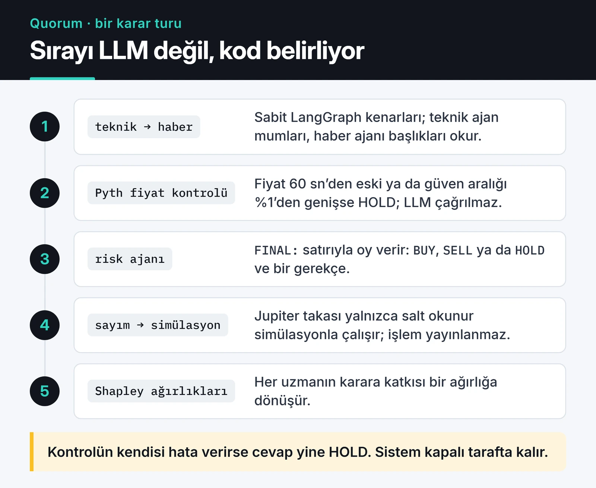

Yapay zekâ destekli trading denince çoğu yazıda aynı resim çiziliyor: bir LSTM modeli eğitilir, tahmin grafiği gerçek fiyatın üstüne neredeyse kusursuz oturur, okur da bu modelin para basacağına ikna olur. O grafik çoğu zaman bir yanılsama.

Ben iki farklı yaklaşımı denedim. Birincisi klasik makine öğrenmesi: fiyat verisinden özellik çıkarıp bir sonraki mumun yönünü tahmin etmek. İkincisi daha yeni: birden fazla LLM ajanının bir işlemi tartışıp oyladığı [Quorum](https://furkankoykiran.com.tr/projeler/quorum/) adlı hackathon projem. Bu yazıda ikisinden öğrendiklerimi, kodu ve ölçtüğüm sonuçlarla birlikte anlatıyorum.

## O güzel LSTM grafikleri neden yanıltıcı?

Bir modele fiyatın kendisini tahmin ettirirseniz (örneğin yarının kapanışı), model kısa sürede en kolay cevabı öğrenir: "yarın da bugüne çok yakın olacak". Tahmin grafiği gerçek fiyatı bir mum geriden takip eder, gözle bakınca harika görünür, ortalama hata da düşüktür. Ama işlem açmak için gereken bilgi, yani yön, o grafikte yoktur.

Bu yüzden artık fiyatı değil, getiriyi ya da yönü hedefliyorum. Başarıyı da "doğruluk yüzde kaç" diye değil, "her zaman aynı tahmini yapan aptal bir modelden ne kadar iyi" diye ölçüyorum.

## Walk-forward doğrulamalı basit bir model

Aşağıdaki kod saatlik mumlardan birkaç özellik çıkarıyor ve bir sonraki mumun yükselip yükselmeyeceğini tahmin eden bir gradient boosting modeli eğitiyor. Rastgele `train_test_split` kullanmak zaman serisinde hata olur, çünkü model geleceği görerek eğitilir. `TimeSeriesSplit` her katmanda sadece geçmişle eğitip hemen sonrasındaki dönemde test ediyor.

```python {title="model.py"}
import pandas as pd
from sklearn.ensemble import HistGradientBoostingClassifier
from sklearn.model_selection import TimeSeriesSplit


def make_features(df: pd.DataFrame) -> pd.DataFrame:
    close = df["close"]
    ret = close.pct_change()
    delta = close.diff()
    gain = delta.clip(lower=0).rolling(14).mean()
    loss = (-delta.clip(upper=0)).rolling(14).mean()
    feats = pd.DataFrame({
        "ret_1": ret,
        "ret_6": close.pct_change(6),
        "ret_24": close.pct_change(24),
        "vol_24": ret.rolling(24).std(),
        "rsi_14": 100 - 100 / (1 + gain / loss),
        "vol_ratio": df["volume"] / df["volume"].rolling(24).mean(),
    })
    # Hedef: bir sonraki mumun kapanışı bu mumdan yüksek mi?
    feats["target"] = (close.shift(-1) > close).astype(int)
    return feats.iloc[:-1].dropna()  # son mumun hedefi henüz bilinmiyor


def walk_forward(data: pd.DataFrame, n_splits: int = 5) -> list[float]:
    """Her katman için modelin doğruluğu ile çoğunluk tahmini arasındaki farkı döndürür."""
    X, y = data.drop(columns="target"), data["target"]
    edges = []
    for train_idx, test_idx in TimeSeriesSplit(n_splits=n_splits, gap=24).split(X):
        model = HistGradientBoostingClassifier(max_iter=200, learning_rate=0.05)
        model.fit(X.iloc[train_idx], y.iloc[train_idx])
        acc = (model.predict(X.iloc[test_idx]) == y.iloc[test_idx]).mean()
        baseline = max(y.iloc[test_idx].mean(), 1 - y.iloc[test_idx].mean())
        edges.append(round(float(acc - baseline), 4))
    return edges
```

`gap=24` eğitim ve test arasına 24 mumluk boşluk koyuyor. Özelliklerin bir kısmı 24 mumluk pencerelerle hesaplandığı için, bu boşluk olmadan eğitimin son satırları ile testin ilk satırları aynı veriyi paylaşırdı.

Bu kodu [pandas yazımdaki](/posts/python-pandas-kripto-para-piyasa-analizi/) rastgele yürüyüş verisini saatlik mumlara çevirerek çalıştırdığımda sonuç beklendiği gibi çıktı: beş katmanda modelin çoğunluk tahminine göre avantajı yaklaşık +0,008 ile -0,020 arasında. Yani sıfır, hatta biraz eksi. Rastgele bir seride öğrenilecek bir şey yok ve model de bir şey öğrenmiyor.

## Veri sızıntısı için en iyi test

Bu sonuç sıkıcı görünebilir ama aslında çok kullanışlı bir test. Aynı veriye, yanlışlıkla geleceği içeren tek bir kolon ekledim: bir sonraki mumun getirisi. Model bu kolonla her katmanda çoğunluk tahmininin 48 ile 50 puan üstüne çıktı, yani neredeyse her tahmini doğru yaptı. Aşağıdaki çıktıda ilk satır temiz veri, ikinci satır sızıntılı veri, üçüncüsü de aynı serinin ilk 50.000 dakikalık mumu:


Kendi kuralım bu yüzden şu: yeni bir özellik ya da veri hattı yazdığımda önce rastgele veride çalıştırıyorum. Rastgele veride anlamlı bir avantaj çıkıyorsa, gerçek veride gördüğüm başarının bir kısmı büyük ihtimalle sızıntıdan geliyor.

Gerçek projelerde sızıntı bu kadar bariz olmuyor. En sık gördüklerim:

- Ölçekleyiciyi (`StandardScaler` gibi) bütün veriye fit edip sonra bölmek. Test döneminin ortalaması eğitime sızar.
- `rolling(..., center=True)` ya da `shift(-n)` ile hesaplanan özellikler. İkisi de geleceğe bakar.
- Mum kapanmadan önce bilinemeyecek bir değeri (o mumun kapanışı, hacmi) o mumda karar vermek için kullanmak.
- Sadece bugün hâlâ listelenen coinlerle eğitmek.

Gerçek veride modelin küçük de olsa bir avantajı çıksa bile iş bitmiyor. Yüzde 51'lik bir isabet, komisyon ve kayma düşüldükten sonra genelde eksiye dönüyor. Bu yüzden model skorunu her zaman maliyetli bir backtest ile birlikte değerlendiriyorum. Backtest tarafını [otomatik trading sistemi yazımda](/posts/building-automated-trading-systems-python/) anlattım.

Bu işi kendi altyapınızla yapmak yerine Freqtrade kullanıyorsanız, FreqAI modülü özellik üretimi, kayan pencereyle yeniden eğitim ve backtest entegrasyonunu hazır getiriyor. Sızıntı riskleri orada da aynı; araç sizin yerinize düşünmüyor.

## LLM ajanlarıyla bir komite: Quorum

Quorum'u SWARM Hackathon için yazdım. Fikir şu: tek bir model her şeye karar vermesin. Teknik analiz, haber ve risk için ayrı ajanlar olsun, her biri işlemi düz metinle tartışsın, sonunda oy versin. Ajanlar LangGraph ile kurulu. Teknik ajan mum verisini [freqtrade-mcp](/posts/freqtrade-mcp-server-tr/) üzerinden, haber ajanı başlıkları [OmniWire-MCP](/posts/omniwire-mcp-ai-news-server/) üzerinden okuyor. Çalıştırma tarafı Solana üzerinde Squads V4 multisig ve Jupiter.



Oylamadan sonra bir Shapley ajanı her uzmanın karara katkısını ağırlık olarak hesaplıyor; amaç, gerçekleşen kârı ajanları çalıştıran operatörler arasında bu ağırlıklarla paylaştırmak.

Projenin dürüst durumu şu: multisig ve kasa işlemleri Solana devnet'te çalıştı, Jupiter takası mainnet'in bir kopyası (fork) üzerinde ve salt okunur simülasyonla denendi. Sürekli çalışan döngü işlemi hiçbir zaman ağa göndermiyor. Yol haritasındaki mainnet geçişi tamamlanmadı. Yani Quorum'un bir getiri iddiası yok; bir mimari denemesi.

Bu projeden çıkardığım dersler, bence modelden bağımsız olarak geçerli:

### Akışı kod belirlesin, model değil

Başta bir "supervisor" LLM'in hangi ajana sıra vereceğine kendisinin karar vermesini istedim. Bazı model ve gateway kombinasyonlarında model "üç ajana da danış" talimatını güvenilir şekilde takip etmedi. Sonunda ajanların sırasını LangGraph'ta sabit kenarlarla (tech → news → risk → tally) kodladım. Bir trading sisteminde hangi adımın atlanabileceğine model karar vermemeli.

### Model çıktısı yapılandırılmış ve doğrulanabilir olmalı

Her ajan cevabını bir `FINAL: {"agent": ..., "vote": ..., "rationale": ...}` satırıyla bitiriyor. Bu satır regex ve JSON ile ayrıştırılıyor. Oy `BUY`, `SELL`, `HOLD` dışında bir şeyse ya da gerekçe boşsa o tur geçersiz sayılıyor. Ayrıştırılamayan bir cevabı "herhalde al demek istedi" diye yorumlamak yok.

### Risk kontrolü prompt'ta değil, kodda yaşar

Risk ajanı çalışmadan önce Pyth fiyat beslemesi kontrol ediliyor. Fiyat 60 saniyeden eskiyse ya da güven aralığı fiyatın yüzde 1'inden genişse, LLM hiç çağrılmadan karar HOLD oluyor. Kontrolün kendisi hata verirse de sonuç yine HOLD: sistem belirsizlikte işlem yapmama yönünde kapanıyor (fail-closed). "Lütfen riskli işlem önerme" diye prompt yazmak bunun yerini tutmaz.

### LLM'ler tahminci değil

Ajanların iyi yaptığı iş haber başlıklarını özetlemek, teknik veriyi okunur bir gerekçeye çevirmek ve kararı açıklamak. Fiyatın nereye gideceğini bilmek bunlardan biri değil. Ayrıca her debate turu birden fazla model çağrısı demek; maliyet ve gecikme, saniyeler içinde karar gerektiren stratejiler için bu yaklaşımı baştan eliyor. Quorum'da varsayılan döngü aralığı bu yüzden dakikalar seviyesinde.

## Bugün olsa nasıl kurardım?

Kendi param söz konusu olsaydı sıralama şöyle olurdu: kuralları açık, maliyetli backtest'ten ve hiç dokunulmamış bir test döneminden geçmiş basit bir strateji; onun üstünde katı pozisyon büyüklüğü ve günlük zarar limiti; makine öğrenmesini de en fazla bir filtre olarak (örneğin yüksek volatilite dönemlerinde işlem açmamak için). LLM ajanlarını izleme, açıklama ve raporlama tarafında kullanırdım. Karar döngüsünün tam ortasına koymazdım.

Bu yazıdaki hiçbir şey yatırım tavsiyesi değil. Bir modelin geçmiş veride iyi görünmesi gelecekte para kazandıracağı anlamına gelmiyor; kripto piyasaları da hızla rejim değiştiriyor. Kaybetmeyi göze alamayacağınız parayla denemeyin.

Quorum'un kodu ve mimari notları [GitHub'da](https://github.com/furkankoykiran/Quorum). Kendi denemenizi yapacaksanız yukarıdaki `walk_forward` fonksiyonunu önce rastgele veride çalıştırın; sıfır civarında bir sonuç görmüyorsanız, gerçek veriye geçmeden önce sızıntıyı bulun.
