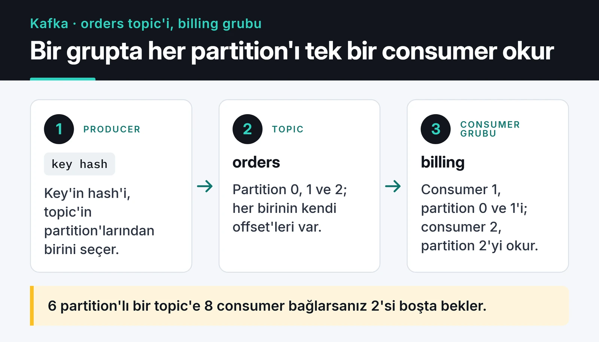

Apache Kafka ile event streaming, klasik bir mesaj kuyruğundan farklı bir model: Kafka mesajları okunduktan sonra silmeyen, sıralı ve dağıtık bir log. Bu fark doğru kullanıldığında olayları tekrar oynatma (replay), birden fazla bağımsız tüketici ve çok yüksek hacim demek. Yanlış kullanıldığında ise sürekli rebalance olan consumer'lar ve kaybolan mesajlar.

Bu yazıda Kafka 4'ün ZooKeeper'sız KRaft moduyla bir cluster'ın nasıl göründüğünü, partition sayısının nasıl seçildiğini ve Python'da `confluent-kafka` ile veri kaybetmeyen bir producer ve consumer'ın nasıl yazıldığını anlatıyorum.

## Kafka'nın RabbitMQ'dan farkı

RabbitMQ akıllı bir broker: mesajı routing kurallarına göre kuyruklara dağıtır, consumer ACK gönderince siler. Kafka'da broker daha basit bir iş yapar: mesajları topic'lerin partition'larına sırayla ekler ve retention süresi dolana kadar tutar. Hangi mesaja kadar okuduğunu (offset) consumer grubu kendisi takip eder.

Bunun pratik sonuçları:

- Aynı topic'i birbirinden habersiz birçok consumer grubu okuyabilir. Sipariş olaylarını hem faturalama hem analitik hem arama indeksi ayrı ayrı tüketir.
- Bir hatayı düzelttikten sonra consumer'ın offset'ini geri alıp geçmişi yeniden işleyebilirsiniz.
- Sıralama sadece partition içinde garanti. Aynı kullanıcının olaylarının sırası önemliyse onları aynı key ile gönderin, aynı partition'a düşsünler.

"Bu işi biri yapsın ve bitsin" tarzı iş kuyrukları için RabbitMQ daha az iş çıkarıyor; o tarafı [RabbitMQ yazımda](/posts/rabbitmq-mesaj-kuyrugu-sistemi/) anlattım. Kafka'yı olay akışı, birden fazla tüketici ve replay gerektiğinde seçiyorum.

## KRaft: ZooKeeper artık yok

Kafka uzun yıllar cluster metadata'sını tutmak için ayrı bir ZooKeeper cluster'ına ihtiyaç duyuyordu. KRaft modunda bu işi Kafka'nın kendi controller'ları Raft konsensüsüyle yapıyor. Kafka 4.0 ile ZooKeeper desteği tamamen kaldırıldı. Hâlâ ZooKeeper ile çalışan bir cluster'ınız varsa önce 3.x serisinde (3.9 köprü sürümü) KRaft'a geçiş yapmanız, sonra 4.x'e yükseltmeniz gerekiyor; ZooKeeper'lı bir cluster doğrudan 4.0'a yükseltilemiyor.

Production'da üç (ya da beş) ayrı controller node'u ve ayrı broker'lar öneriliyor; geliştirme için tek bir node hem controller hem broker olabiliyor. Resmi Docker imajı varsayılan olarak tam bunu yapıyor:

```yaml
# compose.yaml
services:
  kafka:
    image: apache/kafka:4.1.0
    container_name: kafka
    ports:
      - "9092:9092"
```

```bash
docker compose up -d
docker exec -it kafka /opt/kafka/bin/kafka-topics.sh \
  --bootstrap-server localhost:9092 \
  --create --topic orders --partitions 6 --replication-factor 1
```

Kendi kurulumunuzu yaparken her node'da `process.roles` (`controller`, `broker` ya da ikisi) ayarlanıyor ve depolama dizini başlatmadan önce `kafka-storage.sh format` ile bir cluster ID'siyle formatlanıyor. Bu adım ZooKeeper'lı kurulumlarda yoktu ve ilk seferde en çok atlanan adım.

## Partition sayısı nasıl seçilir?

Partition, Kafka'da paralelliğin birimi. Bir consumer grubunda bir partition'ı aynı anda sadece bir consumer okuyabilir; 6 partition'lı bir topic'e 8 consumer bağlarsanız 2'si boşta bekler.



Kaba bir hesap:

```text
partition sayısı ≥ hedef throughput / tek consumer'ın throughput'u
```

Saniyede 1.000 mesaj geliyorsa ve tek bir consumer (veritabanına yazdığı için) saniyede 100 mesaj işleyebiliyorsa en az 10 partition gerekir. Büyüme için biraz pay bırakın, ama binlerce partition açmayın: her partition'ın dosya, bellek ve leader seçimi maliyeti var.

Partition sayısını sonradan artırabilirsiniz ama azaltamazsınız. Artırdığınızda da key'e göre partition seçimi değişir, yani aynı key'in eski ve yeni mesajları farklı partition'lara düşebilir. Key bazlı sıralamaya güveniyorsanız sayıyı baştan cömert seçin.

## Veri kaybetmeyen bir producer

Python için `confluent-kafka` kullanıyorum; C ile yazılmış librdkafka'nın üzerine kurulu ve hızlı. Güvenilirlik için önemli ayarlar:

- `acks=all`: mesaj, leader'a ek olarak tüm in-sync replica'lara yazılmadan başarılı sayılmaz.
- `enable.idempotence=True`: ağ hatasında yapılan yeniden denemeler aynı mesajı iki kez yazmaz ve partition içindeki sıra korunur. Java client'ta varsayılan olarak açık, librdkafka'da değil; açıkça verin.
- Broker tarafında replication factor 3 ve `min.insync.replicas=2`. Böylece bir broker kaybında hem yazmaya devam edersiniz hem veri en az iki kopyada durur.

```python
import json

from confluent_kafka import Producer

producer = Producer(
    {
        "bootstrap.servers": "localhost:9092",
        "acks": "all",
        "enable.idempotence": True,
        "linger.ms": 10,  # küçük mesajları 10 ms biriktirip toplu gönder
        "compression.type": "zstd",
    }
)


def on_delivery(err, msg) -> None:
    if err is not None:
        print(f"teslim edilemedi: {err}")
    else:
        print(f"{msg.topic()}[{msg.partition()}] offset={msg.offset()}")


order = {"id": 42, "user_id": 7, "total": 199.9}
producer.produce(
    "orders",
    key=str(order["user_id"]),  # aynı kullanıcı her zaman aynı partition
    value=json.dumps(order).encode(),
    on_delivery=on_delivery,
)
producer.poll(0)    # teslim callback'lerini tetikler
producer.flush(10)  # kapanmadan önce kuyruktaki mesajları gönder
```

`produce` asenkron çalışır: mesajı yerel bir kuyruğa koyar ve hemen döner. Sonucu callback'te öğrenirsiniz, bu yüzden callback'teki hatayı loglamak ya da tekrar denemek sizin işiniz. Producer nesnesi ağır ve thread-safe; uygulama boyunca bir tane kullanın, her istekte yenisini yaratmayın.

Mesajlar küçük kalmalı. Broker'ın varsayılan mesaj limiti yaklaşık 1 MB; resim ya da büyük dosya yerine object storage'daki yolunu gönderin.

## Consumer: offset'i iş bitince commit edin

Varsayılan `enable.auto.commit=true` ayarında offset'ler arka planda periyodik olarak commit edilir. Mesajı aldınız, commit edildi, işlerken process çöktü: o mesaj bir daha gelmez. Ben otomatik commit'i kapatıp offset'i iş bittikten sonra kendim commit ediyorum. Bu "en az bir kez" (at-least-once) teslim demek; çökme anında bir mesaj iki kez işlenebilir, bu yüzden işleme tarafını idempotent yazın (örneğin sipariş ID'si üzerinde unique kısıt).

```python
import json

from confluent_kafka import Consumer, KafkaException

consumer = Consumer(
    {
        "bootstrap.servers": "localhost:9092",
        "group.id": "billing",
        "enable.auto.commit": False,
        "auto.offset.reset": "earliest",
        "partition.assignment.strategy": "cooperative-sticky",
        "group.instance.id": "billing-1",  # static membership; her instance'a farklı değer
    }
)
consumer.subscribe(["orders"])


def process(order: dict) -> None:
    print("faturalandı:", order["id"])


try:
    while True:
        msg = consumer.poll(1.0)
        if msg is None:
            continue
        if msg.error():
            raise KafkaException(msg.error())
        process(json.loads(msg.value()))
        consumer.commit(message=msg, asynchronous=False)
finally:
    consumer.close()
```

Her mesajdan sonra senkron commit basit ama yavaş. Throughput gerektiğinde birkaç yüz mesajda bir ya da birkaç saniyede bir commit etmek yaygın bir orta yol; çökme anında tekrar işlenecek mesaj sayısı o kadar artar. asyncio tabanlı bir servis yazıyorsanız `aiokafka` aynı modeli `async/await` ile sunuyor.

## Rebalance fırtınası

Bir consumer gruba katıldığında ya da gruptan düştüğünde partition'lar yeniden dağıtılır. Eski "eager" protokolde bu sırada grubun tamamı okumayı durdurur. Rebalance'ları tetikleyen en sık neden de şu: bir consumer `max.poll.interval.ms` (varsayılan 5 dakika) içinde tekrar `poll` çağırmazsa, Kafka onu ölü sayıp gruptan atar. Yavaş bir veritabanı yazması tüm grubu rebalance döngüsüne sokabilir.

Yaptığım ayarlar:

1. `partition.assignment.strategy=cooperative-sticky`: rebalance sırasında sadece taşınması gereken partition'lar bırakılır, diğerleri okunmaya devam eder.
2. `group.instance.id` ile static membership: deploy sırasında yeniden başlayan bir consumer, `session.timeout.ms` dolmadan geri dönerse rebalance hiç olmaz.
3. Bir `poll` döngüsünde işlenen iş, `max.poll.interval.ms`'yi aşmayacak kadar küçük olmalı. Java client'ta bunun için `max.poll.records` var; `confluent-kafka`'nın `poll` çağrısı zaten tek mesaj döndürüyor, `consume(num_messages=...)` ile toplu okuyorsanız sayıyı düşük tutun.

Kafka 4.0 ile yeni consumer group protokolü (KIP-848) de genel kullanıma açıldı. Bu protokolde partition atamasını broker yapıyor ve rebalance'lar grubu durdurmadan, artımlı ilerliyor. Client'ta `group.protocol=consumer` ile açılıyor ve güncel librdkafka sürümleri destekliyor; yeni bir projeye başlıyorsanız denemeye değer.

## Log compaction

Normalde eski segmentler retention süresi dolunca silinir. `cleanup.policy=compact` olan bir topic'te ise Kafka her key için en az son değeri saklar. `user:123` için önce "Ahmet" sonra "Mehmet" geldiyse, compaction sonrası sadece "Mehmet" kalır. Bu sayede topic bir anahtar-değer tablosunun değişim günlüğü gibi davranır; yeni açılan bir servis tüm güncel durumu topic'i baştan okuyarak kurabilir. Bir key'i tamamen silmek için o key'e boş değerli (tombstone) bir mesaj gönderirsiniz.

## Unclean leader election kapalı kalmalı

Bir partition'ın leader'ı öldüğünde Kafka yeni leader'ı in-sync replica'lar arasından seçer. `unclean.leader.election.enable=true` olursa, in-sync replica kalmadığında geride kalmış bir replica'yı leader yapar: partition erişilebilir olur ama o replica'nın almadığı mesajlar kaybolur. Varsayılan değer `false` ve sipariş, ödeme gibi veriler için öyle kalmalı. Erişilebilirliği tutarlılığa tercih ettiğiniz log ya da metrik topic'leri için topic bazında açabilirsiniz.

## İzleme

Kafka'yı izlemeden çalıştırmak, sorunları kullanıcıdan duymak demek. JMX metriklerini Prometheus JMX exporter ile, consumer lag'i de kafka-exporter ya da Burrow gibi bir araçla toplayıp Grafana'ya alıyorum; genel kurulumu [Prometheus ve Grafana yazımda](/posts/prometheus-grafana-ile-izleme/) anlattım. Alarm kurduğum metrikler:

- Consumer lag: grubun ne kadar geride olduğu. Sürekli artıyorsa consumer'lar yetişemiyor, ya ölçeklendirin ya da işleme süresini kısaltın.
- `UnderReplicatedPartitions`: sıfırdan büyükse bir broker geride ya da ölü; veri olması gerekenden az kopyada.
- `OfflinePartitionsCount`: leader'ı olmayan partition sayısı. Sıfır olmalı.
- `ActiveControllerCount`: tüm controller'lar toplandığında tam olarak 1 olmalı.

## Sonraki adım

Yukarıdaki compose dosyasıyla tek node'lu Kafka'yı kaldırın, producer'ı çalıştırın, sonra consumer'ı iki terminalde farklı `group.instance.id` değerleriyle başlatıp partition'ların nasıl paylaşıldığını izleyin. Kafka'ya gelen olaylar dış sistemlerden geliyorsa [webhook handler yazım](/posts/webhook-handler-olay-gudumlu-mimari/) o tarafı anlatıyor; Kafka'dan bir arama indeksini besliyorsanız [Elasticsearch yazıma](/posts/elasticsearch-tam-metin-arama-sistemi/) bakın. Ayarların tam listesi için [Kafka dokümantasyonu](https://kafka.apache.org/documentation/) ve [confluent-kafka Python dokümantasyonu](https://docs.confluent.io/platform/current/clients/confluent-kafka-python/html/index.html) en güvenilir kaynaklar.
