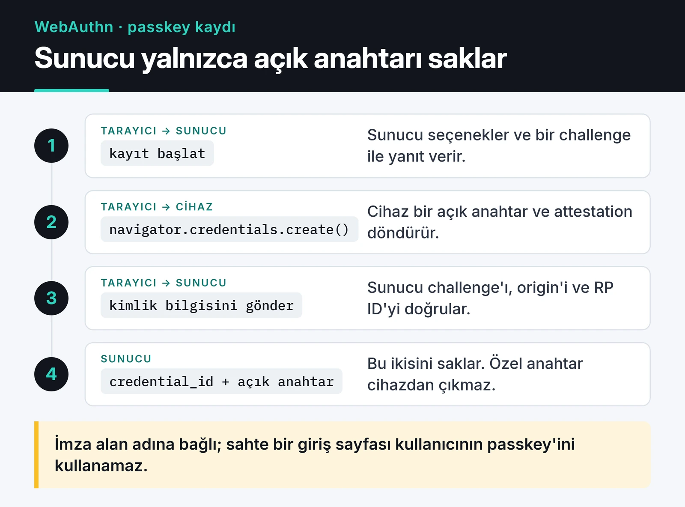

API kimlik doğrulama hakkında okuduğum yazıların çoğu tek bir yönteme odaklanıyor: "JWT kullan" ya da "JWT kullanma". Bence doğru yöntem, API'yi kimin çağırdığına bağlı. Bu yazıda API kimlik doğrulama stratejilerini çağıran türüne göre ayırıyorum: API anahtarları, JWT ve tuzakları, OAuth 2.1, passkey'ler ve servisler arası mTLS. Sonunda da bunları FastAPI'de nasıl bağladığımı gösteriyorum.

Önce iki kavramı ayırmak gerekiyor. Kimlik doğrulama (authentication) "bu kim?" sorusunu, yetkilendirme (authorization) "bu kişi bunu yapabilir mi?" sorusunu cevaplıyor. Güvenlik açıklarının önemli bir kısmı ikincisinin atlanmasından çıkıyor: kullanıcı doğru doğrulanıyor ama başkasının kaydına erişip erişmediği kontrol edilmiyor.

## Kim çağırıyor, ne kullanmalı?

| Çağıran | Önerim |
|---|---|
| Tarayıcıdaki kendi web uygulamanız | Sunucu taraflı oturum + `HttpOnly` çerez; girişte passkey |
| Mobil uygulama veya SPA, dış kimlik sağlayıcıyla | OAuth 2.1 Authorization Code + PKCE, OIDC |
| Kullanıcı adına çalışan üçüncü taraf uygulama | OAuth 2.1, kapsamlı (scope) erişim |
| Kendi script'iyle API'yi kullanan geliştirici | API anahtarı |
| Kendi servisleriniz arası | OAuth client credentials ya da mTLS |

## API anahtarları: düz metin saklamayın

Hâlâ çok sık gördüğüm bir hata, API anahtarlarını veritabanında düz metin olarak tutmak. Veritabanı dökümü sızarsa bütün müşterilerin anahtarı da sızar. Anahtarları parolalar gibi ele alıyorum:

1. Anahtarı güçlü bir rastgele kaynakla ve tanınabilir bir önekle üretmek.
2. Kullanıcıya sadece bir kez göstermek.
3. Veritabanına sadece hash'ini yazmak.

```python
import hashlib
import secrets

PREFIX = "fk_live_"


def new_api_key() -> tuple[str, str]:
    key = PREFIX + secrets.token_urlsafe(32)
    return key, hash_api_key(key)  # kullanıcıya key, veritabanına hash


def hash_api_key(key: str) -> str:
    return hashlib.sha256(key.encode()).hexdigest()
```

Burada sık sık Argon2 önerilir. Parolalar için doğru, API anahtarları için gereksiz. Argon2 ve bcrypt, tahmin edilebilir kısa parolalara karşı kaba kuvveti yavaşlatmak için tasarlandı. 256 bitlik rastgele bir anahtarı kaba kuvvetle bulmak zaten mümkün değil. Üstelik her istekte anahtarı doğrulamanız gerekiyor ve yavaş bir hash her isteğe onlarca milisaniye ekler. SHA-256 burada doğru araç ve hash üzerinden indeksli arama yapabiliyorsunuz. Ek bir önlem isterseniz sunucuda tuttuğunuz bir gizli anahtarla HMAC alabilirsiniz; o zaman sadece veritabanını ele geçiren biri hash'leri test edemez.

Önek de bir işe yarıyor: GitHub'ın secret scanning'i gibi araçlar, bir anahtar yanlışlıkla bir repoya düştüğünde onu desenden tanıyabiliyor. Anahtarlara kapsam (sadece okuma gibi), son kullanma tarihi ve kullanıcının kendisinin yenileyip iptal edebileceği bir arayüz eklemek de işin parçası.

## JWT tuzakları ve sıkı doğrulama

JWT hakkında okuduğum uyarıların çoğu aslında eksik doğrulama hakkında. Gördüğüm başlıca tuzaklar:

- `alg: none`: Token başlığında algoritmayı `none` yapıp imzayı silmek. Algoritmayı token'dan okuyan kütüphaneler bunu kabul edebiliyordu.
- Algoritma karıştırma: Sunucu RS256 bekliyor ama saldırgan HS256 ile, sunucunun açık anahtarını gizli anahtar gibi kullanarak imzalıyor. Algoritma listesine ikisini birden koyarsanız açık kalırsınız.
- `aud` ve `iss` kontrol edilmiyor: Başka bir servis için verilmiş geçerli bir token sizin API'nizde de kabul ediliyor.
- Uzun ömürlü erişim token'ları: İptal edilemedikleri için çalınan bir token günlerce çalışıyor.
- Hassas veri: JWT varsayılan olarak şifreli değil, sadece imzalı. Payload'ı herkes base64 ile okuyabiliyor.

Bunların hepsine karşı aynı reçeteyi uyguluyorum: algoritmayı sabit vermek, `aud`, `iss` ve `exp` alanlarını zorunlu kılmak, erişim token ömrünü 5 ile 15 dakika arasında tutmak. PyJWT ile bir kimlik sağlayıcının imzaladığı token'ı doğrulamak şöyle:

```python
import jwt
from jwt import PyJWKClient

ISSUER = "https://auth.example.com/"
AUDIENCE = "https://api.example.com"
# Gerçek adres: ISSUER + ".well-known/openid-configuration" içindeki jwks_uri
jwks_client = PyJWKClient("https://auth.example.com/.well-known/jwks.json")


def verify_access_token(token: str) -> dict:
    signing_key = jwks_client.get_signing_key_from_jwt(token)
    return jwt.decode(
        token,
        signing_key.key,
        algorithms=["RS256"],
        audience=AUDIENCE,
        issuer=ISSUER,
        options={"require": ["exp", "iat", "sub", "aud", "iss"]},
        leeway=30,
    )
```

Eski eğitimlerin çoğu `python-jose` kullanır. Kütüphane uzun süre bakımsız kaldı ve FastAPI dokümantasyonu PyJWT'ye geçti, ben de PyJWT kullanıyorum.

Token'ı tarayıcıda nerede tuttuğunuz da önemli. `localStorage`'daki bir token, sayfadaki herhangi bir XSS açığıyla okunabilir. Kendi web uygulamanız için `HttpOnly` çerezde bir oturum kimliği çoğu zaman daha güvenli ve daha basit.

PASETO bazen JWT'nin yerini alan "yeni standart" olarak sunulur, bu abartılı. PASETO'nun tasarımı gerçekten daha güvenli; algoritma seçimini geliştiriciye bırakmıyor, `v4.public` Ed25519 ile imzalıyor, `v4.local` payload'ı şifreliyor. Ama ekosistemi küçük ve kimlik sağlayıcıların neredeyse hiçbiri PASETO vermiyor. Yukarıdaki gibi sıkı doğrulanan bir JWT çoğu proje için yeterli.

## Oturum mu, token mı?

| | Sunucu taraflı oturum (Redis) | Kısa ömürlü JWT + refresh token |
|---|---|---|
| İptal | Anında, kaydı silmek yeterli | Erişim token'ı süresi dolana kadar geçerli; refresh token iptal edilebilir |
| Her istekte | Bir Redis okuması | Sadece imza doğrulama |
| En uygun olduğu yer | Kendi web uygulamanız | Birden fazla servis, mobil, dış kimlik sağlayıcı |

"JWT iptal edilemez" sık duyulan ama fazla keskin bir ifade. Erişim token'larını kısa tutup refresh token'ları sunucuda saklarsanız, "tüm cihazlardan çıkış" refresh token'ları silmek demek. En kötü ihtimalle çalınan erişim token'ı birkaç dakika daha çalışır. Bunu kabul edemiyorsanız ihtiyacınız olan şey zaten oturum.

## OAuth 2.1 ve OpenID Connect

OAuth yetkilendirme protokolü: "bu uygulama benim adıma fotoğraflarıma erişebilir mi?" OpenID Connect ise üzerine kimlik katmanını ekliyor: "giriş yapan kişi kim?"

OAuth 2.1 taslağı (draft-ietf-oauth-v2-1), yıllar içinde biriken güvenlik derslerini tek belgede topluyor. RFC 9700 olarak yayımlanan OAuth 2.0 güvenlik en iyi uygulamaları belgesi de aynı yönde. Pratikte değişenler:

- Authorization Code akışında PKCE her istemci için zorunlu, sadece mobil için değil.
- Implicit akış ve kullanıcının parolasını doğrudan uygulamaya verdiği password grant kaldırıldı.
- Redirect URI'ler tam eşleşmeyle kontrol ediliyor, joker karakter yok.
- Tarayıcı ve mobil gibi açık istemcilerde refresh token ya her kullanımda yenileniyor (rotation) ya da istemciye bağlanıyor.

Token'ı istemciye bağlamanın iki standart yolu var: DPoP (RFC 9449) ve mTLS ile sertifikaya bağlı token'lar (RFC 8705). İkisinde de çalınan bir token, sahibinin özel anahtarı olmadan işe yaramıyor.

Kendi yetkilendirme sunucunuzu yazmayın. Bu, kendi kriptografi kütüphanenizi yazmaya benziyor. Keycloak, Ory Hydra ya da Auth0 gibi yönetilen bir servis kullanın, API'niz sadece yukarıdaki gibi token doğrulasın.

## Passkey: parolasız ve oltalamaya dayanıklı giriş

Kullanıcı girişi için son yıllardaki en büyük değişiklik passkey'ler. WebAuthn tabanlı bu yöntemde sunucu sadece açık anahtarı saklıyor; özel anahtar cihazdan çıkmıyor. İmza alan adına bağlı olduğu için sahte bir giriş sayfası kullanıcının passkey'ini kullanamıyor. Parola sızıntısı, credential stuffing ve oltalama saldırılarının büyük kısmı bu yüzden işe yaramıyor.



Python tarafında `webauthn` (py_webauthn) kütüphanesini kullanıyorum. Kaydın sunucu tarafı iki fonksiyon:

```python
from webauthn import generate_registration_options, options_to_json, verify_registration_response
from webauthn.helpers.structs import (
    AuthenticatorSelectionCriteria,
    ResidentKeyRequirement,
    UserVerificationRequirement,
)

RP_ID = "example.com"
ORIGIN = "https://example.com"


def start_registration(user_id: bytes, email: str) -> tuple[str, bytes]:
    options = generate_registration_options(
        rp_id=RP_ID,
        rp_name="Example",
        user_id=user_id,
        user_name=email,
        authenticator_selection=AuthenticatorSelectionCriteria(
            resident_key=ResidentKeyRequirement.REQUIRED,
            user_verification=UserVerificationRequirement.PREFERRED,
        ),
    )
    # challenge'ı kullanıcının oturumunda saklayın; JSON'u tarayıcıya gönderin
    return options_to_json(options), options.challenge


def finish_registration(credential_json: str, expected_challenge: bytes):
    verified = verify_registration_response(
        credential=credential_json,
        expected_challenge=expected_challenge,
        expected_rp_id=RP_ID,
        expected_origin=ORIGIN,
    )
    return verified.credential_id, verified.credential_public_key, verified.sign_count
```

Giriş akışı aynı yapıda: `generate_authentication_options` ve `verify_authentication_response`. Passkey'i tek giriş yöntemi yapmadan önce bir kurtarma yolu (ikinci bir passkey ya da e-posta ile doğrulama) planlamak gerekiyor.

## Servisler arası: mTLS

İç ağdaki servislerin birbirine kimlik sormadan güvenmesi, saldırgan bir kez içeri girdiğinde her şeye erişmesi demek. mTLS'te iki taraf da sertifika gösteriyor ve doğruluyor. Bunu uygulama kodunda değil, reverse proxy'de ya da bir service mesh'te (Istio, Linkerd) yapmak daha pratik. Mesh sertifikaları otomatik üretip yeniliyor.

Elle kurmak isterseniz OpenSSL komutlarında iki şeyi atlamayın: sertifikada `subjectAltName` olmalı (güncel istemciler sadece CN'ye bakmıyor) ve sertifikanın sunucu mu istemci mi olduğu belirtilmeli:

```bash
# İç CA
openssl req -x509 -newkey ec -pkeyopt ec_paramgen_curve:P-256 -nodes \
  -keyout ca.key -out ca.crt -days 365 -subj "/CN=internal-ca"

# Sunucu sertifikası
openssl req -newkey ec -pkeyopt ec_paramgen_curve:P-256 -nodes \
  -keyout server.key -out server.csr -subj "/CN=api.internal"
printf "subjectAltName=DNS:api.internal\nextendedKeyUsage=serverAuth\n" > server.ext
openssl x509 -req -in server.csr -CA ca.crt -CAkey ca.key -CAcreateserial \
  -out server.crt -days 90 -extfile server.ext

# İstemci sertifikası (çağıran servis)
openssl req -newkey ec -pkeyopt ec_paramgen_curve:P-256 -nodes \
  -keyout client.key -out client.csr -subj "/CN=billing-service"
printf "extendedKeyUsage=clientAuth\n" > client.ext
openssl x509 -req -in client.csr -CA ca.crt -CAkey ca.key -CAcreateserial \
  -out client.crt -days 90 -extfile client.ext
```

```nginx
server {
    listen 443 ssl;
    server_name api.internal;

    ssl_certificate         /etc/nginx/certs/server.crt;
    ssl_certificate_key     /etc/nginx/certs/server.key;
    ssl_client_certificate  /etc/nginx/certs/ca.crt;
    ssl_verify_client       on;
    ssl_verify_depth        1;

    location / {
        proxy_pass http://127.0.0.1:8000;
        proxy_set_header X-Client-DN $ssl_client_s_dn;
    }
}
```

Geçerli istemci sertifikası olmayan bağlantı TLS el sıkışması sırasında reddediliyor. TCP bağlantısı kuruluyor, bağlantıyı TLS aşaması kesiyor. `X-Client-DN` header'ı uygulamaya hangi servisin çağırdığını söylüyor; `proxy_set_header` istemcinin aynı adla gönderebileceği header'ın üzerine yazdığı için güvenilir. `curl --cert client.crt --key client.key --cacert ca.crt https://api.internal/` ile test edebilirsiniz.

## FastAPI'de yetki kontrolü: bağımlılıklar

Token'ı bir `@app.middleware("http")` içinde doğrulayıp `HTTPException` fırlatmak sık görülen bir hata. Bu çalışmıyor: middleware içinden fırlatılan `HTTPException` FastAPI'nin hata işleyicilerine ulaşmıyor ve istemci 401 yerine 500 görüyor. Geçersiz token için 403 dönmek de yanlış, doğrusu 401. 403, kimliği belli ama yetkisi olmayan kullanıcı için.

Bağımlılık olarak yazınca hem bu sorunlar çözülüyor hem de yetki kontrolü endpoint imzasında görünür oluyor:

```python
from typing import Annotated

from fastapi import Depends, FastAPI, HTTPException, status
from fastapi.security import HTTPAuthorizationCredentials, HTTPBearer

app = FastAPI()
bearer = HTTPBearer(auto_error=False)


def current_claims(
    creds: Annotated[HTTPAuthorizationCredentials | None, Depends(bearer)],
) -> dict:
    unauthorized = HTTPException(
        status.HTTP_401_UNAUTHORIZED, "Invalid or missing token", headers={"WWW-Authenticate": "Bearer"}
    )
    if creds is None:
        raise unauthorized
    try:
        return verify_access_token(creds.credentials)
    except jwt.PyJWTError:
        raise unauthorized


def require_scope(scope: str):
    def checker(claims: Annotated[dict, Depends(current_claims)]) -> dict:
        if scope not in claims.get("scope", "").split():
            raise HTTPException(status.HTTP_403_FORBIDDEN, "Insufficient scope")
        return claims

    return checker


@app.delete("/products/{product_id}", status_code=204)
def delete_product(product_id: int, claims: Annotated[dict, Depends(require_scope("products:write"))]):
    ...
```

Bağımlılıkları bilerek düz `def` yazdım. `PyJWKClient` anahtarları senkron HTTP ile çekip önbelleğe alıyor; `def` olunca FastAPI bunu thread pool'da çalıştırıyor ve event loop bloklanmıyor.

Bir de denetim kaydı (audit log): kimin, ne zaman, hangi kaynağa ne yaptığını yapılandırılmış JSON olarak yazıp uygulama sunucusunun dışındaki bir log sistemine göndermek. Bir olay olduğunda ilk soracağınız soru bu olacak.

## Sırada ne var

Kendi projem için başlangıç noktam şu: web arayüzü için oturum ve passkey, dış istemciler için kapsamlı API anahtarları, servisler arası için mTLS ya da client credentials. Kaba kuvvet denemelerini yavaşlatmak için [API rate limiting](/posts/python-hiz-sinirla-api-throttling/) yazısındaki limiti giriş endpoint'ine koyun; oturumları saklamak için [Redis ile oturum yönetimi](/posts/redis-onbellekleme-oturum-yonetimi/) yazısına bakın. Referans olarak [RFC 8725 (JWT en iyi uygulamaları)](https://www.rfc-editor.org/rfc/rfc8725), [RFC 9700 (OAuth 2.0 güvenlik en iyi uygulamaları)](https://www.rfc-editor.org/rfc/rfc9700) ve [passkeys.dev](https://passkeys.dev/) en faydalı kaynaklar.
