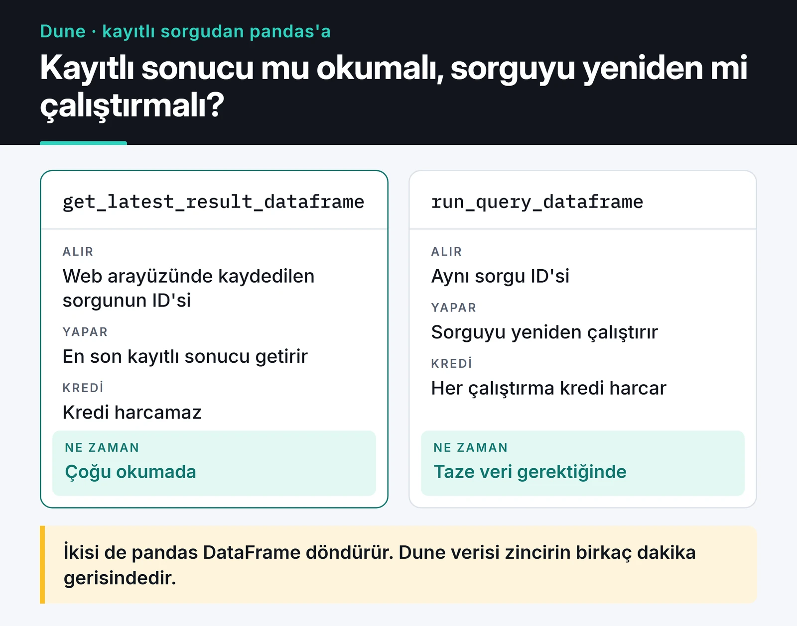

Blockchain verisi herkese açık ama ham haliyle analize hazır değil. Bir bloğun içinde hex kodlu loglar, ABI'ye göre çözülmesi gereken çağrılar ve ondalıkları tokendan tokena değişen sayılar var. Python ile blockchain veri analizi yaparken asıl iş bu veriyi sorgulanabilir bir şekle getirmek.

Bu yazıda Web3 projelerimde kullandığım dört yolu karşılaştırıyorum: RPC'den canlı event dinlemek, kendi küçük indexer'ınızı yazmak, The Graph ve Dune. Örnekler USDC transferleri üzerinden gidiyor. Kodları web3.py 7 ve SQLAlchemy 2 ile ana ağda çalıştırdım.

## Hangi araç ne zaman?

Kısa cevabım şöyle:

- Bir şey olduğu anda tepki vermem gerekiyorsa (alarm, bot) RPC üzerinden WebSocket aboneliği.
- Tek bir kontratın geçmişini kendi sorgularımla, kendi şemamla incelemek istiyorsam küçük bir indexer.
- Popüler bir protokolün (Uniswap, Aave) hazır indekslenmiş verisi yetiyorsa The Graph.
- Zincir genelinde, SQL ile hızlıca keşif yapacaksam Dune.

Bunların hiçbiri diğerinin yerini tam tutmuyor. Sık kullandığım sıra şu: Dune'da bir hipotezi deniyorum, sonra aynı veriyi kendi indexer'ımla botun kullanacağı şekilde topluyorum.

## Canlı event dinlemek

web3.py 7'deki `WebSocketProvider`, `eth_subscribe` ile log aboneliğini destekliyor. Aşağıdaki script USDC kontratının `Transfer` event'lerini dinliyor ve 1 milyon USDC üzerindeki transferler için Telegram'a mesaj atıyor:

```python {title="whale_alert.py"}
import asyncio
import html
import os

from telegram import Bot
from web3 import AsyncWeb3, WebSocketProvider

USDC = AsyncWeb3.to_checksum_address("0xa0b86991c6218b36c1d19d4a2e9eb0ce3606eb48")
TRANSFER_ABI = [{
    "name": "Transfer", "type": "event", "anonymous": False, "inputs": [
        {"name": "from", "type": "address", "indexed": True},
        {"name": "to", "type": "address", "indexed": True},
        {"name": "value", "type": "uint256", "indexed": False}],
}]
THRESHOLD = 1_000_000 * 10**6  # 1 milyon USDC (6 ondalık)


async def notify(text: str) -> None:
    token = os.environ.get("TELEGRAM_BOT_TOKEN")
    if not token:
        print(text)
        return
    async with Bot(token) as bot:
        await bot.send_message(chat_id=os.environ["TELEGRAM_CHAT_ID"], text=text, parse_mode="HTML")


async def main() -> None:
    async with AsyncWeb3(WebSocketProvider(os.environ["ETH_WS_URL"])) as w3:
        usdc = w3.eth.contract(address=USDC, abi=TRANSFER_ABI)
        topic = w3.keccak(text="Transfer(address,address,uint256)").to_0x_hex()
        await w3.eth.subscribe("logs", {"address": USDC, "topics": [topic]})

        async for message in w3.socket.process_subscriptions():
            event = usdc.events.Transfer().process_log(message["result"])
            value = event["args"]["value"]
            if value < THRESHOLD:
                continue
            tx = event["transactionHash"].to_0x_hex()
            await notify(
                f"<b>Büyük USDC transferi</b>\n"
                f"{value / 10**6:,.0f} USDC\n"
                f"{html.escape(event['args']['from'])} → {html.escape(event['args']['to'])}\n"
                f'<a href="https://etherscan.io/tx/{tx}">Etherscan</a>'
            )


if __name__ == "__main__":
    asyncio.run(main())
```

`pip install "web3>=7" python-telegram-bot` yeterli. `TELEGRAM_BOT_TOKEN` tanımlı değilse mesajı ekrana basıyor, bu da denemeyi kolaylaştırıyor. Eşiği düşürüp çalıştırdığımda birkaç saniye içinde ilk transferler geldi.

Birkaç pratik not:

- Filtreyi düğüm tarafında (`address` ve `topics`) yapmak, bütün logları çekip Python'da elemekten çok daha ucuz.
- Değeri her zaman tokenın ondalığına göre çevirin. İşlemin ETH cinsinden `value` alanına bakmak yetmez: büyük hareketlerin çoğu ERC-20 transferi ya da kontratlar içindeki iç işlemler olarak gerçekleşiyor ve işlemin `value` alanında görünmüyor.
- Telegram mesajında HTML kullanıyorum ve adresleri `html.escape` ile kaçırıyorum. Markdown modunda alt çizgi gibi karakterler mesajı bozabiliyor.
- Bağlantı koparsa abonelik de gider. Canlı bir alarmda son işlenen blok numarasını saklayıp yeniden bağlanınca aradaki blokları `get_logs` ile tamamlamak gerekiyor.

Büyük bir transfer tek başına bir "sinyal" değil. Borsaların kendi cüzdanları arasındaki hareketler, köprüler ve mint/burn işlemleri (gönderen ya da alıcı sıfır adres) de bu listeye düşüyor. Anlamlı bir alarm için adres etiketlerine ihtiyaç var.

## Kendi küçük indexer'ınızı yazmak

Belirli bir kontratın geçmişini sorgulamak istediğimde logları bir veritabanına yazan küçük bir indexer kuruyorum. SQLAlchemy 2'nin tipli modelleriyle:

```python {title="indexer.py"}
from sqlalchemy import BigInteger, Integer, String, UniqueConstraint, create_engine, func, select
from sqlalchemy.dialects.sqlite import insert
from sqlalchemy.orm import DeclarativeBase, Mapped, Session, mapped_column
from web3 import Web3

RPC = "https://ethereum-rpc.publicnode.com"
USDC = Web3.to_checksum_address("0xa0b86991c6218b36c1d19d4a2e9eb0ce3606eb48")
TRANSFER_ABI = [{
    "name": "Transfer", "type": "event", "anonymous": False, "inputs": [
        {"name": "from", "type": "address", "indexed": True},
        {"name": "to", "type": "address", "indexed": True},
        {"name": "value", "type": "uint256", "indexed": False}],
}]


class Base(DeclarativeBase):
    pass


class Transfer(Base):
    __tablename__ = "transfers"
    __table_args__ = (UniqueConstraint("tx_hash", "log_index"),)

    id: Mapped[int] = mapped_column(Integer, primary_key=True)
    block_number: Mapped[int] = mapped_column(BigInteger, index=True)
    tx_hash: Mapped[str] = mapped_column(String(66))
    log_index: Mapped[int] = mapped_column(Integer)
    sender: Mapped[str] = mapped_column(String(42), index=True)
    recipient: Mapped[str] = mapped_column(String(42), index=True)
    value: Mapped[str] = mapped_column(String(78))  # uint256, float'a sığmaz


def index_range(w3: Web3, session: Session, start: int, end: int, step: int = 500) -> int:
    token = w3.eth.contract(address=USDC, abi=TRANSFER_ABI)
    processed = 0
    for frm in range(start, end + 1, step):
        to = min(frm + step - 1, end)
        logs = token.events.Transfer.get_logs(from_block=frm, to_block=to)
        rows = [{
            "block_number": log["blockNumber"],
            "tx_hash": log["transactionHash"].to_0x_hex(),
            "log_index": log["logIndex"],
            "sender": log["args"]["from"],
            "recipient": log["args"]["to"],
            "value": str(log["args"]["value"]),
        } for log in logs]
        if rows:
            # Aynı log iki kez gelirse (yeniden çalıştırma, reorg) tekrar yazma
            stmt = insert(Transfer).values(rows).on_conflict_do_nothing()
            session.execute(stmt)
            session.commit()
            processed += len(rows)
    return processed


if __name__ == "__main__":
    w3 = Web3(Web3.HTTPProvider(RPC))
    engine = create_engine("sqlite:///transfers.db")
    Base.metadata.create_all(engine)

    latest = w3.eth.block_number - 12  # son birkaç bloğu reorg payı olarak atla
    with Session(engine) as session:
        print("işlenen log:", index_range(w3, session, latest - 20, latest))
        top = session.execute(
            select(Transfer.sender, func.count().label("n"))
            .group_by(Transfer.sender)
            .order_by(func.count().desc())
            .limit(5)
        ).all()
        for sender, n in top:
            print(sender, n)
```

Son 20 blok için çalıştırdığımda 1.800'ün üzerinde transfer kaydı geldi. USDC'nin ne kadar yoğun kullanıldığını göstermek için iyi bir örnek.

Modelde üç karar önemli:

- `value` bir `Float` değil. `uint256` değerleri 64 bit kayan noktaya sığmaz ve yuvarlama hatası verir. SQLite'ta string olarak, Postgres'te `NUMERIC(78, 0)` olarak saklamak doğru.
- `(tx_hash, log_index)` benzersiz. Aynı aralığı ikinci kez işlediğimde ya da bir hata sonrası yeniden başlattığımda kayıtlar çiftlenmiyor.
- En son 12 bloğu işlemiyorum. Proof of Stake ile reorg'lar nadir ama sıfır değil, kesinleşmemiş bloklardaki kayıtlar sonradan değişebilir. Daha sıkı bir çözüm `"finalized"` etiketli bloğa kadar indekslemek.

Bu yaklaşımın sınırı ölçek. Bütün zinciri bu şekilde indekslemek haftalar alır ve RPC sağlayıcısını zorlar. O noktada [cryo](https://github.com/paradigmxyz/cryo) gibi toplu veri çıkarma araçları, kendi Reth düğümünüz ya da hazır veri setleri devreye giriyor. SQLAlchemy tarafının ayrıntılarını [MySQL ve SQLAlchemy yazısında](/posts/mysql-sqlalchemy-veritabani-yonetimi/) anlattım.

## The Graph: hazır indekslenmiş protokol verisi

The Graph, protokollerin event'lerini "subgraph" denen şemalara göre indeksleyip GraphQL ile sunuyor. Barındırılan ücretsiz servis 2024'te kapandı. Artık sorgular merkeziyetsiz ağdaki gateway üzerinden ve bir API anahtarıyla yapılıyor. Anahtarı Subgraph Studio'dan alıyorsunuz, aylık belirli bir ücretsiz sorgu kotası var.

```python {title="top_pools.py"}
import os

import httpx

API_KEY = os.environ["GRAPH_API_KEY"]
SUBGRAPH_ID = os.environ["UNISWAP_V3_SUBGRAPH_ID"]  # Graph Explorer'daki kimlik
URL = f"https://gateway.thegraph.com/api/{API_KEY}/subgraphs/id/{SUBGRAPH_ID}"

QUERY = """
{
  pools(first: 5, orderBy: volumeUSD, orderDirection: desc) {
    id
    feeTier
    volumeUSD
    token0 { symbol }
    token1 { symbol }
  }
}
"""

resp = httpx.post(URL, json={"query": QUERY}, timeout=30)
resp.raise_for_status()
data = resp.json()
if "errors" in data:
    raise RuntimeError(data["errors"])

for pool in data["data"]["pools"]:
    pair = f'{pool["token0"]["symbol"]}/{pool["token1"]["symbol"]}'
    print(pair, int(pool["feeTier"]) / 10_000, "%", f'{float(pool["volumeUSD"]):,.0f} USD')
```

GraphQL hata durumunda bile HTTP 200 dönebiliyor. Bu yüzden `errors` alanını ayrıca kontrol ediyorum. Uniswap V3 subgraph'ındaki `volumeUSD` havuzun toplam hacmi. Günlük hacim için `poolDayDatas` gibi ayrı varlıklar var. Subgraph'ın şemasını kullanmadan önce Graph Explorer'da okumak, yanlış alanı yorumlamamanın en kolay yolu.

## Dune: SQL ile hızlı keşif

Dune, zincir verisini çözülmüş tablolar halinde SQL ile sorgulamanızı sağlıyor. Bir fikri denemenin en hızlı yolu bu. Topluluğun hazırladığı panolar da iyi bir başlangıç noktası. Kaydedilmiş bir sorgudan DataFrame'e giden yolum şöyle:



Bir sorguyu web arayüzünde yazıp kaydettikten sonra sonucu Python'a resmi `dune-client` paketiyle çekiyorum:

```python
from dune_client.client import DuneClient

dune = DuneClient.from_env()          # DUNE_API_KEY ortam değişkenini okur
df = dune.get_latest_result_dataframe(1234567)  # kendi sorgu kimliğiniz
print(df.head())
```

`pip install dune-client pandas` ile kuruluyor. `get_latest_result_dataframe` sorgunun en son çalıştırılmış sonucunu getiriyor ve sorguyu yeniden çalıştırmıyor, bu da kredi harcamasını düşük tutuyor. Taze veri gerektiğinde `run_query_dataframe` kullanılıyor ama her çalıştırma kredi harcıyor. Dune verisi zincirden birkaç dakika geride, bu yüzden canlı bir bot için değil, analiz ve raporlama için uygun.

DataFrame elinize geçtikten sonrası normal pandas işi. Büyük veride pandas'ı nasıl hızlı kullandığımı [pandas ile kripto veri analizi yazısında](/posts/python-pandas-kripto-para-piyasa-analizi/) anlattım.

## MEV verisine bakarken

Mempool'u izleyip sandwich saldırısı kuran bot kodlarına bu yazıda yer vermiyorum. Başkalarının işleminden pay kesen bir botu adım adım anlatmak istemiyorum. İnternette dolaşan örneklerin çoğu zaten çalışmıyor: imzalı bir işlemin ham halini `get_transaction` ile bu şekilde alamazsınız.

MEV'i analiz etmek ise faydalı bir iş. Bir bloktaki işlemlerin sırasına bakıp aynı adresin bir kurbandan hemen önce alım, hemen sonra satım yaptığı örüntüleri bulmak, sandwich'lerin kullanıcılara ne kadara mal olduğunu ölçmenin yolu. Bunu sıfırdan yazmak yerine Dune'daki topluluk tablolarıyla ve MEV analiz platformlarının hazır verileriyle başlamak çok daha verimli. Kullanıcı tarafında korunmanın yolları için [DEX aggregator yazısındaki](/posts/building-dex-aggregator-web3/) kayma ve özel RPC bölümüne bakabilirsiniz.

## Sırada ne var

Bu yazıdaki kodların altında yatan web3.py kalıplarını [web3.py v7 rehberinde](/posts/web3py-ethereum-blockchain-etkilesimi/) ayrıntılı anlattım. Kendi indexer'ınızla başlamak istiyorsanız tek bir kontrat ve birkaç bin blokla başlayın, şemayı ihtiyaç oldukça büyütün. Burada okuduğunuz veriler eğitim amaçlı. Büyük bir transfer bir alım satım kararı için tek başına yeterli değil ve hiçbir örnek yatırım tavsiyesi değil.
