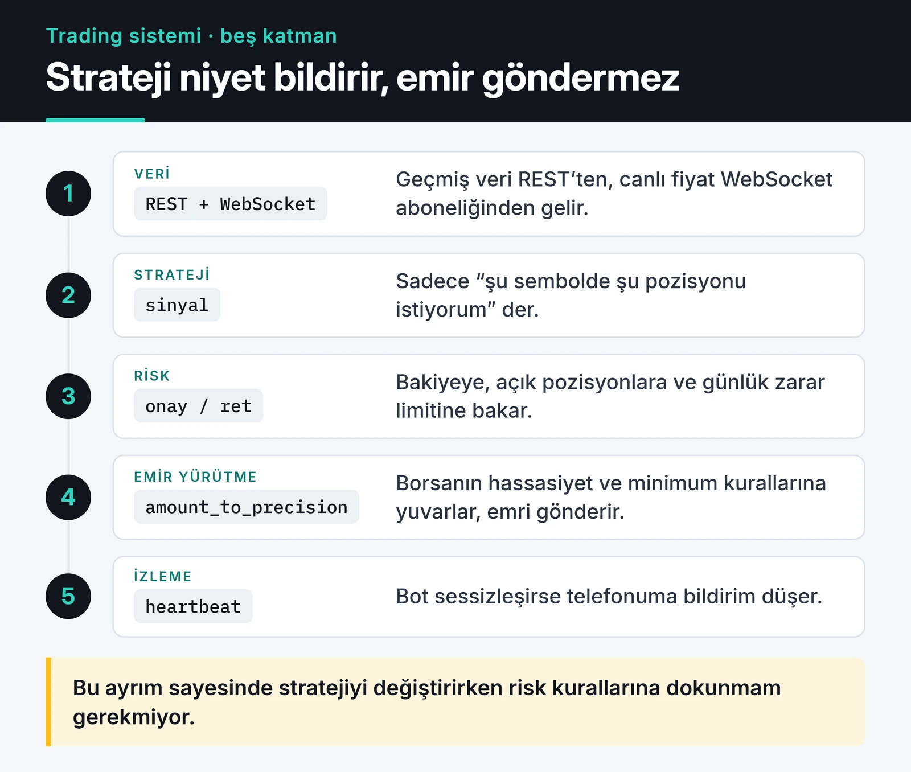

Bu yazı, Python ile otomatik trading sistemi kurarken kullandığım yapının özeti: CCXT ile veri akışı ve emirler, ayrı bir risk katmanı, maliyetleri sayan bir backtest ve canlıya alma kuralları.

Bir trading botunda en az zaman harcadığım kısım strateji oluyor. Zamanın çoğu veri akışının kopmaması, emirlerin borsanın kurallarına uyması ve bir şey ters gittiğinde sistemin kendini durdurabilmesi için gidiyor. Bu yazıdaki kodlar CCXT 4.5 ve Python 3.12 ile test edildi.

## Katmanlar

Sistemi birbirinden bağımsız test edilebilen beş parçaya ayırıyorum:



Strateji hiçbir zaman borsaya doğrudan emir göndermiyor. Sadece "şu sembolde şu yönde pozisyon istiyorum" diyor. Risk katmanı bunu bakiye, açık pozisyonlar ve günlük zarar limitine göre onaylıyor ya da reddediyor. Bu ayrım sayesinde stratejiyi değiştirdiğimde risk kurallarına dokunmam gerekmiyor.

## Neden CCXT?

İlk Binance botlarımda `python-binance` kütüphanesini kullanıyordum. Artık CCXT tercih ediyorum. Yüzden fazla borsayı aynı arayüzle konuşuyor, async desteği var ve WebSocket tarafı (eski adıyla CCXT Pro) ana pakete dahil. Binance'ten başka bir borsaya geçmek çoğu zaman tek satır değişiklik.

Bedeli de var: CCXT her borsanın en ince özelliklerini standart arayüze koyamıyor. Borsaya özel parametreler için `params` sözlüğüne inmeniz gerekiyor. Benim için bu, kod tabanının tek bir borsaya kilitlenmesinden daha küçük bir dert.

## Geçmiş veri REST'ten, canlı veri WebSocket'ten

Geçmiş mumları REST ile çekmek yeterli. Canlı fiyat için her saniye REST isteği atmak hem gecikme yaratıyor hem hız sınırını (rate limit) tüketiyor. Bunun yerine WebSocket aboneliği kullanıyorum:

```python {title="stream.py"}
import asyncio

import ccxt.async_support as ccxt
import ccxt.pro as ccxtpro


async def stream(symbol: str) -> None:
    exchange = ccxtpro.binance()
    delay = 1
    try:
        while True:
            try:
                ticker = await exchange.watch_ticker(symbol)
                book = await exchange.watch_order_book(symbol, limit=10)
                delay = 1
                spread = book["asks"][0][0] - book["bids"][0][0]
                print(symbol, ticker["last"], f"spread={spread:.2f}")
            except ccxt.NetworkError as exc:
                print(f"Bağlantı hatası: {exc}; {delay} sn sonra tekrar")
                await asyncio.sleep(delay)
                delay = min(delay * 2, 60)  # üstel geri çekilme, tavanı 60 sn
    finally:
        await exchange.close()


asyncio.run(stream("BTC/USDT"))
```

Burada iki şey önemli. Birincisi üstel geri çekilme (exponential backoff): bağlantı koptuğunda saniyede yüz kez yeniden bağlanmaya çalışırsanız borsa IP'nizi bir süreliğine engelleyebilir. İkincisi `watch_order_book`: eskiden emir defterini snapshot ve fark (diff) mesajlarından elle kuruyordum. Bu iş, sıra numarası kontrolü dahil, hata yapmaya çok açık. CCXT bunu kendisi yapıyor. Ben de artık kendi emir defteri senkronizasyonumu yazmıyorum.

Birden fazla sembolü dinlerken her biri için ayrı bir task açıp `asyncio.gather` ile topluyorum. Tek bir sembolün hatası diğerlerini düşürmesin diye her task kendi hatasını yakalıyor.

## Emirler: hassasiyet, minimum tutar, testnet

Borsaya gönderdiğiniz miktar ve fiyat, borsanın adım büyüklüğüne uymak zorunda. 0.0123456789 BTC gibi bir miktar reddedilir. CCXT bu yuvarlamayı yapıyor:

```python
import ccxt.async_support as ccxt


async def place_limit_buy(exchange: ccxt.Exchange, symbol: str, qty: float, price: float):
    market = exchange.market(symbol)
    amount = exchange.amount_to_precision(symbol, qty)
    px = exchange.price_to_precision(symbol, price)

    min_cost = market["limits"]["cost"]["min"] or 0
    if float(amount) * float(px) < min_cost:
        raise ValueError(f"Emir çok küçük: minimum {min_cost} USDT")

    return await exchange.create_order(symbol, "limit", "buy", amount, px)


async def main():
    exchange = ccxt.binance({
        "apiKey": "...",        # testnet anahtarı, ortam değişkeninden okuyun
        "secret": "...",
        "enableRateLimit": True,
    })
    exchange.set_sandbox_mode(True)  # Binance spot testnet
    try:
        await exchange.load_markets()
        order = await place_limit_buy(exchange, "BTC/USDT", 0.0123456789, 50_000)
        print(order["id"], order["status"])
    finally:
        await exchange.close()
```

`set_sandbox_mode(True)` aynı kodu borsanın test ağına yönlendiriyor. Yeni bir emir mantığını önce burada, sonra çok küçük gerçek tutarlarla deniyorum. Testnet'in likiditesi ve fiyatları gerçek piyasaya benzemiyor; emir akışını test etmek için iyi, strateji performansını ölçmek için işe yaramaz.

Market emri mi, limit emri mi? Market emri hızlıdır ama taker komisyonu ödersiniz ve ince bir emir defterinde ciddi kayma (slippage) yaşarsınız. Limit emri daha ucuzdur ama dolmayabilir. Dolmayan emri takip edip iptal eden ya da fiyatı güncelleyen bir mantık yazmak gerekiyor. "En iyi alış fiyatına bir tick ekle" gibi basit bir kural bile bu mantığın ilk adımı sayılır.

## Risk: pozisyon büyüklüğü ve kill switch

Bir botu batıran şey genelde strateji olmuyor, kontrolsüz pozisyon büyüklüğü oluyor. Kullandığım kural sabit oranlı risk: her işlemde sermayenin en fazla yüzde 1'ini kaybetmeyi kabul ediyorum.

```python
def position_size(equity: float, risk_pct: float, entry: float, stop: float) -> float:
    """Stop'a gelindiğinde equity * risk_pct kadar kaybedecek miktarı döndürür."""
    risk_amount = equity * risk_pct
    return risk_amount / abs(entry - stop)


# 10.000 USDT sermaye, %1 risk, giriş 80.000, stop 78.400
print(position_size(10_000, 0.01, 80_000, 78_400))  # 0.0625 BTC
```

0.0625 BTC, 80.000 dolardan yaklaşık 5.000 dolarlık pozisyon demek. Fiyat stop seviyesine indiğinde kayıp 100 dolar, yani sermayenin yüzde 1'i. Stop'u uzak koyarsanız pozisyon otomatik küçülüyor.

Bunun üstüne sistem seviyesinde iki kural daha koyuyorum:

- Günlük zarar belirli bir eşiği geçerse bot yeni pozisyon açmayı durduruyor ve bana haber veriyor.
- Üst üste belirli sayıda API hatası gelirse (borsa bakımı, rate limit, yanlış anahtar) bot kendini duraklatıyor.

Stop emirlerinin borsada mı bekleyeceği, botun hafızasında mı tutulacağı bir tercih. Borsadaki stop, bot çökse bile çalışır. Botun içindeki stop daha esnektir ama bot kapalıyken sizi korumaz. Ben kritik stop'ları borsada tutuyorum.

## Backtest: maliyetleri saymayan backtest masaldır

Hareketli ortalama kesişimi için komisyon ve kaymayı hesaba katan, pandas ile yazılmış basit bir backtest:

```python
import pandas as pd


def backtest(df: pd.DataFrame, fee: float = 0.001, slippage: float = 0.0005) -> pd.DataFrame:
    fast = df["close"].rolling(50).mean()
    slow = df["close"].rolling(200).mean()
    signal = (fast > slow).astype(int)

    # Sinyal mum kapanışında oluşur, pozisyon bir sonraki mumda açılır
    position = signal.shift(1, fill_value=0)
    ret = df["close"].pct_change().fillna(0)
    turnover = position.diff().abs().fillna(0)

    strat_ret = position * ret - turnover * (fee + slippage)
    out = pd.DataFrame({
        "strategy": (1 + strat_ret).cumprod(),
        "buy_hold": (1 + ret).cumprod(),
    })
    out["drawdown"] = out["strategy"] / out["strategy"].cummax() - 1
    return out
```

En önemli satır `signal.shift(1)`. Bunu unutursanız backtest, sinyali ürettiği mumun kapanış fiyatından işlem yaptığınızı varsayar. Gerçekte o fiyatı ancak mum kapandıktan sonra bilirsiniz.

Fonksiyonu gerçek veriyle denemek için Binance'in herkese açık mum verisi yeterli, API anahtarı gerekmiyor:

```python {title="run_backtest.py"}
import ccxt
import pandas as pd

from backtest import backtest  # yukarıdaki fonksiyon, backtest.py içinde

exchange = ccxt.binance()
rows = exchange.fetch_ohlcv("BTC/USDT", "1d", limit=1000)
df = pd.DataFrame(rows, columns=["ts", "open", "high", "low", "close", "volume"])
df.index = pd.to_datetime(df["ts"], unit="ms")

out = backtest(df)
print(out.tail(3).round(3).to_string())
print(f"max drawdown: {out['drawdown'].min():.1%}")
```

BTC/USDT'nin son 1.000 günlük mumu üzerinde çalıştırdığımda sonuç şöyleydi:


Aynı dönemde al ve tut sermayeyi yaklaşık ikiye katlarken kesişim stratejisi başa baş bile kalamadı ve en kötü anında %39,7 düşüşteydi. Bin günde pozisyon sadece 5 kez değişti; bu kadar az işlemle stratejinin iyi ya da kötü olduğuna karar vermek mümkün değil. Aşağıdaki listenin son maddesi tam olarak bu.

Backtest sonuçlarına güvenmeden önce kendime şu soruları soruyorum:

- Komisyon, kayma ve vadeli işlemlerde funding ücreti dahil mi?
- Parametreleri aynı veri üzerinde optimize edip aynı veride mi test ettim? Öyleyse sonuç neredeyse kesin olarak abartılı. Test için hiç dokunulmamış bir dönem ayırmak gerekiyor.
- Sadece bugün hâlâ listelenen coinleri mi test ettim? Delist edilen coinleri dışarıda bırakmak (survivorship bias) sonuçları güzelleştirir.
- Strateji sadece tek bir piyasa rejiminde mi (örneğin güçlü yükseliş) para kazanıyor?
- İşlem sayısı istatistiksel olarak anlamlı mı? Üç yılda on iki işlem bir şey kanıtlamaz.

Bu kodu gerçek bir strateji aracı olarak değil, mantığı görmek için yazdım. Ciddi bir backtest için Freqtrade'in backtesting ve hyperopt modülleri ya da vectorbt gibi kütüphaneler emir doldurma, komisyon ve zaman kaydırma ayrıntılarını çok daha dikkatli ele alıyor.

## Hazır bot mu, kendi botunuz mu?

Kendi botlarımı yazmak bana çok şey öğretti ama gerçek parayla çalışacak bir sistem için sıfırdan başlamak yerine Freqtrade gibi olgun bir altyapıyı tercih ederim. Freqtrade; backtest, hyperopt, emir yönetimi, Telegram kontrolü ve REST API ile geliyor, strateji de bir Python sınıfı olarak içine yazılıyor. Benim kendi kodum daha çok etrafındaki araçlarda. Örneğin [freqtrade-mcp](https://furkankoykiran.com.tr/projeler/freqtrade-mcp/) sunucumla Freqtrade'in REST API'sini Claude gibi yapay zekâ ajanlarına açtım; nasıl çalıştığını [freqtrade-mcp yazımda](/posts/freqtrade-mcp-server-tr/) anlattım.

Kendi botunuzu yazmanın mantıklı olduğu durumlar da var: Freqtrade'in desteklemediği bir piyasa, alışılmadık bir veri kaynağı ya da sadece öğrenmek istemeniz.

## Canlıya alma ve izleme

Botu evdeki bilgisayarda değil, küçük bir VPS'te Docker container'ı veya systemd servisi olarak çalıştırıyorum. [Docker ile Python uygulamalarını paketleme](/posts/docker-ile-python-uygulamasi-containerization/) yazımdaki yapının aynısı burada da geçerli. Birkaç kural:

- API anahtarları ortam değişkeninden ya da bir secret yöneticisinden gelir, imaja ve repoya asla girmez. Anahtarda para çekme yetkisi kapalıdır ve IP kısıtlaması açıktır.
- Loglar yapılandırılmış (JSON) tutulur. Bir emrin neden açıldığını veya neden reddedildiğini sonradan görebilmek için sinyal, risk kararı ve borsa yanıtı aynı log kaydında olur.
- Bot belirli aralıklarla bir izleme servisine "yaşıyorum" sinyali gönderir. Sinyal gelmezse telefonuma bildirim düşer. Bildirim kanalı olarak Telegram kullanıyorum; [Telegram trading botu yazısında](/posts/python-telegram-trading-bot/) bunun kodunu paylaştım.
- Bot yeniden başladığında açık pozisyonları ve emirleri kendi hafızasından değil, borsadan okur.

## Risk ve sonraki adımlar

Bu yazıdaki hiçbir şey yatırım tavsiyesi değil. Kripto piyasaları çok oynak; kaldıraçla çalışırken birkaç dakikada hesabın tamamı gidebilir. Backtest'te iyi görünen stratejilerin çoğu canlıda aynı performansı göstermiyor. Otomatik bir sistem duyguları devreden çıkarır, ama hatalı bir kuralı da yorulmadan tekrar eder. Kaybetmeyi göze alamayacağınız parayla denemeyin.

Verinin pandas tarafını [pandas ile kripto veri analizi yazımda](/posts/python-pandas-kripto-para-piyasa-analizi/), sinyal üretmede makine öğrenmesi ve LLM ajanlarıyla yaptığım denemeleri de [yapay zekâ destekli trading stratejileri yazımda](/posts/yapay-zeka-destekli-trading-stratejileri/) anlattım. CCXT'nin güncel API'si için [resmi CCXT belgeleri](https://docs.ccxt.com/) en doğru kaynak.

Başlamak için `run_backtest.py`'yi kendi sembolünüz ve zaman diliminizle çalıştırın, sonra `fee` ve `slippage` değerlerini sıfırlayıp sonucun ne kadar değiştiğine bakın.
