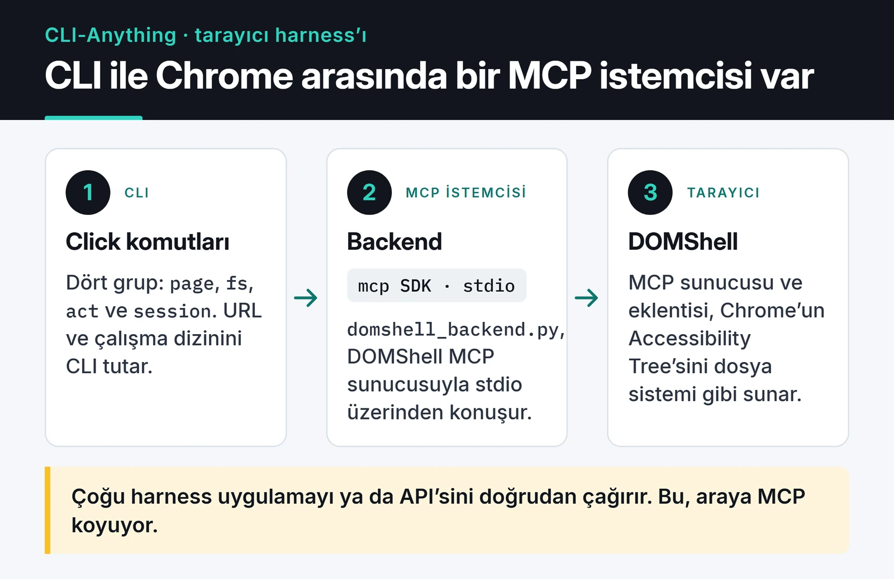

Mart 2026'da [CLI-Anything](https://github.com/HKUDS/CLI-Anything) projesine tarayıcı otomasyonu ekleyen bir PR gönderdim. [PR #118](https://github.com/HKUDS/CLI-Anything/pull/118), projede bir MCP sunucusunu backend olarak kullanan ilk "harness" oldu. Bu yazıda neyi neden öyle kurduğumu, review'da neler çıktığını ve merge'den sonra ortaya çıkan, benim kaçırdığım hataları anlatıyorum.

CLI-Anything'in fikri basit: bir yazılımı komut satırından yönetilebilir hale getirirsen, AI ajanları da onu kullanabilir. Projede GIMP, Blender, LibreOffice gibi uygulamalar için "harness" denen CLI sarmalayıcıları var. Tarayıcı listede yoktu.

## Issue #90: tarayıcı neden dosya sistemi gibi gezilsin?

16 Mart 2026'da DOMShell'in geliştiricisi [@apireno](https://github.com/apireno), [issue #90](https://github.com/HKUDS/CLI-Anything/issues/90)'ı açtı. [DOMShell](https://github.com/apireno/DOMShell), Chrome'un Accessibility Tree'sini sanal bir dosya sistemi olarak sunan bir Chrome eklentisi ve MCP sunucusu. Ajan sayfada `ls`, `cd`, `grep`, `click` gibi komutlarla dolaşıyor. apireno'nun Claude ile yaptığı ölçümlere göre bu yaklaşım, ekran görüntüsü tabanlı gezinmeye kıyasla API çağrılarını yarıya indiriyordu. Bu rakam onun benchmark'ı, ben ayrıca ölçmedim.

Accessibility Tree, tarayıcının ekran okuyucular için DOM'dan çıkardığı sadeleştirilmiş ağaç. Her öğe bir rol taşıyor: button, link, textbox. CSS sınıfları ve iç içe geçmiş `div`'ler burada yok, bu yüzden sayfa tasarımı değiştiğinde selector'lara göre daha az kırılıyor. Sayfa → bölümler → öğeler hiyerarşisi de bir dizin yapısına doğal olarak oturuyor.

Issue altında [@omerarslan0](https://github.com/omerarslan0) bir entegrasyon taslağı önerdi: DOMShell'in MCP sunucusu backend olacak, CLI tarafı `page` gibi komut grupları sunacak, durum (URL, çalışma dizini) CLI'da tutulacak. apireno da selector tabanlı komutlar yerine dosya sistemi komutlarının korunmasını ve resmi `mcp` Python SDK'sının stdio transport'uyla kullanılmasını önerdi. Ben bu konuşmanın üzerine implementasyonu yazıp 21 Mart'ta PR'ı açtım.

## Harness'ın yapısı

Diğer harness'lar genelde uygulamanın kendi API'sini ya da CLI'ını çağırıyor. Burada araya bir MCP istemcisi giriyor:



Komutlar dört grupta toplandı:

- `page`: open, reload, back, forward, info
- `fs`: ls, cd, cat, grep, pwd
- `act`: click, type
- `session`: status, daemon-start, daemon-stop

Kullanımı şöyle:

```bash
cli-anything-browser page open https://example.com
cli-anything-browser fs ls /
cli-anything-browser fs grep "Login"
cli-anything-browser act click /main/button[0]
cli-anything-browser --json fs ls /
```

Her tek seferlik komut yeni bir oturumla başlıyor. `cd` yapıp ardından yolsuz `ls` çalıştırmak gibi durum gerektiren akışlar için REPL var (`cli-anything-browser` komutunu argümansız çalıştırınca açılıyor).

### MCP çağrısı Python'da nasıl görünüyor

PR'ı yazdığım günlerde DOMShell her komut için ayrı bir MCP aracı sunuyordu (`domshell_ls`, `domshell_click` gibi). DOMShell 2.0 bunları tek bir `domshell_execute` aracında topladı ve harness da buna göre güncellendi. DOMShell 2.x ile çalışan minimal bir istemci şöyle:

```python
import asyncio
import os

from mcp import ClientSession, StdioServerParameters
from mcp.client.stdio import stdio_client

params = StdioServerParameters(
    command="npx",
    args=[
        "-p", "@apireno/domshell", "domshell-proxy",
        "--port", os.environ.get("DOMSHELL_PORT", "3001"),
        "--token", os.environ["DOMSHELL_TOKEN"],
    ],
)


async def main() -> None:
    async with stdio_client(params) as (read, write):
        async with ClientSession(read, write) as session:
            await session.initialize()
            result = await session.call_tool(
                "domshell_execute", {"command": "ls", "group_id": "new"}
            )
            print(result.content[0].text)


asyncio.run(main())
```

`domshell-proxy`, zaten çalışan bir DOMShell sunucusuna stdio köprüsü kuruyor. `DOMSHELL_TOKEN` o sunucunun açılışta verdiği token. `group_id: "new"` ise DOMShell 2.x'te ajana ayrı bir sekme grubu açıyor. Bu ayrıntıların hiçbiri benim ilk PR'ımda yoktu, aşağıda nedenini anlatıyorum.

### Senkron CLI, asenkron SDK

MCP Python SDK tamamen async. Click komutları ise senkron. Her komut kendi içinde `asyncio.run()` ile kısa bir oturum açıp kapatıyor. Bunun bedeli, her komutta `npx` ile alt süreç başlatmak. Bu yüzden bir de daemon modu ekledim: REPL açıkken tek bir MCP bağlantısı açık kalıyor ve bütün komutlar onu kullanıyor. Daemon modu yalnızca tek bir süreç içinde çalışıyor. Ayrı CLI çağrıları arasında bağlantı taşınmıyor, bunu README'ye de açıkça yazdım.

## Testler

İki katman vardı. `test_core.py` içindeki 31 unit test MCP yanıtlarını mock'luyor, yol çözümlemeyi ve oturum durumunu test ediyordu. Chrome gerekmiyordu. `test_full_e2e.py` içindeki E2E testler ise gerçek Chrome ve DOMShell eklentisiyle çalışıyor ve yalnızca açıkça istendiğinde koşuyordu:

```bash
pytest cli_anything/browser/tests/test_core.py -v
DOMSHELL_E2E=1 pytest cli_anything/browser/tests/test_full_e2e.py -v
```

`DOMSHELL_E2E` bayrağını Copilot'un bir yorumundan sonra ekledim. Öncesinde test toplama aşaması bile `npx` çalıştırmaya kalkabiliyordu.

## Review süreci

PR'a Copilot iki tur review yaptı: ilk turda 10, ikinci turda 9 yorum. Birkaçı gerçekten önemliydi:

- Daemon modunda context manager sızıntısı. `_start_daemon()` içinde `stdio_client(...)` için `__aenter__` çağrılıyor ama referans saklanmıyordu, `_stop_daemon()` ise yepyeni bir istemcide `__aexit__` çağırıyordu. Asıl alt süreç hiç kapanmıyordu. Referansı `_daemon_client_context` adlı modül değişkeninde tutarak düzelttim.
- `page back` ve `page forward` CLI içindeki yerel geçmişten yeniden navigasyon yapıyordu. Tek seferlik kullanımda geçmiş hep boş olduğu için çalışmıyordu. DOMShell'in kendi geri/ileri araçlarını çağıracak şekilde değiştirdim.
- REPL'de tırnaklı argümanlar bölünüyordu. `act type /path "Hello, World!"` artık `shlex.split()` ile doğru ayrıştırılıyor.
- `act type` yazılan metni ekrana basıyordu. Şifre yazdırırsanız terminal geçmişinde kalıyor. Artık basmıyor.
- `fs cd` yalnızca backend başarılı yanıt verince çalışma dizinini değiştiriyor.

omerarslan0 ilk review'unda 8 madde sıraladı. Hepsi önceki commit'lerde düzeltilmişti, commit'leri tek tek eşleştirip cevap yazdım, o da kontrol edip onayladı. [@yuh-yang](https://github.com/yuh-yang) `registry.json`'daki contributor alanının düzeltilmesini istedi, sonra PR'ı onaylayıp 22 Mart'ta merge etti. Toplam: 15 commit, 21 dosya, 3.095 satır ekleme:

 Projenin `cli-anything-plugin/HARNESS.md` dosyasına da diğer MCP entegrasyonları için bir "MCP Backend Pattern" bölümü ekledim.

## Merge'den sonra ne bozuldu

Bu PR'dan en çok şeyi merge'den sonra öğrendim. Merge'den hemen sonra apireno harness'ı gerçek DOMShell sunucusuna karşı test etti. 31 unit testin hepsi geçti, E2E'de 10 testten 9'u geçti. Elle denemelerde ise birkaç komut çalışmadı:

1. Tek seferlik modda her komut yeni bir `npx @apireno/domshell` süreci başlatıyordu ve bu süreç 9876 ile 3001 portlarını açmaya çalışıyordu. Claude Desktop gibi başka bir istemci DOMShell'i zaten çalıştırıyorsa bütün komutlar düşüyordu.
2. Bazı MCP araçlarına yanlış parametre adları gönderiyordum (`ls`, `cat`, `click` için).
3. `--version` desteği DOMShell'de yoktu, bunu apireno kendi tarafında düzeltti.

Port ve parametre sorunlarını apireno [PR #135](https://github.com/HKUDS/CLI-Anything/pull/135) ile düzeltti (24 Mart'ta merge edildi). Bağlantı modeli `domshell-proxy` köprüsüne ve token tabanlı kimlik doğrulamaya geçti. Yani benim unit testlerim mock'larla geçiyordu ama mock'lar sunucunun gerçek arayüzünü yansıtmıyordu. Bir MCP sunucusunu sararken araç şemalarını sunucudan `list_tools` ile çekip testleri ona göre kurmak bu hatayı baştan yakalardı.

## Güvenlik sertleştirmesi: PR #156

LinkedIn'de bu katkıyı paylaştıktan sonra Ilhan Goktas birkaç saldırı yüzeyine dikkat çekti: rastgele URL açtırarak SSRF, ARIA etiketlerine gizlenmiş prompt injection, sanal dosya sisteminden kaçış. Bunun üzerine [PR #156](https://github.com/HKUDS/CLI-Anything/pull/156)'yı açtım. omerarslan0 onu 7 Nisan'da merge etti.

PR şunları ekledi:

- `file://`, `javascript:`, `data:` ve `vbscript:` şemalarını engelleyen URL doğrulaması
- Bir ortam değişkeniyle açılabilen özel ağ engellemesi
- Sayfa içeriğinde bilinen prompt injection kalıpları için basit bir temizleme katmanı
- 42 yeni güvenlik testi ve ajanlar için `SKILL.md` içine güvenlik notları

Temizleme katmanı yalnızca bariz kalıpları yakalıyor, prompt injection'ı tek başına çözmüyor. Bir ajana tarayıcı veriyorsanız sayfadaki her metni güvenilmeyen girdi olarak görmek zorundasınız.

## Kodun sonraki hayatı

Harness'ı ilk ben yazdım, çalışan kodun büyük kısmı ise sonradan başkalarının elinden geçti. DOMShell 2.0 geçişini ve sonraki düzeltmeleri apireno yaptı, ardından başka katkıcılar da dokundu. Açık kaynakta bu olağan, bu yüzden bir sonraki kişinin kolayca değiştirebileceği kod yazmaya değer.

Bu PR'dan aklımda kalanlar:

- Bir MCP sunucusunu sarıyorsanız gerçek sunucuya karşı en az bir uçtan uca test koşmadan merge istemeyin.
- Async SDK'yı senkron CLI'a bağlarken bağlantının yaşam döngüsünü tek bir yerde tutun. Sızıntıların çoğu oradan çıkıyor. asyncio tarafını [asyncio rehberimde](/posts/python-asyncio-paralel-islem/) daha ayrıntılı anlattım.
- Review yorumlarına her düzeltmenin commit hash'iyle cevap verin. Reviewer'ın kontrol etmesi çok kolaylaşıyor.

## Sırada ne var

Kodu incelemek isterseniz [browser/agent-harness](https://github.com/HKUDS/CLI-Anything/tree/main/browser/agent-harness) dizininden başlayın. Kendi yazdığım MCP sunucularından biri için [freqtrade-mcp yazısına](/posts/freqtrade-mcp-server-tr/), diğer açık kaynak katkılarım için [MCP ve AI platformlarına katkılarım](/posts/mcp-ai-contributions/) ve [Keploy katkım](/posts/keploy-acik-kaynak-katkim/) yazılarına bakabilirsiniz.
