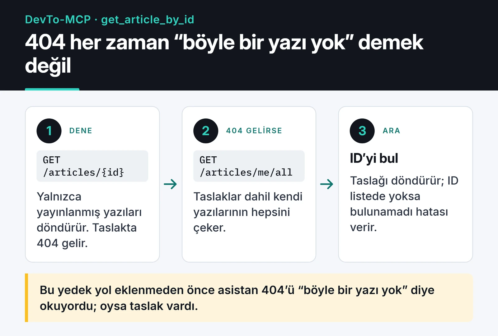

DevTo-MCP, DEV Community'nin (dev.to) altyapısı olan Forem API'sini MCP araçlarına çeviren bir sunucu. Claude Desktop, Cursor ya da başka bir MCP istemcisine bağladığınızda asistan DEV'de makale arayabiliyor, kendi yazılarınızı listeleyebiliyor ve taslak oluşturup güncelleyebiliyor. TypeScript ile yazdım, npm'de `@furkankoykiran/devto-mcp` adıyla yayında.

Proje sayfası: [DevTo-MCP](https://furkankoykiran.com.tr/projeler/devto-mcp/) · Kaynak kod: [GitHub](https://github.com/furkankoykiran/DevTo-MCP)

Bu yazıda sunucunun yapısını, API istemcisindeki tercihleri, kapattığım bir özelliği ve npm'de paket adı konusunda öğrendiğim dersi anlatıyorum.

## Neden DEV için bir MCP sunucusu

Yazılarımın bir kısmını DEV'de de yayınlıyorum. Taslağı editörde yazıp tarayıcıya kopyalamak, etiketleri tek tek girmek, sonra yorumlara bakmak için siteye dönmek sıkıcı bir döngü. İstediğim şey asistana "bu markdown'ı DEV'de taslak olarak aç" ya da "bu haftanın popüler TypeScript yazılarını listele" diyebilmekti.

MCP'de üç taraf var. Host, Claude Desktop gibi asistanı çalıştıran uygulama. Host'un içindeki MCP client, sunucuyla JSON-RPC 2.0 üzerinden konuşan bağlantı. DevTo-MCP ise sunucu tarafı: hangi araçları sunduğunu bildiriyor, client çağırdığında Forem API'sine gidip sonucu dönüyor.

## Yapı ve araçlar

```text
src/
├── index.ts            # DEVTO_API_KEY'i okur, stdio üzerinden başlatır
├── server.ts           # araç gruplarını kaydeder
├── services/
│   └── api-client.ts   # Forem API istemcisi
├── tools/              # articles, comments, users, tags, organizations,
│                       # reading-list, followers
└── types/
```

İlk sürüm 17 araçla çıktı, bugün 16'sı açık. Makaleler için `get_articles`, `get_article_by_id`, `create_article`, `update_article` ve `get_my_articles` var. Bunların yanında yorumları okuma, kullanıcı ve organizasyon bilgisi, etiketler, okuma listesi ve takipçiler için okuma araçları bulunuyor. Forem API'si yorum yazmayı desteklemediği için yorum tarafı sadece okuma.

## Zod ile girdi doğrulama

Model araç çağırırken parametreleri kendisi üretiyor ve bazen yanlış üretiyor. DEV bir makalede en fazla dört etiket kabul ediyor, model beş tane gönderebilir. Bu yüzden her aracın parametrelerini Zod şemasıyla tanımladım:

```ts
server.tool(
  "create_article",
  "Create a new article on DEV Community. Set published to false to save as draft.",
  {
    title: z.string().describe("Title of the article"),
    body_markdown: z.string().optional().describe("Article content in markdown format"),
    published: z.boolean().optional().describe("Whether to publish immediately (false = draft)"),
    tags: z.array(z.string()).max(4).optional().describe("List of tags (max 4)"),
    series: z.string().optional().describe("Article series name"),
    canonical_url: z.string().url().optional().describe("Original URL if cross-posting"),
    description: z.string().optional().describe("Short description for the article"),
    main_image: z.string().url().optional().describe("Main cover image URL"),
    organization_id: z.number().int().optional().describe("Organization ID to publish under"),
  },
  async (params) => { /* ... */ },
);
```

SDK bu şemadan JSON Schema üretip modele gösteriyor, gelen parametreleri de aynı şemayla doğruluyor. Beşinci etiket ya da geçersiz bir `canonical_url` API'ye hiç gitmiyor, model anlaşılır bir hata mesajı alıyor ve çoğu zaman bir sonraki denemede düzeltiyor.

API'den gelen cevaplar ise Zod'dan geçmiyor. İstemci cevabı `response.json()` ile alıp `as T` ile tipe çeviriyor, çalışma anında doğrulama yok. Forem bir alanı beklenmedik şekilde dönerse TypeScript bunu yakalamaz. Asistana giden şey zaten JSON metni olduğu için bu pratikte bir çökmeye yol açmıyor. Yine de yanıt tiplerinin yalnızca derleme zamanında var olduğunu bilmekte fayda var.

## API istemcisi: timeout, retry ve Retry-After

`api-client.ts` düz bir `fetch` sarmalayıcısından biraz fazlası:

- Her istek `AbortSignal.timeout(30_000)` ile 30 saniyede kesiliyor.
- 429 ve 5xx cevaplarında ve ağ hatalarında en fazla 3 kez yeniden deniyor. Bekleme süresi 1, 2 ve 4 saniye.
- Sunucu `Retry-After` header'ı gönderirse kendi hesabı yerine o süreyi bekliyor.
- Hata durumunda `x-ratelimit-*` header'larını ve `x-request-id`'yi hata mesajına ekliyor, böylece asistan ve ben neyin ters gittiğini görebiliyoruz.

```ts
private getRetryDelay(attempt: number, response?: Response): number {
  const retryAfter = response?.headers.get("retry-after");
  if (retryAfter) {
    const seconds = Number(retryAfter);
    if (!isNaN(seconds) && seconds > 0) return seconds * 1_000;
  }
  return INITIAL_BACKOFF_MS * Math.pow(2, attempt); // 1s, 2s, 4s
}

private isRetryable(status: number): boolean {
  return status === 429 || (status >= 500 && status < 600);
}
```

İstemci `x-ratelimit-remaining` değerine bakıp limit dolmadan yavaşlamıyor. Bu header'ı sadece hata mesajı için okuyor ve hız sınırına (rate limit) ancak 429 aldıktan sonra tepki veriyor.

Baştan düşünmem gereken bir risk de var: retry mantığı POST ve PUT istekleri için de çalışıyor. `create_article` isteği sunucuda başarılı olup cevap dönerken 502 alırsak istemci isteği tekrarlıyor ve DEV'de aynı taslaktan iki tane oluşabiliyor. Doğrusu, idempotent olmayan istekleri sadece ağ seviyesinde, istek sunucuya hiç ulaşmadığında tekrar denemek ya da POST'u hiç tekrar etmemek.

## Kapattığım özellik: reactions

İlk sürümde makalelere tepki (beğeni, unicorn vb.) bırakan araçlar da vardı. Test ederken API key doğru olmasına rağmen 401 almaya başladım. Bazı denemelerde istek başarılı dönüyor ama tepki arayüzde görünmüyordu.

Bir asistanın "yaptım" deyip aslında hiçbir şey yapmamış olması, aracın hiç olmamasından kötü. 18 Şubat'ta reactions araçlarını kayıttan çıkardım:

```ts
// registerReactionTools(server, client); // Disabled due to API 401 issues
```

Kod repoda duruyor, nedenini bulup düzeltmek isteyen olursa oradan devam edebilir.

## Taslaklar ve 404

`get_article_by_id` aracı `/articles/{id}` uç noktasını kullanıyor. Bu uç nokta sadece yayınlanmış makaleleri dönüyor, taslak için 404 veriyor. Asistan bunu "böyle bir makale yok" diye yorumluyordu, oysa makale vardı.

Çözüm olarak 404 durumunda kullanıcının kendi bütün makalelerini, taslaklar dahil, `/articles/me/all` ile çekip ID'ye göre arıyorum. Akış aşağıdaki kartta, kod hemen altında:




```ts
} catch (error: unknown) {
  const is404 =
    typeof error === "object" && error !== null && "status" in error &&
    (error as { status?: number }).status === 404;

  if (is404) {
    try {
      const allArticles = await client.get<Article[]>("/articles/me/all", { per_page: 1000 });
      const article = allArticles.find((a) => a.id === params.id);
      if (article) {
        return { content: [{ type: "text", text: JSON.stringify(article, null, 2) }] };
      }
    } catch (fallbackError) {
      console.error("Fallback lookup failed:", fallbackError);
    }
  }
  // ...
}
```

`console.error` kullanmam önemli: stdio sunucusunda stdout JSON-RPC mesajlarına ayrılmış, oraya yazılan herhangi bir log protokolü bozar. Loglar stderr'e gitmeli.

Bu fallback 1.000'den fazla makalesi olan biri için eksik kalır. Benim gibi birkaç düzine yazısı olan biri için yeterli.

## Yayınlama ve paket adı dersi

### Workflow'un evrimi

İlk workflow elle tetikleniyordu (`workflow_dispatch`) ve bir dry-run seçeneği vardı. v1.0.2 ile tetikleyiciyi release yayınlanmasına bağladım:

```yaml
on:
  release:
    types: [published]

permissions:
  contents: read
  id-token: write

jobs:
  publish:
    runs-on: ubuntu-latest
    environment: production
    steps:
      # checkout, setup-node (Node 22), npm ci, lint, typecheck, test, build
      - run: npm publish --provenance --access public
        env:
          NODE_AUTH_TOKEN: ${{ secrets.NPM_TOKEN }}
```

Bu workflow OIDC tabanlı trusted publishing kullanmıyor. `environment: production` repodaki ilk sürümden beri orada ve yayın bir `NPM_TOKEN` secret'ıyla yapılıyor. `id-token: write` izni provenance imzası için. Node 22 ile gelen npm 10 zaten trusted publishing yapamıyor, bunun için npm 11.5.1 veya üstü gerekiyor.

Yine de `environment` satırının neden önemli olabileceğini bilmekte fayda var. Bir secret'ı repo seviyesinde değil de bir environment'a tanımladıysanız, o environment'ı belirtmeyen job secret'ı boş görür. npm de yetkisiz yayın denemelerine çoğu zaman 403 yerine 404 döner, bu yüzden hata mesajı sorunun kaynağını hiç göstermez.

PR #1 ile reactions ve taslak değişikliklerini merge ettiğimde yeni sürümün otomatik çıkmasını bekledim, çıkmadı. Tetikleyici release'ti, merge değil. `package.json`'daki sürümü de artırmamıştım. Bu değişiklikler v1.0.3 ile Mart'ta yayınlandı.

### Scoped paket adına geçiş

Şubat'ta paket `devto-mcp` adıyla, scope'suz yayındaydı. Mart'ta GitHub Packages'a da yayınlamak için paketi `@furkankoykiran/devto-mcp` olarak yeniden adlandırdım, çünkü GitHub Packages scoped isim istiyor.

Bunun beklemediğim bir sonucu oldu. Scope'suz `devto-mcp` adı artık npm'de başka bir projeye ait; farklı bir maintainer ve farklı bir repo ile 0.x sürümleri yayında. DEV'deki challenge yazımda geçen `npx -y devto-mcp` komutu da artık benim sunucumu değil, o paketi çalıştırıyor. Bir MCP sunucusu API anahtarınızı ortam değişkeni olarak alıyor, yani yanlış paket adı burada güvenlik meselesi.

Bu yüzden iki kural çıkardım: kişisel paketleri baştan scoped adla yayınlamak ve sonradan isim değiştirmemek, paket adı değişirse dokümanlardaki ve yazılardaki `npx` komutlarını hemen güncellemek. Repodaki son README commit'i de tam olarak bunu yapıyor.

## Kurulum

Node.js 18 veya üstü ve bir DEV API anahtarı gerekiyor. Anahtarı DEV'de Settings → Extensions altındaki "DEV Community API Keys" bölümünden oluşturabilirsiniz. Claude Desktop'ın `claude_desktop_config.json` dosyasına şunu ekleyin:

```json
{
  "mcpServers": {
    "devto": {
      "command": "npx",
      "args": ["-y", "@furkankoykiran/devto-mcp"],
      "env": {
        "DEVTO_API_KEY": "anahtarınız"
      }
    }
  }
}
```

Dosya macOS'ta `~/Library/Application Support/Claude/`, Windows'ta `%APPDATA%\Claude\` altında. Claude'u yeniden başlattıktan sonra şöyle istekler deneyebilirsiniz:

- "Bu haftanın en popüler TypeScript makalelerini özetle."
- "Bu markdown dosyasını DEV hesabımda taslak olarak oluştur, etiketleri mcp ve typescript yap."
- "Son makaleme gelen yorumları listele, cevap bekleyen soruları ayır."

## Sırada ne var

Yukarıda bahsettiğim POST retry riskini kapatmak, araçları SDK'nın yeni `registerTool()` API'sine taşımak ve reactions'taki 401'in nedenini bulmak listemde. DevTo-MCP'yi ilk kez gerçek bir iş için kullandığım hikayeyi, yani bir yarışma yazısını asistana yazdırıp DEV'de yayınlattığımı, [Gemini challenge yazısında](/posts/mcp-gemini-challenge-deneyimi/) anlattım. Aynı serideki diğer sunucularım [OmniWire-MCP](/posts/omniwire-mcp-ai-news-server/) ve [freqtrade-mcp](/posts/freqtrade-mcp-server-tr/).
