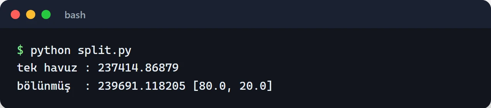

Aynı token çifti Uniswap'ın V2 ve V3 havuzlarında, SushiSwap'ta, Curve'de ve daha onlarca yerde farklı derinlikte işlem görüyor. DEX aggregator, bir swap için bu kaynakların hepsinden fiyat alıp kullanıcıya en çok çıktıyı veren rotayı bulan sistem. 1inch, 0x, CoW Swap ve Velora (eski adıyla ParaSwap) bu işi yapan bilinen örnekler.

Ben üretimde bir aggregator çalıştırmadım. Bu konuyla [flash loan arbitraj botumu](/posts/building-flash-loan-arbitrage-bot/) yazarken karşılaştım. Orada da birden fazla DEX'ten fiyat almam, kârı gas'a göre hesaplamam ve router'larla konuşmam gerekiyordu. Bunların bir kısmını o projede yanlış yapmıştım. Bu yazıda aggregator'ın parçalarını tek tek kuruyorum. Kodların hepsini Ethereum ana ağında ya da onun bir fork'unda çalıştırdım.

## Fiyat teklifi toplamak

Yazının iskeleti şu: teklifler toplanıyor, rota gas'a göre seçiliyor, swap kontratı da sonucu `minAmountOut` ile kontrol ediyor.

Her kaynak teklif için farklı bir arayüz sunuyor. Uniswap V2 ve onun kopyaları (SushiSwap gibi) router üzerinde `getAmountsOut` view fonksiyonunu veriyor. Uniswap V3'te ise teklif için `QuoterV2` kontratı var. Bu kontrat `view` değil, içeride swap'ı simüle edip revert ederek sonucu döndürüyor. Bu yüzden onu işlem olarak değil, `eth_call` ile çağırmak gerekiyor. ethers v6'da bunun yolu `staticCall`.

```javascript {title="quotes.mjs"}
import { Contract, JsonRpcProvider, formatUnits, parseEther } from "ethers";

const provider = new JsonRpcProvider(process.env.RPC_URL ?? "https://ethereum-rpc.publicnode.com");

const WETH = "0xC02aaA39b223FE8D0A0e5C4F27eAD9083C756Cc2";
const USDC = "0xA0b86991c6218b36c1d19D4a2e9Eb0cE3606eB48";

const V2_ABI = ["function getAmountsOut(uint256 amountIn, address[] path) view returns (uint256[])"];
const QUOTER_ABI = [
  "function quoteExactInputSingle((address tokenIn, address tokenOut, uint256 amountIn, uint24 fee, uint160 sqrtPriceLimitX96)) returns (uint256 amountOut, uint160 sqrtPriceX96After, uint32 initializedTicksCrossed, uint256 gasEstimate)",
];

const uniV2 = new Contract("0x7a250d5630B4cF539739dF2C5dAcb4c659F2488D", V2_ABI, provider);
const sushi = new Contract("0xd9e1cE17f2641f24aE83637ab66a2cca9C378B9F", V2_ABI, provider);
const quoterV3 = new Contract("0x61fFE014bA17989E743c5F6cB21bF9697530B21e", QUOTER_ABI, provider);

function v2Source(name, router) {
  return async (amountIn) => {
    const amounts = await router.getAmountsOut(amountIn, [WETH, USDC]);
    return { name, amountOut: amounts[1], gas: 120_000n };
  };
}

function v3Source(fee) {
  return async (amountIn) => {
    // QuoterV2 view değil; staticCall ile eth_call olarak çalıştırıyoruz
    const [amountOut, , , gasEstimate] = await quoterV3.quoteExactInputSingle.staticCall({
      tokenIn: WETH, tokenOut: USDC, amountIn, fee, sqrtPriceLimitX96: 0n,
    });
    return { name: `Uniswap V3 ${fee / 10_000}%`, amountOut, gas: gasEstimate };
  };
}

const sources = [
  v2Source("Uniswap V2", uniV2),
  v2Source("SushiSwap", sushi),
  v3Source(500),
  v3Source(3000),
];

export async function bestQuote(amountIn) {
  const results = await Promise.allSettled(sources.map((quote) => quote(amountIn)));
  const quotes = results.filter((r) => r.status === "fulfilled").map((r) => r.value);

  // Gas maliyetini USDC'ye çevirip çıktıdan düşüyoruz
  const { gasPrice } = await provider.getFeeData();
  const usdcPerEth = quotes.reduce((m, q) => (q.amountOut > m ? q.amountOut : m), 0n) * 10n ** 18n / amountIn;
  for (const q of quotes) {
    const gasCostUsdc = (q.gas * gasPrice * usdcPerEth) / 10n ** 18n;
    q.netOut = q.amountOut - gasCostUsdc;
  }
  return quotes.sort((a, b) => (b.netOut > a.netOut ? 1 : -1));
}

for (const q of await bestQuote(parseEther("10"))) {
  console.log(q.name.padEnd(18), formatUnits(q.amountOut, 6), "USDC (gas sonrası", formatUnits(q.netOut, 6) + ")");
}
```

Burada birkaç tercih var. `Promise.all` yerine `Promise.allSettled` kullanıyorum, çünkü bir kaynağın hata vermesi (havuz yok, RPC zaman aşımı) bütün teklifi düşürmemeli. V2 için gas'ı sabit bir tahminle, V3 için quoter'ın döndürdüğü `gasEstimate` ile hesaplıyorum. Karşılaştırmayı ham çıktıya göre değil, gas maliyeti çıkarılmış net çıktıya göre yapıyorum. Gas'ın pahalı olduğu anlarda iki havuz arasındaki küçük fark, ekstra bir adımın gas'ını karşılamayabiliyor.

10 WETH için yaptığım bir çalıştırmada sıralama şöyleydi: Uniswap V3'ün yüzde 0,05'lik havuzu yaklaşık 24.063 USDC, yüzde 0,3'lük havuzu 23.967, Uniswap V2 23.911, SushiSwap ise 20.386 USDC. SushiSwap'taki V2 havuzu artık bu boyutta bir işlem için çok sığ. Aynı işlemi en kötü kaynağa göndermek kullanıcıya yüzde 15 civarı kaybettirirdi. Aggregator'ın varlık sebebi bu.

## Fiyat etkisi ve bölünmüş rota

Sabit çarpım (x * y = k) havuzlarında büyük bir işlem fiyatı kendi aleyhine kaydırır. Aynı miktarı iki havuza bölmek, her birinde daha küçük bir fiyat etkisi yaratır. Uniswap V2 formülüyle bunu birkaç satırda modelleyebiliyorsunuz:

```python {title="split.py"}
def amount_out(amount_in: int, reserve_in: int, reserve_out: int, fee_bps: int = 30) -> int:
    """Uniswap V2 formülü (x * y = k, ücret girişten kesilir)."""
    amount_in_with_fee = amount_in * (10_000 - fee_bps)
    return amount_in_with_fee * reserve_out // (reserve_in * 10_000 + amount_in_with_fee)


def split_route(amount_in: int, pools: list[tuple[int, int]], parts: int = 20) -> list[int]:
    """Miktarı parçalara bölüp her parçayı o an en çok çıktı veren havuza verir."""
    chunk = amount_in // parts
    alloc = [0] * len(pools)
    for i in range(parts):
        size = chunk if i < parts - 1 else amount_in - chunk * (parts - 1)
        gains = [
            amount_out(alloc[j] + size, *pools[j]) - amount_out(alloc[j], *pools[j])
            for j in range(len(pools))
        ]
        best = max(range(len(pools)), key=gains.__getitem__)
        alloc[best] += size
    return alloc


ETH = 10**18
USDC = 10**6
# (WETH rezervi, USDC rezervi): biri derin, biri sığ iki havuz
pools = [(2_000 * ETH, 5_000_000 * USDC), (500 * ETH, 1_250_000 * USDC)]
amount = 100 * ETH

single = amount_out(amount, *pools[0])
alloc = split_route(amount, pools)
split = sum(amount_out(a, *p) for a, p in zip(alloc, pools))

print("tek havuz :", single / USDC)
print("bölünmüş  :", split / USDC, [a / ETH for a in alloc])
```

Bu örnekte 100 WETH'i sadece derin havuza göndermek 237.415 USDC veriyor. Algoritma işlemi 80/20 bölüyor (havuz derinliklerinin oranı) ve sonuç 239.691 USDC oluyor. Aradaki yaklaşık yüzde 1, büyük işlemlerde ciddi para.



Greedy bölme basit ve V2 havuzlarında iyi çalışıyor. Gerçek aggregator'lar bunu çok daha fazla kaynakla, V3'ün tick yapısıyla ve çok adımlı rotalarla yapıyor. Her bölme ve her adım ek gas demek, bu yüzden optimizasyon "en çok çıktı" değil, "gas sonrası en çok çıktı" üzerinden yapılmalı.

Çok adımlı rotalar (örneğin TOKEN -> WETH -> USDC) tokenları düğüm, havuzları kenar olarak gören bir graf problemi. Pratikte arama derinliğini 2 ya da 3 adımla sınırlamak yetiyor. Bu bağlamda sık anılan Bellman-Ford, negatif döngü bulmak, yani arbitraj tespiti için daha uygun. Rota bulmak için sınırlı derinlikte arama yeterli.

## Swap kontratı

Rota zincir dışında hesaplanıyor, işlem ise bir kontrat üzerinden yapılıyor. Kullanıcı tokenı kontrata onaylıyor, kontrat tokenı çekip rotaları uyguluyor, sonucu kontrol edip kullanıcıya gönderiyor.

Aggregator'lar tarihsel olarak çok saldırı yedi. Sebeplerin çoğu şuydu: kontrat, kullanıcıların verdiği onaylarla birlikte dışarıdan gelen rastgele bir adrese rastgele bir çağrı yapabiliyordu. Saldırgan bu çağrıyı `transferFrom(kurban, saldırgan, ...)` olacak şekilde kurup onay vermiş herkesin tokenlarını çekti. Aşağıdaki kontrat bu yüzden sadece izin listesindeki router'ları ve sadece belirli bir fonksiyonu çağırıyor:

```solidity {title="src/SplitRouter.sol"}
// SPDX-License-Identifier: MIT
pragma solidity ^0.8.24;

import {IERC20} from "@openzeppelin/contracts/token/ERC20/IERC20.sol";
import {SafeERC20} from "@openzeppelin/contracts/token/ERC20/utils/SafeERC20.sol";
import {Ownable} from "@openzeppelin/contracts/access/Ownable.sol";
import {ReentrancyGuard} from "@openzeppelin/contracts/utils/ReentrancyGuard.sol";

interface IUniswapV2Router {
    function swapExactTokensForTokens(
        uint256 amountIn,
        uint256 amountOutMin,
        address[] calldata path,
        address to,
        uint256 deadline
    ) external returns (uint256[] memory amounts);
}

contract SplitRouter is Ownable, ReentrancyGuard {
    using SafeERC20 for IERC20;

    struct Split {
        address router;     // sadece izin verilen V2 tipi router'lar
        address[] path;     // path[0] = tokenIn, path[son] = tokenOut
        uint256 amountIn;
    }

    mapping(address => bool) public allowedRouter;

    error Expired();
    error RouterNotAllowed(address router);
    error BadPath();
    error BadSplitTotal();
    error InsufficientOutput(uint256 got, uint256 min);

    constructor(address owner_) Ownable(owner_) {}

    function setRouter(address router, bool allowed) external onlyOwner {
        allowedRouter[router] = allowed;
    }

    function swap(
        IERC20 tokenIn,
        IERC20 tokenOut,
        uint256 amountIn,
        uint256 minAmountOut,
        Split[] calldata splits,
        address recipient,
        uint256 deadline
    ) external nonReentrant returns (uint256 amountOut) {
        if (block.timestamp > deadline) revert Expired();

        uint256 total;
        for (uint256 i; i < splits.length; ++i) total += splits[i].amountIn;
        if (total != amountIn) revert BadSplitTotal();

        uint256 balanceBefore = tokenOut.balanceOf(address(this));
        tokenIn.safeTransferFrom(msg.sender, address(this), amountIn);

        for (uint256 i; i < splits.length; ++i) {
            Split calldata s = splits[i];
            if (!allowedRouter[s.router]) revert RouterNotAllowed(s.router);
            if (s.path[0] != address(tokenIn) || s.path[s.path.length - 1] != address(tokenOut)) {
                revert BadPath();
            }
            tokenIn.forceApprove(s.router, s.amountIn);
            IUniswapV2Router(s.router).swapExactTokensForTokens(
                s.amountIn, 0, s.path, address(this), deadline
            );
        }

        // Sadece bu işlemde gelen miktarı say, kontratta kalmış eski bakiyeyi değil
        amountOut = tokenOut.balanceOf(address(this)) - balanceBefore;
        if (amountOut < minAmountOut) revert InsufficientOutput(amountOut, minAmountOut);

        tokenOut.safeTransfer(recipient, amountOut);
    }
}
```

Kontratta dikkat ettiğim noktalar:

- Çıktı, işlem öncesi ve sonrası bakiye farkı. Kontratın toplam `balanceOf(address(this))` değerini göndermek yaygın bir hata: kontratta yanlışlıkla kalmış tokenlar varsa onları da sıradaki kullanıcıya verir.
- `transfer` ve `transferFrom` yerine `SafeERC20` kullanılıyor. USDT gibi bazı tokenlar `bool` döndürmüyor ve düz çağrılar bu tokenlarda revert ediyor.
- Bölme toplamı `amountIn`'e eşit olmak zorunda, `deadline` geçmişse işlem reddediliyor.
- Kullanıcıyı koruyan asıl şey `minAmountOut`. Ara swap'larda alt sınır yok, son kontrol işlemin tamamını geri alıyor.

Bu kontratı ana ağ fork'unda üç testle denedim: 1 WETH'i Uniswap V2 ve SushiSwap arasında 80/20 bölüp USDC'nin alıcıya gittiğini ve kontratta bakiye kalmadığını, `minAmountOut` çok yüksekken `InsufficientOutput` ile revert ettiğini ve izin listesinde olmayan bir router'ın reddedildiğini kontrol ettim. Bu hâlâ bir öğretim örneği. Gerçek bir aggregator'da fee-on-transfer tokenlar, ETH ile doğrudan swap ve V3/V4 havuzları için ayrı adaptörler gerekiyor.

Kullanıcı tarafında onay meselesi de önemli. Kullanıcıların her yeni router'a sınırsız onay vermesi yerine Uniswap'ın Permit2 kontratı ile imzalı, süreli ve miktarı sınırlı onaylar kullanmak bugün daha iyi bir pratik.

## Kayma (slippage), son tarih ve MEV

Kullanıcının gördüğü teklif ile işlemin bloğa girdiği andaki fiyat farklı olabiliyor. `minAmountOut` bu farkın üst sınırı:

```javascript
const slippageBps = 50n; // yüzde 0,5
const minAmountOut = (quote.amountOut * (10_000n - slippageBps)) / 10_000n;
const deadline = BigInt(Math.floor(Date.now() / 1000) + 120); // 2 dakika
```

Kayma toleransı geniş tutulursa işlem sandwich saldırısına açık hale gelir. Bir bot önünüze alım koyup fiyatı tam tolerans sınırınıza kadar iter, arkanıza da satım koyar. Bunun iki çaresi var: toleransı dar tutmak ve işlemi public mempool yerine Flashbots Protect gibi özel bir RPC üzerinden göndermek. CoW Swap gibi bazı aggregator'lar emirleri toplu açık artırmayla eşleştirerek bu sorunu farklı bir yoldan çözüyor.

## Backend tarafı

Teklif toplamayı tarayıcıda yapmak mümkün ama RPC anahtarınızı açığa çıkarıyor ve her kullanıcı için aynı sorguları tekrar ettiriyor. Ben bunu bir backend servisine koyardım:

- Teklifleri blok numarasına göre önbelleğe almak. Aynı blok içinde aynı çift ve miktar için tekrar sormanın anlamı yok.
- Birden fazla RPC sağlayıcısı ve hız limiti. Teklif toplama çok sayıda `eth_call` demek ve tek sağlayıcı kolayca limite takılıyor.
- Teklif ile gönderilen işlem arasında süreyi kısa tutmak. Birkaç bloktan eski bir teklif çoğu zaman artık geçerli değil.

Bir ürün yapıyorsanız 0x, 1inch ya da Velora'nın API'leri bu işi sizin için zaten yapıyor ve onlarca kaynağı, adaptörleri, MEV korumasını içeriyor. Kendi yönlendiricinizi yazmak, mekanizmayı anlamak ya da özel bir ihtiyaç için mantıklı.

## Sırada ne var

Teklif toplama ve rota mantığını tersinden kullanan, yani fiyat farkından kâr arayan tarafı [flash loan arbitraj yazısında](/posts/building-flash-loan-arbitrage-bot/) anlattım. O projenin kodu [GitHub'da](https://github.com/furkankoykiran/Flash-Loan-Arbitrage). Swap kontratı yazacaksanız önce [Solidity güvenliği rehberine](/posts/ethereum-smart-contract-security-best-practices/), kontratlarla Python'dan konuşmak için de [web3.py v7 yazısına](/posts/web3py-ethereum-blockchain-etkilesimi/) bakabilirsiniz.
