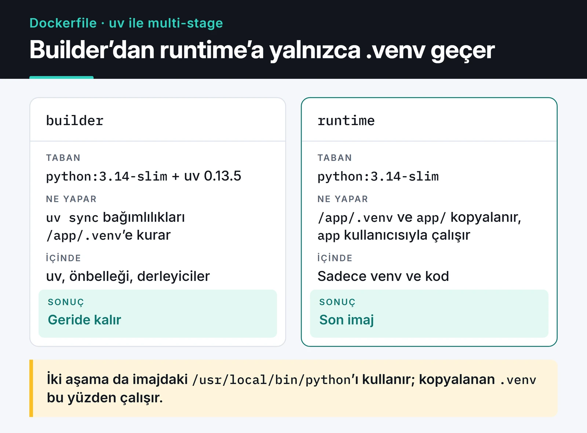

Docker ile Python uygulaması paketlemek ilk bakışta üç satırlık bir iş: `FROM python`, `COPY . .`, `pip install`. Çalışır da. Sorun birkaç hafta sonra çıkar: imaj 1 GB'a yaklaşmıştır, her kod değişikliğinde bütün bağımlılıklar baştan kurulur, uygulama root olarak çalışır ve `docker stop` dediğinizde konteyner 10 saniye bekleyip zorla öldürülür.

Bu yazıda kendi FastAPI servislerim ve botlarım için kullandığım Dockerfile düzenini anlatıyorum. Bağımlılıkları [uv](https://docs.astral.sh/uv/) ile kuruyorum, imajı iki aşamada derliyorum ve yerelde Docker Compose ile ayağa kaldırıyorum. Örnekler Python 3.14 ve uv 0.13 ile yazıldı.

## Proje yapısı

Örnek proje şöyle:

```text
.
├── app/
│   ├── __init__.py
│   └── main.py
├── pyproject.toml
├── uv.lock
├── .dockerignore
├── Dockerfile
└── compose.yaml
```

`uv.lock` dosyası repoda durmalı. Docker build sırasında bu dosyadan kurulum yaptığımız için yerelde ve imajda birebir aynı paket sürümleri olur. Poetry'den uv'ye geçiş konusunu [uv ve Poetry karşılaştırmamda](/posts/poetry-python-proje-yonetimi/) ayrıca ele aldım.

`app/main.py` en basit haliyle bir health endpoint'i içeriyor:

```python
from fastapi import FastAPI

app = FastAPI()


@app.get("/health")
async def health() -> dict[str, str]:
    return {"status": "ok"}
```

## Önce .dockerignore

Build context, `docker build` çalıştığında BuildKit'e gönderilen dosyaların tamamı. `.dockerignore` yoksa `.git` klasörü, yereldeki `.venv` ve en kötüsü `.env` dosyanız da gider. `COPY . .` kullanan bir Dockerfile'da bu dosyalar imajın içine girer.

```text
.git
.venv
__pycache__/
*.pyc
.env
.env.*
.pytest_cache/
.mypy_cache/
Dockerfile
compose.yaml
```

Yereldeki `.venv` özellikle önemli. Sizin işletim sisteminize göre derlenmiş paketler içerir ve Linux imajında işe yaramaz.

## Base imaj seçimi: slim, alpine değil

Tam `python:3.14` imajı derleyiciler ve geliştirme kütüphaneleriyle birlikte geldiği için 1 GB civarında. `python:3.14-slim` aynı Debian tabanını kullanır ama bu araçların çoğunu içermez, bu yüzden çok daha küçüktür.

Alpine daha da küçük görünür ama Python için genelde kötü bir takas. Alpine glibc yerine musl kullanır. PyPI'daki pek çok paketin hazır wheel'i ya yoktur ya da musl için ayrı derlenmiştir. Wheel bulunamayınca pip veya uv paketi kaynak koddan derlemeye çalışır, build uzar ve derleyici kurmanız gerekir. Ben bu yüzden `slim` ile başlıyorum.

## uv ile multi-stage Dockerfile

Fikir basit: bağımlılıkları bir "builder" aşamasında kurup sanal ortamı (`.venv`) hazırlıyorum. Son imaja yalnızca bu sanal ortamı ve uygulama kodunu kopyalıyorum. uv binary'si, önbellek dosyaları ve varsa derleyiciler builder'da kalıyor.

Aşağıdaki kart iki aşamayı karşılaştırıyor: runtime aşamasına builder'dan yalnızca `.venv` geçiyor.



```dockerfile {title="Dockerfile"}
# syntax=docker/dockerfile:1

FROM python:3.14-slim AS builder

COPY --from=ghcr.io/astral-sh/uv:0.13.5 /uv /uvx /bin/

ENV UV_COMPILE_BYTECODE=1 \
    UV_LINK_MODE=copy \
    UV_PYTHON_DOWNLOADS=0

WORKDIR /app

RUN --mount=type=cache,target=/root/.cache/uv \
    --mount=type=bind,source=uv.lock,target=uv.lock \
    --mount=type=bind,source=pyproject.toml,target=pyproject.toml \
    uv sync --locked --no-install-project --no-dev


FROM python:3.14-slim AS runtime

RUN groupadd --system app \
 && useradd --system --gid app --home-dir /app --no-create-home app

WORKDIR /app

COPY --from=builder --chown=app:app /app/.venv /app/.venv
COPY --chown=app:app app/ ./app/

ENV PATH="/app/.venv/bin:$PATH" \
    PYTHONUNBUFFERED=1

USER app
EXPOSE 8000

HEALTHCHECK --interval=30s --timeout=3s --start-period=10s --retries=3 \
  CMD ["python", "-c", "import urllib.request; urllib.request.urlopen('http://127.0.0.1:8000/health', timeout=2)"]

CMD ["uvicorn", "app.main:app", "--host", "0.0.0.0", "--port", "8000"]
```

Satır satır gidersek:

- `COPY --from=ghcr.io/astral-sh/uv:0.13.5` uv'yi resmi imajdan tek binary olarak alır. Sürümü sabitliyorum, `latest` kullanırsam iki farklı günde alınan build'ler farklı uv sürümüyle çalışabilir.
- `UV_COMPILE_BYTECODE=1` paketleri kurarken `.pyc` dosyalarını da üretir. Konteyner ilk açılışta bu işi yapmak zorunda kalmaz.
- `UV_LINK_MODE=copy` önbellek mount'u ayrı bir dosya sisteminde olduğu için gereken bir ayar. Yoksa uv hardlink kuramadığı için uyarı basar.
- `UV_PYTHON_DOWNLOADS=0` uv'nin kendi Python'unu indirmesini engeller. İki aşama da imajdaki `/usr/local/bin/python` ile çalışır, böylece kopyaladığım `.venv` runtime aşamasında da geçerli kalır.
- `--mount=type=cache` uv önbelleğini build'ler arasında saklar. `uv.lock` değiştiğinde bile önceden indirilmiş paketler tekrar indirilmez.
- `--mount=type=bind` ile `pyproject.toml` ve `uv.lock` yalnızca o komut süresince görünür. Katmana kopyalanmazlar.
- `--locked` lock dosyası `pyproject.toml` ile uyuşmuyorsa build'i durdurur. Birinin lock'u güncellemeyi unuttuğunu CI'da öğrenirsiniz.
- `--no-install-project` projenin kendisini paket olarak kurmaz, yalnızca bağımlılıkları kurar. Kodu zaten ayrı bir `COPY` ile alıyorum.

Önbellek mount'u ve `UV_LINK_MODE` ayarı, uv belgelerindeki Docker rehberinin önerdiği düzenle aynı:


Uygulamanız `psycopg` veya `cryptography` gibi derleme gerektiren bir paketi kaynaktan kuruyorsa `build-essential` ve ilgili `-dev` paketlerini yalnızca builder aşamasına ekleyin. Runtime aşamasına sadece çalışma zamanı kütüphanesi (örneğin `libpq5`) gerekir. Çoğu popüler paketin artık hazır wheel'i olduğu için ben bu adıma nadiren ihtiyaç duyuyorum.

## Katman önbelleği neden önemli

Docker her talimatı bir katman olarak saklar ve bir talimatın girdisi değişmediyse o katmanı yeniden kullanır. Yukarıdaki düzende bağımlılık katmanı yalnızca `uv.lock` veya `pyproject.toml` değişince yeniden oluşur. `app/main.py` dosyasında bir satırı değiştirdiğinizde sadece son `COPY` katmanı yenilenir. Build birkaç saniyede biter.

İlk örnekteki gibi `COPY . .` en başta yapılırsa herhangi bir dosya değişikliği bütün bağımlılık kurulumunu geçersiz kılar. Günde onlarca kez build alınan bir projede bu fark ciddi zaman demek.

## Root olmayan kullanıcı ve sinyaller

Konteyner içindeki süreç varsayılan olarak root çalışır. Uygulamanızda bir uzaktan kod çalıştırma açığı varsa saldırgan konteyner içinde root olur. `useradd --system` ile ayrı bir kullanıcı açıp `USER app` demek bu riski azaltan en ucuz adım.

`CMD` satırını exec formunda (JSON dizi) yazmak da önemli. `CMD uvicorn app.main:app` gibi shell formu kullanırsanız PID 1 `/bin/sh` olur ve `docker stop` ile gelen SIGTERM uvicorn'a ulaşmayabilir. Sonuç: Docker 10 saniye bekler, sonra SIGKILL gönderir. Bu konuyu, Kubernetes ve systemd tarafıyla birlikte [zarif kapanış yazımda](/posts/zarif-kapanis-sinyal-isleme/) ayrıntılı anlattım.

## Healthcheck: curl olmadan

Eski Dockerfile'larda sık gördüğüm satır `CMD curl -f http://localhost/health || exit 1`. Slim imajda `curl` yok, bu yüzden bu healthcheck sürekli başarısız olur ve konteyner `unhealthy` görünür. Sırf bunun için curl kurmak yerine imajda zaten olan Python'u kullanıyorum. `urlopen` 2xx dışında bir yanıt aldığında ya da bağlanamadığında exception fırlatır, süreç sıfırdan farklı kodla çıkar ve Docker bunu başarısız kontrol sayar.

Bir not: Kubernetes, Dockerfile'daki `HEALTHCHECK` talimatını kullanmaz. Orada aynı endpoint'i liveness ve readiness probe olarak tanımlamanız gerekir. Detaylar [Kubernetes yazımda](/posts/kubernetes-container-orkestrasyon/).

## Docker Compose ile yerel ortam

Uygulamanın yanında genelde bir PostgreSQL, bazen Redis olur. Bunları elle kurmak yerine `compose.yaml` kullanıyorum. Compose dosyalarının başındaki `version: "3.8"` satırı artık gereksiz. Güncel `docker compose` eklentisi bu alanı yok sayar ve uyarı basar, o yüzden yazmıyorum.

```yaml {title="compose.yaml"}
services:
  api:
    build: .
    ports:
      - "8000:8000"
    environment:
      DATABASE_URL: postgresql://app:${POSTGRES_PASSWORD}@db:5432/app
    depends_on:
      db:
        condition: service_healthy
    restart: unless-stopped
    stop_grace_period: 30s
    develop:
      watch:
        - action: sync
          path: ./app
          target: /app/app
        - action: rebuild
          path: uv.lock

  db:
    image: postgres:17-alpine
    environment:
      POSTGRES_USER: app
      POSTGRES_PASSWORD: ${POSTGRES_PASSWORD}
      POSTGRES_DB: app
    volumes:
      - pgdata:/var/lib/postgresql/data
    healthcheck:
      test: ["CMD-SHELL", "pg_isready -U app -d app"]
      interval: 5s
      timeout: 3s
      retries: 10

volumes:
  pgdata:
```

Bu dosyada üç şey işime yarıyor:

1. `depends_on` ile `condition: service_healthy` API'nin, Postgres gerçekten bağlantı kabul etmeye başlayana kadar beklemesini sağlar. Yalnızca `depends_on: [db]` yazmak konteynerin başlamasını bekler, veritabanının hazır olmasını beklemez.
2. `POSTGRES_PASSWORD` aynı klasördeki `.env` dosyasından okunur. Şifre Compose dosyasına yazılmaz ve `.dockerignore` sayesinde imaja da girmez.
3. `develop.watch` ile `docker compose up --watch` çalıştırdığınızda `app/` altındaki değişiklikler konteynere senkronize edilir, `uv.lock` değişince imaj yeniden derlenir. Kod değişikliği için uvicorn'u `--reload` ile çalıştıran ayrı bir geliştirme komutu da tanımlayabilirsiniz.

## CI'da build ve etiketleme

İmajları yerelde değil CI'da derleyip bir registry'ye gönderiyorum. Her imaja commit SHA'sını etiket olarak veriyorum. `latest` etiketi "en son push edilen" demek. Üretimde hangi kodun çalıştığını ya da neye geri döneceğinizi söylemez. SHA etiketiyle bir deploy'u geri almak, önceki SHA'yı yeniden çalıştırmaktan ibaret.

GitHub Actions'ta `docker/build-push-action` ile GHCR'a push eden, BuildKit önbelleğini GitHub Actions cache'inde tutan tam bir pipeline'ı [GitHub Actions CI/CD yazımda](/posts/github-actions-cicd-pipeline/) paylaştım.

## Üretime çıkmadan önce kontrol listesi

- `.dockerignore` içinde `.env`, `.git` ve `.venv` var mı?
- Base imaj ve uv sürümü sabitlenmiş mi?
- Uygulama root olmayan bir kullanıcıyla mı çalışıyor?
- `CMD` exec formunda mı, uygulama SIGTERM'i yakalıyor mu?
- Loglar dosyaya değil stdout'a mı yazılıyor? `PYTHONUNBUFFERED=1` çıktının gecikmeden görünmesini sağlar.
- Konteynere bellek ve CPU limiti verildi mi? Compose'da `deploy.resources.limits`, Kubernetes'te `resources.limits` ile.
- İmaj SHA ile mi etiketleniyor?

## Sırada ne var

Bu düzeni yeni bir projeye taşırken genelde yalnızca `CMD` satırını ve kopyalanan klasörü değiştiriyorum. Bir sonraki adım olarak uv'nin [Docker entegrasyon rehberine](https://docs.astral.sh/uv/guides/integration/docker/) göz atabilir, sonra aynı imajı [Kubernetes üzerinde](/posts/kubernetes-container-orkestrasyon/) çalıştırmayı deneyebilirsiniz.
