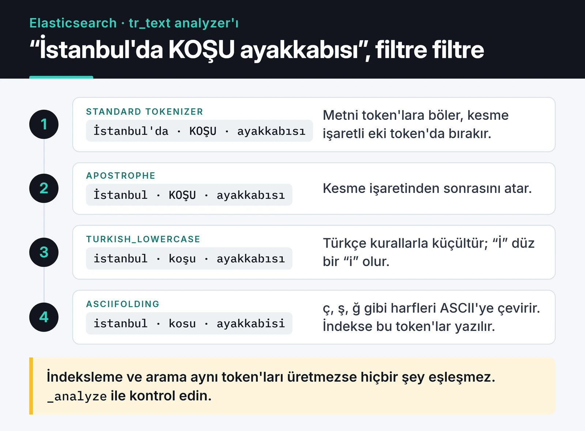
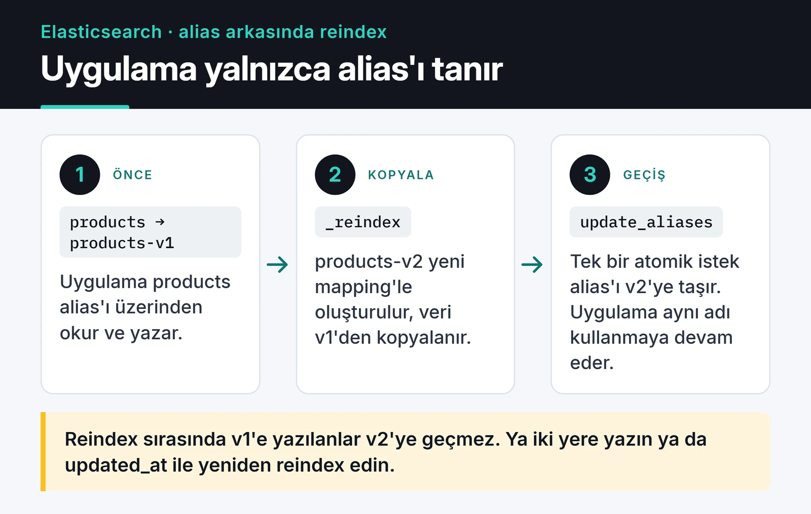

Elasticsearch ile tam metin arama kurmak ilk gün çok kolay görünür: Docker imajını kaldırırsınız, birkaç JSON belgesi atarsınız, arama çalışır. Sorunlar veri büyüyüp mapping'i değiştirmeniz gerektiğinde, cluster sarıya döndüğünde ya da biri "10.000. sayfaya" gitmeye çalıştığında başlar.

Bu yazı, Elasticsearch'ü PostgreSQL'in yanında bir arama motoru olarak kullanırken dikkat ettiğim noktaları topluyor. Örnekler Elasticsearch 8/9 ve resmi `elasticsearch` Python client'ı ile yazıldı.

## Önce kural: Elasticsearch verinin aslı değildir

Elasticsearch bir arama ve analiz motoru. Transaction yok, yazdığınız belge yaklaşık bir saniye sonra (refresh aralığı) aranabilir hale gelir ve mapping değiştirmek reindex demek. Bu yüzden verinin aslını PostgreSQL gibi bir veritabanında tutuyorum, Elasticsearch'e ise bir kuyruk ya da CDC üzerinden asenkron senkronize ediyorum. İndeks bozulursa veritabanından baştan doldurursunuz; tersi mümkün olmayabilir.

| | PostgreSQL | Elasticsearch |
| :--- | :--- | :--- |
| Rol | Verinin aslı | Arama ve analiz |
| Tutarlılık | ACID | Near real-time, eventual |
| Metin arama | `ILIKE '%x%'` yavaş, `tsvector` sınırlı | Inverted index, relevance skoru |
| Şema değişikliği | `ALTER TABLE` | Yeni indeks + reindex |

Senkronizasyonu bir mesaj kuyruğuyla yapacaksanız [RabbitMQ yazım](/posts/rabbitmq-mesaj-kuyrugu-sistemi/) ve [Kafka yazım](/posts/apache-kafka-event-streaming/) iki farklı yaklaşımı anlatıyor.

## Python client ile bağlantı

Elasticsearch 8 ile güvenlik varsayılan olarak açık geldi: TLS ve kimlik doğrulama zorunlu. Client'ın major sürümü sunucuyla aynı olmalı; 8.x cluster için `elasticsearch>=8,<9`, 9.x için `elasticsearch>=9,<10` kurun. 9.x client'ta eski `body=` parametresi tamamen kalktı, her şey keyword argument ile gidiyor.

```python
from elasticsearch import Elasticsearch

es = Elasticsearch(
    "https://localhost:9200",
    api_key="BASE64_API_KEY",
    ca_certs="http_ca.crt",
    request_timeout=10,
)
print(es.info()["version"]["number"])
```

Uygulamada kullanıcı adı ve şifre yerine yetkisi kısıtlı bir API key kullanmanızı öneririm. FastAPI gibi async bir uygulamada aynı API'yi `AsyncElasticsearch` ile kullanırsınız.

## Dynamic mapping'i production'da kapatın

Elasticsearch, tanımadığı bir alanı gördüğünde tipini kendisi tahmin eder. İlk belgede `"status_code": 200` gelirse alan `long` olur. Ertesi gün bir servis `"status_code": "404 Not Found"` gönderdiğinde belge `mapper_parsing_exception` ile reddedilir. Daha sinsi durum da var: her yeni JSON anahtarı yeni bir alan açar ve mapping zamanla şişer.

Bu yüzden production indekslerinde `dynamic: strict` kullanıyorum. Tanımsız bir alan gelirse yazma hata verir ve sorunu hemen görürsünüz.

```python
es.indices.create(
    index="products-v1",
    settings={
        "number_of_shards": 1,
        "number_of_replicas": 1,
        "analysis": {
            "analyzer": {
                "tr_text": {
                    "type": "custom",
                    "tokenizer": "standard",
                    "filter": ["apostrophe", "turkish_lowercase", "asciifolding"],
                }
            },
            "filter": {
                "turkish_lowercase": {"type": "lowercase", "language": "turkish"}
            },
        },
    },
    mappings={
        "dynamic": "strict",
        "properties": {
            "sku": {"type": "keyword"},
            "name": {
                "type": "text",
                "analyzer": "tr_text",
                "fields": {"raw": {"type": "keyword"}},
            },
            "description": {"type": "text", "analyzer": "tr_text"},
            "price": {"type": "scaled_float", "scaling_factor": 100},
            "created_at": {"type": "date"},
        },
    },
)
```

`keyword` birebir eşleşme, filtre ve sıralama içindir; `text` analiz edilip parçalanır. Bir alanı ikisi olarak da kullanacaksanız yukarıdaki `name.raw` gibi multi-field tanımlayın.

## Türkçe metin ve analyzer seçimi

Inverted index, her kelimenin hangi belgelerde geçtiğini tutan bir tablodur. Arama hızı buradan gelir ama sonucu analyzer belirler: indekslerken ve ararken metin aynı şekilde token'lara bölünmezse eşleşme olmaz.

Türkçede iki klasik tuzak var:

1. Standart `lowercase` filtresi "İ" harfini "i" yerine "i" + birleşik nokta karakterine çevirir. `language: turkish` ayarlı lowercase bunu doğru yapar.
2. "İstanbul'da" kelimesi standart tokenizer ile tek token kalır. `apostrophe` filtresi kesmeden sonrasını atar, geriye "İstanbul" kalır.

Aşağıdaki şema, mapping'deki `tr_text` analyzer'ının örnek bir metni adım adım nasıl token'lara çevirdiğini gösteriyor:



`tr_text` bu iki sorunu çözüyor, `asciifolding` da "ç, ş, ğ" gibi harfleri ASCII karşılığına indirerek Türkçe klavyesi olmayan kullanıcının "kosu ayakkabisi" aramasını da yakalıyor. Kök bulma (stemming) isterseniz Elasticsearch'ün hazır `turkish` analyzer'ına bakın; o stop word ve stemmer filtrelerini de ekliyor. Ürün adı gibi kısa metinlerde stemming bazen alakasız sonuçlar getirebiliyor, o yüzden açmadan önce `_analyze` ile deneyin:

```python
tokens = es.indices.analyze(index="products-v1", analyzer="tr_text", text="İstanbul'da KOŞU ayakkabısı")
print([t["token"] for t in tokens["tokens"]])
# ['istanbul', 'kosu', 'ayakkabisi']
```

Arama tarafında `multi_match` ile birden fazla alana bakıp ada daha fazla ağırlık veriyorum:

```python
resp = es.search(
    index="products",
    query={
        "multi_match": {
            "query": "koşu ayakkabısı",
            "fields": ["name^3", "description"],
            "fuzziness": "AUTO",
        }
    },
    size=10,
)
for hit in resp["hits"]["hits"]:
    print(hit["_score"], hit["_source"]["name"])
```

## Alias ile kesintisiz reindex

Mevcut bir alanın tipini değiştiremezsiniz. `text` olan alanı `keyword` yapmak, analyzer değiştirmek ya da shard sayısını değiştirmek için yeni bir indeks açıp veriyi taşımanız gerekir. Uygulama doğrudan fiziksel indeks adına bağlıysa bu iş kesinti demektir.

Çözüm, uygulamanın hep bir alias üzerinden okuyup yazması. Yukarıdaki aramada `products` aslında bir alias.



Akış şöyle:

```python
# 1. Yeni mapping ile products-v2 oluştur (create çağrısı yukarıdaki gibi)
# 2. Veriyi kopyala; büyük indekslerde arka planda çalıştır
task = es.reindex(
    source={"index": "products-v1"},
    dest={"index": "products-v2"},
    wait_for_completion=False,
)
print(task["task"])  # es.tasks.get(task_id=...) ile takip edin

# 3. Bitince alias'ı tek bir atomik istekle taşı
es.indices.update_aliases(
    actions=[
        {"remove": {"index": "products-v1", "alias": "products"}},
        {"add": {"index": "products-v2", "alias": "products", "is_write_index": True}},
    ]
)
```

Bir detay: reindex sürerken v1'e yazılan belgeler v2'ye geçmez. Ya o aralıkta yazmaları iki indekse birden yaparsınız ya da reindex sonrası `updated_at` alanına göre bir delta reindex daha çalıştırırsınız. Ben ikincisini daha basit buluyorum.

Log gibi zaman serisi veriler için alias'ı elle yönetmek yerine data stream ve ILM kullanmak daha az iş çıkarır; rollover'ı Elasticsearch kendisi yapar.

## Shard ve cluster boyutlandırma

"Kaç shard?" sorusunun cevabı veri boyutuna bağlı. Elastic'in güncel önerisi, shard başına 10 ile 50 GB arası veri ve 200 milyonun altında belge. Çok küçük shard'lar heap ve dosya tanıtıcısı harcar, çok büyükleri ise node kaybında saatlerce taşınır. 8.x'ten beri yeni indeksler varsayılan olarak tek primary shard ile açılıyor; küçük bir katalog için bu genelde yeterli.

Replica sayısı en az 1 olmalı, ama tek node'lu bir cluster'da replica'nın gideceği başka node olmadığı için cluster sarı kalır. Geliştirme ortamında `number_of_replicas: 0` verin.

Eski yazılarda sık görülen `discovery.zen.minimum_master_nodes` ayarı Elasticsearch 7 ile kalktı. Artık cluster, master seçimi için oy çoğunluğunu kendisi yönetiyor; siz yalnızca ilk kurulumda `cluster.initial_master_nodes` verirsiniz. Yine de master-eligible node sayısını tek tutun (3 veya 5), çünkü 4 node'lu bir oylama 3 node'lukten daha fazla hataya dayanmaz.

Trafik arttığında rolleri ayırmak işe yarar: master node'lar sadece cluster durumunu yönetir, data node'lar veriyi tutar ve sorgu çalıştırır, ingest node'lar yazmadan önce pipeline işler. Ağır bir aggregation data node'u boğduğunda master'ın etkilenmemesi bu ayrımın asıl faydası.

## Derin sayfalama: from/size yerine search_after

`from: 100000, size: 10` sorgusu, her shard'ın ilk 100.010 sonucu toplayıp sıralamasını ister. Bu yüzden Elasticsearch `index.max_result_window` ile varsayılan olarak 10.000 sonucun ötesine izin vermez. Tüm sonuçları gezmeniz gerekiyorsa point-in-time (PIT) ve `search_after` kullanın:

```python
pit = es.open_point_in_time(index="products", keep_alive="1m")
search_after = None

while True:
    resp = es.search(
        pit={"id": pit["id"], "keep_alive": "1m"},
        query={"match_all": {}},
        sort=[{"created_at": "asc"}],
        size=1000,
        search_after=search_after,
    )
    hits = resp["hits"]["hits"]
    if not hits:
        break
    for hit in hits:
        ...  # belgeyi işle
    search_after = hits[-1]["sort"]

es.close_point_in_time(id=pit["id"])
```

PIT ile sorgularken Elasticsearch sıralamaya gizli bir `_shard_doc` tie-breaker ekler, aynı `created_at` değerine sahip belgeler atlanmaz. Kullanıcı arayüzünde ise "10.000. sayfa" butonu koymamak en iyi çözüm.

## Sarı cluster ve circuit breaker

Cluster sarıysa tüm primary shard'lar atanmış, bazı replica'lar atanamamış demektir. En sık iki neden: disk high watermark'ı (varsayılan %90) aşmış ya da replica'nın gidebileceği node yok. Tahmin etmek yerine sorun:

```python
print(es.cluster.allocation_explain())
```

`circuit_breaking_exception` ise bir sorgunun heap'i patlatacak kadar bellek istediğini gösterir. Tipik nedenler, `fielddata: true` açılmış bir `text` alanda aggregation yapmak ya da çok büyük `terms` aggregation'larıdır. Aggregation'ları `keyword` alanlarda yapın.

## Canlıya çıkmadan önce kontrol listesi

- Node'larda swap kapalı mı ya da `bootstrap.memory_lock: true` ayarlı mı?
- Heap'i elle verdiyseniz RAM'in yarısını ve yaklaşık 31 GB'ı geçmiyor mu? 8.x heap'i makineye göre kendisi boyutlandırıyor, çoğu durumda dokunmamak daha iyi.
- Başında `*` olan wildcard sorgularını (`*kiran`) kapattınız mı? Tüm terim sözlüğünü tarar. Buna gerçekten ihtiyaç varsa `wildcard` alan tipine bakın.
- 9200 portu internete açık değil ve uygulama rol kısıtlı bir API key kullanıyor mu?
- Düzenli snapshot alınıyor mu? S3 uyumlu bir depo yeterli; kendi sunucunuzda [MinIO](/posts/minio-ile-object-storage-sistemi/) bu iş için iyi çalışıyor.

## Sonraki adım

Kendiniz denemek için tek node'lu bir Elasticsearch'ü Docker ile kaldırıp yukarıdaki `tr_text` analyzer'ını kendi verinizle `_analyze` üzerinden test edin. Mapping, analyzer ve alias kararlarını ilk günden doğru vermek, sonradan yapacağınız reindex işlerinin çoğunu ortadan kaldırıyor. Senkronizasyonu olay akışıyla kuracaksanız [Kafka yazım](/posts/apache-kafka-event-streaming/) iyi bir sonraki adım. Referans için [Python client dokümantasyonu](https://www.elastic.co/docs/reference/elasticsearch/clients/python) ve [analyzer referansı](https://www.elastic.co/docs/reference/text-analysis/analyzer-reference) en güvenilir kaynaklar.
