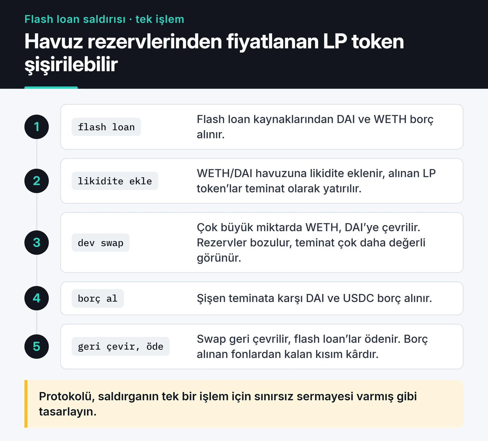

Flash loan arbitrajı, DeFi'ye ilk bakan herkesin aklını çelen bir fikir: teminatsız borç al, iki borsa arasındaki fiyat farkından kâr et, borcu aynı işlemde öde. Ben de bu fikirle [Flash-Loan-Arbitrage](https://github.com/furkankoykiran/Flash-Loan-Arbitrage) adında bir Python projesi yazdım.

Bu yazıda o projeyi dürüstçe inceliyorum. Kod neyi yapıyor, neyi yapamıyor, bugün aynı işi nasıl kurardım ve bu stratejinin pratikte neden bu kadar zor olduğu. Depo bir öğrenme projesi ve bu yazı bir eğitim notu. Yatırım tavsiyesi değil.

## Flash loan nasıl çalışıyor?

Aave gibi bir protokol, borcun aynı işlem içinde faiziyle (prim) birlikte geri ödenmesi şartıyla havuzundaki varlığı teminatsız verir. Ödeme yapılmazsa EVM bütün işlemi geri alır. Sanki borç hiç alınmamış gibi olur ve kaybınız sadece harcanan gas olur.

Aave V3'te akış şöyle:

1. Kendi kontratınız `Pool.flashLoanSimple(receiver, asset, amount, params, 0)` çağırır.
2. Havuz `amount` kadar varlığı kontratınıza gönderir.
3. Havuz kontratınızdaki `executeOperation(asset, amount, premium, initiator, params)` fonksiyonunu çağırır.
4. Siz bu fonksiyonda istediğinizi yaparsınız (swap, likidasyon, borç taşıma).
5. Fonksiyon bitmeden havuza `amount + premium` kadar onay (approve) vermiş olmanız gerekir. Havuz parayı geri çeker.

Primi governance belirliyor. Ethereum'daki Aave V3 havuzunda `FLASHLOAN_PREMIUM_TOTAL` 5 baz puan (yüzde 0,05). Sık alıntılanan yüzde 0,09 Aave V2'ye ait. Değeri koda gömmek yerine her zaman callback'teki `premium` parametresini kullanın.

## Python botum ne yapıyordu?

Proje Poetry ile kurulmuş, web3.py 6 kullanan asenkron bir bot. Modüller şöyle ayrılıyor:

- `config.py`: `.env` okuma, RPC bağlantısı ve yedek RPC'lere geçiş, Telegram bildirimcisinin kurulması.
- `token_discovery.py`: bilinen Uniswap V2 çiftlerinden başlayıp token bilgilerini ve rezervleri okuma.
- `market_utils.py`: CoinGecko'dan fiyat, gas fiyatı ve DEX permütasyonları üzerinden "en kârlı yol" araması.
- `contracts.py`: router ve ERC-20 ABI'leri, `swapExactTokensForTokens` ile işlem gönderme.
- `notifications.py`: fırsat, işlem sonucu ve 5 dakikada bir durum özeti için Telegram mesajları.

Asenkron döngü, yedek RPC'ye geçiş, Telegram bildirimleri ve `SIGINT` ile düzgün kapanma gibi altyapı kısımları işini görüyordu. Sorunlar asıl işin yapıldığı yerdeydi.

## Kodu bugün okuyunca gördüklerim

Depoyu baştan okuduğumda ilk fark ettiğim şu oldu: README "flash loan ile arbitraj" diyor ama kod bunu yapmıyor.

### Flash loan yok

Kodda Aave'ye ya da başka bir borç verene yapılan tek bir çağrı bulunmuyor. Bot, cüzdanda zaten olan token bakiyesiyle sırayla swap yapacak şekilde yazılmış. Yani kendi sermayenizi riske atan, atomik olmayan bir arbitraj denemesi.

### `amountOutMin` sıfır

Swap çağrısı `swapExactTokensForTokens(amount, 0, ...)` şeklinde. Bu, "ne gelirse kabul ederim" demek. Public mempool'a giden böyle bir işlem sandwich botları için hazır bir hedef: önünüze alım, arkanıza satım koyup farkı alırlar.

### Router adresleri ve ABI'ler uyuşmuyor

Kayıtta PancakeSwap için BNB Chain'deki router adresi var ama bot Ethereum'a bağlanıyor. Uniswap V3'ün `SwapRouter` adresi, V2 router ABI'si ile çağrılıyor. Likidite kontrolü `getReserves`'i router üzerinde çağırıyor. Oysa bu fonksiyon router'da değil, çift (pair) kontratında var. Bu çağrılar hata verip sessizce `False` döndüğü için izlenecek çift listesi büyük ihtimalle boş kalıyor.

### Kârlılık modeli hiçbir zaman kâr göstermiyor

`calculate_path_profitability` gerçek fiyat teklifi almıyor. Başlangıç miktarını her adımda `(1 - fee)` ile çarpıp sonuna gas ekliyor. Sonuç her zaman başlangıçtan küçük çıktığı için "kârlı" koşulu hiç sağlanmıyor. CoinGecko çağrısı da token adresini fiyat kimliği olarak gönderiyor, bu da çalışmıyor.

### Bu hatalar birlikte ne anlama geliyor?

İşin ironik tarafı şu: son iki hata yüzünden bot hiçbir zaman işlem göndermiyor ve bu, ilk iki hatanın para kaybettirmesini engelliyor. Kodda başka eskimiş kısımlar da var: EIP-1559 yerine eski `gasPrice`, sınırsız (`2**256 - 1`) approve ve web3.py 6'daki `rawTransaction` alanı. Proje bu haliyle bir prototip. Portföyde de "erken dönem öğrenme projesi" olarak duruyor.

## Bugün nasıl kurardım?

İş ikiye ayrılıyor. Zincir dışında fırsatı arayan bir bot, zincir üstünde ise borcu alıp swap'ları yapan ve kâr yoksa her şeyi geri alan bir kontrat.

### Zincir üstü: kâr yoksa revert eden kontrat

Kontratın en önemli satırı sondaki kontrol. Swap'lardan sonra elde borç artı prim artı istenen minimum kâr yoksa işlem revert ediyor. Ara swap'larda alt sınır koymamın sebebi bu: atomik işlemde son kontrol hepsini koruyor.

```solidity {title="src/FlashArb.sol"}
// SPDX-License-Identifier: MIT
pragma solidity ^0.8.24;

import {IERC20} from "@openzeppelin/contracts/token/ERC20/IERC20.sol";
import {SafeERC20} from "@openzeppelin/contracts/token/ERC20/utils/SafeERC20.sol";
import {Ownable} from "@openzeppelin/contracts/access/Ownable.sol";

interface IPool {
    function flashLoanSimple(
        address receiverAddress,
        address asset,
        uint256 amount,
        bytes calldata params,
        uint16 referralCode
    ) external;
}

interface IUniswapV2Router {
    function swapExactTokensForTokens(
        uint256 amountIn,
        uint256 amountOutMin,
        address[] calldata path,
        address to,
        uint256 deadline
    ) external returns (uint256[] memory amounts);
}

contract FlashArb is Ownable {
    using SafeERC20 for IERC20;

    struct Route {
        address buyRouter;   // asset -> tokenOut
        address sellRouter;  // tokenOut -> asset
        address tokenOut;
        uint256 minProfit;   // borç + prim ödendikten sonra kalması gereken en az miktar
    }

    IPool public immutable POOL;

    error NotPool();
    error NotInitiator();
    error NoProfit(uint256 owed, uint256 received);

    constructor(IPool pool, address owner_) Ownable(owner_) {
        POOL = pool;
    }

    function start(address asset, uint256 amount, Route calldata route) external onlyOwner {
        POOL.flashLoanSimple(address(this), asset, amount, abi.encode(route), 0);
    }

    // Aave V3 bu fonksiyonu borcu gönderdikten hemen sonra çağırır
    function executeOperation(
        address asset,
        uint256 amount,
        uint256 premium,
        address initiator,
        bytes calldata params
    ) external returns (bool) {
        if (msg.sender != address(POOL)) revert NotPool();
        if (initiator != address(this)) revert NotInitiator();

        Route memory route = abi.decode(params, (Route));

        uint256 bought = _swap(route.buyRouter, asset, route.tokenOut, amount);
        uint256 received = _swap(route.sellRouter, route.tokenOut, asset, bought);

        uint256 owed = amount + premium;
        if (received < owed + route.minProfit) revert NoProfit(owed, received);

        IERC20(asset).forceApprove(address(POOL), owed);
        return true;
    }

    function withdraw(IERC20 token, address to) external onlyOwner {
        token.safeTransfer(to, token.balanceOf(address(this)));
    }

    function _swap(address router, address tokenIn, address tokenOut, uint256 amountIn)
        internal
        returns (uint256)
    {
        IERC20(tokenIn).forceApprove(router, amountIn);
        address[] memory path = new address[](2);
        path[0] = tokenIn;
        path[1] = tokenOut;
        // Ara adımda alt sınır yok; kârlılık kontrolü bütün işlemi geri alıyor
        uint256[] memory amounts = IUniswapV2Router(router).swapExactTokensForTokens(
            amountIn, 0, path, address(this), block.timestamp
        );
        return amounts[1];
    }
}
```

Güvenlik açısından kritik satırlar şunlar:

- `msg.sender != address(POOL)` kontrolü olmadan herkes `executeOperation`'ı doğrudan çağırıp kontratın elindeki tokenlarla swap yaptırabilir.
- `initiator != address(this)` kontrolü, başka birinin sizin kontratınızı alıcı göstererek flash loan başlatmasını ve primi size ödetmesini engelliyor.
- `start` ve `withdraw` sadece sahibe açık. Kâr kontratta birikiyor, korumasız bir `withdraw` bütün birikimi herkese açar.
- Onaylar `forceApprove` ile tam tutar kadar veriliyor, sınırsız approve yok. Arayüzleri (`IPool`, `IUniswapV2Router`) kendim tanımladım. Aave'nin eski `@aave/core-v3` npm paketi yerine sadece kullandığım iki fonksiyona bağımlıyım.

Kontrat Aave V3 arayüzüne göre yazıldı. Aave V4 ile çalışacaksanız flash loan arayüzünü kullanmadan önce güncel dokümantasyonu kontrol edin.

### Ana ağ fork'unda test

Testnet'lerde DEX likiditesi gerçekçi olmadığı için arbitraj kodunu ana ağın bir kopyası üzerinde test ediyorum:

```solidity {title="test/FlashArb.t.sol"}
// SPDX-License-Identifier: MIT
pragma solidity ^0.8.24;

import {Test} from "forge-std/Test.sol";
import {FlashArb, IPool} from "../src/FlashArb.sol";

contract FlashArbForkTest is Test {
    address constant AAVE_POOL = 0x87870Bca3F3fD6335C3F4ce8392D69350B4fA4E2;
    address constant WETH = 0xC02aaA39b223FE8D0A0e5C4F27eAD9083C756Cc2;
    address constant USDC = 0xA0b86991c6218b36c1d19D4a2e9Eb0cE3606eB48;
    address constant UNI_V2 = 0x7a250d5630B4cF539739dF2C5dAcb4c659F2488D;
    address constant SUSHI = 0xd9e1cE17f2641f24aE83637ab66a2cca9C378B9F;

    FlashArb arb;

    function setUp() public {
        vm.createSelectFork(vm.envString("MAINNET_RPC_URL"));
        arb = new FlashArb(IPool(AAVE_POOL), address(this));
    }

    function test_UnprofitableRouteReverts() public {
        FlashArb.Route memory route = FlashArb.Route({
            buyRouter: UNI_V2,
            sellRouter: SUSHI,
            tokenOut: USDC,
            minProfit: 0
        });
        // Fiyatlar zaten eşitlenmişse borç + prim ödenemez ve her şey geri alınır
        vm.expectPartialRevert(FlashArb.NoProfit.selector);
        arb.start(WETH, 10 ether, route);
    }

    function test_OnlyPoolCanCallback() public {
        vm.expectRevert(FlashArb.NotPool.selector);
        arb.executeOperation(WETH, 1 ether, 0, address(arb), "");
    }
}
```

`MAINNET_RPC_URL=... forge test --match-contract FlashArbForkTest` ile çalışıyor. İlk test, sıradan bir anda Uniswap V2 ile SushiSwap arasında 10 WETH'lik bir turun kâr etmediğini ve işlemin `NoProfit` ile geri alındığını gösteriyor. Botun gerçek hayatta en sık göreceği sonuç bu.

### Zincir dışı: fırsatı ölçmek

Bot tarafında kârı tahmin etmek için router'ların `getAmountsOut` fonksiyonunu `eth_call` ile çağırıp primi ve gas'ı düşüyorum. Aşağıdaki script web3.py 7 ile çalışıyor:

```python {title="quote.py"}
from web3 import Web3

w3 = Web3(Web3.HTTPProvider("https://ethereum-rpc.publicnode.com"))

ROUTER_ABI = [{
    "name": "getAmountsOut", "type": "function", "stateMutability": "view",
    "inputs": [{"name": "amountIn", "type": "uint256"}, {"name": "path", "type": "address[]"}],
    "outputs": [{"name": "amounts", "type": "uint256[]"}],
}]
POOL_ABI = [{
    "name": "FLASHLOAN_PREMIUM_TOTAL", "type": "function", "stateMutability": "view",
    "inputs": [], "outputs": [{"name": "", "type": "uint128"}],
}]

WETH = Web3.to_checksum_address("0xC02aaA39b223FE8D0A0e5C4F27eAD9083C756Cc2")
USDC = Web3.to_checksum_address("0xA0b86991c6218b36c1d19D4a2e9Eb0cE3606eB48")
UNI_V2 = w3.eth.contract(address="0x7a250d5630B4cF539739dF2C5dAcb4c659F2488D", abi=ROUTER_ABI)
SUSHI = w3.eth.contract(address="0xd9e1cE17f2641f24aE83637ab66a2cca9C378B9F", abi=ROUTER_ABI)
AAVE_POOL = w3.eth.contract(address="0x87870Bca3F3fD6335C3F4ce8392D69350B4fA4E2", abi=POOL_ABI)


def round_trip(amount_in: int, buy, sell) -> int:
    usdc_out = buy.functions.getAmountsOut(amount_in, [WETH, USDC]).call()[-1]
    return sell.functions.getAmountsOut(usdc_out, [USDC, WETH]).call()[-1]


amount = w3.to_wei(10, "ether")
premium_bps = AAVE_POOL.functions.FLASHLOAN_PREMIUM_TOTAL().call()
premium = amount * premium_bps // 10_000
gas_cost = 350_000 * w3.eth.gas_price  # kaba tahmin

for name, buy, sell in [("Uni->Sushi", UNI_V2, SUSHI), ("Sushi->Uni", SUSHI, UNI_V2)]:
    back = round_trip(amount, buy, sell)
    net = back - amount - premium - gas_cost
    # from_wei negatif değer kabul etmiyor, bu yüzden 1e18'e bölüyorum
    print(f"{name}: geri dönen {back / 1e18:.4f} WETH, net {net / 1e18:+.4f} WETH "
          f"(prim {premium_bps} bps)")
```

Script'i çalıştırdığımda iki yönde de 10 WETH'lik tur yaklaşık 8,44 WETH geri getirdi, yani 1,5 WETH'ten fazla zarar. Fiyatlar arasında fark yok. Kaybın büyük kısmı fiyat etkisinden geliyor: bu V2 havuzlarındaki likidite artık 10 WETH'lik bir işlemi kaldıracak kadar derin değil. Sadece spot fiyatlara bakan bir bot burada "fırsat" görürdü.

Gerçek bir sistemde bu tahmin yetmez. Sırada şunlar var: Uniswap V3 ve V4 için `QuoterV2` gibi tekliflendiricileri kullanmak, işlem miktarını kâr fonksiyonunu maksimize edecek şekilde seçmek ve göndermeden önce bütün işlemi `eth_call` ile simüle etmek.

## Rekabet ve risk pratikte

Flash loan arbitrajı çoğu zaman "sermayesiz arbitraj" diye parlak bir şekilde anlatılıyor. Gerçek daha sert.

İki büyük DEX arasındaki basit fiyat farkları, profesyonel searcher'lar tarafından genellikle aynı blok içinde kapatılıyor. Bu ekipler mempool'u ve blok builder'ları sürekli izliyor, kendi düğümlerini çalıştırıyor, gecikmeyi milisaniyelerle ölçüyor ve kârın büyük kısmını builder'a ödeme olarak veriyor. Ev internetinden çalışan bir Python botunun bu yarışı kazanması çok zor.

Flash loan riski de sıfırlamıyor:

- Public mempool'a gönderilen kârlı bir işlem kopyalanıp önünüze geçilebilir. Başarısız olsa bile gas ödersiniz. Bunun için işlemleri Flashbots Protect gibi özel bir RPC ya da builder'lara doğrudan bundle olarak göndermek gerekiyor. Böylece revert eden işlem bloğa girmiyor.
- Kontrattaki bir mantık hatası kontratta biriken kârı ya da verdiğiniz onayları saldırıya açar.
- Flash loan'lar en çok saldırılarla gündeme geldi. Aşağıdaki kart, bir lending protokolünün LP token fiyatını havuz rezervlerinden hesaplamasının nasıl istismar edildiğini gösteriyor.



Bugün flash loan'ı DeFi protokollerinin atomik işlemlerini ve oracle varsayımlarını anlamak için iyi bir araç olarak görüyorum. Bedava para kaynağı olarak görmüyorum. Kendi protokolünüzü yazıyorsanız saldırganın elinde sınırsız sermaye olduğunu varsayarak tasarlayın. Bu konuyu [Solidity güvenliği yazısında](/posts/ethereum-smart-contract-security-best-practices/) oracle manipülasyonu başlığı altında anlattım.

## Sırada ne var?

Kodun tamamı [GitHub'da](https://github.com/furkankoykiran/Flash-Loan-Arbitrage), projenin özeti de [portföyümde](https://furkankoykiran.com.tr/projeler/flash-loan-arbitrage/) duruyor. Aynı mantığın kullanıcı tarafını, yani en iyi fiyat için rota bulmayı [DEX aggregator yazısında](/posts/building-dex-aggregator-web3/), Python'dan zincirle konuşmanın temellerini de [web3.py v7 rehberinde](/posts/web3py-ethereum-blockchain-etkilesimi/) bulabilirsiniz. Bu alanda bir şey deneyecekseniz önce fork üzerinde, sonra testnet'te ve kaybetmeyi göze aldığınız küçük tutarlarla deneyin.
