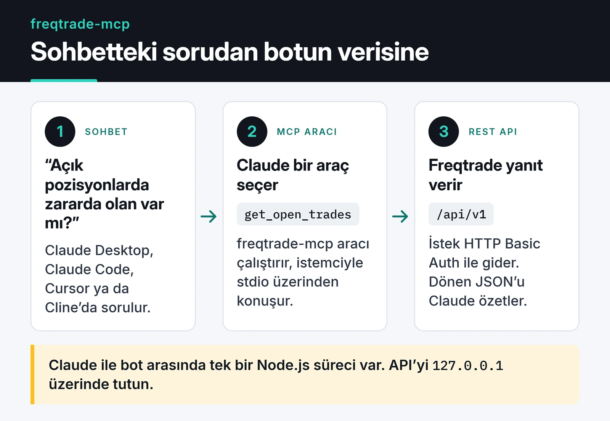

Bir Freqtrade botu çalıştırıyorum. Strateji hazır, bot işini yapıyor, benim bakmama gerek yok. Teoride. Pratikte gece on birde FreqUI'yı açıp sekmelere tıklıyor, bir sayıya bakıp kapatıyor, on beş dakika sonra yine açıyordum.

Claude zaten açıktı ve botun düzgün bir REST API'si vardı. Aradaki köprüyü [freqtrade-mcp](https://github.com/furkankoykiran/freqtrade-mcp) adıyla yazdım: Freqtrade'in REST API'sini MCP araçları olarak sunan bir TypeScript MCP sunucusu. Claude Desktop, Claude Code, Cursor ve Cline gibi [Model Context Protocol](https://modelcontextprotocol.io) konuşan her istemciyle çalışıyor. 1.0.0 sürümünü 4 Nisan 2026'da npm'e yayınladım.

## Ne işe yarıyor

Botla ilgili sorduğum sorular genelde şunlar:

> "Bu ay kârda mıyım?"
>
> "Açık pozisyonlarda zararda olan var mı?"
>
> "BTC/USDT 4 saatlikte son 50 mum nasıl görünüyor?"

Claude her soruyu ilgili araca çeviriyor, Freqtrade'den gelen JSON'u okuyup özetliyor. Sayıları kendim ayıklamak zorunda kalmıyorum. Araçlar altı gruba ayrılıyor:

| Grup | Araçlar |
|---|---|
| Hesap | `get_profit_stats`, `get_balance`, `get_performance` |
| İşlemler | `get_open_trades`, `get_trade`, `get_trade_history` |
| Piyasa verisi | `get_market_data` |
| Çift listeleri | `get_whitelist`, `get_blacklist`, `add_to_blacklist`, `remove_from_blacklist` |
| İşlem açma/kapama | `execute_trade`, `force_exit_trade` |
| Bot yönetimi | `start_bot`, `stop_bot`, `reload_config`, `get_bot_info`, `get_locks`, `delete_lock` |

Kodda toplam 19 araç var. README hâlâ "15 araç" diyor, onu da düzeltmem gerekiyor.

Birkaç pratik not:

- `get_market_data`, Freqtrade'in `/pair_candles` endpoint'ini kullanıyor. Bu endpoint botun kendi analiz ettiği mum verisini döndürüyor, yani pratikte yalnızca botun takip ettiği çiftler için çalışıyor.
- `get_trade_history` ve `get_market_data` en fazla 500 kayıt döndürüyor.
- `get_bot_info`, sürüm bilgisini son strateji döngüsünün zamanıyla birlikte veriyor. "Bot ayakta mı, yoksa sessizce takılmış mı?" sorusunun cevabı burada.

## Mimari

Sunucu, istemciyle stdio üzerinden konuşan tek bir Node.js süreci. Freqtrade'e HTTP Basic Auth ile `/api/v1` altından bağlanıyor:



Kod üç katmanlı:

- `src/client.ts`: Freqtrade API'si için tipli bir HTTP istemcisi. Node 18+ ile gelen `fetch`'i kullanıyor, her isteği `AbortController` ile 10 saniyede kesiyor ve 2xx dışı yanıtlarda Freqtrade'in `detail` alanını hata mesajına ekliyor.
- `src/tools/*.ts`: Her grup için bir dosya. Her araç parametrelerini bir zod şemasıyla tanımlıyor.
- `src/index.ts`: İstemciyi ortam değişkenlerinden kurup araçları kaydediyor ve `StdioServerTransport` ile bağlanıyor.

Repo bu yüzden küçük: `src/` altında kod, yanında bir `.env.example` ve CI ile npm yayını için `.github/` klasörü.

Bir aracın tamamı şu kadar:

```typescript
server.tool(
  'get_trade',
  'Retrieve detailed information about a specific trade by its ID, including full history, fees, and profit/loss.',
  {
    trade_id: z.number().int().positive().describe('The numeric trade ID to look up.'),
  },
  async ({ trade_id }) => {
    try {
      const data = await client.getTrade(trade_id);
      return { content: [{ type: 'text', text: JSON.stringify(data, null, 2) }] };
    } catch (err) {
      return {
        content: [{ type: 'text', text: `Error fetching trade ${trade_id}: ${(err as Error).message}` }],
        isError: true,
      };
    }
  },
);
```

Hataları fırlatmak yerine `isError: true` ile döndürüyorum. Model böylece "trade 42 bulunamadı" mesajını görüp kullanıcıya düzgün bir cevap verebiliyor ve oturum düşmüyor. Modelin aracı ne zaman seçeceğini de açıklama metinleri belirliyor. `execute_trade` açıklamasına "100 USDT'lik BTC al" gibi doğal dil örneklerini ve bunların hangi parametrelere karşılık geldiğini yazdım.

Bugün yeniden yazsam tek bir şeyi değiştirirdim. MCP TypeScript SDK'nın yeni sürümleri `server.tool()` yerine `registerTool()` kullanmayı öneriyor. Sunucu 1.x SDK ile sorunsuz çalışıyor, ama yeni bir projeye `registerTool()` ile başlardım.

## Kurulum

Önce Freqtrade'in REST API'sini açın, varsayılan olarak kapalı geliyor. `config.json` içine şunu ekleyin:

```json
"api_server": {
  "enabled": true,
  "listen_ip_address": "127.0.0.1",
  "listen_port": 8080,
  "verbosity": "error",
  "enable_openapi": false,
  "jwt_secret_key": "rastgele-uzun-bir-deger",
  "username": "Freqtrader",
  "password": "GucluBirSifre"
}
```

`listen_ip_address` değerini `127.0.0.1` bırakın. API'yi internete açarsanız botunuz ve borsa hesabınız tek bir şifreye kalır. Freqtrade dokümantasyonu da aynı uyarıyı yapıyor:

")

Sonra Claude Desktop yapılandırmasına (`claude_desktop_config.json`) sunucuyu ekleyin:

```json
{
  "mcpServers": {
    "freqtrade": {
      "command": "npx",
      "args": ["-y", "@furkankoykiran/freqtrade-mcp"],
      "env": {
        "FREQTRADE_API_URL": "http://127.0.0.1:8080",
        "FREQTRADE_USERNAME": "Freqtrader",
        "FREQTRADE_PASSWORD": "GucluBirSifre"
      }
    }
  }
}
```

Claude Desktop'ı yeniden başlatınca araçlar listede görünüyor. Claude Code kullanıyorsanız aynı şeyi tek komutla yapabilirsiniz:

```bash
claude mcp add freqtrade \
  -e FREQTRADE_API_URL=http://127.0.0.1:8080 \
  -e FREQTRADE_USERNAME=Freqtrader \
  -e FREQTRADE_PASSWORD=GucluBirSifre \
  -- npx -y @furkankoykiran/freqtrade-mcp
```

Araçları bir istemciye bağlamadan önce denemek isterseniz MCP Inspector işinizi görür: `npx @modelcontextprotocol/inspector npx -y @furkankoykiran/freqtrade-mcp`.

## Canlı işlemde dikkat edilecekler

`execute_trade` ve `force_exit_trade` stratejiyi atlayıp doğrudan Freqtrade'in `/forceenter` ve `/forceexit` endpoint'lerini çağırıyor. Sunucuda onay adımı yok.

> [!WARNING]
> Bot canlı moddaysa bu araçlar gerçek borsada, gerçek parayla, geri alınamayan bir emir veriyor.

Güvenmeden önce şunları bilmeniz gerekiyor:

- Freqtrade `/forceenter` çağrılarını yalnızca config'te `force_entry_enable: true` varsa kabul ediyor. Bu ayar kapalıyken `execute_trade` hata döndürüyor. Ayarı bilerek açmanız gerekiyor.
- `side: "short"` yalnızca futures ya da margin modunda çalışan botlarda anlamlı. Spot modda short açamazsınız.
- Önce `dry_run: true` ile deneyin. Freqtrade bu modda emirleri simüle ediyor, araçların davranışını risksiz görürsünüz.
- Claude Desktop ve Claude Code araç çağrılarından önce izin istiyor. İşlem açan araçlar için "her zaman izin ver" seçeneğini hiç kullanmıyorum.

## Kodu ve sonraki adımlar

Çözmek istediğim şey basitti: FreqUI'yı açmadan bota bakabilmek. REST API zaten oradaydı, MCP sunucusu onu sohbete taşıdı. "Acaba bir şey değişti mi" hissi geçmedi, ama sormak artık tek bir cümle.

Kod MIT lisanslı ve [GitHub'da](https://github.com/furkankoykiran/freqtrade-mcp), projenin özeti de [proje sayfamda](https://furkankoykiran.com.tr/projeler/freqtrade-mcp/). Kendi botunuza bağlamadan önce bir hafta `dry_run: true` ile çalıştırıp `get_profit_stats` ve `get_open_trades` sonuçlarını FreqUI ile karşılaştırın. Python tarafında bot geliştirmeyle ilgileniyorsanız [Python ile Telegram trading botu](/posts/python-telegram-trading-bot/) ve [yapay zekâ destekli trading stratejileri](/posts/yapay-zeka-destekli-trading-stratejileri/) yazılarına, başka bir MCP sunucusunu nasıl sardığımı görmek için de [CLI-Anything katkıma](/posts/cli-anything-browser-automation-katkim/) bakabilirsiniz.
