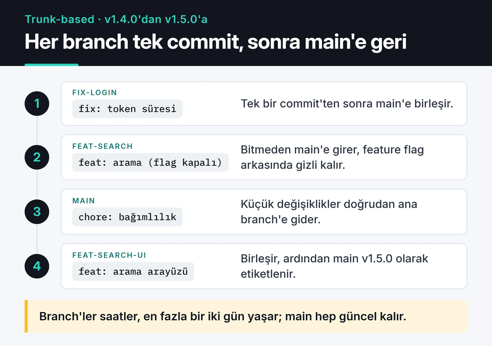
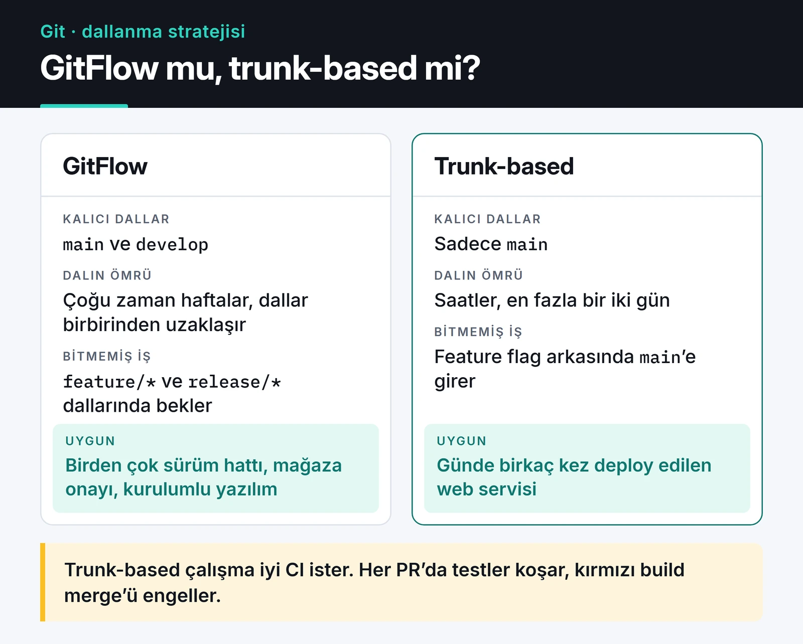

Git branch stratejisi seçimi, ekip büyüdükçe kod yazmaktan daha çok zaman yiyen konulardan biri. Cuma akşamı üç feature branch'ini `develop`'a birleştirmeye çalışıp yüzlerce conflict ile uğraşan ekibi herkes bir yerden tanır. Bu yazıda GitFlow ile trunk-based development'ı karşılaştırıyorum, sonra hangisini seçerseniz seçin işe yarayan araçlara geçiyorum: merge stratejisi, commit mesajı kuralları, pre-commit hook'ları ve `git bisect`.

Kendi projelerimde ve açık kaynak katkılarımda kullandığım düzen basit: kısa ömürlü branch, PR, CI yeşilse squash merge. Neden bunu seçtiğimi aşağıda anlatıyorum.

## GitFlow: ne zaman hâlâ mantıklı

GitFlow'da iki uzun ömürlü branch vardır: `main` (ya da `master`) üretimdeki kodu, `develop` bir sonraki sürümü tutar. Özellikler `feature/*` branch'lerinde geliştirilir, sürüm zamanı `release/*` açılır, acil düzeltmeler `hotfix/*` ile hem `main`'e hem `develop`'a girer.

Sorun, branch'lerin uzun yaşaması. Siz iki hafta `feature-x` üzerinde çalışırken arkadaşınız `feature-y`'de aynı modülü yeniden düzenler. Birleştirme günü ikiniz de iki haftalık farkla uğraşırsınız. Modelin yazarı Vincent Driessen de [orijinal yazıya](https://nvie.com/posts/a-successful-git-branching-model/) 2020'de bir not ekleyip sürekli deploy edilen web uygulamaları için daha basit bir akışı önerdi.

GitFlow'un hâlâ yerinde olduğu durumlar var: aynı anda birden fazla sürümü desteklediğiniz kütüphaneler, mağaza onayı bekleyen mobil uygulamalar, müşteriye kurulan on-premise yazılımlar. Günde birkaç kez deploy edilen bir web servisinde ise bence fazla tören.

## Trunk-based development

Tek kural: herkes ana branch'e (trunk, `main`) sık ve küçük parçalar halinde birleştirir. Branch açılır ama ömrü saatler, en fazla bir iki gündür.



"Yarım kalan özellik ne olacak?" sorusunun cevabı feature flag. Kod `main`'e girer, üretime de gider, ama bayrak kapalıyken kullanıcı görmez. En basit hâli bir ortam değişkeni:

```python
import os


def new_checkout_enabled(user_id: int) -> bool:
    if os.getenv("FEATURE_NEW_CHECKOUT") != "1":
        return False
    rollout = int(os.getenv("NEW_CHECKOUT_ROLLOUT_PERCENT", "0"))
    return user_id % 100 < rollout
```

Bu kadarı küçük bir ekip için yeter. Bayrak sayısı artınca bir flag servisi ya da OpenFeature gibi bir standarda geçmek gerekiyor; yoksa eski bayraklar kodda birikip ayrı bir teknik borca dönüşüyor. İş bitince bayrağı silmeyi takip eden bir issue açmak iyi bir alışkanlık.

Trunk-based çalışmanın ön şartı iyi bir CI. Herkes `main`'e sık birleştiriyorsa her PR'da testlerin çalışması ve kırmızı CI'ın birleştirmeyi engellemesi gerekir. GitHub Actions tarafını [CI/CD pipeline yazımda](/posts/github-actions-cicd-pipeline/), dakika limitine takılınca ne yaptığımı da [self-hosted runner yazısında](/posts/github-actions-self-hosted-runner-tr/) anlattım.

Aşağıdaki kart iki modeli yan yana koyuyor.



## Merge queue

Ekip büyüdükçe yeni bir sorun çıkar. İki PR ayrı ayrı yeşildir ama birlikte `main`'i kırar, çünkü ikisi de birbirini görmeden test edilmiştir. GitHub'ın merge queue özelliği bunu çözer: "merge" dediğinizde PR kuyruğa girer, GitHub o anki `main`'in ve sıradaki PR'ların üstüne geçici bir branch açıp testleri orada çalıştırır, geçerse birleştirir.

Bu "birleşen PR'lar yüzünden kırılan main" sorununu ortadan kaldırır. Flaky testler ya da CI'da çalışmayan testler yüzünden `main` yine kırılabilir. Merge queue'yu açmak için workflow'unuzun `merge_group` olayını dinlemesi gerekiyor:

```yaml
on:
  pull_request:
  merge_group:
```

Bu satırı unutursanız kuyruk, hiç başlamayan check'leri bekleyip takılı kalır.

## Merge, rebase, squash

```text
Başlangıç:         A---B---C            main
                        \
                         D---E          feature

Merge commit:      A---B---C-------M    main
                        \         /
                         D-------E

Rebase and merge:  A---B---C---D'--E'   main   (D' ve E' yeni commit'ler)

Squash and merge:  A---B---C---S        main   (S, D + E'nin tek commit hali)
```

- Merge commit: branch geçmişi olduğu gibi kalır, üstüne bir birleştirme commit'i eklenir. Kim neyi ne zaman birleştirdi bellidir ama log kalabalıklaşır.
- Rebase and merge: commit'ler `main`'in üstüne tek tek yeniden yazılır, geçmiş düz kalır. Branch'teki her commit anlamlıysa iyi.
- Squash and merge: branch'teki bütün commit'ler tek commit olur.

Ben squash'ı tercih ediyorum. Branch'teki "wip", "typo", "test düzeltmesi" commit'leri `main`'e girmiyor, her PR tek ve geri alınabilir bir commit oluyor. PR başlığı da commit mesajı oluyor, o yüzden başlığa özen göstermek gerekiyor.

Kendi branch'inizi güncel tutmak için rebase kullanın, ve force push gerekiyorsa her zaman lease ile:

```bash
git fetch origin
git rebase origin/main
git push --force-with-lease
```

`--force-with-lease`, siz son çektikten sonra uzaktaki branch'e başkası push ettiyse işlemi reddeder. Düz `--force` o commit'leri sessizce siler. Üst üste bağlı (stacked) branch'lerle çalışıyorsanız `git rebase --update-refs` aradaki branch'leri de birlikte taşır.

## Conventional Commits ve otomatik sürüm

Commit mesajları bir formata uyarsa sürüm numarasını ve changelog'u araçlar üretebilir. [Conventional Commits](https://www.conventionalcommits.org/) formatı:

- `fix(payment): zaman aşımını düzelt` patch sürümü artırır (1.1.0 → 1.1.1).
- `feat(auth): google ile giriş` minor sürümü artırır (1.1.0 → 1.2.0).
- `feat!: eski API kaldırıldı` ya da gövdede `BREAKING CHANGE:` major sürümü artırır (1.1.0 → 2.0.0).

semantic-release ve release-please bu mesajlardan sürüm numarasını, tag'i ve changelog'u otomatik çıkarır. Squash merge kullanıyorsanız kurala uyması gereken şey PR başlığıdır.

## Kuralları insana değil araca bırakın

"Commit mesajın formata uymuyor" diye review'da yorum yazmak iki tarafın da vaktini harcar. Bunu commit anında [pre-commit](https://pre-commit.com/) ile kontrol edin:

```yaml
# .pre-commit-config.yaml
default_install_hook_types: [pre-commit, commit-msg]
repos:
  - repo: https://github.com/pre-commit/pre-commit-hooks
    rev: v6.0.0
    hooks:
      - id: trailing-whitespace
      - id: end-of-file-fixer
      - id: check-yaml
      - id: check-added-large-files
  - repo: https://github.com/astral-sh/ruff-pre-commit
    rev: v0.17.2
    hooks:
      - id: ruff-check
        args: [--fix]
      - id: ruff-format
  - repo: https://github.com/gitleaks/gitleaks
    rev: v8.30.1
    hooks:
      - id: gitleaks
  - repo: https://github.com/compilerla/conventional-pre-commit
    rev: v4.4.0
    hooks:
      - id: conventional-pre-commit
        stages: [commit-msg]
```

`pre-commit install` bir kez çalıştırıldığında hem normal hook'lar hem commit mesajı kontrolü kurulur. Sürümleri ara sıra `pre-commit autoupdate` ile güncelleyin. Aynı kontrolleri CI'da da çalıştırın, çünkü `git commit --no-verify` hook'ları atlar. JavaScript projelerinde aynı işi Husky ve commitlint yapıyor. Yukarıdaki dosya ise Husky'nin değil, pre-commit'in kendi biçiminde.

## git bisect: hatayı getiren commit'i bulmak

"Dün çalışıyordu, bugün çalışmıyor" ve arada yüz commit var. Tek tek denemek yerine `git bisect` ikili arama yapar; 1000 commit'te bile 10 civarı adımda sonuca ulaşırsınız. Bir test komutu verirseniz adımları da kendisi yürütür:

```bash
git bisect start
git bisect bad HEAD
git bisect good v1.4.0
git bisect run pytest tests/test_checkout.py -x -q
git bisect reset
```

`git bisect run`, komut 0 ile çıkarsa commit'i "good", 1 ile 127 arasında (125 hariç) çıkarsa "bad" sayar. 125, "bu commit test edilemiyor, atla" demektir.

## Sık yapılan hatalar ve kurtarma

- `git reset --hard` ile kaybettiğinizi sandığınız commit'ler genelde kaybolmamıştır. `git reflog`, HEAD'in uğradığı her noktayı bir süre tutar; oradan `git branch kurtarilan <hash>` ile geri alırsınız.
- `.git` klasörü gigabaytlara çıktıysa biri muhtemelen dump ya da video commit'lemiştir. Geçmişten silmek için [git-filter-repo](https://github.com/newren/git-filter-repo) kullanın. Sonrasında herkesin repoyu yeniden klonlaması gerekir.
- API anahtarı push ettiyseniz önce anahtarı iptal edip yenisini üretin, geçmişi temizlemek ikinci adım. Push edilen bir sır kopyalanmış kabul edilmeli. GitHub'ın secret scanning ve push protection özelliklerini açın, yerelde de yukarıdaki gitleaks hook'u ilk savunma hattı olsun.
- `main`'e doğrudan push ve force push'u branch protection ya da ruleset ile kapatın. Kod sadece PR ve yeşil CI ile girsin.
- Lock dosyalarında (`poetry.lock`, `uv.lock`) conflict çıkınca elle birleştirmeye çalışmayın; `main`'in hâlini alıp lock'u yeniden üretin. Ayrıntısı [Poetry ve uv yazısında](/posts/poetry-python-proje-yonetimi/).

## Monorepo mu, polyrepo mu?

Kısaca: monorepo tek commit'te backend, frontend ve ortak kütüphaneyi birlikte değiştirmenizi sağlar, ama ölçek büyüyünce Nx, Turborepo, Bazel gibi araçlar ve sadece değişen kısmı test eden bir CI gerektirir. Polyrepo'da her servis bağımsız deploy edilir ama ortak bir kütüphanedeki düzeltmeyi elli repoya taşımak ayrı bir iş olur. Beş kişilik bir ekipte iki seçenek de çalışır; kararı ekip büyüklüğü ve servislerin ne kadar birlikte değiştiği belirlesin.

## İşimi kolaylaştıran araçlar

- [delta](https://github.com/dandavison/delta): `git diff` çıktısına syntax highlighting ve yan yana görünüm ekler.
- [lazygit](https://github.com/jesseduffield/lazygit): terminalde Git arayüzü. Parça parça stage etmek ve interaktif rebase için çok rahat.
- `git switch` ve `git restore`: `git checkout`'un iki ayrı işini ayıran, yanlış kullanması daha zor komutlar.

## Sırada ne var

Ekibiniz hâlâ uzun ömürlü branch'lerle çalışıyorsa her şeyi bir günde değiştirmeye çalışmayın. Önce branch ömrüne bir sınır koyun (örneğin iki gün), squash merge'e geçin ve pre-commit dosyasını repoya ekleyin. Feature flag ve merge queue, bu alışkanlıklar oturduktan sonra daha kolay geliyor.

CI tarafını kurmak için [GitHub Actions ile CI/CD yazısına](/posts/github-actions-cicd-pipeline/), lock dosyalarını CI'da kontrol etmek için de [Poetry ve uv yazısına](/posts/poetry-python-proje-yonetimi/) bakabilirsiniz.
