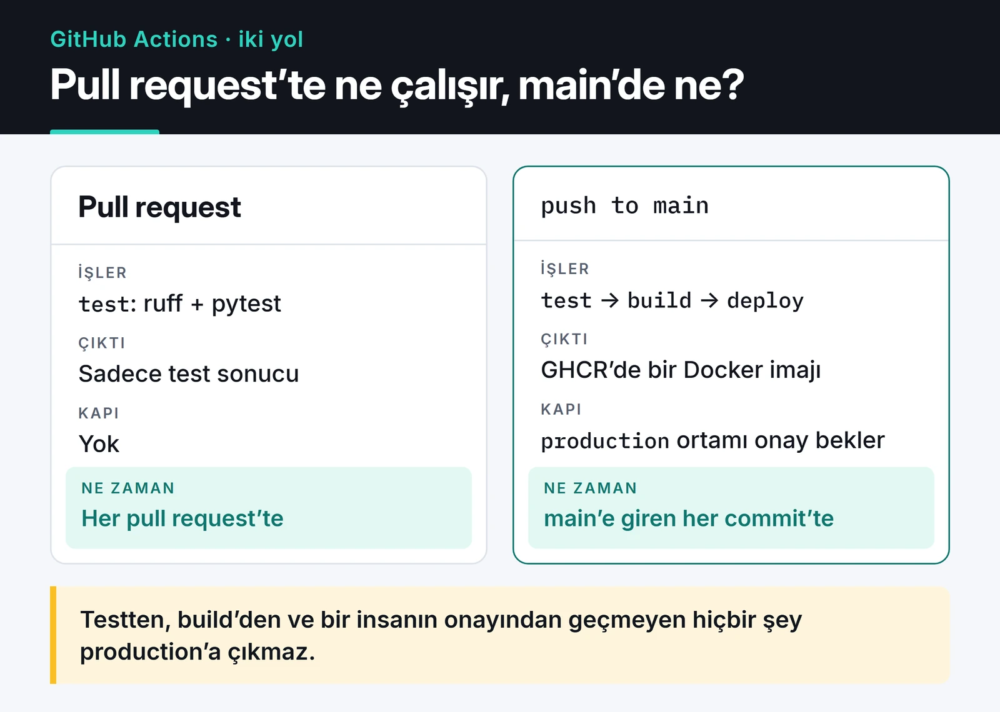

GitHub Actions ile çalışan bir CI/CD pipeline'ı yazmak beş dakika sürer. Zor kısım, o pipeline'ın birkaç ay sonra hâlâ hızlı, ucuz ve güvenli olması. Kopyala-yapıştır ile çoğalan YAML dosyaları, her yerde `write-all` yetkisi alan token'lar, takılıp altı saat çalışan job'lar zamanla birikiyor.

Bu yazıda bir Python projesi için kurduğum pipeline'ı adım adım anlatıyorum: pull request'te test, `main` dalında Docker imajı, onay bekleyen bir üretim deploy'u. Sonra aynı mantığı birden fazla repoya taşımak için reusable workflow'ları, statik bulut anahtarlarından kurtulmak için OIDC'yi ve gözden kaçan güvenlik ayarlarını ele alıyorum.

## Pipeline'ın şekli

Pull request'lerde yalnızca test çalışıyor. `main` dalına merge edilen her commit test edilip imajı derleniyor ve üretime çıkmak için onay bekliyor. Aşağıdaki kart bu iki yolu gösteriyor.



## Her PR'da çalışan test workflow'u

```yaml {title=".github/workflows/ci.yml"}
name: CI

on:
  pull_request:
  push:
    branches: [main]

permissions:
  contents: read

concurrency:
  group: ${{ github.workflow }}-${{ github.ref }}
  cancel-in-progress: ${{ github.event_name == 'pull_request' }}

jobs:
  test:
    runs-on: ubuntu-latest
    timeout-minutes: 15
    strategy:
      fail-fast: false
      matrix:
        python-version: ["3.13", "3.14"]
    steps:
      - uses: actions/checkout@v7
      - uses: astral-sh/setup-uv@v10
        with:
          python-version: ${{ matrix.python-version }}
          enable-cache: true
      - run: uv sync --locked
      - run: uv run ruff check .
      - run: uv run pytest
```

Bu dosyadaki her satırın bir sebebi var:

- `permissions: contents: read` workflow'daki `GITHUB_TOKEN` yetkisini kod okumakla sınırlar. Organizasyon veya repo ayarında varsayılan token yetkisi geniş olabilir. Her workflow'da ihtiyacı açıkça yazmak, bir adım ele geçirilirse verebileceği zararı küçültür.
- `concurrency` aynı PR'a art arda iki commit attığınızda eskisinin çalışmasını iptal eder. Sonucu artık kimseyi ilgilendirmeyen bir test için dakika harcamazsınız. `main` dalında iptal etmiyorum, çünkü orada her commit'in sonucunu görmek istiyorum.
- `timeout-minutes: 15` önemli. Job'ların varsayılan zaman aşımı 360 dakika. Takılan bir test veya ağ çağrısı altı saat boyunca dakika yer.
- `setup-uv` içindeki `enable-cache` uv önbelleğini Actions cache'inde saklar. `uv sync --locked`, lock dosyası güncel değilse hata verir.

Testlerin kendisini yazarken kullandığım fixture ve mock teknikleri [pytest yazımda](/posts/pytest-ile-ileri-seviye-test-teknikleri/).

## Docker imajını GHCR'a göndermek

Testler geçince imajı derleyip GitHub Container Registry'ye gönderiyorum. Aynı workflow dosyasına ikinci bir job olarak ekliyorum:

```yaml
  build:
    needs: test
    if: github.event_name == 'push' && github.ref == 'refs/heads/main'
    runs-on: ubuntu-latest
    timeout-minutes: 20
    permissions:
      contents: read
      packages: write
    outputs:
      image: ${{ steps.meta.outputs.tags }}
    steps:
      - uses: actions/checkout@v7
      - uses: docker/setup-buildx-action@v4
      - uses: docker/login-action@v4
        with:
          registry: ghcr.io
          username: ${{ github.actor }}
          password: ${{ secrets.GITHUB_TOKEN }}
      - id: meta
        uses: docker/metadata-action@v6
        with:
          images: ghcr.io/${{ github.repository }}
          tags: |
            type=sha,format=long
      - uses: docker/build-push-action@v7
        with:
          context: .
          push: true
          tags: ${{ steps.meta.outputs.tags }}
          labels: ${{ steps.meta.outputs.labels }}
          cache-from: type=gha
          cache-to: type=gha,mode=max
```

`packages: write` yetkisini yalnızca bu job'a veriyorum, test job'ı imaj push edemiyor. `metadata-action` imaja `sha-<commit>` etiketini ve kaynak repo, commit gibi OCI label'larını ekliyor. Registry isimleri küçük harf olmak zorunda. Repo adınızda büyük harf varsa `metadata-action` bunu sizin yerinize düzeltir, elle yazılmış `ghcr.io/${{ github.repository }}` ise bozulur. `cache-from/cache-to: type=gha` BuildKit katman önbelleğini Actions cache'inde tutuyor. Dockerfile'ı katman önbelleğine uygun yazdıysanız bağımlılıklar değişmedikçe build birkaç saniyede bitiyor. Dockerfile tarafını [Docker ile Python uygulaması yazımda](/posts/docker-ile-python-uygulamasi-containerization/) anlattım.

## Onay bekleyen deploy

Üretime çıkışı tamamen otomatik yapmak istemediğim projelerde GitHub Environments kullanıyorum. Repo ayarlarından `production` adında bir ortam oluşturup "Required reviewers" ekliyorum. Bu ortama bağlanan job, listedeki biri onaylayana kadar bekliyor:

```yaml
  deploy:
    needs: build
    runs-on: ubuntu-latest
    timeout-minutes: 10
    environment: production
    concurrency:
      group: deploy-production
      cancel-in-progress: false
    steps:
      - run: echo "Deploying ${{ needs.build.outputs.image }}"
      # sunucuya SSH, kubectl set image, ECS güncellemesi vb.
```

Environment'ın bir faydası daha var: ortama özel secret'lar yalnızca o ortama bağlı job'larda görünür. Üretim veritabanı şifresi bir PR workflow'unda okunamaz. Buradaki `concurrency` ise iki deploy'un aynı anda çalışmasını engelliyor ama sıradakini iptal etmiyor. Hedef bir Kubernetes cluster'ıysa deploy adımı genelde bir `kubectl set image` veya GitOps reposuna atılan bir commit oluyor. Cluster tarafında nelere dikkat ettiğimi [Kubernetes yazımda](/posts/kubernetes-container-orkestrasyon/) anlattım.

## Aynı pipeline'ı birden fazla repoda: reusable workflow

Beş servisiniz varsa yukarıdaki build job'ını beş repoya kopyalamak, bir değişikliği beş kez yapmak demek. Reusable workflow ile mantığı tek bir repoda tutup diğerlerinden çağırıyorum:

```yaml {title="org/ci-workflows/.github/workflows/python-image.yml"}
name: Python image

on:
  workflow_call:
    inputs:
      python-version:
        type: string
        default: "3.14"

jobs:
  test:
    runs-on: ubuntu-latest
    timeout-minutes: 15
    permissions:
      contents: read
    steps:
      - uses: actions/checkout@v7
      - uses: astral-sh/setup-uv@v10
        with:
          python-version: ${{ inputs.python-version }}
          enable-cache: true
      - run: uv sync --locked
      - run: uv run pytest
```

Servis reposundaki workflow artık birkaç satır:

```yaml {title=".github/workflows/ci.yml"}
name: CI
on:
  pull_request:
  push:
    branches: [main]

jobs:
  pipeline:
    uses: org/ci-workflows/.github/workflows/python-image.yml@v1
    permissions:
      contents: read
    with:
      python-version: "3.14"
    secrets: inherit
```

Çağrılan workflow'u bir etiket (`@v1`) veya commit SHA'sı ile sabitliyorum. `@main` kullanırsanız merkezi repodaki her değişiklik, bütün servislerde anında devreye girer. `secrets: inherit` çağıran tarafın secret'larını aktarır. Kullanışlı ama geniş. Yalnızca gereken secret'ları `secrets:` altında tek tek geçmek daha sıkı bir seçenek.

Birkaç adımı tekrar kullanmak istiyorsanız (örneğin "uv kur, sync et, önbelleği ayarla") composite action daha uygun. Reusable workflow bütün job'ları paylaşır, composite action bir job içindeki adımları.

## Statik bulut anahtarları yerine OIDC

Repo secret'larında `AWS_ACCESS_KEY_ID` duruyorsa, o anahtar süresiz geçerli ve sızarsa fark edilene kadar kullanılabilir. GitHub Actions, OIDC ile bulut sağlayıcısından her çalışmada kısa ömürlü kimlik bilgisi alabiliyor.

AWS tarafında GitHub'ın OIDC sağlayıcısına (`token.actions.githubusercontent.com`) güvenen bir IAM rolü oluşturuyorum. Rolün trust policy'sinde `sub` claim'ini kısıtlamak şart, yoksa GitHub'daki herhangi bir repo bu rolü üstlenebilir:

```json
{
  "Condition": {
    "StringEquals": {
      "token.actions.githubusercontent.com:aud": "sts.amazonaws.com",
      "token.actions.githubusercontent.com:sub": "repo:my-org/my-service:environment:production"
    }
  }
}
```

Workflow tarafında yalnızca `id-token: write` yetkisi ve bir adım gerekiyor:

```yaml
  deploy:
    environment: production
    runs-on: ubuntu-latest
    permissions:
      id-token: write
      contents: read
    steps:
      - uses: aws-actions/configure-aws-credentials@v6
        with:
          role-to-assume: arn:aws:iam::123456789012:role/github-deploy
          aws-region: eu-central-1
      - run: aws sts get-caller-identity
```

Job bir environment'a bağlı olduğunda `sub` claim'i `repo:<org>/<repo>:environment:<ad>` biçiminde gelir. Rolü yalnızca `production` ortamına bağlamak, onay adımını da güvenlik zincirine katıyor. Google Cloud ve Azure aynı mekanizmayı workload identity federation adıyla destekliyor.

## Güvenlik: gözden kaçanlar

- Üçüncü parti action'ları commit SHA'sı ile sabitleyin. Etiketler taşınabilir. Mart 2025'te [`tj-actions/changed-files`](https://github.com/advisories/GHSA-mrrh-fwg8-r2c3) action'ının etiketleri kötü amaçlı bir commit'e yönlendirildi ve onu etiketle kullanan workflow'lar secret'larını loglara bastı. SHA ile sabitlenmiş bir adım şöyle görünüyor:

  ```yaml
  - uses: astral-sh/setup-uv@07a047e608db84b3d8c06cd9a7c7dcc9c355c18e # v10.3.2
  ```

  Sürümleri elle takip etmemek için Dependabot'a `package-ecosystem: github-actions` ekliyorum. SHA'ları da yorumdaki sürümle birlikte güncelliyor.
- Kullanıcı girdisini `run` içinde doğrudan kullanmayın. `run: echo "${{ github.event.pull_request.title }}"` satırında PR başlığı shell komutunun parçası olur. Başlığa `"; curl ... | sh; "` yazan biri runner'da komut çalıştırır. Değeri önce `env:` ile bir ortam değişkenine atayıp `"$PR_TITLE"` olarak kullanın.
- `pull_request_target` tetikleyicisine dikkat. Bu tetikleyici, fork'tan gelen PR için bile hedef reponun secret'larıyla ve yazma yetkisiyle çalışır. Bu tetikleyiciyle PR'ın kodunu checkout edip çalıştırmak, dışarıdan gelen koda secret'larınızı vermek demek.
- Public repolarda self-hosted runner kullanmayın. Herkes bir PR açıp sizin makinenizde kod çalıştırabilir.

tj-actions olayı GitHub Advisory Database'de CVE-2025-30066 olarak kayıtlı. Kayıt 45.0.7 dahil bütün sürümleri etkilenmiş sayıyor, çünkü saldırgan mevcut sürüm etiketlerini kötü amaçlı commit'e taşımıştı.


## Maliyet

Private repolarda GitHub'ın verdiği ücretsiz dakikalar planınıza göre sınırlı. Dakikaları en çok şu ayarlar kurtarıyor: `concurrency` ile eski çalışmaları iptal etmek, her job'a `timeout-minutes` vermek, bağımlılık ve Docker katmanlarını önbelleğe almak, sadece dokümantasyon değişen commit'lerde testleri `paths-ignore` ile atlamak. Bunlar da yetmediğinde elinizdeki bir sunucuyu runner yapabilirsiniz. Ben dakikalarım bittiğinde bunu yaptım ve süreci [self-hosted runner yazımda](/posts/github-actions-self-hosted-runner-tr/) anlattım.

## Branch korumasıyla bağlamak

Pipeline'ın anlamı, `main` dalına testten geçmemiş kod girmemesi. Repo ayarlarında bir ruleset ile `main` için "Require status checks to pass" kuralını açıp `test` job'larını zorunlu kontrol olarak seçiyorum. Böylece kırmızı bir PR merge edilemiyor ve force-push engelleniyor.

## Sırada ne var

Bu yapıyı yeni bir projeye kurarken önce sadece `ci.yml` ile başlamanızı öneririm. Build ve deploy job'larını, test job'ı birkaç hafta sorunsuz çalıştıktan sonra eklemek daha kolay. İlk iş olarak mevcut workflow'larınızdaki üçüncü parti action'ları SHA ile sabitleyip Dependabot'u açın.

İmajın kendisi için [Docker ile Python uygulaması](/posts/docker-ile-python-uygulamasi-containerization/), dakika sorunu için [self-hosted runner](/posts/github-actions-self-hosted-runner-tr/) yazılarıma bakabilirsiniz. Sözdizimi ve güvenlik ayrıntıları için en güvenilir kaynak [GitHub Actions dokümantasyonu](https://docs.github.com/en/actions).
