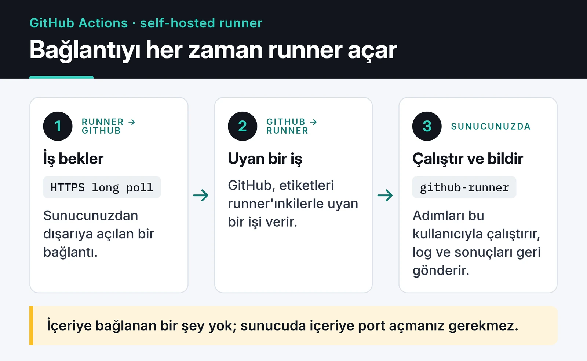

GitHub Actions'ta private repolar için aylık ücretsiz dakika kotası var: Free planda 2.000, Pro ve Team planlarında 3.000 dakika. Her push'ta ve her PR'da çok adımlı bir CI pipeline çalıştırınca bu kota beklediğinizden hızlı bitiyor. Mayıs 2026'da benim de bitti. Ek dakika için ödemek yerine zaten çalışan bir Linux sunucumu self-hosted runner yaptım. Bu rehberde kurulumu adım adım anlatıyorum: ayrı kullanıcı, hash doğrulama, systemd servisi, etiketler ve kalıcı bir runner'ın güvenlik bedeli.

## Neden self-hosted runner

GitHub'ın [faturalandırma dokümanına](https://docs.github.com/en/billing/concepts/product-billing/github-actions) göre self-hosted runner'larda çalışan işler Actions dakikası tüketmiyor. Kotayı aşınca standart Linux runner dakikası 0,006 dolar. Benim sunucum zaten açıktı, ek maliyet sadece CPU ve disk.

Bir avantajı daha var: runner'ın diski işler arasında kalıyor. Benim projemde ilk çalıştırma uzun sürdü çünkü Poetry bütün bağımlılıkları sıfırdan kurdu. Sonraki çalıştırmalarda virtualenv yerinde durduğu için işler belirgin şekilde hızlandı. Bu kalıcılık aynı zamanda en büyük dezavantaj, güvenlik bölümünde ona döneceğim.

Runner'ın nasıl çalıştığını bilmek kurulumu kolaylaştırıyor. Runner GitHub'a dışarıya doğru HTTPS bağlantısı açıp iş bekliyor. Sunucuda içeriye port açmanız gerekmiyor:



## Ayrı bir kullanıcı oluşturun

Runner'ı root olarak çalıştırmayın. `config.sh` zaten root ile çalışmayı reddediyor. Ayrı bir sistem kullanıcısı açın:

```bash
sudo useradd -r -m -d /opt/github-runner -s /bin/bash \
  -c "GitHub Actions Runner" github-runner
```

`-r` bir sistem hesabı oluşturuyor, `-m -d` ev dizinini `/opt/github-runner` olarak açıyor. Kullanıcının parolası yok, bu yüzden parolayla giriş yapılamıyor. Sudo yetkisi de yok. Shell olarak `/bin/bash` veriyorum çünkü sonraki adımları bu kullanıcıyla çalıştıracağım.

## Runner'ı indirip hash'ini doğrulayın

Bundan sonraki her şeyi runner kullanıcısıyla yapın, böylece dosyalar baştan doğru sahiplikle oluşur:

```bash
sudo -iu github-runner
cd /opt/github-runner

VERSION=2.338.1
curl -fsSLO "https://github.com/actions/runner/releases/download/v${VERSION}/actions-runner-linux-x64-${VERSION}.tar.gz"

echo "08e9ccb3604d2462c24b5e33604dc30810296ca15cc65f23cffd4317eb144c37  actions-runner-linux-x64-${VERSION}.tar.gz" | sha256sum -c

tar xzf "actions-runner-linux-x64-${VERSION}.tar.gz"
```

Örnekteki sürüm ve SHA256 değeri runner 2.338.1'e ait. Her release'in notlarında, Linux x64 kurulum komutlarının hemen altında o paketin hash'i yazıyor:

")

Kendi kurulumunuzda [releases sayfasındaki](https://github.com/actions/runner/releases) güncel sürümü ve o sürümün hash'ini kullanın. Sunucunuzda kod çalıştıracak bir binary indiriyorsunuz, hash kontrolünü atlamayın.

## Runner'ı repoya kaydedin

Repo → Settings → Actions → Runners → New self-hosted runner sayfası bir kayıt token'ı gösteriyor. Token bir saat geçerli, bu yüzden komutu önceden hazırlayın:

```bash
./config.sh \
  --url https://github.com/KULLANICI/REPO \
  --token KAYIT_TOKENI \
  --name prod-server-01 \
  --labels prod \
  --unattended
```

`self-hosted`, `linux` ve `x64` etiketlerini runner kendisi ekliyor. `--labels` ile sadece kendi etiketlerinizi verin. `--unattended` etkileşimli soruları atlıyor. Başarılı olunca şuna benzer bir çıktı görürsünüz:

```text
√ Connected to GitHub
√ Runner successfully added
√ Settings Saved
```

Bu adımdan sonra `exit` ile runner kullanıcısından çıkın.

## systemd servisi olarak kurun

Runner klasöründeki `svc.sh` bir systemd unit dosyası oluşturuyor. Root ile çalıştırıp hangi kullanıcıyla koşacağını belirtin:

```bash
cd /opt/github-runner
sudo ./svc.sh install github-runner
sudo ./svc.sh start
sudo ./svc.sh status
```

Log'ları journald'dan okuyabilirsiniz:

```bash
sudo journalctl -u 'actions.runner.*' -n 50 --no-pager
```

Aradığınız satır `Listening for Jobs`. Bunu görünce runner hazır ve iş bekliyor demektir. Repo ayarlarındaki Runners listesinde de "Idle" olarak görünür.

## Workflow'ları runner'a yönlendirin

`runs-on` satırını etiketlerle değiştirin:

```yaml
jobs:
  lint:
    runs-on: [self-hosted, linux, prod]
    steps:
      - uses: actions/checkout@v7
      - run: poetry install --no-interaction
      - run: poetry run ruff check .
```

İş, listedeki bütün etiketlere sahip bir runner'a gider. Birden fazla sunucunuz varsa `prod`, `staging` gibi etiketlerle hangi işin nerede çalışacağını seçebilirsiniz.

İlk PR'ımı açtığımda Actions sayfasında `Running job: Backend Lint (ruff)` satırı belirdi. İş, Azure'da bir yerde açılan bir sanal makinede değil, önümdeki sunucuda çalışıyordu. Kullanıcıyı açmaktan workflow dosyalarını güncellemeye kadar bütün kurulum 20 dakika kadar sürdü.

## Güvenlik: kalıcı runner'ın bedeli

GitHub'ın barındırdığı runner'larda her iş temiz bir sanal makinede başlıyor. Self-hosted runner'da öyle değil. Bir işin diske bıraktığı her şey sonraki işe kalıyor. Bu yüzden şunlara dikkat ediyorum:

- Public repolarda self-hosted runner kullanmayın. Bir fork'tan gelen PR, workflow'unuzu değiştirip sunucunuzda kod çalıştırabilir. GitHub'ın [güvenlik rehberi](https://docs.github.com/en/actions/reference/security/secure-use) de bunu açıkça öneriyor. Benim kurulumum yalnızca private repolar için.
- Runner dizinini sadece runner kullanıcısına açın: `sudo chown -R github-runner:github-runner /opt/github-runner` ve `sudo chmod 700 /opt/github-runner`.
- Runner kullanıcısını sudoers'a eklemeyin. Bir iş gerçekten root komutu gerektiriyorsa, sadece o komuta izin veren dar bir sudoers kuralı yazın.
- Runner kullanıcısını `docker` grubuna eklemek pratikte root yetkisi vermek demek. Docker gerekiyorsa bunu bilerek yapın ya da rootless Docker kullanın.
- Gizli bilgileri diske yazan adımlardan kaçının, yazıyorsanız işin sonunda silin. Bir sonraki iş aynı diski görüyor.
- Her işin temiz başlaması gerekiyorsa runner'ı `--ephemeral` ile kaydedin. Runner tek bir iş alıp kaydını siliyor. Bunun karşılığında her iş için yeni bir runner kaydetmeniz gerekiyor. Bu genelde bir otomasyon ya da Actions Runner Controller ile yapılıyor.

Runner varsayılan olarak yeni sürümleri kendisi indirip güncelliyor. Bunu kapatmayın, yoksa eski sürümleri GitHub bir süre sonra kabul etmiyor. İşletim sistemi yamaları ise sizin sorumluluğunuzda.

Runner'ı kaldırmak gerekirse önce servisi, sonra kaydı silin:

```bash
cd /opt/github-runner
sudo ./svc.sh stop
sudo ./svc.sh uninstall
sudo -u github-runner ./config.sh remove --token KALDIRMA_TOKENI
```

Kaldırma token'ı, Runners sayfasında runner'ın menüsünden alınıyor.

## Hangisi ne zaman

| | GitHub'ın runner'ı | Self-hosted |
|---|---|---|
| Maliyet | Kota içinde ücretsiz, sonra dakika başı | Actions dakikası yok, sunucu masrafı sizde |
| Bakım | Yok | Runner ve işletim sistemi güncellemeleri |
| Hız | Her işte kurulum ve cache indirme | İlk işten sonra yerel cache sayesinde hızlı |
| İzolasyon | Her işte temiz VM | İşler aynı diski paylaşıyor |
| Ağ | GitHub'ın ağı | Sizin ağınız, iç servislere erişim kolay |

Kotanın altındaysanız GitHub'ın runner'ları doğru varsayılan. Kotayı düzenli olarak aşıyorsanız ve boşta bir sunucunuz varsa self-hosted runner, birkaç güvenlik kuralına uymak şartıyla mantıklı bir seçim.

## Sırada ne var

Bir sonraki adım olarak reusable workflow'lar ve OIDC ile daha düzenli bir pipeline kurmak isterseniz [GitHub Actions CI/CD yazısına](/posts/github-actions-cicd-pipeline/) bakın. GitHub Actions'ın cron ile çalışan bir projede nasıl kullanıldığını [awesome-trending-repos yazısında](/posts/awesome-trending-repos-web/), sunucudaki servislerin ayakta olup olmadığını izlemeyi de [Uptime Kuma yazısında](/posts/uptime-kuma-servis-izleme/) anlattım. Resmi kurulum adımları için [GitHub'ın self-hosted runner dokümanı](https://docs.github.com/en/actions/how-tos/manage-runners/self-hosted-runners/add-runners) en güncel kaynak.
