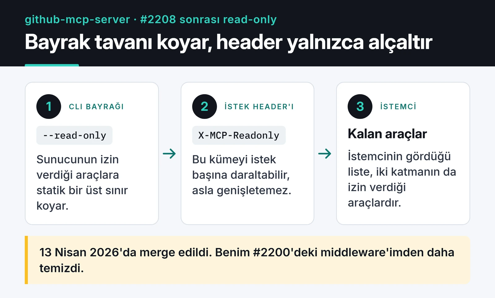

GitHub'ın resmi MCP sunucusu `github/github-mcp-server`, Copilot ve Claude gibi asistanların GitHub API'sini araç (tool) olarak kullanmasını sağlayan Go projesi. Bu projeye iki PR açtım. İkisi de merge edilmedi. Bu yazıda neler yaptığımı, kod tabanı ben yokken nasıl değiştiğini ve ikinci PR'ın neden kapatıldığını anlatıyorum. Büyük bir projeye ilk katkınızı düşünüyorsanız, merge edilmeyen PR'lar bence en az merge edilenler kadar şey öğretiyor.

## Eksik araç: create_discussion

Kasım 2025'te Discussions araç setine bakarken bir boşluk fark ettim. `list_discussions`, `get_discussion`, `get_discussion_comments` ve `list_discussion_categories` vardı ama discussion oluşturan bir araç yoktu. Yani asistan mevcut tartışmaları okuyabiliyor, "bu konu için bir Q&A başlat" dendiğinde hiçbir şey yapamıyordu.

1 Aralık 2025'te [#1517](https://github.com/github/github-mcp-server/issues/1517) numaralı issue'yu açtım, birkaç saat sonra da [#1519](https://github.com/github/github-mcp-server/pull/1519) numaralı PR'ı gönderdim. Issue'ya maintainer'dan bir yanıt gelmedi, PR'a ise yalnızca Copilot'un otomatik review'u düştü. Yani işe maintainer'dan bir onay almadan başlamıştım.

Araç GraphQL tarafında iki adımda çalışıyor. `createDiscussion` mutation'ı repository'nin node ID'sini istiyor. Bu yüzden önce owner ve repo adıyla ID'yi çekiyor, sonra mutation'ı gönderiyorum.

ID'yi çeken yardımcı fonksiyon:

```go
func getDiscussionRepositoryID(ctx context.Context, client *githubv4.Client, owner, repo string) (githubv4.ID, error) {
	var q struct {
		Repository struct {
			ID githubv4.ID
		} `graphql:"repository(owner: $owner, name: $repo)"`
	}
	vars := map[string]any{
		"owner": githubv4.String(owner),
		"repo":  githubv4.String(repo),
	}
	if err := client.Query(ctx, &q, vars); err != nil {
		return "", err
	}
	return q.Repository.ID, nil
}
```

Sonra mutation'ı çalıştırıp yeni discussion'ın ID, numara ve URL'ini dönüyorum. `repo` parametresi verilmezse organizasyon seviyesinde discussion açmak için `.github` reposuna düşüyorum. GitHub organizasyon discussion'larını zaten bu repo üzerinden yönetiyor.

```go
input := githubv4.CreateDiscussionInput{
	RepositoryID: repoID,
	CategoryID:   githubv4.ID(categoryID),
	Title:        githubv4.String(title),
	Body:         githubv4.String(body),
}
if err := client.Mutate(ctx, &mutation, input, nil); err != nil {
	return utils.NewToolResultError(fmt.Sprintf("failed to create discussion: %v", err)), nil, nil
}
```

Testlerde GraphQL cevaplarını `githubv4mock` ile taklit ettim ve aracın JSON şemasını projenin `toolsnaps` snapshot sistemine ekledim. Başarılı oluşturma, organizasyon seviyesi, eksik parametre ve bulunamayan repo/kategori durumları testlerde var.

## İki aylık ara

PR açıldıktan birkaç gün sonra GitHub hesabım askıya alındı. Anladığım kadarıyla bağlı olduğum paylaşımlı ağdan gelen şüpheli trafik yüzünden işaretlenmiştim. İtiraz formunu doldurdum ve beklemeye başladım. Hesap açılana kadar yaklaşık iki ay geçti. Bu sürede PR'ım, repolarım ve profilim dışarıdan görünmüyordu.

Hesap geri geldiğinde PR'da "This branch has conflicts that must be resolved" yazıyordu. Asıl sorun conflict'lerin sayısı değil, değişikliğin büyüklüğüydü. PR'ı açtığım günden döndüğüm güne kadar `main`'e 204 commit girmiş, yaklaşık 300 dosya değişmişti. Araçların nasıl tanımlandığı baştan yazılmıştı.

## Ben yokken değişen mimari

Aralık'taki halinde her araç bir `mcp.Tool` ve ayrı bir handler fonksiyonu dönüyordu. GraphQL istemcisi parametre olarak geliyordu:

```go
func CreateDiscussion(getGQLClient GetGQLClientFn, t translations.TranslationHelperFunc) (mcp.Tool, mcp.ToolHandlerFor[map[string]any, any])
```

Şubat'taki `main`'de ise her araç `NewTool()` fabrikasıyla kuruluyor ve `inventory.ServerTool` dönüyordu:

```go
func CreateDiscussion(t translations.TranslationHelperFunc) inventory.ServerTool {
	return NewTool(
		ToolsetMetadataDiscussions,
		mcp.Tool{ /* ad, açıklama, şema */ },
		[]scopes.Scope{scopes.Repo},
		func(ctx context.Context, deps ToolDependencies, _ *mcp.CallToolRequest, args map[string]any) (*mcp.CallToolResult, any, error) {
			client, err := deps.GetGQLClient(ctx)
			// ...
		},
	)
}
```

Farklar şöyleydi. Araç artık hangi toolset'e ait olduğunu metadata ile kendisi söylüyor. İstemciler `ToolDependencies` üzerinden enjekte ediliyor. Her araç ihtiyaç duyduğu OAuth scope'larını (`scopes.Repo` gibi) beyan ediyor, böylece sunucu token'ın yetkisine göre araç listesini filtreleyebiliyor. Bu bir refactoring'den çok yeni bir sözleşme. Projedeki bütün araçlar buna taşınmıştı.

## Rebase yerine baştan yazmak

İki yol vardı. Birincisi eski commit'leri yeni `main` üzerine rebase edip conflict'leri tek tek çözmek. Bu, eski imzalı fonksiyonu yeni sözleşmeye elle bükmek demekti ve sonuçta çoğu satırı zaten yeniden yazacaktım.

İkincisi branch'i upstream'e sıfırlayıp aracı yeni kalıpla sıfırdan yazmak. PR merge edilmemişti, kimse o commit geçmişine bağlı değildi. İkinciyi seçtim:

```bash
git fetch upstream
git checkout feature/add-create-discussion-tool
git reset --hard upstream/main
# create_discussion'ı NewTool() ile yeniden yaz, testleri güncelle
go build ./...
UPDATE_TOOLSNAPS=true go test ./pkg/github/ -run Test_CreateDiscussion
git push origin feature/add-create-discussion-tool --force-with-lease
```

`--force-with-lease` burada önemli. Düz `--force` uzak branch'te benim görmediğim bir commit varsa onu sessizce siler. `--force-with-lease` ise o durumda push'u reddeder.

Yeniden yazmak düşündüğümden kolay oldu, çünkü artık elimde yeni kalıpla yazılmış onlarca örnek araç vardı. `ListDiscussionCategories`'i açıp aynı iskeleti izledim. Testlerde de yeni yardımcıları kullandım: `tool.InputSchema.(*jsonschema.Schema)` ile şema kontrolü, `githubv4mock.DataResponse` ile sahte cevaplar ve `toolsnaps.Test` ile şema snapshot'ı.

Son hali tek commit, üç dosya (`discussions.go`, `discussions_test.go` ve `create_discussion.snap`), 336 satır ekleme. 4 Şubat 2026'da force push yaptım ve maintainer'a PR'ın güncel `main` üzerinde yeniden yazıldığını, review'a hazır olduğunu söyleyen bir yorum bıraktım.

## #1519 nerede duruyor

#1519 açık ve henüz bir insan review'u almadı. #1517 de açık, `main`'de de `create_discussion` aracı yok. PR'ın başlığı tek commit'i ve 336 satırlık eklemeyi gösteriyor:


Bu arada ekip yorumlar için `discussion_comment_write` adında yeni bir yazma aracı ekledi. Discussion tarafının yazma işlerine kendi önceliğiyle dokunuyor.

Bunu kişisel almıyorum. Bu repoda çok sayıda dış PR bekliyor ve ekip yazma araçlarını, scope'ları ve güvenliği birlikte düşünüyor. Yeni bir yazma aracı eklemek onlar için "kod doğru mu" sorusundan büyük bir ürün kararı.

## İkinci PR: read-only bayrağı ve kapanış

Mart 2026'da daha küçük bir şey denedim. [#2156](https://github.com/github/github-mcp-server/issues/2156) numaralı issue'da `--read-only` bayrağının HTTP modunda etkisiz olduğu, `create_pull_request` gibi yazma araçlarının açık kaldığı bildirilmişti. [#2200](https://github.com/github/github-mcp-server/pull/2200) ile bayrağı HTTP sunucu yapılandırmasına taşıyan ve bütün isteklere uygulayan bir middleware ekledim.

Maintainer birkaç dakika içinde bunun hata olmadığını yazdı. HTTP modunda kullanıcılar read-only'yi istek başına `X-MCP-Readonly` header'ıyla açabiliyordu, uzak sunucuda olduğu gibi. Global ayara izin verip vermeme kararı henüz verilmemişti. Ben stdio moduyla tutarlılık ve çok kiracılı kurulumlar gibi gerekçelerimi yazdım.

Sonunda maintainer konuyu kendi PR'ıyla çözdü. [#2208](https://github.com/github/github-mcp-server/pull/2208) CLI bayraklarını statik bir üst sınır yapıyor; header'lar bu sınırı yalnızca daraltabiliyor. 13 Nisan 2026'da merge edildi. Aşağıdaki şema bu iki katmanı gösteriyor.


 Bana bunun sorunu çözüp çözmediğini sordular, çözdüğünü ve yaklaşımın benim middleware'imden daha temiz olduğunu yazdım. #2200 15 Nisan'da merge edilmeden kapandı.

Bu kapanışı iyi bir sonuç sayıyorum. Hata gerçekti ve issue'daki Docker senaryosu artık çalışıyor; çözümü başka biri yazdı.

## Bu iki PR'dan aldıklarım

Yoğun bir projede bir PR, üzerine yazıldığı koddan uzun yaşayabiliyor. İki ay sonra döndüğümde yazdığım her satır eski bir sözleşmeye göreydi. Bekleyen bir PR'ı bir iki haftada bir upstream ile karşılaştırmanızı öneririm; farkı tek seferde keşfetmekten çok daha kolay.

Yazma yapan araçlar, okuma yapanlardan çok daha zor kabul görüyor. Bir asistanın adına discussion açmak yetki, spam ve güvenlik sorularını beraberinde getiriyor. Bir dahaki sefere kodu yazmadan önce issue'da maintainer'dan açık bir "evet" beklerim.

"Bu bir tasarım kararı" cevabı da işe yarar bir sonuç. #2200'de maintainer'ın gerekçesini okuyunca middleware'imin yanlış katmanda olduğunu anladım. Düzeltme de doğru yere, sunucu yapılandırmasına girdi.

## PR'lar ve diğer katkılarım

Açık kaynak katkılarımın diğer örnekleri bu serinin başka yazılarında: [Google RE2'ye lookaround prototipi](/posts/google-re2-lookaround-proof-of-concept/), [Keploy'a Go katkılarım](/posts/keploy-acik-kaynak-katkim/) ve [CLI-Anything'e tarayıcı otomasyonu](/posts/cli-anything-browser-automation-katkim/). #1519'un son haline [PR sayfasından](https://github.com/github/github-mcp-server/pull/1519) bakabilirsiniz. Discussions için bir yazma aracına ihtiyacınız varsa [#1517](https://github.com/github/github-mcp-server/issues/1517) numaralı issue'ya bir +1 tepkisi bırakın. Bu, ekibin önceliklendirmesine benim yorumlarımdan daha çok yardım eder.
