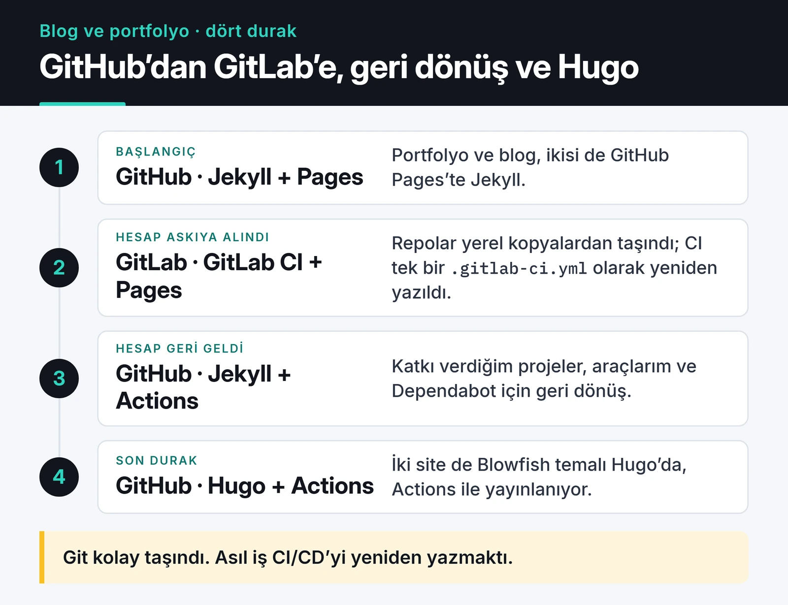

Bir sabah GitHub hesabımın askıya alındığını gördüm. Açık kaynak projelerim, portfolyo sitem ve Jekyll ile kurduğum blogum bir anda erişilemez olmuştu. Sebep sonradan basit bir hata çıktı ve hesabım geri açıldı. Ama hesap kapalıyken bütün repolarımı GitLab'a taşıyıp siteleri oradan yayınlamaya başladım. Bu yazıda o göçü, GitLab CI ile GitHub Actions arasında gördüğüm farkları ve sonrasında altyapımı nasıl kurduğumu anlatıyorum.



## Başlangıçtaki kurulum

O dönem iki sitem vardı ve ikisi de Jekyll ile GitHub Pages üzerindeydi:

- Portfolyo (`furkankoykiran.com.tr`): `<kullanıcı>.github.io` adlı repoda, sade bir Jekyll temasıyla. Ayarlar `_config.yml` içindeydi, içerik Markdown'dı. Alan adı Cloudflare'de duruyordu.
- Blog (`blog.furkankoykiran.com.tr`): ayrı bir repoda, Chirpy temasıyla. Temanın `tools/init.sh` script'i repoyu temizleyip kişiselleştirmeye hazırlıyordu.

Yerelde `bundle exec jekyll s` ile test ederken bir kez takıldığım şey: `_config.yml` içindeki `url` ve `baseurl` değerleri yerel adresle uyuşmazsa CSS ve JS dosyaları 404 veriyor. Sayfa açılıyor ama tasarımsız geliyor.

## GitLab durağı

GitHub kapanınca repoları GitLab'a taşıdım. Git tarafı kolaydı, yerel kopyalar bendeydi. Asıl iş CI/CD'yi yeniden yazmaktı, çünkü GitHub Actions workflow'ları GitLab'da çalışmıyor.

GitLab'da her şey repo kökündeki tek bir `.gitlab-ci.yml` dosyasında. Jekyll sitesini GitLab Pages'e yayınlayan yapılandırma bugünkü sözdizimiyle şöyle:

```yaml
image: ruby:3.3

cache:
  key:
    files:
      - Gemfile.lock
  paths:
    - vendor/bundle

pages:
  stage: deploy
  script:
    - bundle config set --local path vendor/bundle
    - bundle install
    - bundle exec jekyll build -d public
  artifacts:
    paths:
      - public
  rules:
    - if: $CI_COMMIT_BRANCH == $CI_DEFAULT_BRANCH
```

Dikkat edilecek birkaç şey:

- GitLab Pages, çıktıyı `public` adlı bir artifact klasöründe bekliyor. Jekyll varsayılan olarak `_site` ürettiği için `-d public` gerekiyor.
- Cache anahtarını `Gemfile.lock` dosyasına bağlamak, lock dosyası değişmediği sürece gem'lerin yeniden indirilmemesini sağlıyor.
- O zamanki dosyamda `only: [master]` kullanıyordum. GitLab bunu artık eski sayıyor, yerine `rules` öneriyor.

Aynı işin GitHub Actions karşılığı, `ruby/setup-ruby` sayesinde daha kısa:

```yaml
name: Deploy Jekyll site

on:
  push:
    branches: [main]

permissions:
  contents: read
  pages: write
  id-token: write

jobs:
  build:
    runs-on: ubuntu-latest
    steps:
      - uses: actions/checkout@v7
      - uses: ruby/setup-ruby@v1
        with:
          ruby-version: '3.3'
          bundler-cache: true
      - run: bundle exec jekyll build
        env:
          JEKYLL_ENV: production
      - uses: actions/upload-pages-artifact@v5

  deploy:
    needs: build
    runs-on: ubuntu-latest
    environment:
      name: github-pages
      url: ${{ steps.deployment.outputs.page_url }}
    steps:
      - id: deployment
        uses: actions/deploy-pages@v5
```

`bundler-cache: true`, `bundle install` ve cache adımlarını tek satıra indiriyor. `upload-pages-artifact` varsayılan olarak `_site` klasörünü yüklüyor, bu yüzden Jekyll'ın çıktı yolunu değiştirmeye gerek yok. Eski Jekyll rehberlerinde hâlâ `actions/setup-ruby@v1` ve `cache: 'bundler'` görebilirsiniz. O action çoktan arşivlendi, `ruby/setup-ruby` README'si de cache için `bundler-cache` seçeneğini gösteriyor:

")

## İki platformda gördüğüm farklar

İki platformu da kısa bir süre gerçek projelerde kullandım. Kağıt üzerindeki özellik listelerinden çok, günlük kullanımda fark ettiklerim şunlar:

| | GitLab CI/CD | GitHub Actions |
|---|---|---|
| Yapılandırma | Tek `.gitlab-ci.yml`, stage'ler ve job'lar | Birden çok workflow dosyası, olaylara göre tetiklenen job'lar |
| Hazır bileşenler | CI/CD Catalog var ama küçük, genelde script yazıyorsunuz | Marketplace çok geniş, çoğu iş için hazır action var |
| Cache | `cache:` ile yolu ve anahtarı kendiniz tanımlıyorsunuz | `setup-*` action'larında tek satırla geliyor |
| Kendi runner'ınız | Docker ve Kubernetes executor'ları hazır geliyor | Mümkün, ama güvenliği sizin sorumluluğunuzda |
| Artifact'lar | Hangi job'un ne ürettiği arayüzde çok görünür | Daha az belirgin, ama Pages için yeterli |

GitLab'ın her şeyi tek yerde toplaması ve runner yönetiminin rahatlığı hoşuma gitti. Kendi sunucusunda her şeyi barındırmak isteyen bir ekip için GitLab'ı rahatlıkla öneririm. Kişisel projelerde ise GitHub'ın hazır action'ları işimi daha çabuk bitiriyor. Kendi runner'ımı daha sonra GitHub tarafında da kurdum, onu [self-hosted runner yazısında](/posts/github-actions-self-hosted-runner-tr/) anlattım.

## Neden GitHub'a döndüm

Hesabım geri açılınca her şeyi GitHub'a geri taşıdım. Sebepler pratikti:

- Katkı verdiğim açık kaynak projelerin neredeyse hepsi GitHub'da. Issue açmak, PR göndermek, review yapmak orada.
- Editörüm ve kullandığım araçlar GitHub'la doğrudan entegre.
- Dependabot'un bağımlılık güncellemeleri için kendiliğinden PR açması bakım yükümü azaltıyor. GitLab'ın da bağımlılık taraması var, ama GitHub'daki akış bana daha rahat geldi.

## Bu olaydan kalan alışkanlıklar

Asıl kazanç, hangi platformda olursam olayım bir sonraki kesintiye hazırlıklı olmak oldu:

- Önemli repoların bir kopyası başka bir platformda duruyor. Elle yapmak için:

  ```bash
  git clone --mirror git@github.com:KULLANICI/REPO.git
  cd REPO.git
  git push --mirror git@gitlab.com:KULLANICI/REPO.git
  ```

  `--mirror` bütün branch'leri ve tag'leri taşıyor. GitLab'ın push mirroring özelliğiyle bu işi otomatik de yapabilirsiniz.
- Build adımı tek bir komut ya da script olmalı. CI dosyası sadece onu çağırmalı. Platform değişince yalnızca o ince katmanı yeniden yazarsınız.
- Buluta tek başına güvenmiyorum. Düzenli `git clone --mirror` ile alınmış yerel bir kopya, başka hiçbir şey çalışmadığında işe yarıyor.
- Alan adı kod barındırıcısından ayrı bir yerde, Cloudflare'de duruyor. Bu yüzden siteyi GitLab Pages'e yönlendirmek birkaç DNS kaydını değiştirmek demekti.

## Son durak: Hugo

Sonunda hem blogu hem portfolyo sitesini Jekyll'dan [Hugo](https://gohugo.io/)'ya taşıdım. İkisi de Blowfish temasıyla, GitHub Actions üzerinden GitHub Pages'e yayınlanıyor. Türkçe yazılar eski `/posts/<slug>/` adreslerinde kaldı, İngilizce yazılar `/en/` altına geçti ve eski adresler yönlendirmeyle korunuyor. Build tek bir `hugo --gc --minify` komutu, yani yukarıdaki "CI'dan bağımsız build komutu" alışkanlığının en sade hali.

## Sırada ne var

Kendi altyapınızda bir yedekleme ve ayna planı yoksa bugün bir repoyu `--mirror` ile başka bir yere kopyalayıp geri yüklemeyi deneyin. Branch düzenini sadeleştirmek için [Git iş akışı ve branch stratejileri](/posts/git-is-akisi-branch-stratejileri/) yazısına, GitHub Pages'e cron ile yayın yapan bir proje için de [awesome-trending-repos yazısına](/posts/awesome-trending-repos-web/) bakabilirsiniz.
