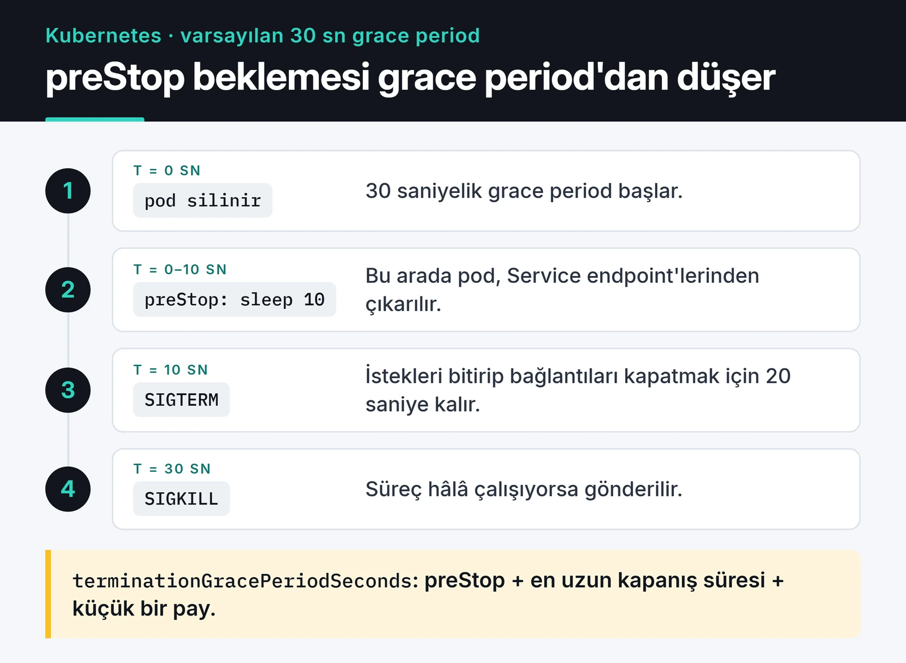

Bir Python servisini yeniden deploy ettiğinizde eski süreç bir şekilde ölür. Zarif kapanış (graceful shutdown), bu ölümün kontrollü olması demek: süreç kapanacağını öğrenir, yeni iş almayı bırakır, elindeki işi bitirir, bağlantılarını kapatır ve öyle çıkar. Bunu yapmayan bir servis deploy sırasında yarım kalmış istekler, bozuk yazılmış dosyalar ve kullanıcıya dönen 502 hataları üretir.

Bu yazıda sinyallerin nasıl çalıştığını, düz Python ve asyncio'da SIGTERM'i nasıl yakaladığımı, Docker ve Kubernetes'te nerede takıldığımı ve konteyner kullanmadığım sunucularda Python servislerini systemd ile nasıl yönettiğimi anlatıyorum. Örnekler Python 3.11 ve sonrası içindir; asyncio örneğindeki `TimeoutError` yakalaması 3.11'den önce çalışmaz.

## Üç sinyal

Linux, bir sürece "kapan" demek için sinyal gönderir. Bilmeniz gerekenler:

- SIGINT (2): Terminalde Ctrl+C. Python bunu varsayılan olarak `KeyboardInterrupt` exception'ına çevirir.
- SIGTERM (15): Docker'ın, Kubernetes'in ve systemd'nin varsayılan kapatma sinyali. Yakalanabilir. Python'un SIGTERM için hazır bir davranışı yoktur, siz handler yazmazsanız süreç anında ölür.
- SIGKILL (9): Yakalanamaz. Çekirdek süreci hemen sonlandırır, `finally` blokları bile çalışmaz.

Bütün orkestratörler aynı sırayı izler: önce SIGTERM gönderir, bir süre bekler (Docker'da 10, Kubernetes'te 30, systemd'de varsayılan 90 saniye), süreç hâlâ çalışıyorsa SIGKILL gönderir. Uygulamanın işi, o bekleme süresi içinde temiz çıkmak.

## Düz Python döngüsünde SIGTERM

Bir kuyruğu tüketen veya periyodik veri toplayan bir worker için kullandığım kalıp:

```python {title="worker.py"}
import logging
import signal
import threading

logging.basicConfig(level=logging.INFO)
stop = threading.Event()


def request_stop(signum: int, frame: object) -> None:
    logging.info("Got %s, stopping after the current batch", signal.Signals(signum).name)
    stop.set()


signal.signal(signal.SIGTERM, request_stop)
signal.signal(signal.SIGINT, request_stop)


def process_batch() -> None:
    ...  # tek bir iş parçası; ortasında kesilmemeli


while not stop.is_set():
    process_batch()
    stop.wait(5)  # sinyal gelirse beklemeden uyanır

logging.info("Closing resources")
# db.close(), producer.flush() vb.
```

Handler yalnızca bir bayrak kaldırıyor. Asıl kapanış ana döngüde, iş parçası bittikten sonra yapılıyor. Böylece sinyal bir yazma işleminin ortasında gelse bile o iş yarıda kesilmiyor. `time.sleep(5)` yerine `stop.wait(5)` kullanmamın sebebi de bu: uyku sırasında sinyal gelirse beş saniye beklemeden döngüden çıkılıyor.

Aynı betiği WSL'deki Ubuntu 22.04'te Python 3.10 ile çalıştırıp iki saniye sonra SIGTERM gönderdim. Aşağıdaki çıktıda iki log satırı ve `wait`'in ölçtüğü süre görünüyor: süreç, beş saniyelik beklemenin bitmesini beklemeden 0,025 saniyede temiz çıktı.


Bir şart var: tek bir `process_batch()` çağrısı, orkestratörün bekleme süresinden kısa sürmeli. Bir iş 2 dakika sürüyorsa ya bekleme süresini uzatmanız ya da işi kesilip tekrar çalıştırılabilir (idempotent) hale getirmeniz gerekiyor.

## asyncio ile

asyncio uygulamalarında sinyali event loop'a bağlamak daha temiz. `loop.add_signal_handler` handler'ı loop'un içinde, güvenli bir noktada çalıştırır (yalnızca Unix'te çalışır):

```python {title="async_worker.py"}
import asyncio
import signal


async def process_batch() -> None:
    await asyncio.sleep(1)  # asıl iş


async def worker(stop: asyncio.Event) -> None:
    while not stop.is_set():
        await process_batch()
        try:
            await asyncio.wait_for(stop.wait(), timeout=5)
        except TimeoutError:
            pass


async def main() -> None:
    stop = asyncio.Event()
    loop = asyncio.get_running_loop()
    for sig in (signal.SIGTERM, signal.SIGINT):
        loop.add_signal_handler(sig, stop.set)

    task = asyncio.create_task(worker(stop))
    await stop.wait()
    # Elindeki işi bitirmesi için süre tanı, sonra iptal et
    try:
        await asyncio.wait_for(task, timeout=20)
    except TimeoutError:
        pass  # wait_for zaman aşımında görevi zaten iptal eder
    # await pool.close(), await client.aclose() vb.


asyncio.run(main())
```

Asenkron kod ve event loop konusunda daha fazlası için [asyncio yazıma](/posts/python-asyncio-paralel-islem/) bakabilirsiniz.

## FastAPI ve uvicorn

Web servislerinde döngüyü siz yazmıyorsunuz, sinyali uvicorn yakalıyor. SIGTERM geldiğinde uvicorn yeni bağlantı kabul etmeyi bırakır, devam eden isteklerin bitmesini bekler ve ardından FastAPI'nin lifespan'indeki kapanış kodunu çalıştırır:

```python
from contextlib import asynccontextmanager

from fastapi import FastAPI


@asynccontextmanager
async def lifespan(app: FastAPI):
    app.state.pool = await create_pool()
    yield
    await app.state.pool.close()


app = FastAPI(lifespan=lifespan)
```

Uvicorn'un `--timeout-graceful-shutdown` parametresi, devam eden istekler için ne kadar bekleneceğini belirler. Bu değeri orkestratörün bekleme süresinden kısa tutuyorum, yoksa lifespan kapanışı çalışamadan SIGKILL gelebilir. Gunicorn kullanıyorsanız karşılığı `--graceful-timeout`.

## Docker'da PID 1 tuzağı

Konteynerdeki ilk süreç PID 1 olur ve Linux PID 1'e özel davranır: PID 1 için handler kurulmamış sinyallerin varsayılan eylemi uygulanmaz, sinyal yok sayılır. Bunun iki sonucu var:

1. Dockerfile'da shell formu kullanırsanız (`CMD python app.py`) PID 1 `/bin/sh` olur. `sh` SIGTERM'i Python'a iletmez. `docker stop` 10 saniye bekler, sonra SIGKILL gönderir.
2. Exec formu kullansanız bile (`CMD ["python", "app.py"]`) Python PID 1 olur ve SIGTERM handler'ı yazmadıysanız sinyal yok sayılır. Konteyner dışında anında ölecek bir script, konteynerde 10 saniye takılır.

Çözümler:

- `CMD` ve `ENTRYPOINT` her zaman exec formunda olsun. Bir entrypoint betiği kullanıyorsanız son satırı `exec "$@"` olsun ki Python, shell'in yerine geçsin.
- Uygulamada SIGTERM handler'ı olsun (yukarıdaki gibi) ya da sinyali zaten yöneten bir sunucu (uvicorn, gunicorn) kullanın.
- Alt süreç başlatan uygulamalarda küçük bir init süreci kullanın. Compose'da `init: true`, `docker run`'da `--init` yeterli. Docker, sinyalleri ileten ve zombi süreçleri toplayan tini'yi PID 1 olarak ekler.
- Bekleme süresini Compose'da `stop_grace_period: 30s` ile ihtiyacınıza göre ayarlayın.

Dockerfile'ın geri kalanı için [Docker ile Python uygulaması yazıma](/posts/docker-ile-python-uygulamasi-containerization/) bakabilirsiniz.

## Kubernetes: SIGTERM ile endpoint kaldırma yarışı

Kubernetes bir pod'u silerken iki şey aynı anda olur. Kubelet pod'u kapatma sürecine sokar (önce varsa `preStop` hook'u, sonra SIGTERM). Aynı anda kontrol düzlemi pod'u Service'in EndpointSlice'larından çıkarır ve bu değişiklik kube-proxy'ye, ingress veya gateway controller'lara yayılır. Yayılma birkaç saniye sürebilir. Bu arada uygulamanız SIGTERM alıp bağlantı kabul etmeyi bırakmışsa, hâlâ ona yönlendirilen istekler hata alır.

Çözüm, SIGTERM'den önce kısa bir bekleme koymak. Bunun bilinen yolu `preStop` içinde `/bin/sleep` çalıştırmaktı. Bu, imajda `sleep` binary'si olmasını gerektirir ve distroless imajlarda yoktur. Kubernetes 1.34'ten beri GA olan `sleep` aksiyonu bu ihtiyacı kaldırıyor:

```yaml
spec:
  terminationGracePeriodSeconds: 45
  containers:
    - name: api
      image: ghcr.io/example/api:1a2b3c4
      lifecycle:
        preStop:
          sleep:
            seconds: 10
```

Aşağıdaki şema varsayılan 30 saniyelik grace period ile zamanlamayı gösteriyor.



Dikkat edilecek nokta: `terminationGracePeriodSeconds` preStop süresini de kapsar. 30 saniyelik varsayılan süreyle 10 saniyelik bir preStop koyarsanız uygulamanıza kapanmak için 20 saniye kalır. Ben bu yüzden grace period'u preStop süresi artı uygulamanın en uzun kapanış süresi artı küçük bir pay olarak ayarlıyorum. Probe'lar, kaynak limitleri ve diğer üretim ayarları [Kubernetes yazımda](/posts/kubernetes-container-orkestrasyon/).

## Uzun süren worker'lar

Celery gibi kuyruk worker'larında durum farklı. Celery SIGTERM aldığında "warm shutdown" yapar: yeni görev almaz, eldeki görevlerin bitmesini bekler. Görev 10 dakika sürüyorsa ve pod'un grace period'u 30 saniyeyse görev SIGKILL ile yarıda kalır.

İki yol var. Ya worker pod'larının `terminationGracePeriodSeconds` değerini en uzun görev süresine göre yükseltirsiniz ya da görevleri kesilmeye dayanıklı yaparsınız: `acks_late=True` ile görev ancak bittikten sonra onaylanır, worker ölürse görev kuyruğa geri döner ve tekrar çalışır. İkincisi görevlerin idempotent olmasını gerektirir ama deploy süresini uzatmaz. Celery ve Arq karşılaştırmasını [görev kuyrukları yazımda](/posts/celery-arq-asenkron-gorev-kuyrugu/) yaptım.

## Konteyner yoksa: Python servisini systemd ile çalıştırmak

Her şeyi konteynerde çalıştırmıyorum. Tek bir VPS'te çalışan bir bot veya veri toplayıcı için systemd çoğu zaman yeterli ve daha basit. `nohup python main.py &` ile başlatılan bir süreç, sunucu yeniden başladığında geri gelmez, çöktüğünde kimse fark etmez ve logları bir dosyada birikir. systemd bu üç sorunu da çözüyor.

```ini {title="/etc/systemd/system/collector.service"}
[Unit]
Description=Price collector
After=network-online.target
Wants=network-online.target

[Service]
Type=notify
User=collector
Group=collector
WorkingDirectory=/opt/collector
ExecStart=/opt/collector/.venv/bin/python -m collector
EnvironmentFile=/etc/collector/env

Restart=on-failure
RestartSec=5
WatchdogSec=60
TimeoutStopSec=30
KillMode=mixed

NoNewPrivileges=yes
ProtectSystem=strict
ProtectHome=yes
PrivateTmp=yes
StateDirectory=collector
RestrictAddressFamilies=AF_INET AF_INET6 AF_UNIX

[Install]
WantedBy=multi-user.target
```

Kapanış açısından önemli satırlar şunlar. systemd durdururken varsayılan olarak SIGTERM gönderir. `TimeoutStopSec=30` sonrasında SIGKILL gelir. `KillMode=mixed` SIGTERM'i yalnızca ana sürece, süre dolunca SIGKILL'i ise bütün alt süreçlere gönderir. Böylece ana süreç alt süreçlerini kendi sırasıyla kapatabilir. Yukarıdaki SIGTERM handler'ları burada da aynen çalışıyor.

Güvenlik satırları servisin yetkisini daraltıyor. `ProtectSystem=strict` bütün dosya sistemini salt okunur yapar. Yazılabilir tek yer, `StateDirectory=collector` ile systemd'nin oluşturduğu `/var/lib/collector` klasörü olur. `RestrictAddressFamilies` listesinde `AF_UNIX` olmalı. Bu satırı yalnızca `AF_INET AF_INET6` olarak yazarsanız servis systemd'ye `READY=1` bildirimini gönderemez ve `Type=notify` ile başlatma zaman aşımına düşer. `systemd-analyze security collector.service` komutu servisin ne kadar kısıtlandığını puanlıyor ve eksikleri listeliyor.

### Type=notify ve watchdog

`Type=notify`, systemd'ye "süreç başladı" değil "servis hazır" bilgisini verir. Uygulama hazır olduğunda `READY=1` gönderir. `WatchdogSec=60` ise uygulamanın en geç 60 saniyede bir `WATCHDOG=1` göndermesini bekler. Göndermezse systemd süreci kilitlenmiş sayar, öldürür ve `Restart=on-failure` sayesinde yeniden başlatır. Süreç çalışıyor görünüp bir deadlock'ta takıldığında bunu başka türlü fark etmek zor.

Bunun için bir kütüphane gerekmiyor. Protokol, `NOTIFY_SOCKET` ortam değişkenindeki Unix soketine bir datagram göndermekten ibaret:

```python {title="collector/notify.py"}
import os
import socket


def sd_notify(message: str) -> None:
    address = os.environ.get("NOTIFY_SOCKET")
    if not address:
        return  # systemd altında çalışmıyoruz
    if address.startswith("@"):
        address = "\0" + address[1:]  # abstract namespace soketi
    with socket.socket(socket.AF_UNIX, socket.SOCK_DGRAM) as sock:
        sock.connect(address)
        sock.sendall(message.encode())
```

Worker döngüsüne bağlarsak:

```python
sd_notify("READY=1")
while not stop.is_set():
    process_batch()
    sd_notify("WATCHDOG=1")
    stop.wait(5)
sd_notify("STOPPING=1")
```

Watchdog sinyalini `WatchdogSec` değerinin yarısından sık göndermek iyi bir pay bırakır. Döngünün tek turu 60 saniyeyi aşabiliyorsa `WatchdogSec` değerini buna göre büyütün.

### Loglar

Uygulama stdout'a yazdığında systemd çıktıyı journald'ye gönderir. Log dosyası, rotasyon ayarı gerekmez:

```bash
journalctl -u collector -f                 # canlı takip
journalctl -u collector -p err             # yalnızca hata ve üstü
journalctl -u collector --since "1 hour ago"
journalctl -u collector -o json            # log toplayıcılar için
```

### Cron yerine systemd timer

Zamanlanmış işler için cron yerine timer kullanıyorum. Loglar yine journald'de oluyor ve bir önceki çalışma bitmeden yenisi başlamıyor, çünkü timer zaten çalışan bir servisi ikinci kez başlatmaz. İki dosya gerekir, `report.service` (ne yapılacak) ve `report.timer` (ne zaman):

```ini {title="/etc/systemd/system/report.timer"}
[Unit]
Description=Daily report

[Timer]
OnCalendar=*-*-* 03:00:00
RandomizedDelaySec=10min
Persistent=true

[Install]
WantedBy=timers.target
```

Unit dosyalarında satır sonu yorumu yazılamaz. `RandomizedDelaySec=600 # açıklama` gibi bir satır değerin parçası sayılır ve geçersiz olur. Yorumları ayrı satıra, `#` ile başlayarak yazın. `Persistent=true` makine 03:00'te kapalıysa açıldığında işi bir kez çalıştırır. Etkinleştirmek için `systemctl enable --now report.timer`, sıradaki çalışmaları görmek için `systemctl list-timers` yeterli.

## Bonus: kilitlenmiş süreçte stack trace

Bir süreç CPU kullanmadan takılı kaldığında nerede beklediğini görmek için onu öldürmek istemem. Python'un standart kütüphanesindeki `faulthandler` bunu tek satırda çözüyor:

```python
import faulthandler
import signal

faulthandler.register(signal.SIGUSR1, all_threads=True)
```

Sonra `kill -USR1 <pid>` gönderdiğinizde bütün thread'lerin stack trace'i stderr'e, yani journald'ye veya konteyner loglarına düşer. Süreç çalışmaya devam eder.

## Kapatmadan önce kontrol listesi

- Uygulama SIGTERM'i yakalıyor ve elindeki işi bitirip çıkıyor mu?
- Uygulamanın kapanış süresi, orkestratörün bekleme süresinden kısa mı?
- Dockerfile'da `CMD` exec formunda mı, entrypoint betiği `exec` kullanıyor mu?
- Kubernetes'te `preStop` beklemesi var mı ve grace period bunu da kapsıyor mu?
- Uzun görevler kesilip tekrar çalıştırılabilir mi?
- systemd servislerinde `TimeoutStopSec` ve `Restart=` ayarlı mı?

## Sırada ne var

Bir sonraki deploy'dan önce `worker.py` kalıbını kendi servisinize ekleyin ve yukarıdaki gibi `kill -TERM` ile deneyin. Çıkış süresi bekleme süresine yakınsa bir yerde sinyal kayboluyor demektir.

Servis yeniden başlarken kullanıcı tarafında bir şeyin bozulup bozulmadığını dışarıdan izlemek için [Uptime Kuma](/posts/uptime-kuma-servis-izleme/) kullanıyorum. İmaj tarafı için [Docker ile Python uygulaması](/posts/docker-ile-python-uygulamasi-containerization/), pod ayarları için [Kubernetes yazım](/posts/kubernetes-container-orkestrasyon/) iyi birer devam. systemd seçeneklerinin tamamı için [systemd.service](https://www.freedesktop.org/software/systemd/man/latest/systemd.service.html) ve [systemd.exec](https://www.freedesktop.org/software/systemd/man/latest/systemd.exec.html) man sayfaları en güvenilir kaynak.
