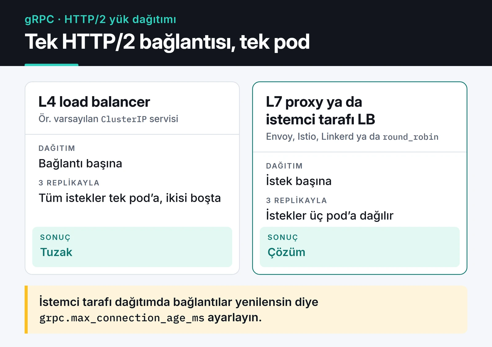

gRPC ile yüksek performanslı API yazmanın vaadi basit: JSON yerine ikili (binary) Protobuf mesajları, HTTP/1.1 yerine HTTP/2 ve elle yazılmış istemci yerine bir şema dosyasından üretilen tipli kod. Servisler arası iletişimde bu üçü gerçek fark yaratıyor. Tarayıcının çağırdığı bir API'de ise REST çoğu zaman hâlâ daha pratik.

Bu yazıda Python'da `grpcio`'nun asyncio API'si (`grpc.aio`) ile bir servis yazıyorum, ardından production'da karşıma çıkan konulara geçiyorum: deadline, hata kodları, interceptor, şema evrimi ve load balancing. Sunucu ve istemci örneklerini Python 3.12 ve grpcio 1.84 ile çalıştırdım.

## gRPC ne zaman mantıklı?

REST/JSON'un servisler arası trafikteki maliyetleri belli: her mesajda alan isimleri tekrar tekrar gider, metin parse etmek CPU yer ve "bu alan string mi int mi?" sorusunun cevabını ancak dokümantasyon verir. gRPC'de kontrat bir `.proto` dosyasıdır ve her dil için istemci/sunucu kodu ondan üretilir.

Benim seçimim şöyle:

| | REST (JSON) | gRPC (Protobuf) |
| :--- | :--- | :--- |
| Payload | Metin, okunabilir | İkili, küçük |
| Taşıma | Genelde HTTP/1.1 | HTTP/2 |
| Kontrat | OpenAPI (opsiyonel) | `.proto` (zorunlu) |
| Streaming | SSE, WebSocket ile ayrıca | Dört çağrı tipi yerleşik |
| Tarayıcı | Doğrudan | gRPC-Web veya Connect gerekir |
| Debug | `curl` | `grpcurl`, reflection |

gRPC'yi servisler arası (east-west) trafikte, farklı dillerde yazılmış servislerin konuştuğu yerlerde ve streaming gerektiğinde kullanıyorum. Herkese açık bir API, tarayıcıdan doğrudan çağrılan bir backend ya da basit bir CRUD için [FastAPI ile REST](/posts/python-fastapi-restful-api-gelistirme/) daha az sürtünme demek.

## Kontrat: .proto dosyası

gRPC'de her şey tek bir `.proto` dosyasından başlar: `protoc` bu dosyadan mesaj sınıflarını ve stub'ları üretir, sunucu ve istemci de aynı üretilmiş koda dayanır.

Örnek bir fiyat servisi; bir unary, bir de server streaming metodu var:

```protobuf
// proto/stocks.proto
syntax = "proto3";

package stocks.v1;

service StockService {
  rpc GetPrice(PriceRequest) returns (PriceReply);
  rpc StreamPrices(PriceRequest) returns (stream PriceReply);
}

message PriceRequest {
  string symbol = 1;
}

message PriceReply {
  string symbol = 1;
  double price = 2;
  int64 ts_ms = 3;
}
```

Kodu üretmek için:

```bash
pip install grpcio grpcio-tools
python -m grpc_tools.protoc -I proto --python_out=. --pyi_out=. --grpc_python_out=. proto/stocks.proto
```

Bu komut `stocks_pb2.py` (mesajlar), `stocks_pb2.pyi` (editör için tip bilgisi) ve `stocks_pb2_grpc.py` (stub ve servicer) dosyalarını üretir.

## asyncio ile sunucu

```python
# server.py
import asyncio
import random
import time

import grpc

import stocks_pb2
import stocks_pb2_grpc


def quote(symbol: str) -> float:
    return round(100 + random.uniform(-5, 5), 2)  # gerçek veri kaynağı yerine


class StockService(stocks_pb2_grpc.StockServiceServicer):
    async def GetPrice(self, request, context):
        if not request.symbol:
            await context.abort(grpc.StatusCode.INVALID_ARGUMENT, "symbol zorunlu")
        return stocks_pb2.PriceReply(
            symbol=request.symbol,
            price=quote(request.symbol),
            ts_ms=int(time.time() * 1000),
        )

    async def StreamPrices(self, request, context):
        # İstemci iptal edene ya da deadline dolana kadar akar
        while True:
            yield stocks_pb2.PriceReply(
                symbol=request.symbol,
                price=quote(request.symbol),
                ts_ms=int(time.time() * 1000),
            )
            await asyncio.sleep(1)


async def serve() -> None:
    server = grpc.aio.server()
    stocks_pb2_grpc.add_StockServiceServicer_to_server(StockService(), server)
    server.add_insecure_port("[::]:50051")
    await server.start()
    await server.wait_for_termination()


if __name__ == "__main__":
    asyncio.run(serve())
```

Senkron `grpc.server()` bir thread pool ile çalışır; her açık stream bir thread tutar. `grpc.aio` ile aynı process binlerce stream'i event loop üzerinde taşıyabiliyor. Ama handler içinde bloklayan bir çağrı yaparsanız (senkron bir veritabanı sürücüsü gibi) tüm sunucuyu durdurursunuz, burada da asyncio kuralları geçerli.

## İstemci ve deadline

```python
# client.py
import asyncio

import grpc

import stocks_pb2
import stocks_pb2_grpc


async def main() -> None:
    async with grpc.aio.insecure_channel("localhost:50051") as channel:
        stub = stocks_pb2_grpc.StockServiceStub(channel)

        reply = await stub.GetPrice(stocks_pb2.PriceRequest(symbol="AAPL"), timeout=2)
        print(reply.symbol, reply.price)

        try:
            async for update in stub.StreamPrices(
                stocks_pb2.PriceRequest(symbol="AAPL"), timeout=5
            ):
                print("canlı:", update.price)
        except grpc.aio.AioRpcError as err:
            if err.code() != grpc.StatusCode.DEADLINE_EXCEEDED:
                raise


asyncio.run(main())
```

Sunucuyu bir terminalde, istemciyi başka bir terminalde çalıştırdığımda çıktı şöyleydi:


Önce unary `GetPrice` cevabı geliyor, sonra stream saniyede bir fiyat basıyor. Beşinci saniyede deadline doluyor, istemci `DEADLINE_EXCEEDED` hatasını yakalayıp temiz çıkıyor.

`timeout` parametresi gRPC'nin deadline'ı. Varsayılan olarak deadline yok, yani sunucu takılırsa istemci sonsuza kadar bekler. Her çağrıya bir deadline vermeyi alışkanlık haline getirin; deadline sunucuya da iletilir ve sunucu `context.time_remaining()` ile ne kadar süresi kaldığını görebilir.

Kanal (channel) pahalı bir nesne: altında HTTP/2 bağlantısı var. Her istekte yeni kanal açmayın, uygulama boyunca bir tane kullanın.

## Hata kodları ve interceptor

gRPC'de HTTP durum kodları yerine kendi status kodları var: `INVALID_ARGUMENT`, `NOT_FOUND`, `UNAVAILABLE`, `DEADLINE_EXCEEDED` gibi. İstemci tarafında hangi hataların tekrar denenebileceğine bu kodlara bakarak karar veriyorum; `UNAVAILABLE` genelde güvenle tekrar denenir, `INVALID_ARGUMENT` asla. Hata ile birlikte yapılandırılmış detay (yeniden deneme süresi, alan hataları) göndermek isterseniz `grpcio-status` paketi `google.rpc.Status` modelini destekliyor.

Loglama, kimlik doğrulama, metrik gibi kesişen işler için her metoda kod yazmak yerine interceptor kullanılır. asyncio sunucusu için basit bir token kontrolü:

```python
class AuthInterceptor(grpc.aio.ServerInterceptor):
    def __init__(self, token: str) -> None:
        self._expected = ("authorization", f"Bearer {token}")

        async def deny(request, context):
            await context.abort(grpc.StatusCode.UNAUTHENTICATED, "geçersiz token")

        self._deny = grpc.unary_unary_rpc_method_handler(deny)

    async def intercept_service(self, continuation, handler_call_details):
        if self._expected in (handler_call_details.invocation_metadata or ()):
            return await continuation(handler_call_details)
        return self._deny


server = grpc.aio.server(interceptors=[AuthInterceptor("s3cret")])
```

İstemci token'ı metadata olarak gönderir: `await stub.GetPrice(req, metadata=[("authorization", "Bearer s3cret")], timeout=2)`. Bu örnek reddetmek için unary bir handler döndürüyor; streaming metotları da koruyacaksanız metot tipine uygun handler döndürmeniz gerekir. Token yönetimi tarafını [API kimlik doğrulama yazımda](/posts/api-kimlik-dogrulama-stratejileri/) anlattım. Production'da `add_insecure_port` yerine TLS ile `add_secure_port` kullanın; token'ı şifresiz kanaldan göndermenin anlamı yok.

## Şema evrimi: alan numaraları kutsal

Protobuf'ta kablo üzerinde alan isimleri değil numaraları gider. Bu yüzden:

- Yeni alan eklemek güvenli. Eski istemciler bilmedikleri alanı yok sayar.
- Bir alanın numarasını ya da tipini değiştirmek uyumluluğu bozar.
- Alan silerken numarasını ve adını `reserved` ile kilitleyin. Protobuf bunu kendiliğinden yapmaz; biri ileride aynı numarayı başka bir alana verirse eski istemciler veriyi yanlış okur.

```protobuf
message PriceReply {
  reserved 4;
  reserved "currency";
  string symbol = 1;
  double price = 2;
  int64 ts_ms = 3;
}
```

Alan adını değiştirmek ikili formatta sorun çıkarmaz ama Protobuf'ın JSON gösterimi alan adlarını kullanır, yani JSON'a çeviren bir gateway'iniz varsa orada kırılır. Gerçekten kırıcı bir değişiklik gerekiyorsa `package stocks.v2;` ile yeni bir paket açıp iki sürümü bir süre birlikte çalıştırıyorum.

## HTTP/2 ve load balancing tuzağı

gRPC'de ilk uyaracağım tuzak bu. HTTP/2 tek bir TCP bağlantısı üzerinde çok sayıda isteği taşır (multiplexing). Bağlantı seviyesinde dağıtım yapan bir L4 load balancer (Kubernetes'in varsayılan `ClusterIP` servisi dahil) istemciden gelen tek bağlantıyı tek bir pod'a bağlar ve o istemcinin tüm istekleri o pod'a gider. Üç replika çalıştırırsınız, biri yanarken ikisi boş durur.



İki çözüm var:

1. İstek seviyesinde dağıtım yapan bir L7 proxy: Envoy, bir service mesh (Istio, Linkerd) ya da gRPC destekli bir ingress.
2. İstemci tarafında load balancing. Kubernetes'te headless bir servis tüm pod IP'lerini DNS'ten döndürür, gRPC istemcisi de hepsine bağlanıp istekleri sırayla dağıtır:

```python
channel = grpc.aio.insecure_channel(
    "dns:///stocks-headless.default.svc.cluster.local:50051",
    options=[("grpc.lb_policy_name", "round_robin")],
)
```

İkinci yöntemde pod sayısı değiştiğinde istemcinin DNS'i yeniden çözmesi gerekir; sunucuda `grpc.max_connection_age_ms` ayarlayarak bağlantıların periyodik olarak yenilenmesini sağlamak işe yarıyor. Kubernetes tarafını [Kubernetes yazımda](/posts/kubernetes-container-orkestrasyon/) anlattım.

## Debug ve sağlık kontrolü

REST'in en büyük avantajı `curl` ile her şeyi deneyebilmek. gRPC'de bunun karşılığı `grpcurl`; sunucuda reflection açarsanız `.proto` dosyası olmadan da metotları listeleyip çağırabilir. `grpcio-reflection` ve `grpcio-health-checking` paketleri sırasıyla reflection'ı ve Kubernetes probe'larının kullanabileceği standart sağlık servisini ekliyor. İkisini de ilk günden kurarım.

Tarayıcıdan doğrudan gRPC çağrılamaz, çünkü tarayıcı API'leri HTTP/2 frame'lerine ve trailer'lara erişim vermiyor. Gerekirse gRPC-Web (bir proxy ile) ya da hem gRPC hem JSON konuşabilen Connect protokolü kullanılıyor. Tarayıcıya canlı veri itmek için ise [WebSocket](/posts/websocket-ile-gercek-zamanli-iletisim/) daha doğal bir seçim.

## Sonraki adım

Yukarıdaki `.proto`, sunucu ve istemciyi aynı klasöre koyup çalıştırın, sonra sunucuya `grpcio-reflection` ekleyip `grpcurl -plaintext localhost:50051 list` ile servisi keşfedin. Resmi [gRPC Python dokümantasyonu](https://grpc.io/docs/languages/python/) ve [asyncio API referansı](https://grpc.github.io/grpc/python/grpc_asyncio.html) en güvenilir kaynaklar.

Aynı servisi dışarıya REST ile açmayı düşünüyorsanız [FastAPI yazım](/posts/python-fastapi-restful-api-gelistirme/), servisler arasında olay taşımak için [Kafka yazım](/posts/apache-kafka-event-streaming/) iyi devam noktaları.
