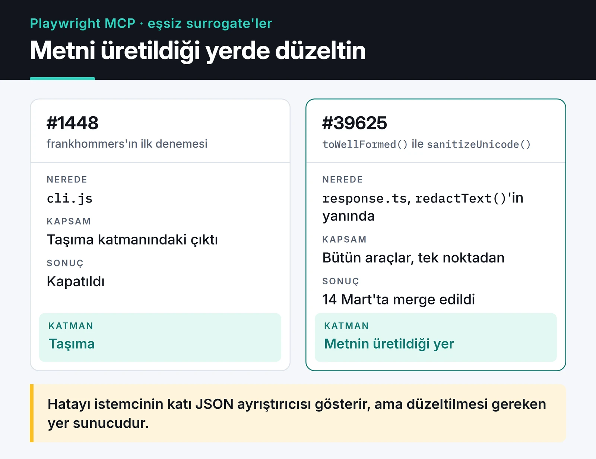

Kendi MCP sunucularımı yazmaya başladıktan sonra aynı ekosistemdeki büyük projelerin koduna da bakar oldum. Bu yazıda Model Context Protocol (MCP) ve yapay zekâ araçları etrafında açtığım beş PR'ı anlatıyorum. Playwright'a giden ikisi merge edildi. GitHub'ın MCP sunucusundaki biri açık, diğeri kapandı ve yerine bakımcının yazdığı daha iyi bir çözüm girdi. LobeHub'daki tek satırlık düzeltme ise bekliyor. Her PR için hatayı, düzeltmeyi ve review'da öğrendiğimi yazdım.

## Beş PR ve durumları

Tablodaki durumlar ve tarihler GitHub'daki PR kayıtlarından.

| Proje | PR | Konu | Durum |
| :--- | :--- | :--- | :--- |
| microsoft/playwright | [#39401](https://github.com/microsoft/playwright/pull/39401) | `--cdp-header` değerlerinin kesilmesi | Merge edildi, 10 Mart 2026 |
| microsoft/playwright | [#39625](https://github.com/microsoft/playwright/pull/39625) | MCP yanıtlarında bozuk Unicode | Merge edildi, 14 Mart 2026 |
| github/github-mcp-server | [#1519](https://github.com/github/github-mcp-server/pull/1519) | `create_discussion` aracı | Açık |
| github/github-mcp-server | [#2200](https://github.com/github/github-mcp-server/pull/2200) | HTTP modunda `--read-only` | Kapandı, yerine #2208 girdi |
| lobehub/lobehub | [#12818](https://github.com/lobehub/lobehub/pull/12818) | Onboarding'de model seçici çökmesi | Açık |

## Playwright MCP: iki nokta üst üste içeren header'lar

Playwright MCP'yi CDP üzerinden uzaktaki bir tarayıcıya bağlarken `--cdp-header` flag'iyle ya da `PLAYWRIGHT_MCP_CDP_HEADERS` ortam değişkeniyle header gönderebiliyorsunuz. Bu değerleri ayrıştıran `headerParser` fonksiyonu metni `arg.split(':')` ile bölüp ilk iki parçayı alıyordu. Sonuçta `X-Custom: http://example.com` gibi bir header sessizce `http` değerine dönüşüyordu. URL, `host:port` ya da içinde iki nokta geçen her token aynı şekilde kesiliyordu.

Düzeltme, metni yalnızca ilk `:` karakterinden bölmek:

```ts
const colonIndex = arg.indexOf(':');
const name = colonIndex === -1 ? arg.trim() : arg.substring(0, colonIndex).trim();
const value = colonIndex === -1 ? '' : arg.substring(colonIndex + 1).trim();
```

Teste `X-Forwarded-Proto: value:with:colons` ve değeri olmayan bir `X-Empty` header'ı ekledim. Test, sunucuya gerçekte ne ulaştığını kontrol ediyor. PR 10 Mart'ta merge edildi.

## Playwright MCP: yanıtlarda bozuk Unicode

### Sorun

frankhommers, [playwright-mcp#1447](https://github.com/microsoft/playwright-mcp/issues/1447) numaralı issue'da bazı sayfalarda MCP yanıtlarının JSON hatasıyla düştüğünü bildirmişti. Sebep "lone surrogate" denen şey: eşi olmayan yarım bir UTF-16 karakteri. Ortasından kesilmiş bir emoji buna iyi bir örnek.

```js
const s = `Merhaba ${String.fromCharCode(0xD800)}`;

s.isWellFormed();   // false
JSON.stringify(s);  // '"Merhaba \\ud800"' (hata yok, ama eşsiz surrogate hâlâ içeride)
s.toWellFormed();   // 'Merhaba �', ekranda "Merhaba �"
```

Modern JavaScript'te `JSON.stringify` burada hata vermiyor, karakteri `\ud800` olarak kaçırıp yazıyor. Sorun zincirin ilerisinde çıkıyor: metni okuyan daha katı JSON ayrıştırıcıları isteği "invalid high surrogate" benzeri hatalarla reddediyor. Hatayı istemci görüyor ama düzeltilmesi gereken yer sunucu.

### Düzeltmenin yeri

frankhommers'ın ilk denemesi ([#1448](https://github.com/microsoft/playwright-mcp/pull/1448)) sorunu `cli.js` içinde, taşıma katmanında çözüyordu ve kapatıldı. Ben çıktının üretildiği yere baktım. `packages/playwright-core/src/tools/backend/response.ts` dosyasında yanıt metni zaten `redactText()` fonksiyonundan geçiyordu. Temizliği oraya eklemek bütün araçları tek noktadan kapsıyordu. Aşağıdaki şemada iki denemenin zincirdeki yeri görünüyor:



Değişikliğin kendisi kısa:

```ts
text: sanitizeUnicode(redactText(text.join('\n'))),

// ...

function sanitizeUnicode(text: string): string {
  return text.toWellFormed();
}
```

`toWellFormed()` eşsiz surrogate'ları U+FFFD ile değiştiriyor, geçerli emoji ve CJK karakterlerine dokunmuyor.

### Review'da aldığım ders

PR'ın ilk commit'inde Node 18 için regex'li bir yedek yol ve altı test vardı. Pavel Feldman'ın yorumu kısaydı: PR ajan üretimi bir yığın gibi duruyor ve lint'ten geçmiyor, düzeltmenin yeri doğru ama Node 20'yi varsay ve testleri elle yaz. Haklıydı. Yedek yolu sildim, çünkü `toWellFormed()` Node 20'den beri var. Testleri de projedeki MCP testlerinin stiline uyan üç teste indirdim: eşsiz surrogate içeren bir sayfa, geçerli emoji içeren bir sayfa ve eşsiz surrogate basan bir `console.log`. Pavel Feldman PR'ı 14 Mart'ta merge etti:


Bakımcı üretilmiş kodu ilk bakışta fark etti. Projenin test stiline uyan kısa sürüm ise birkaç gün içinde girdi.

## GitHub MCP Server

### create_discussion aracı (#1519, açık)

GitHub'ın resmî MCP sunucusu discussion'ları okuyabiliyordu ama yenisini açamıyordu. Aralık 2025'te `create_discussion` aracını ekleyen PR'ı açtım. Araç önce GraphQL ile repository ID'sini alıyor, sonra `createDiscussion` mutation'ını çağırıyor. `repo` verilmezse discussion organizasyon düzeyinde açılıyor. Bu arada kod tabanı yeni `NewTool()` yapısına geçti, ben de aracı rebase sırasında baştan yazdım. PR açık duruyor. Hikâyenin tamamı [ayrı bir yazıda](/posts/github-mcp-server-acik-kaynak-katki/).

### HTTP modunda --read-only (#2200, kapandı)

[#2156](https://github.com/github/github-mcp-server/issues/2156) numaralı issue'da bir kullanıcı sunucuyu Docker'da `http --read-only` ile çalıştırmış, ama `create_branch` ve `create_pull_request` gibi yazma araçları yine de listede görünüyormuş. stdio modunda bu flag çalışıyordu, HTTP modunda ise config'e hiç aktarılmıyordu. Benim PR'ım flag'i `ServerConfig`'e taşıdı ve her isteğin context'ine read-only bilgisini koyan bir middleware ekledi:

```go
func withGlobalReadonly(cfg *ServerConfig) func(http.Handler) http.Handler {
	return func(next http.Handler) http.Handler {
		return http.HandlerFunc(func(w http.ResponseWriter, r *http.Request) {
			if cfg.ReadOnly {
				ctx := ghcontext.WithReadonly(r.Context(), true)
				next.ServeHTTP(w, r.WithContext(ctx))
			} else {
				next.ServeHTTP(w, r)
			}
		})
	}
}
```

Bakımcı Sam Morrow ilk yorumunda bunun bir hata olmadığını, tasarım kararı olduğunu yazdı. HTTP modunda her kullanıcı read-only modu `x-mcp-readonly: true` header'ıyla kendisi açabiliyordu, tıpkı GitHub'ın barındırdığı uzak sunucuda olduğu gibi. Ben de global ayarın neden gerektiğini anlattım: stdio ile tutarlılık, özel header gönderemeyen istemciler ve issue'daki Docker senaryosu.

Sonra Sam kendi PR'ını açtı. [#2208](https://github.com/github/github-mcp-server/pull/2208), CLI flag'lerini bir üst sınır olarak kabul ediyor. İstek başına gelen header'lar bu sınırı yalnızca daraltabiliyor. Bu, benim middleware'imden daha sağlam bir model. Docker senaryosunu çözdüğünü doğruladım. #2208 13 Nisan'da merge edildi, benim PR'ım da kapandı.

Middleware'im girmedi, istediğim davranış #2208 ile girdi. Bu PR bana bir hata raporunun bazen tasarım sorusu olduğunu gösterdi. O tartışmayı yürütmek de katkının parçası.

## LobeHub: tek satırlık bir regresyon (#12818, açık)

LobeHub'ın onboarding sayfasında model seçme menüsüne tıklayınca uygulama React Error #185 ile çöküyordu. Bunu [#12817](https://github.com/lobehub/lobehub/issues/12817) ile bildirdim. Geçmişe bakınca aynı hatanın Ocak'ta [#11905](https://github.com/lobehub/lobehub/pull/11905) ile düzeltildiğini gördüm. base-ui geçişi sırasında bu düzeltme kaybolmuş ve `ModelItemRender`'a verilen `showInfoTag` yeniden `true` olmuştu. PR'ım onu geri alıyor:

```tsx
<ModelItemRender
  {...(option as ModelOption)}
  {...(option as ModelOption).abilities}
  showInfoTag={false}
/>
```

Bakımcılardan biri "hâlâ hatalı gibi" diye yorum yaptı. Hangi senaryoda tekrarlandığını sordum ve Vercel önizlemesinde de yerelde de hatanın gittiğini yazdım. Cevap gelmedi. Issue'da başka bir kullanıcı üstteki menüden model değiştirirken de aynı çökmeyi gördüğünü yazmıştı. Yani benim tek satırım sorunun tamamını kapatmıyor olabilir. PR açık duruyor, issue ise sonradan kapandı.

Aynı günlerde DevTo-MCP ve OmniWire-MCP'nin de aralarında olduğu MCP sunucularımın LobeHub marketplace'e eklenmesi için [#12805](https://github.com/lobehub/lobehub/issues/12805) numaralı issue'yu açtım. "Planlanmadı" olarak kapandı.

## Bu PR'lardan aklımda kalanlar

- Düzeltmeyi hatanın göründüğü yere değil, verinin üretildiği yere koymak gerekiyor. Unicode PR'ında işe yarayan bu oldu.
- Kısa bir diff ve elle yazılmış testler review'ı hızlandırıyor.
- "Bu bir bug" demeden önce sormak lazım. Read-only meselesi bir tasarım kararıydı.
- Tek satırlık bir düzeltme de kanıt istiyor: tekrarlama adımları, önce ve sonra ekran görüntüsü ya da bir test.

## Sırada ne var

Kendi MCP sunucularım [DevTo-MCP](https://furkankoykiran.com.tr/projeler/devto-mcp/) ve [OmniWire-MCP](https://furkankoykiran.com.tr/projeler/omniwire-mcp/) üzerine ayrı yazılar da var: [DevTo-MCP'nin geliştirme süreci](/posts/devto-mcp-server-gelistirme-ve-yayinlama/) ve [OmniWire-MCP](/posts/omniwire-mcp-ai-news-server/). Aynı dönemde açtığım diğer PR'lar [güvenlik ve API düzeltmeleri](/posts/security-api-fixes/) ile [SDK ve CLI katkıları](/posts/python-sdk-cli/) yazılarında. MCP ekosistemine katkı vermek isterseniz Playwright'ın `tests/mcp` klasörüyle başlayın. Testler kısa, yeni bir test eklemek kolay.
