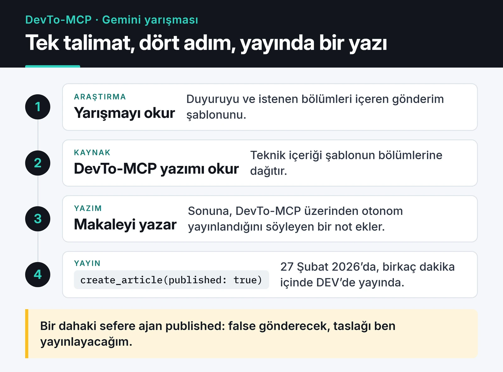

Şubat 2026'da DEV Community'de, Major League Hacking (MLH) ile birlikte düzenlenen "Built with Google Gemini: Writing Challenge" yarışması vardı. Katılmak için Gemini ile yaptığınız bir projeyi anlatan bir yazı yayınlamanız gerekiyordu. Birkaç gün önce DEV API'si için bir MCP sunucusu yazmıştım. Yarışma yazısını bir AI ajanına yazdırıp bu sunucu üzerinden doğrudan DEV'de yayınlatmaya karar verdim.

Bu yazı o denemeyi anlatıyor: ajanın ne yaptığını, nelerin iyi gittiğini ve sonradan fark ettiğim, yazıya sızan hataları.

## Kullandığım araç: DevTo-MCP

[DevTo-MCP](/posts/devto-mcp-server-gelistirme-ve-yayinlama/), Forem API'sini MCP araçlarına çeviren sunucum. Asistan bu sunucu sayesinde DEV'de makale arayabiliyor, kendi yazılarımı listeleyebiliyor ve `create_article` aracıyla yeni makale oluşturabiliyor. 18 Şubat'ta sunucuyu test ederken hesabımda "DevTo MCP Test Article [Automated]" başlıklı bir deneme yazısı oluşturup güncellemiştim. Yarışma, aracı ilk kez gerçek bir iş için kullanma fırsatıydı.

Proje sayfası: [DevTo-MCP](https://furkankoykiran.com.tr/projeler/devto-mcp/)

## Ajana verdiğim görev

Editörümden çıkmadan, Gemini ile çalışan bir ajana kabaca şu talimatı verdim:

> Built with Google Gemini yarışmasını araştır. Blogumdaki DevTo-MCP yazısını oku. Bu süreci anlatan, yarışma şablonuna uyan İngilizce bir makale hazırla. Bitince DEV hesabımda yayınla.

Ajan sırasıyla şunları yaptı:

1. Yarışma duyurusunu ve gönderim şablonunu okudu. Şablon "What I Built with Google Gemini", "Demo" ve sonrasında öğrenilenler gibi bölümler istiyordu.
2. Blogumdaki DevTo-MCP yazısını okudu ve teknik içeriği şablonun bölümlerine dağıttı.
3. Makaleyi yazdı ve sonuna, yazının ajan tarafından DevTo-MCP üzerinden otonom olarak yayınlandığını söyleyen bir not ekledi.
4. `create_article` aracını `published: true` ile çağırdı.

Makale 27 Şubat 2026'da [DEV'de yayınlandı](https://dev.to/furkankoykiran/building-devto-mcp-bridging-forem-api-and-ai-assistants-with-google-gemini-4a58). Başlığı "Building DevTo-MCP: Bridging Forem API and AI Assistants with Google Gemini", etiketleri `devchallenge`, `geminireflections`, `gemini` ve `mcp`. Bütün akış birkaç dakika sürdü.

Tek talimattan yayınlanmış yazıya kadar bütün zincir şöyle:

## İyi giden kısım

Teknik olarak her şey çalıştı. Ajanın `create_article` çağrısı ilk denemede geçti. Yarışma şablonunu doğru okudu, gönderim satırını doğru yere koydu ve yarışmanın etiketlerini kullandı.

Bir MCP sunucusunun değerini en iyi gösteren şey bu tür bir zincir: araştırma, okuma, yazma ve yayınlama tek bir talimatla birbirine bağlanıyor. Ben sadece hedefi söyledim, aradaki adımları ajan kendisi planladı.

## Gözden kaçan kısım

Ajanın kaynak olarak kullandığı DevTo-MCP yazısında kodla uyuşmayan birkaç iddia vardı. Ajan yarışma yazısını o metinden ürettiği için aynı hatalar oraya da taşındı:

- Yazı, API istemcisinin `x-ratelimit-remaining` header'ını okuyup limite yaklaşınca yavaşladığını söylüyor. İstemci bunu yapmıyor, header'ı sadece hata mesajlarında kullanıyor.
- Yazı, npm yayınının OIDC trusted publishing ile yapıldığını ve eksik bir `environment: production` satırının 404'lere yol açtığını, bu satırı da Gemini'nin bulduğunu anlatıyor. Repodaki workflow'da o satır ilk commit'ten beri var ve yayın bir npm token'ıyla yapılıyor.
- Kurulum bölümünde `npx -y devto-mcp` komutu var. Paketi Mart'ta `@furkankoykiran/devto-mcp` adına taşıdım ve scope'suz `devto-mcp` adı bugün npm'de başka bir projeye ait. O komutu çalıştıran biri benim sunucumu değil, başka birinin paketini kuruyor ve ona DEV API anahtarını veriyor.

Son madde en ciddisi. Ajan o gün doğru komutu yazmıştı, paket adı sonradan değişti. Ama yayınlanmış bir yazı, kodun aksine, kendi kendine güncellenmiyor.

Ajan ayrıca yazıyı kendi geliştirme hikayemmiş gibi, Gemini'nin bana her adımda eşlik ettiği bir anlatıyla kurdu. Şablon bunu istiyordu ve ajan kaynakta olmayan bağlantıları kurmaktan çekinmedi. Kendi adımla yayınlanan bir metinde her cümlenin arkasında durabilmem gerekiyor ve bu yazıda duramayacağım cümleler var.

## Bir dahaki sefere farklı yapacaklarım

Yayını ajana bırakmayacağım. `create_article` aracının `published: false` seçeneği var. Ajan taslağı oluşturur, ben DEV editöründe okuyup yayınlarım. Otomasyonun kazandırdığı süre birkaç dakikalık bir okumayı fazlasıyla karşılıyor.

Kaynağı önce doğrulayacağım. Ajan bir blog yazısından ürettiği için o yazıdaki her hata yarışma yazısına geçti. Yanlış bir kaynağı hızlı ve akıcı biçimde yeniden yazan bir model, hatayı daha inandırıcı hale getiriyor.

Sunucuya bir koruma da eklenebilir: `create_article` için varsayılanı taslak yapmak ve yayın için açık bir onay parametresi istemek. Bir yazma aracının en geri alınamaz yan etkisini varsayılan davranış yapmamak, MCP sunucusu tasarlarken uyguladığım bir kural olmalı.

## Sırada ne var

Deneme, MCP ile bir ajanın uçtan uca iş yapabildiğini gösterdi. Aynı zamanda yazma yetkisi olan bir ajanın, kaynağı neyse onu yayınladığını da gösterdi. Bir sonraki adımım DevTo-MCP'de yayın varsayılanını değiştirmek ve DEV'deki yazıya güncel kurulum komutunu içeren bir düzeltme notu eklemek.

Sunucunun teknik ayrıntıları [DevTo-MCP yazısında](/posts/devto-mcp-server-gelistirme-ve-yayinlama/), aynı serideki bir başka sunucum da [OmniWire-MCP](/posts/omniwire-mcp-ai-news-server/). Kod [GitHub'da](https://github.com/furkankoykiran/DevTo-MCP).
