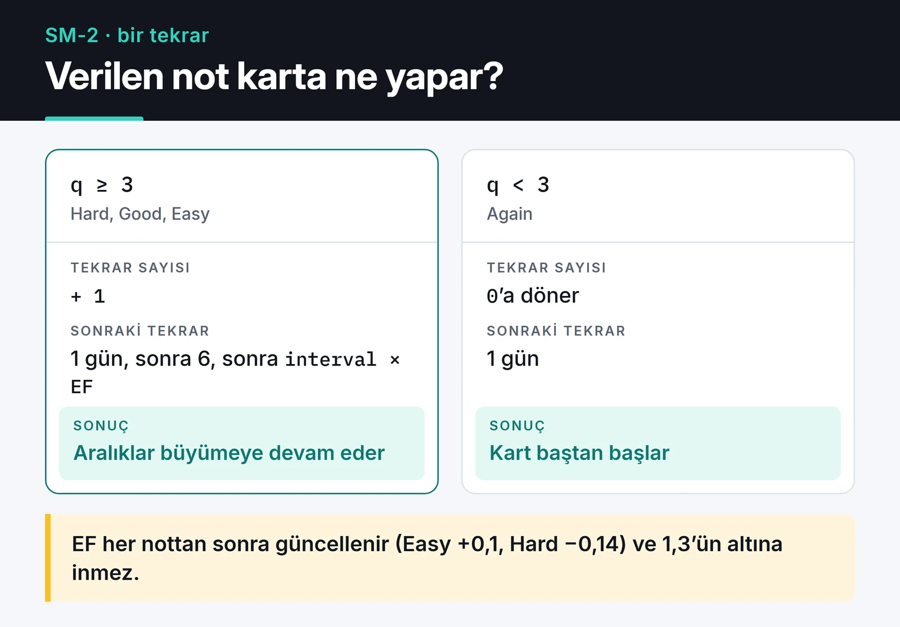

Memoryze, kelime ve kavram ezberlemek için yazdığım açık kaynak bir aralıklı tekrar (spaced repetition) uygulaması. Kart destesi oluşturuyorsunuz, uygulama SM-2 algoritmasıyla her kartın bir sonraki tekrar tarihini hesaplıyor. React, TypeScript, Supabase ve Framer Motion ile yazdım, GitHub Pages üzerinde çalışıyor.

[Uygulamayı dene](https://furkankoykiran.com.tr/Memoryze/) · [Kaynak kod](https://github.com/furkankoykiran/Memoryze) · [Proje sayfası](https://furkankoykiran.com.tr/projeler/memoryze/)

Bu yazıda uygulamanın nasıl çalıştığını, en çok uğraştığım kısım olan 3D kart çevirmeyi ve kodu tekrar okurken bulduğum iki hatayı anlatıyorum.


## Neden kendi uygulamam

Duolingo bana fazla oyunlaştırılmış geliyor ve benim seçtiğim kelimelere odaklanmıyor. Quizlet'in işe yarar özelliklerinin çoğu ücretli. Anki'nin algoritması çok iyi ama arayüzü eski ve masaüstü odaklı. İstediğim şey basitti: kendi destelerim, tarayıcıda açılan temiz bir arayüz ve arkada düzgün bir tekrar algoritması.

Uygulamayı 5 Şubat 2026 gecesi, yaklaşık iki saatlik bir oturumda yazdım. Repodaki 25 commit'in hepsi o geceye ait ve aşağıdaki hataların bir kısmı o hızın doğrudan sonucu.

## Stack ve mimari

- React 19 ve TypeScript, Vite 7 ile derleniyor.
- Tailwind CSS 3 ile koyu temalı, cam efektli bir arayüz.
- Framer Motion 12 animasyonlar için.
- Supabase: PostgreSQL veritabanı ve e-posta/şifre ile kimlik doğrulama, şifre sıfırlama dahil.
- react-i18next ile Türkçe ve İngilizce arayüz, tarayıcı diline göre otomatik seçim.
- React Router 7 ve GitHub Actions ile GitHub Pages'e deploy.

Ayrı bir backend yok, tarayıcı doğrudan Supabase'le konuşuyor. Veri modeli iki tablodan oluşuyor: `decks` ve her kartın ön yüzünü, arka yüzünü ve tekrar durumunu tutan `cards`.

GitHub Pages bir SPA'yı doğrudan desteklemediği için workflow bir `404.html` üretiyor ve router'ın `basename` değerini `/Memoryze` olarak ayarlıyor. Böylece `/Memoryze/dashboard` gibi bir adresi doğrudan açtığınızda 404 yerine uygulama yükleniyor.

## SM-2: kartlar ne zaman geri geliyor

SM-2, SuperMemo'nun 1980'lerden kalma algoritması. Anki'nin varsayılan zamanlayıcısı da buna dayanıyor. Her kart için üç değer tutuluyor: kaç kez üst üste doğru bilindiği (`repetition`), kolaylık katsayısı (`ef`) ve gün cinsinden aralık (`interval`). Notun karta etkisi aşağıdaki kartta, Memoryze'daki kod da hemen altında:



```ts
export const calculateSM2 = ({ q, repetition, ef, interval }: SM2Input): SM2Output => {
  let newRepetition = repetition;
  let newInterval = interval;

  if (q >= 3) {
    if (repetition === 0) newInterval = 1;
    else if (repetition === 1) newInterval = 6;
    else newInterval = Math.round(interval * ef);
    newRepetition += 1;
  } else {
    newRepetition = 0;
    newInterval = 1;
  }

  // EF' = EF + (0.1 - (5 - q) * (0.08 + (5 - q) * 0.02)), en az 1.3
  let newEf = ef + (0.1 - (5 - q) * (0.08 + (5 - q) * 0.02));
  if (newEf < 1.3) newEf = 1.3;

  const nextReviewDate = new Date();
  nextReviewDate.setDate(nextReviewDate.getDate() + newInterval);

  return { repetition: newRepetition, ef: newEf, interval: newInterval, nextReviewDate };
};
```

`q` 0 ile 5 arasında bir not. Arayüzde dört düğme var: Tekrar (0), Zor (3), İyi (4) ve Kolay (5). Doğru bilinen bir kart önce 1 gün, sonra 6 gün, sonra her seferinde bir önceki aralığın EF katı kadar sonra geri geliyor. "Kolay" EF'yi 0,1 artırıyor, "Zor" 0,14 düşürüyor. Böylece zorlandığınız kartların aralıkları daha yavaş büyüyor.

Tekrar ekranı, tarihi gelmiş en fazla 20 kartı `next_review` sırasına göre çekiyor. Not 4'ün altındaysa kart aynı oturumda kuyruğun sonuna tekrar ekleniyor, yani bilemediğiniz kart oturum bitmeden yeniden karşınıza çıkıyor.

## 3D kart çevirme

En çok zamanımı alan kısım buydu. O gecenin son altı commit'i tamamen bu animasyonla ilgili.

İlk denemede klasik CSS yaklaşımını kullandım: kartı `rotateY(180deg)` ile çevir, iki yüze de `backface-visibility: hidden` ver. Masaüstü Chrome'da çalıştı, ama bazı durumlarda arka yüz ayna görüntüsü gibi ters görünüyordu, bazen hiç çizilmiyordu, bazen de ön yüz üstte kaldığı için arkadaki düğmeler tıklanmıyordu.

Ardından opaklık üzerinden çözmeyi denedim. Framer Motion'ın `useMotionValue` ve `useTransform` fonksiyonlarıyla, kart 90 dereceyi geçtiği anda ön yüzü görünmez, arka yüzü görünür yapıyordum. Opaklık yaklaşımı da tutmadı ve iki commit sonra kararlı bir 3D yapıya döndüm. Repodaki çalışan hali şu:

```tsx
<div style={{ perspective: "1000px" }}>
  <motion.div
    onClick={() => !isFlipped && setIsFlipped(true)}
    initial={false}
    animate={{ rotateY: isFlipped ? 180 : 0 }}
    transition={{ type: "spring", stiffness: 260, damping: 20 }}
    style={{ transformStyle: "preserve-3d" }}
    className="relative w-full min-h-[350px]"
  >
    <div
      className="absolute inset-0"
      style={{
        backfaceVisibility: "hidden",
        WebkitBackfaceVisibility: "hidden",
        zIndex: isFlipped ? 0 : 1,
      }}
    >
      {card.front}
    </div>
    <div
      className="absolute inset-0"
      style={{
        backfaceVisibility: "hidden",
        WebkitBackfaceVisibility: "hidden",
        transform: "rotateY(180deg)",
        zIndex: isFlipped ? 1 : 0,
      }}
    >
      {card.back}
    </div>
  </motion.div>
</div>
```

İşi gören dört detay var:

1. Dönüş iki yüzün değil, ortak ebeveynin üzerinde ve ebeveynde `transform-style: preserve-3d` var. Bu olmadan yüzler kendi düzlemlerinde kalıyor ve arka yüz gizlenemiyor.
2. Arka yüz baştan 180 derece çevrilmiş. Ebeveyn de 180 derece dönünce iki dönüş birbirini götürüyor ve yazı düz görünüyor. Ayna görüntüsü sorununun kaynağı bunun eksik olmasıydı.
3. Safari için `WebkitBackfaceVisibility` ön ekini ayrıca vermek gerekiyor.
4. `zIndex` çevrilme durumuna göre değişiyor. Görünmeyen yüz hâlâ DOM'da ve tıklamaları yakalayabiliyor, üstte olan yüz değişince düğmeler doğru yüzde çalışıyor.

## Supabase anahtarı ve RLS

Repoda `.env` dosyası commit'li ve içinde Supabase URL'si ile anon key var. İlk bakışta güvenlik açığı gibi duruyor. Ancak anon key zaten tarayıcıya gönderilen JavaScript paketinin içinde ve herkes DevTools'tan görebiliyor. Bir SPA'da gerçek koruma Row Level Security. Kullanıcı yalnızca kendi destelerini ve o destelerdeki kartları görebilmeli.

`cards` tablosunda `user_id` yok, kart sahipliği desteden geliyor. Bu şemada politikanın şekli şuna benziyor:

```sql
alter table cards enable row level security;

create policy "kendi kartlarım" on cards
  for all
  using (exists (
    select 1 from decks d
    where d.id = cards.deck_id and d.user_id = (select auth.uid())
  ))
  with check (exists (
    select 1 from decks d
    where d.id = cards.deck_id and d.user_id = (select auth.uid())
  ));
```

`auth.uid()` çağrısını `select` içine almak Supabase'in önerdiği bir optimizasyon. Postgres fonksiyonu her satır için değil, sorgu başına bir kez çalıştırıyor.

Yine de `.env`'yi repodan çıkarıp anahtarları GitHub Actions secret'ı olarak build'e vermek daha temiz. Anon key gizli değil ama repoda durması, ileride yanlışlıkla service role key'in de oraya konmasına zemin hazırlıyor.

## Kodu tekrar okurken bulduğum iki hata

Kodu sonradan baştan okuduğumda iki sorun buldum.

Birincisi "Zor" düğmesi. Not 3 veriyor. SM-2 tarafında 3 geçer not, yani `repetition` artıyor ve aralık büyüyor. Ama arayüz 4'ün altındaki her notu "bilinemedi" sayıp kartı oturumda tekrar kuyruğa ekliyor. Sonuçta "Zor" dediğiniz kart hem bir sonraki güne ileri atılıyor hem de aynı oturumda tekrar soruluyor. İkinci kez "İyi" derseniz `repetition` bir daha artıyor ve aralık beklenenden hızlı büyüyor. Düzeltmesi basit: ya geçme eşiğini her yerde aynı yapmak ya da yeniden kuyruğa alınan kart için veritabanını ikinci kez güncellememek.

İkincisi oturum sonu. Kart kuyruğa yeniden eklenirken `setCards` ile state güncelleniyor, ama hemen ardından oturumun bitip bitmediği eski `cards.length` ile kontrol ediliyor. Son kartı bilemezseniz kart kuyruğa eklenmiş olsa bile oturum "tamamlandı" ekranına geçiyor. Bunu düzeltmek için yeni uzunluğu bir değişkende hesaplayıp hem state'e hem kontrole aynı değeri vermek yeterli.

İkisi de iki saatlik bir sprintin tipik hataları ve test yazmadığım için o gece fark edilmedi. `calculateSM2` saf bir fonksiyon; Vitest ile birkaç test birincisini yakalardı.

## Sırada ne var

Listemde paylaşılabilir desteler, tarayıcının Web Speech API'si ile telaffuz ve GitHub katkı grafiğine benzeyen bir çalışma ısı haritası var. Önce yukarıdaki iki hatayı düzeltmek ve SM-2 için test eklemek istiyorum. Ardından SM-2'yi, Anki'nin de desteklediği daha yeni [FSRS](https://github.com/open-spaced-repetition/fsrs4anki) algoritmasıyla değiştirmeyi deneyebilirim.

Kod MIT lisanslı ve [GitHub'da](https://github.com/furkankoykiran/Memoryze). Supabase projenizi oluşturup `.env` dosyasına kendi URL ve anon key'inizi yazarak `npm install && npm run dev` ile yerelde çalıştırabilirsiniz. Ücretsiz Supabase planında e-posta gönderim limiti düşük, geliştirme sırasında "Confirm email" seçeneğini kapatmak kayıt olmayı kolaylaştırıyor.

React ve Vite ile yazdığım bir başka küçük proje [awesome-trending-repos](/posts/awesome-trending-repos-web/). Framework'süz arayüz yazmaya dair düşüncelerim de [modern web arayüzü yazısında](/posts/modern-web-arayuzu-css-javascript/).
