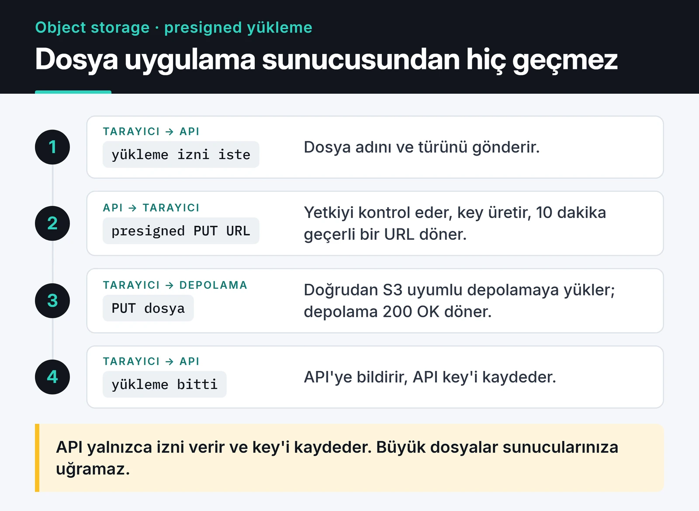

MinIO, birkaç yıl boyunca kendi sunucunuzda S3 çalıştırmanın en kısa yoluydu. Bugün durum farklı: açık kaynak community sürümü adım adım kapandı ve GitHub deposu arşivlendi. Bu yazıda dosyaları neden object storage'a taşımanız gerektiğini, S3 API'siyle boto3 üzerinden nasıl çalışacağınızı, erasure coding ve object lock gibi kavramları ve yeni bir kurulumda hangi yazılımı seçeceğinizi anlatıyorum. Kod örnekleri depolama yazılımından bağımsız; MinIO'dan başka bir sisteme geçerken de aynen çalışıyor.

## Dosyaları sunucu diskinde tutmanın sorunu

Klasik dosya yükleme akışı şöyle başlar: formdan gelen dosyayı al, `/var/www/uploads/user_123.jpg` olarak kaydet. Tek sunuculu bir projede bu yeterli. Load balancer arkasına ikinci sunucuyu eklediğiniz gün bozulur: kullanıcı fotoğrafı Sunucu-1'e yükler, sayfayı yenilediğinde istek Sunucu-2'ye gider ve 404 alır.

Çözüm uygulamayı stateless yapmak. Dosyalar uygulama sunucusunda değil, ayrı bir object storage'da durur. Uygulama sadece hangi dosyanın nerede olduğunu bilir.

Object storage düz bir yapıdır. Klasör hiyerarşisi yoktur; her obje bir bucket içinde bir anahtar (key) ve metadata ile saklanır. `photos/2026/a.jpg` gibi anahtarlar klasör gibi görünse de aslında düz birer string'dir.

## Presigned URL ile doğrudan yükleme

Object storage'ın asıl faydası, büyük dosyaların uygulama sunucusundan hiç geçmemesi. Uygulama kısa ömürlü, imzalı bir URL üretir; tarayıcı dosyayı doğrudan depolamaya yükler ya da oradan indirir. Aşağıdaki şema yükleme akışını adım adım gösteriyor.



S3 API'si fiili standart olduğu için kod, depolama yazılımından bağımsız. Aşağıdaki boto3 kodu AWS S3, MinIO, Garage, SeaweedFS, Ceph RGW ve Cloudflare R2 ile çalışır; değişen sadece `endpoint_url` ve kimlik bilgileri:

```python
import os

import boto3
from botocore.config import Config

s3 = boto3.client(
    "s3",
    endpoint_url=os.environ["S3_ENDPOINT"],  # örn. http://localhost:9000
    aws_access_key_id=os.environ["S3_ACCESS_KEY"],
    aws_secret_access_key=os.environ["S3_SECRET_KEY"],
    region_name=os.environ.get("S3_REGION", "us-east-1"),
    config=Config(
        signature_version="s3v4",
        s3={"addressing_style": "path"},
        # boto3 1.36+ varsayılan checksum'ları bazı S3 uyumlu sunucularda hata veriyor
        request_checksum_calculation="when_required",
        response_checksum_validation="when_required",
    ),
)


def upload_and_share(local_path: str, bucket: str, key: str) -> str:
    """Dosyayı yükler, 1 saat geçerli bir indirme linki döner."""
    s3.upload_file(local_path, bucket, key)  # büyük dosyalarda otomatik multipart
    return s3.generate_presigned_url(
        "get_object", Params={"Bucket": bucket, "Key": key}, ExpiresIn=3600
    )


def presigned_upload_url(bucket: str, key: str, content_type: str) -> str:
    """Tarayıcının doğrudan PUT atacağı, 10 dakika geçerli URL."""
    return s3.generate_presigned_url(
        "put_object",
        Params={"Bucket": bucket, "Key": key, "ContentType": content_type},
        ExpiresIn=600,
    )
```

Kimlik bilgilerini koda gömmeyin; ortam değişkeninden ya da secret yöneticisinden okuyun. Checksum ayarı da gerçek bir tuzak: boto3 1.36 ile gelen yeni varsayılan bütünlük kontrolleri, bunları desteklemeyen S3 uyumlu sunucularda yüklemeleri bozabiliyor. Sağlayıcınız destekliyorsa bu iki satırı kaldırabilirsiniz.

Tarayıcıdan doğrudan yükleme yapacaksanız bucket'a CORS kuralı eklemeyi unutmayın; yoksa PUT isteği tarayıcıda takılır.

## MinIO'ya ne oldu

Kısa zaman çizelgesi:

- 2025 baharında community sürümün web konsolundan yönetim özellikleri çıkarıldı, geriye büyük ölçüde bir obje tarayıcısı kaldı.
- Ekim 2025'te resmi Docker imajları ve binary'ler yayınlanmayı bıraktı. Son community sürümü `RELEASE.2025-10-15T17-29-55Z` sadece kaynak kod olarak çıktı.
- Aralık 2025'te depo "maintenance mode"a alındı: yeni özellik yok, PR kabul edilmiyor.
- Ardından [minio/minio](https://github.com/minio/minio) deposu arşivlendi ve salt okunur oldu.

Deponun GitHub sayfasında adın yanında "Public archive" rozeti duruyor; lisans hâlâ AGPLv3.


Şirket, ticari ürünü AIStor'a yöneliyor. Kod hâlâ AGPLv3 lisanslı, yani fork'lamak serbest ve topluluk fork'ları var. Ama "resmi imajı çek, çalıştır" yolu artık yok: eski `docker-compose.yml` dosyalarındaki `minio/minio` imajı Docker Hub'da bulunmuyor.

Çalışan bir kurulumunuz varsa yarın bozulmaz. Asıl risk güvenlik yamaları: yeni bir açık çıktığında resmi bir sürüm gelmeyecek. Bu yüzden benim önerim şöyle:

- Mevcut MinIO kurulumunu hemen sökmeyin, ama internete açık tutmayın ve bir geçiş planı yapın.
- Yeni projede MinIO community ile başlamayın.
- Ticari destek ve MinIO'nun özelliklerine ihtiyacınız varsa AIStor'un lisans koşullarına bakın.

## Bugün ne seçerdim

Hepsi S3 API'si konuşuyor; yukarıdaki boto3 kodu değişmeden çalışır. Farklar işletme yükünde:

| Seçenek | Ne zaman |
|---|---|
| [Garage](https://garagehq.deuxfleurs.fr/) | Küçük ve orta ölçek, birkaç düğüm, farklı konumlarda sunucular. Rust ile yazılmış, hafif. |
| [SeaweedFS](https://github.com/seaweedfs/seaweedfs) | Çok sayıda küçük dosya, yüksek hacim. S3 dışında filer ve FUSE da sunuyor. |
| Ceph RGW | Zaten Ceph işletiyorsanız ya da petabayt ölçeğindeyseniz. Öğrenme eğrisi en dik olanı. |
| Yönetilen S3 (AWS S3, R2, Backblaze B2) | Donanımı kendiniz işletmek istemiyorsanız. Veri yurt dışına çıkabiliyorsa en az işçilik bu. |

Verinin ülke içinde kalması gerekiyorsa (KVKK, finans ya da sağlık verisi) self-hosted seçenekler hâlâ anlamlı. Bu durumda Garage, tek kişilik bir ekip için başlaması en kolay olanı. Kurulumu sürüme göre değiştiği için buraya kopyalamıyorum; [resmi hızlı başlangıç](https://garagehq.deuxfleurs.fr/documentation/quick-start/) güncel adımları veriyor. Uygulamayı container'a koyma tarafını [Docker ile Python yazımda](/posts/docker-ile-python-uygulamasi-containerization/) anlattım.

## Erasure coding: RAID yerine ne var

MinIO'yu öğrenirken en çok işime yarayan kavram buydu ve Ceph, SeaweedFS gibi sistemlerde de karşınıza çıkıyor.

Erasure coding, bir objeyi veri ve parity parçalarına bölüp farklı disklere dağıtır (Reed-Solomon). MinIO'da 4 diskli bir sette varsayılan parity 2'dir: herhangi iki disk tamamen gitse bile obje okunabilir. Yazma için daha fazla disk gerekir; aynı sette iki disk kaybedildiğinde okuma devam eder ama yazmalar durur. RAID'e göre farkı, korumanın disk yerine obje seviyesinde olması ve her parçanın hash ile kontrol edilmesi. Disk zamanla sessizce bozulduğunda (bit rot) bozuk parça tespit edilip parity'den yeniden üretilir.

Garage ise erasure coding yerine replikasyon kullanır (genelde 3 kopya). Disk maliyeti daha yüksek ama mantığı daha basit. Seçim yaparken bu farkı bilin.

## Object lock ve WORM

Finans, sağlık ve hukuk gibi alanlarda "bu belge 5 yıl boyunca silinemez ve değiştirilemez" şartı olur. S3'ün object lock özelliği bunu sağlar (WORM: write once, read many). İki modu vardır:

- Governance: özel yetkisi olan kullanıcı kilidi aşabilir.
- Compliance: süre dolana kadar root dahil kimse silemez ya da kısaltamaz.

Object lock bucket oluşturulurken açılır, sonradan eklenemez. boto3 ile:

```python
s3.create_bucket(Bucket="faturalar", ObjectLockEnabledForBucket=True)
s3.put_object_lock_configuration(
    Bucket="faturalar",
    ObjectLockConfiguration={
        "ObjectLockEnabled": "Enabled",
        "Rule": {"DefaultRetention": {"Mode": "COMPLIANCE", "Years": 5}},
    },
)
```

Compliance modunu test bucket'ında denemeden üretimde açmayın. Yanlış süre verirseniz onu siz de geri alamazsınız. Kullandığınız depolamanın object lock'u destekleyip desteklemediğini de kontrol edin; her S3 uyumlu sistem desteklemiyor.

## Yaşam döngüsü kuralları

Log ve geçici dosya bucket'ları kendiliğinden temizlenmezse disk dolar. Lifecycle kuralı da S3 API'sinin parçası:

```python
s3.put_bucket_lifecycle_configuration(
    Bucket="logs",
    LifecycleConfiguration={
        "Rules": [
            {
                "ID": "expire-30d",
                "Filter": {"Prefix": ""},
                "Status": "Enabled",
                "Expiration": {"Days": 30},
                "AbortIncompleteMultipartUpload": {"DaysAfterInitiation": 7},
            }
        ]
    },
)
```

`AbortIncompleteMultipartUpload` satırı gözden kaçıyor: yarıda kalan multipart yüklemelerin parçaları görünmez ama yer kaplar.

## Şifreleme

Diskte şifreleme (encryption at rest) için S3'te üç model var:

- SSE-S3: anahtarları depolama sunucusu yönetir.
- SSE-KMS: anahtarlar harici bir KMS'te (Vault gibi) durur.
- SSE-C: anahtarı her istekte istemci gönderir.

SSE-S3 en kolayı gibi görünür, ama MinIO'da o bile bir KMS bağlantısı (KES) ister. Kendi sunucunuzda en pratik yol çoğu zaman disk seviyesinde şifreleme (LUKS) artı TLS oluyor.

## Sık sorulanlar

### MinIO'yu veritabanı gibi kullanabilir miyim?

Hayır. İçerikte arama yapamazsınız; objeyi anahtarıyla okursunuz. Hangi kullanıcının hangi dosyası olduğu bilgisini veritabanında tutun.

### Donanım olarak neye dikkat etmeli?

Darboğaz genelde disk ve ağdır, CPU değil. NVMe diskleri 1 Gbps ağ kartıyla kullanırsanız ağ tıkanır.

### Nasıl izlenir?

Depolamanın kendi Prometheus metriklerini toplayın: disk doluluğu, istek gecikmesi, hata sayısı. Thanos gibi araçlar da object storage'ı uzun süreli metrik deposu olarak kullanıyor; bunu [Prometheus ve Grafana yazısında](/posts/prometheus-grafana-ile-izleme/) anlattım.

## Sırada ne var

Dosyalarınız hâlâ uygulama sunucusunun diskindeyse, önce yukarıdaki boto3 koduyla tek bir yükleme akışını S3 API'sine taşıyın. Arkadaki yazılımı sonra değiştirmek, sadece `S3_ENDPOINT` değişkenini değiştirmek kadar kolay olur.

Uygulamayı container'a taşıyacaksanız [Docker ile Python yazısı](/posts/docker-ile-python-uygulamasi-containerization/), depolamayı izlemek için de [Prometheus ve Grafana yazısı](/posts/prometheus-grafana-ile-izleme/) iyi bir sonraki adım.
