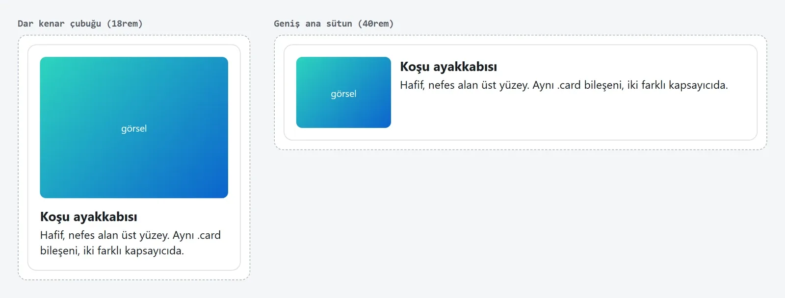

Modern web arayüzü yazmak için her projede React ya da Vue kurmak gerekmiyor. Son birkaç yılda tarayıcılara gelen CSS ve HTML özellikleri, eskiden JavaScript ya da bir kütüphane gerektiren işlerin önemli bir kısmını tek başına yapıyor. Bir dashboard, bir landing page ya da bir backend servisinin yönetim paneli için düz HTML, modern CSS ve biraz vanilla JavaScript çoğu zaman yeterli.

Framework'lere karşı değilim; kendi [awesome-trending-repos sitemi](/posts/awesome-trending-repos-web/) React ve Vite ile yazdım. Bu yazı, framework'e uzanmadan önce tarayıcının bugün neler verdiğine bakıyor. Buradaki CSS özelliklerinin hepsi Chrome, Firefox ve Safari'nin güncel sürümlerinde çalışıyor.

## Container query: bileşen kendi genişliğine baksın

Media query ekranın genişliğine bakar. Ama bir kart bileşeni bazen geniş bir ana sütunda, bazen dar bir kenar çubuğunda durur; ekran genişliği bu durumda yanlış soruyu sorar. Container query ile bileşen, içinde bulunduğu kutunun genişliğine göre düzen değiştirir:

```css
.card-wrap {
  container-type: inline-size;
}

.card {
  display: grid;
  gap: 0.75rem;
  padding: 1rem;
}

@container (min-width: 28rem) {
  .card {
    grid-template-columns: 8rem 1fr;
  }
}
```

Aynı `.card` artık sayfanın neresine koyarsanız koyun kendine uygun düzeni seçiyor. Aşağıdaki görüntü, bu yazıdaki kart CSS'inin Chrome'da iki farklı genişlikteki kapsayıcıda nasıl çizildiğini gösteriyor:



Ekran genişliği iki kartta da aynı; farkı yaratan sadece kapsayıcı. Bileşen seviyesindeki media query'lerin çoğu bu yüzden gereksiz hale geliyor.

## Nesting, katmanlar ve tema değişkenleri

Sass'ın en çok kullanılan özelliği iç içe kural yazmaktı. Bu artık CSS'in kendisinde var. Aynı kart, nesting, `@layer` ve `light-dark()` ile:

```css
@layer reset, base, components;

:root {
  color-scheme: light dark;
  --bg: light-dark(#ffffff, #0f1115);
  --fg: light-dark(#1b1f24, #e6e8eb);
  --accent: light-dark(#0b63ce, #5aa2ff);
}

@layer base {
  body {
    background: var(--bg);
    color: var(--fg);
    font-family: system-ui, sans-serif;
  }
}

@layer components {
  .card {
    display: grid;
    gap: 0.75rem;
    padding: 1rem;
    border: 1px solid color-mix(in oklab, var(--fg) 15%, transparent);
    border-radius: 0.75rem;

    & h3 {
      margin: 0;
    }

    &:hover {
      border-color: var(--accent);
    }

    @container (min-width: 28rem) {
      grid-template-columns: 8rem 1fr;
    }
  }
}
```

Burada üç şey var:

- `color-scheme: light dark` ve `light-dark()`, kullanıcının sistem temasına göre doğru rengi seçiyor. Ayrı bir `prefers-color-scheme` bloğu yazmanız gerekmiyor.
- `@layer`, stillerin hangi sırayla kazanacağını belirliyor. `components` katmanındaki bir kural, `base` katmanındaki daha spesifik bir seçiciyi de ezer. `!important` savaşlarının çoğu bununla bitiyor.
- `color-mix()`, ana renkten şeffaf bir kenarlık rengi türetiyor; tasarım sisteminde ayrı bir değişken tanımlamaya gerek kalmıyor.

## :has() ile ebeveyni seçmek

`:has()` uzun yıllar "CSS'te olmayan ebeveyn seçici" olarak bilinen boşluğu dolduruyor. İçeriğine göre bir elementi stillendirebiliyorsunuz:

```css
/* Resmi olan kartlar farklı görünsün */
.card:has(img) {
  grid-template-rows: auto 1fr;
}

/* Formda kullanıcının dokunduğu geçersiz bir alan varsa gönder butonunu soluklaştır */
form:has(:user-invalid) button[type="submit"] {
  opacity: 0.5;
}

/* Seçili checkbox'ın etiketi */
label:has(input:checked) {
  font-weight: 600;
}
```

Eskiden bunların her biri için bir event listener ve class ekleyip çıkaran kod gerekirdi. `:user-invalid` de sadece kullanıcı alanla etkileşime girdikten sonra eşleştiği için, sayfa açılır açılmaz kırmızı hata kutuları göstermiyor.

## JavaScript'siz etkileşim: dialog ve popover

Modal ve açılır menü, kütüphane kurmanın en sık nedenlerinden ikisiydi. İkisi de artık HTML'de:

```html
<button popovertarget="user-menu">Hesabım</button>
<div id="user-menu" popover>
  <a href="/profile">Profil</a>
  <a href="/logout">Çıkış</a>
</div>

<dialog id="confirm">
  <form method="dialog">
    <p>Silmek istediğinize emin misiniz?</p>
    <button value="cancel">Vazgeç</button>
    <button value="ok">Sil</button>
  </form>
</dialog>
<button onclick="document.getElementById('confirm').showModal()">Sil</button>
```

Popover dışarı tıklayınca ve `Esc` ile kendiliğinden kapanıyor, her zaman en üst katmanda (top layer) görünüyor, yani `z-index` ayarlamanız gerekmiyor. `showModal()` ile açılan dialog odağı içinde tutuyor, arka planı etkileşime kapatıyor ve `Esc` ile kapanıyor. Elle yazınca en çok unutulan erişilebilirlik detayları bunlar.

## Island yaklaşımı: JavaScript'i sadece gereken yere

Sayfanın büyük kısmı statik içerikse, tüm sayfayı bir JavaScript uygulamasına çevirmeye gerek yok. Astro gibi araçların yaptığı "island" fikri bunu söylüyor: HTML'i sunucuda üretin, sadece etkileşim gereken parçaları JavaScript ile canlandırın. Basit bir sürümünü build aracı olmadan yazabilirsiniz:

```html
<div data-island="price-chart" data-symbol="BTCUSDT"></div>
```

```javascript
const io = new IntersectionObserver((entries) => {
  for (const entry of entries) {
    if (!entry.isIntersecting) continue;
    io.unobserve(entry.target);
    const el = entry.target;
    import(`./islands/${el.dataset.island}.js`).then((mod) => mod.mount(el));
  }
});

document.querySelectorAll("[data-island]").forEach((el) => io.observe(el));
```

Her island'ın kodu ancak ekrana girdiğinde indiriliyor. Ekranın altındaki bir grafik, kullanıcı oraya kaydırmadıkça ağ ve ana thread maliyeti yaratmıyor. Canlı veri gösteren bir island için sunucu tarafında [WebSocket](/posts/websocket-ile-gercek-zamanli-iletisim/) ya da SSE ile beslemek doğal bir eşleşme.

## Web Components: framework'ten bağımsız bileşen

Bileşen mantığı için de kütüphane şart değil. Custom element ve Shadow DOM tarayıcı standardı, her framework'ün içinde de çalışıyor. Bu yüzden birden fazla projede kullanılacak bir UI kit için iyi bir seçim:

```javascript
class ProductCard extends HTMLElement {
  connectedCallback() {
    if (this.shadowRoot) return;
    const root = this.attachShadow({ mode: "open" });
    root.innerHTML = `
      <style>
        :host { display: block; container-type: inline-size; }
        .card { padding: 1rem; border: 1px solid #ccc; border-radius: 0.5rem; }
      </style>
      <div class="card">
        <h3></h3>
        <slot name="description"></slot>
      </div>`;
    // Attribute değerini innerHTML'e gömmüyoruz: textContent XSS'e kapalı
    root.querySelector("h3").textContent = this.getAttribute("name") ?? "";
  }
}

customElements.define("product-card", ProductCard);
```

```html
<product-card name="Koşu ayakkabısı">
  <p slot="description">Hafif, nefes alan üst yüzey.</p>
</product-card>
```

Kullanıcıdan gelebilecek bir değeri template string ile `innerHTML`'e koymak, framework'süz kodda çok sık yapılan bir güvenlik hatası. Statik şablonu `innerHTML` ile, dinamik değerleri `textContent` ile basın.

## State için olaylar ve küçük bir sinyal

Orta ölçekli bir sayfada bileşenler arası haberleşme için global bir store'a çoğu zaman gerek yok. DOM'un kendi olay sistemi bir pub/sub mekanizması:

```javascript
document.addEventListener("click", (event) => {
  const button = event.target.closest("[data-action='add-to-cart']");
  if (!button) return;
  cart.push(button.dataset.sku);
  document.dispatchEvent(new CustomEvent("cart:updated", { detail: { count: cart.length } }));
});

document.addEventListener("cart:updated", (event) => {
  document.querySelector("#cart-count").textContent = event.detail.count;
});
```

İlk dinleyici olay delegasyonu kullanıyor: yüzlerce butona ayrı ayrı listener eklemek yerine tek bir listener tıklamanın nereden geldiğine bakıyor. Sonradan eklenen butonlar da otomatik çalışıyor.

Daha çok yerden okunan bir değer için küçük bir sinyal yeterli:

```javascript
function signal(initial) {
  let value = initial;
  const subscribers = new Set();
  return {
    get: () => value,
    set(next) {
      value = next;
      subscribers.forEach((fn) => fn(value));
    },
    subscribe(fn) {
      subscribers.add(fn);
      fn(value);
      return () => subscribers.delete(fn);
    },
  };
}

const count = signal(0);
count.subscribe((v) => (document.querySelector("#cart-count").textContent = v));
count.set(3);
```

Bu fikir Solid, Preact Signals, Vue ve Angular'da da var; TC39'da standartlaştırmak için bir öneri de bulunuyor. Uygulamanın state'i karmaşıklaşıp bu yapı yetmemeye başladığında framework'e geçmek için iyi bir işaret.

## Performansı ölçmek

Google'ın Core Web Vitals metrikleri LCP (en büyük içeriğin görünme süresi), INP (etkileşime cevap süresi) ve CLS (düzen kayması). INP, Mart 2024'te FID'in yerini aldı ve tek bir ilk tıklamayı değil, sayfa boyunca tüm etkileşimleri ölçüyor. Büyük bir JavaScript paketi en çok bu metriği bozuyor, çünkü ana thread meşgulken tıklamalar bekliyor.

Tahmin etmek yerine ölçün:

- Chrome DevTools'un Performance panelinde bir kayıt alın. Uzun görevler (50 ms üstü) ve ardışık DOM okuma/yazmalarından doğan "forced reflow" uyarıları ilk bakılacak yerler.
- Gerçek kullanıcı verisi için `web-vitals` kütüphanesi birkaç KB ve metrikleri kendi analitik endpoint'inize gönderebiliyor.
- CI'da her PR'da Lighthouse CI ve axe-core çalıştırın; performans skoru ya da erişilebilirlik hataları eşik değerin altına düşerse build kırılsın.

## Erişilebilirlik ve yasal zorunluluk

Avrupa Erişilebilirlik Yasası (European Accessibility Act) Haziran 2025'ten beri uygulanıyor ve AB'de birçok dijital ürün ve hizmet için erişilebilirliği zorunlu kılıyor. Teknik tarafı çoğunlukla temel HTML'i doğru kullanmaktan geçiyor:

- Her şey için `div` yerine `header`, `nav`, `main`, `button` kullanın. `div`'e tıklama olayı eklemek klavye ve ekran okuyucu desteğini kendiniz yazmanız demek.
- Sadece ikon olan butonlara `aria-label` verin.
- Sayfayı fare olmadan, sadece `Tab` ile gezin. Odak görünür mü, sıra mantıklı mı?

Yukarıdaki `dialog` ve `popover` bu yüzden değerli: odak yönetimi ve klavye davranışı hazır geliyor.

## Ne zaman framework?

Benim ayrımım şu: içerik ağırlıklı sayfalar, paneller ve küçük araçlar için düz HTML, modern CSS ve island'lar. Çok sayfalı, yoğun state'i olan, birçok kişinin aynı kod tabanında çalıştığı bir uygulama için bir framework'ün getirdiği yapı ve ekosistem bedelini çıkarıyor.

## Sonraki adım

Mevcut bir projede media query ile yazılmış bir bileşeni container query'ye çevirip farklı genişlikteki sütunlara koyun, farkı hemen görürsünüz. Özelliklerin tarayıcı desteğini [MDN](https://developer.mozilla.org/en-US/docs/Web/CSS/CSS_containment/Container_queries) ve [Baseline](https://web.dev/baseline) üzerinden takip edebilirsiniz. MDN her referans sayfasının başında bu durumu bir rozetle gösteriyor:


Bu sayfalara canlı veri eklemek isterseniz [WebSocket yazım](/posts/websocket-ile-gercek-zamanli-iletisim/) sunucu tarafını, [awesome-trending-repos yazım](/posts/awesome-trending-repos-web/) da framework'lü bir sitenin nasıl kurulduğunu anlatıyor.
