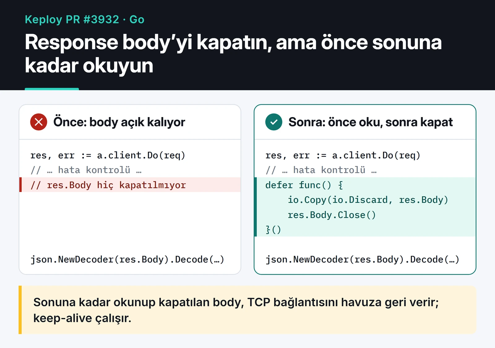

[awesome-trending-repos](https://github.com/furkankoykiran/awesome-trending-repos) ile GitHub trending listesini takip ederken Go ile yazılmış bir API test aracı olan [Keploy](https://github.com/keploy/keploy) gözüme çarptı. Issue listesinde iki kaynak yönetimi hatası buldum ve ikisi için de PR açtım. Bu yazı o Keploy katkısını anlatıyor: Go'da `defer`'in doğru kullanımı ve HTTP response body'lerinin neden hem okunup hem kapatılması gerektiği. İki PR da 20 Mart 2026'da merge edildi. Keploy'a ilk katkımdı.

## Keploy ne yapıyor

Keploy, uygulamanızın gerçek trafiğini eBPF ile yakalayıp bundan API testleri ve dış bağımlılıklar için mock'lar üretiyor. Testleri yeniden çalıştırırken veritabanı ve dış servis çağrıları bu mock'lardan cevaplanıyor.

Benim düzelttiğim iki hata bu akışın kenarlarında duruyor: biri Keploy'un uygulamanın dilini tespit ettiği yerde, diğeri Keploy'un kendi agent'ıyla konuştuğu HTTP istemcisinde.

## PR #3927: kapatılmış dosyadan okuma

### Hata

[#3821](https://github.com/keploy/keploy/issues/3821) numaralı issue, `utils/utils.go` içindeki `isGoBinary` fonksiyonunu gösteriyordu. Fonksiyon bir ELF dosyasını açıyor, hemen kapatıyor, sonra kapatılmış dosyanın section'larını okumaya çalışıyordu:

```go
f, err := elf.Open(filePath)
if err != nil {
	logger.Debug(fmt.Sprintf("failed to open file %s", filePath), zap.Error(err))
	return false
}
if err := f.Close(); err != nil { // dosya burada kapanıyor
	LogError(logger, err, "failed to close file", zap.String("file", filePath))
}

sections := []string{".go.buildinfo", ".gopclntab"}
for _, section := range sections {
	if sect := f.Section(section); sect != nil { // kapalı dosya üzerinde çalışıyor
		fmt.Println(section)
		return true
	}
}
```

`isGoBinary`, `DetectLanguage` tarafından kullanılıyor. Yani hata, Keploy'un bir uygulamanın Go ile yazılıp yazılmadığına karar verdiği yeri etkiliyordu.

### Düzeltme

`Close()` çağrısını `defer` ile fonksiyonun sonuna taşıdım. `defer` edilen çağrı, fonksiyon hangi yoldan çıkarsa çıksın (erken `return`, normal dönüş ya da panic) en sonda çalışıyor. Bir de debug'dan kalmış `fmt.Println(section)` satırını sildim.

PR'ın ilk commit'inde düz `defer f.Close()` yazmıştım. Copilot'un otomatik review'u iki şeye dikkat çekti: bu yazım `Close()` hatasını yutuyor, ayrıca dosyanın geri kalanında kapatma hataları loglanıyor. Muhtemelen `golangci-lint`'in `errcheck` kuralına da takılacaktı. Son hâli dosyadaki diğer kullanımlarla aynı:

```go
f, err := elf.Open(filePath)
if err != nil {
	logger.Debug(fmt.Sprintf("failed to open file %s", filePath), zap.Error(err))
	return false
}
defer func() {
	if err := f.Close(); err != nil {
		LogError(logger, err, "failed to close file", zap.String("file", filePath))
	}
}()

sections := []string{".go.buildinfo", ".gopclntab"}
for _, section := range sections {
	if sect := f.Section(section); sect != nil {
		return true
	}
}
return false
```

[PR #3927](https://github.com/keploy/keploy/pull/3927) +5/−4 satırlık bir değişiklikti. AkashKumar7902 onu 20 Mart'ta merge etti.

## PR #3932: kapatılmayan response body'ler

### Hata

[#3854](https://github.com/keploy/keploy/issues/3854) numaralı issue, `pkg/platform/http/agent.go` içindeki `MockOutgoing` ve `UpdateMockParams` fonksiyonlarını gösteriyordu. İkisi de agent'a istek atıyor ama `res.Body`'yi hiç kapatmıyordu:

```go
res, err := a.client.Do(req)
if err != nil {
	return fmt.Errorf("failed to send request for mockOutgoing: %s", err.Error())
}
// res.Body hiç kapatılmıyor

var mockResp models.AgentResp
err = json.NewDecoder(res.Body).Decode(&mockResp)
```

`net/http` dokümantasyonu açık: body'yi kapatmak çağıranın sorumluluğunda. Kapatılmayan her body, altındaki TCP bağlantısını da elinde tutuyor. Bağlantı havuza geri dönemiyor, her istek yeni bir bağlantı açıyor. Uzun çalışan bir süreçte bu, dosya tanımlayıcılarının ve portların tükenmesine kadar gidebiliyor.

### Düzeltme: kapat, ama önce sonuna kadar oku

Yan yana koyunca değişikliğin tamamı tek bir defer fonksiyonu:



```go
res, err := a.client.Do(req)
if err != nil {
	return fmt.Errorf("failed to send request for mockOutgoing: %s", err.Error())
}
defer func() {
	io.Copy(io.Discard, res.Body)
	if err := res.Body.Close(); err != nil {
		utils.LogError(a.logger, err, "failed to close response body for mockOutgoing")
	}
}()

var mockResp models.AgentResp
err = json.NewDecoder(res.Body).Decode(&mockResp)
```

`io.Copy(io.Discard, res.Body)` satırı bu PR'dan öğrendiğim en faydalı şey oldu. Bakımcı AkashKumar7902 Copilot yorumlarına bakmamı istedi ve yorumlardan biri tam da bunu söylüyordu: `json.Decoder.Decode` body'nin sonuna kadar okumayı garanti etmiyor. JSON nesnesi bittikten sonra body EOF'a ulaşmadan kapatılırsa, `Transport` bağlantıyı yeniden kullanamıyor. Body'yi önce EOF'a kadar tüketmek, keep-alive'ın gerçekten çalışmasını sağlıyor.

Bir uyarı: body çok büyük olabiliyorsa sınırsız `io.Copy` gereksiz yere megabaytlarca veri indirebilir. Böyle durumlarda okumayı sınırlamak daha iyi:

```go
io.Copy(io.Discard, io.LimitReader(res.Body, 64<<10)) // en fazla 64 KiB
```

Keploy'daki agent yanıtları küçük olduğu için sınırsız hâli yeterliydi. [PR #3932](https://github.com/keploy/keploy/pull/3932) iki commit ve 12 satırla merge edildi.

## defer ile ilgili akılda tutulacaklar

Bu iki PR'dan sonra kendi Go kodumda da şu kurallara dikkat ediyorum.

`defer` kaynağı aldıktan hemen sonra ve hata kontrolünden sonra yazılır. `os.Open` hata döndürdüyse `f` nil'dir, `defer f.Close()` hata kontrolünden önce yazılırsa panic'e gider.

Döngü içinde `defer` kullanılmaz. Ertelenen çağrılar döngü bitince değil fonksiyon bitince çalışır, binlerce dosya açık kalabilir. Çözüm, döngünün gövdesini ayrı bir fonksiyona almak:

```go
func countLines(paths []string) (int, error) {
	total := 0
	for _, p := range paths {
		n, err := countFile(p) // defer, countFile bitince çalışır
		if err != nil {
			return 0, err
		}
		total += n
	}
	return total, nil
}

func countFile(path string) (int, error) {
	f, err := os.Open(path)
	if err != nil {
		return 0, err
	}
	defer f.Close()

	n := 0
	scanner := bufio.NewScanner(f)
	for scanner.Scan() {
		n++
	}
	return n, scanner.Err()
}
```

Birden fazla `defer` ters sırada (LIFO) çalışır. Argümanlar ise `defer` satırına gelindiği anda değerlendirilir, fonksiyon bittiğinde değil. Değişkenin son değerini istiyorsanız closure kullanın.

Sadece okunan bir dosyada `Close()` hatası nadiren önemlidir. Yazılan bir dosyada ise önemlidir, çünkü tamponlanmış verinin diske yazılamadığını ancak orada öğrenirsiniz. O durumda hatayı loglamak yerine fonksiyonun döndürdüğü hataya eklemek daha doğru olur.

## Sırada ne var

İki PR toplamda 17 satır ekledi. Body'yi boşaltma ayrıntısını review yorumları sayesinde öğrendim. Kendi Go kodunuzda `client.Do` çağrılarını tarayıp her birinin arkasında `defer` ile kapatılan ve boşaltılan bir body olup olmadığına bakın. Daha fazlası için Go'nun [net/http Client.Do dokümantasyonuna](https://pkg.go.dev/net/http#Client.Do) ve [Go wiki'deki yaygın hatalar sayfasına](https://go.dev/wiki/CommonMistakes) bakabilirsiniz.

Keploy'u bulduğum araç olan [awesome-trending-repos](https://furkankoykiran.com.tr/projeler/awesome-trending-repos/) için [ayrı bir yazı](/posts/awesome-trending-repos-web/) var. Diğer açık kaynak katkılarım [MCP ekosistemi](/posts/mcp-ai-contributions/), [GitHub MCP Server](/posts/github-mcp-server-acik-kaynak-katki/) ve [güvenlik ve API düzeltmeleri](/posts/security-api-fixes/) yazılarında.
