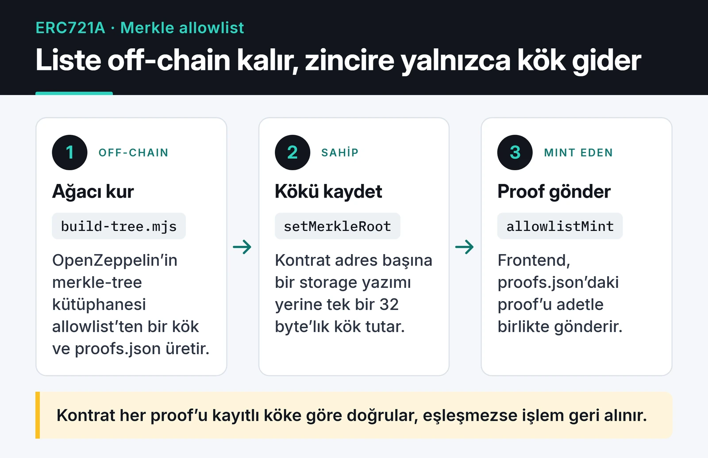

Web3 tarafında çalışırken birkaç NFT koleksiyonu için mint kontratı yazdım. Bu yazıda Ethereum'da NFT minting'i bugün sıfırdan kursam nasıl kuracağımı anlatıyorum: ERC721A ile toplu mint, Merkle ağacıyla allowlist, IPFS'te metadata, Foundry ile testler ve ethers v6 ile bir mint butonu.

Kodlar Solidity 0.8.x, OpenZeppelin Contracts 5 ve ERC721A 4.x ile derleniyor, testler de geçiyor. Yine de bu bir öğretici örnek, denetimden geçmiş bir kontrat değil. Gerçek para toplayacak bir koleksiyon çıkaracaksanız önce testnet'te deneyin, sonra bir denetim yaptırın.

## ERC721 mi, ERC721A mı?

OpenZeppelin'in `ERC721` kontratı her token için sahiplik bilgisini ayrı bir storage slotuna yazar. Bir kullanıcı tek işlemde beş token mint ettiğinde beş ayrı yazma yapılır. Bunun üstüne `ERC721Enumerable` eklerseniz her mint ve transferde birkaç indeks daha güncellenir, maliyet ciddi şekilde artar.

Azuki ekibinin yazdığı [ERC721A](https://github.com/chiru-labs/ERC721A) toplu mintte sahipliği sadece ilk token için yazar. Sonraki tokenların sahibi, `ownerOf` çağrıldığında geriye doğru ilk dolu slota bakılarak bulunur. Bu yüzden 1 token ile 5 token mint etmek arasındaki gas farkı küçüktür.

Bunun bedeli de var:

- Toplu mint edilmiş bir grubun ortasındaki tokenı ilk kez transfer etmek normal ERC721'e göre biraz daha pahalı, çünkü kontrat o anda eksik sahiplik slotlarını dolduruyor.
- `ownerOf` ve benzeri okumalar büyük gruplarda daha fazla iş yapıyor. Off-chain okumada sorun olmuyor ama on-chain başka bir kontrat bunu döngüde çağırıyorsa dikkat etmek gerekiyor.
- `tokenOfOwnerByIndex` gibi enumerable fonksiyonlar yok. Kullanıcının tokenlarını listelemek için event'leri bir indexer ile toplamak daha doğru.

Kısacası "herkes 1-5 arası mint edecek, 10 binlik bir PFP koleksiyonu" senaryosunda ERC721A mantıklı. Tek tek mint edilen, sık transfer edilen tokenlarda OpenZeppelin'in düz `ERC721`'i yeterli ve daha sade.

Hatırlatma olarak ERC-721 arayüzünün parçaları:

| Parça | Fonksiyonlar ve event'ler |
|---|---|
| Sahiplik | `balanceOf`, `ownerOf` |
| Transfer | `transferFrom`, `safeTransferFrom` |
| Onay | `approve`, `getApproved`, `setApprovalForAll`, `isApprovedForAll` |
| Event'ler | `Transfer`, `Approval`, `ApprovalForAll` |
| `ERC721Metadata` (opsiyonel) | `name`, `symbol`, `tokenURI` |
| `ERC721Enumerable` (opsiyonel) | `totalSupply`, `tokenByIndex`, `tokenOfOwnerByIndex` |
| Alıcı kontratlar | `IERC721Receiver.onERC721Received` |

## Metadata ve IPFS

`tokenURI(1)` bir JSON dosyası döndürür. Pazar yerleri görseli ve özellikleri bu JSON'dan okur:

```json
{
  "name": "MyNFT #1",
  "description": "Örnek koleksiyon",
  "image": "ipfs://bafy.../1.png",
  "attributes": [{ "trait_type": "Background", "value": "Blue" }]
}
```

Görseller ve JSON dosyaları kendi sunucunuzda duruyorsa sunucu kapandığında NFT'nin içi de boşalır. Bu yüzden dosyaları IPFS'e yükleyip içerik adresini (CID) kullanmak standart hale geldi. IPFS tek başına kalıcılık garantisi vermez. Dosyaların erişilebilir kalması için en az bir pinning servisinde, mümkünse birden fazlasında pinlenmesi gerekir.

Klasör düzeni basit tutulabilir: `metadata/1`, `metadata/2` ... dosyaları tek klasör olarak yüklenir ve kontrata `ipfs://<CID>/` base URI olarak verilir.

Koleksiyon sonradan "reveal" edilecekse provenance hash eklemek iyi bir pratik. Bütün görsellerin hash'lerinden tek bir hash üretip satış başlamadan yayınlarsınız. Böylece sonradan sıralamayı değiştirmediğinizi herkes doğrulayabilir.

## Kontrat: ERC721A ve Merkle allowlist

Binlerce adresi `mapping(address => bool)` ile kontrata yazmak her adres için bir storage yazması demek. Merkle ağacında ise sadece kökü (32 byte) saklarsınız. Kullanıcı mint ederken listede olduğunu kanıtlayan proof'u gönderir.

Aşağıdaki kart, listenin off-chain tarafta nasıl köke ve proof dosyasına dönüştüğünü gösteriyor:



Kontrat şöyle:

```solidity {title="src/MyNFT.sol"}
// SPDX-License-Identifier: MIT
pragma solidity ^0.8.24;

import {ERC721A} from "erc721a/contracts/ERC721A.sol";
import {Ownable} from "@openzeppelin/contracts/access/Ownable.sol";
import {MerkleProof} from "@openzeppelin/contracts/utils/cryptography/MerkleProof.sol";

contract MyNFT is ERC721A, Ownable {
    uint256 public constant MAX_SUPPLY = 10_000;
    uint256 public constant MAX_PER_WALLET = 3;
    uint256 public constant PRICE = 0.01 ether;

    bytes32 public merkleRoot;
    string private baseURI;

    error SoldOut();
    error WrongPayment();
    error WalletLimit();
    error NotAllowlisted();
    error WithdrawFailed();

    constructor(address initialOwner, string memory baseURI_)
        ERC721A("MyNFT", "MNFT")
        Ownable(initialOwner)
    {
        baseURI = baseURI_;
    }

    function allowlistMint(uint256 quantity, bytes32[] calldata proof) external payable {
        if (_totalMinted() + quantity > MAX_SUPPLY) revert SoldOut();
        if (msg.value != PRICE * quantity) revert WrongPayment();
        if (_numberMinted(msg.sender) + quantity > MAX_PER_WALLET) revert WalletLimit();

        // @openzeppelin/merkle-tree ile aynı yaprak formatı (çift hash)
        bytes32 leaf = keccak256(bytes.concat(keccak256(abi.encode(msg.sender))));
        if (!MerkleProof.verifyCalldata(proof, merkleRoot, leaf)) revert NotAllowlisted();

        _mint(msg.sender, quantity);
    }

    function setMerkleRoot(bytes32 root) external onlyOwner {
        merkleRoot = root;
    }

    function withdraw(address payable to) external onlyOwner {
        (bool ok, ) = to.call{value: address(this).balance}("");
        if (!ok) revert WithdrawFailed();
    }

    function _baseURI() internal view override returns (string memory) {
        return baseURI;
    }

    function _startTokenId() internal pure override returns (uint256) {
        return 1;
    }
}
```

Kontratta açıklamaya değer birkaç tercih var:

- OpenZeppelin 5'te `Ownable` constructor'ı ilk sahibi parametre olarak istiyor. `Ownable(initialOwner)` yazmazsanız kontrat derlenmiyor. Sahip olarak kişisel cüzdan yerine bir Safe multisig adresi vermek daha güvenli.
- Yaprak `keccak256(bytes.concat(keccak256(abi.encode(msg.sender))))` şeklinde, yani çift hash'li. Bu, OpenZeppelin'in `merkle-tree` kütüphanesinin ürettiği formatla birebir aynı ve ikinci ön görüntü (second preimage) saldırılarını engelliyor. Pek çok örnekte görülen `keccak256(abi.encodePacked(msg.sender))` tek hash'li yaprak bu korumayı vermiyor ve JS tarafındaki ağaçla da uyuşmayabiliyor.
- Ödeme `msg.value != PRICE * quantity` ile birebir kontrol ediliyor. `>=` kullanırsanız fazla gönderilen ETH kontratta kalır ve kullanıcıya geri dönmez.
- Cüzdan başına limit ERC721A'nın tuttuğu `_numberMinted` sayacıyla kontrol ediliyor. Yine de bu limit Sybil'e karşı koruma sağlamaz. Allowlist dışındaki bir public mint aşamasında bir kişi çok sayıda cüzdan açabilir.
- `require` ve string mesajlar yerine custom error kullanıyorum. Bytecode küçülüyor, revert daha ucuz oluyor, testlerde selector ile kontrol etmek de kolaylaşıyor.

`_safeMint` yerine `_mint` kullandım. `_safeMint`, alıcı bir kontratsa `onERC721Received` çağırır ve bu, mint sırasında dışarıya kontrol veren bir harici çağrıdır. ERC721A'nın `_safeMint`'inde reentrancy'ye karşı bir kontrol var, yani kullanmak da mümkün. Ben sade tutmayı tercih ettim.

## Merkle ağacını oluşturmak

Ağacı off-chain, OpenZeppelin'in [merkle-tree](https://github.com/OpenZeppelin/merkle-tree) kütüphanesiyle üretiyorum:

```javascript {title="scripts/build-tree.mjs"}
import fs from "node:fs";
import { StandardMerkleTree } from "@openzeppelin/merkle-tree";

const addresses = [
  "0x1111111111111111111111111111111111111111",
  "0x2222222222222222222222222222222222222222",
];

const tree = StandardMerkleTree.of(addresses.map((a) => [a]), ["address"]);
console.log("Merkle root:", tree.root);

// Her adres için proof'u önceden hesapla; frontend bunu okuyacak
const proofs = {};
for (const [i, [address]] of tree.entries()) {
  proofs[address.toLowerCase()] = tree.getProof(i);
}
fs.writeFileSync("proofs.json", JSON.stringify({ root: tree.root, proofs }, null, 2));
```

`node scripts/build-tree.mjs` kökü yazdırır ve `proofs.json` dosyasını üretir. Kökü `setMerkleRoot` ile kontrata yazarsınız. Bu kütüphanenin kökü ile Solidity tarafındaki çift hash'li yaprak formatının aynı sonucu verdiğini ayrıca kontrol ettim.

Betiği iki örnek adresle çalıştırdım. İki yapraklı ağaçta her adresin proof'u tek elemanlı: diğer adresin yaprak hash'i. Foundry testinde aynı yapıyı elle kuracağım.

## Foundry ile testler

Akıllı kontratta yayından sonra düzeltme yapmak çok zor. Bu yüzden önce testleri yazıyorum. Proje Foundry ile kuruluyor:

```bash
forge init my-nft && cd my-nft
forge install chiru-labs/ERC721A OpenZeppelin/openzeppelin-contracts
```

`remappings.txt` dosyasına iki satır yetiyor:

```text {title="remappings.txt"}
erc721a/=lib/ERC721A/
@openzeppelin/contracts/=lib/openzeppelin-contracts/contracts/
```

Testte iki yapraklı küçük bir ağaç kuruyorum. İki yapraklı ağaçta kök, sıralanmış iki yaprağın hash'idir. OpenZeppelin'in `Hashes.commutativeKeccak256` fonksiyonu da tam bunu yapıyor. Alice'in proof'u Bob'un yaprağından ibaret.

```solidity {title="test/MyNFT.t.sol"}
// SPDX-License-Identifier: MIT
pragma solidity ^0.8.24;

import {Test} from "forge-std/Test.sol";
import {Hashes} from "@openzeppelin/contracts/utils/cryptography/Hashes.sol";
import {MyNFT} from "../src/MyNFT.sol";

contract MyNFTTest is Test {
    MyNFT nft;
    address owner = makeAddr("owner");
    address alice = makeAddr("alice");
    address bob = makeAddr("bob");
    address mallory = makeAddr("mallory");

    function _leaf(address a) internal pure returns (bytes32) {
        return keccak256(bytes.concat(keccak256(abi.encode(a))));
    }

    function _aliceProof() internal view returns (bytes32[] memory proof) {
        proof = new bytes32[](1);
        proof[0] = _leaf(bob);
    }

    function setUp() public {
        nft = new MyNFT(owner, "ipfs://CID/");
        bytes32 root = Hashes.commutativeKeccak256(_leaf(alice), _leaf(bob));
        vm.prank(owner);
        nft.setMerkleRoot(root);
        vm.deal(alice, 1 ether);
        vm.deal(mallory, 1 ether);
    }

    function test_AllowlistedWalletCanMint() public {
        vm.prank(alice);
        nft.allowlistMint{value: 0.02 ether}(2, _aliceProof());

        assertEq(nft.balanceOf(alice), 2);
        assertEq(nft.ownerOf(1), alice);
        assertEq(nft.tokenURI(1), "ipfs://CID/1");
    }

    function test_RevertWhen_NotAllowlisted() public {
        bytes32[] memory proof = _aliceProof();
        vm.prank(mallory);
        vm.expectRevert(MyNFT.NotAllowlisted.selector);
        nft.allowlistMint{value: 0.01 ether}(1, proof);
    }

    function test_RevertWhen_WrongPayment() public {
        bytes32[] memory proof = _aliceProof();
        vm.prank(alice);
        vm.expectRevert(MyNFT.WrongPayment.selector);
        nft.allowlistMint{value: 0.005 ether}(1, proof);
    }

    function test_RevertWhen_OverWalletLimit() public {
        bytes32[] memory proof = _aliceProof();
        vm.startPrank(alice);
        nft.allowlistMint{value: 0.03 ether}(3, proof);
        vm.expectRevert(MyNFT.WalletLimit.selector);
        nft.allowlistMint{value: 0.01 ether}(1, proof);
        vm.stopPrank();
    }

    function test_OnlyOwnerCanWithdraw() public {
        vm.prank(alice);
        nft.allowlistMint{value: 0.01 ether}(1, _aliceProof());

        vm.prank(mallory);
        vm.expectRevert();
        nft.withdraw(payable(mallory));

        vm.prank(owner);
        nft.withdraw(payable(owner));
        assertEq(owner.balance, 0.01 ether);
    }
}
```

`forge test -vv` beş testin hepsini geçiyor. `vm.prank` ve `vm.expectRevert` sadece bir sonraki harici çağrıyı etkiliyor. Proof'u bu satırlardan önce bir değişkene almam bu yüzden: araya kontrata yapılan başka bir çağrı girerse prank yanlış çağrıya uygulanır ve test yanlış sebeple geçer ya da kalır.

Bu testler sadece mutlu yolu ve bariz hataları kapsıyor. Gerçek bir koleksiyonda arz sınırını, `withdraw`'un başarısız olduğu durumu ve satış aşamaları arasındaki geçişleri de test ederdim.

## Frontend: ethers v6 ile mint butonu

İnternetteki mint örneklerinin çoğu hâlâ ethers v5 kullanıyor (`ethers.providers.Web3Provider`, `ethers.utils.parseEther`). Bu API'ler v6'da kaldırıldı. Aşağıdaki kod v6 ile yazıldı. Proof'u tarayıcıda ağacı yeniden kurarak üretmek yerine, önceden hazırlanmış `proofs.json` dosyasından okumak daha basit:

```javascript {title="mint.js"}
import { BrowserProvider, Contract, parseEther } from "ethers";

const CONTRACT_ADDRESS = "0x..."; // deploy sonrası adres
const ABI = ["function allowlistMint(uint256 quantity, bytes32[] proof) payable"];
const SEPOLIA_CHAIN_ID = 11155111n;

export async function mint(quantity) {
  if (!window.ethereum) throw new Error("Tarayıcıda cüzdan bulunamadı");

  const provider = new BrowserProvider(window.ethereum);
  const { chainId } = await provider.getNetwork();
  if (chainId !== SEPOLIA_CHAIN_ID) throw new Error("Lütfen Sepolia ağına geçin");

  const signer = await provider.getSigner();
  const address = (await signer.getAddress()).toLowerCase();

  const { proofs } = await fetch("/proofs.json").then((r) => r.json());
  const proof = proofs[address];
  if (!proof) throw new Error("Bu adres allowlist'te yok");

  const nft = new Contract(CONTRACT_ADDRESS, ABI, signer);
  const tx = await nft.allowlistMint(quantity, proof, {
    value: parseEther("0.01") * BigInt(quantity),
  });
  const receipt = await tx.wait();
  return receipt.hash;
}
```

v6'da `getSigner()` asenkron, miktarlar `BigInt`, zincir kimliği de `bigint` olarak geliyor (`11155111n`). Proof dosyası herkese açık olabilir. Proof sadece "bu adres listede" der, başka bir adres onu kullanamaz çünkü kontrat yaprağı `msg.sender`'dan hesaplıyor.

## Deploy: önce Sepolia

Private key'i `.env` dosyasına koymak yerine Foundry'nin şifreli keystore'unu kullanıyorum:

```bash
cast wallet import deployer --interactive

forge create src/MyNFT.sol:MyNFT \
  --rpc-url "$SEPOLIA_RPC_URL" \
  --account deployer \
  --broadcast \
  --verify \
  --constructor-args 0xSAFE_ADRESINIZ "ipfs://CID/"
```

`--verify` için `ETHERSCAN_API_KEY` ortam değişkeninin tanımlı olması gerekiyor. Foundry 1.0 ile birlikte `forge create` varsayılan olarak sadece simülasyon yapıyor, gerçekten göndermek için `--broadcast` şart.

Mainnet'e geçmeden önce kendime sorduğum sorular şunlar:

- Kontratın sahibi bir multisig mi, yoksa tek bir sıcak cüzdan mı?
- `merkleRoot` değişmeden önce testnet'te gerçek bir proof ile mint denendi mi?
- Metadata en az bir pinning servisinde pinli mi, `tokenURI` doğru dosyayı döndürüyor mu?
- Gas maliyeti kullanıcılar için kabul edilebilir mi? Değilse bir L2 (Base, Arbitrum, Polygon PoS) daha uygun olabilir.

## Sırada ne var

Bu kontratı genişletmek isterseniz önce güvenlik tarafına bakın. [Solidity güvenliği ve gas optimizasyonu yazımda](/posts/ethereum-smart-contract-security-best-practices/) reentrancy, erişim kontrolü ve custom error'lar gibi konuları daha ayrıntılı anlattım. Kontratla Python'dan konuşmak isterseniz [web3.py v7 rehberi](/posts/web3py-ethereum-blockchain-etkilesimi/) işinize yarar. Gas'ın ucuz olduğu bir ağda yayınlamayı düşünüyorsanız [Polygon PoS mimarisi yazısı](/posts/polygon-network-architecture-deep-dive/) farkları anlatıyor.
