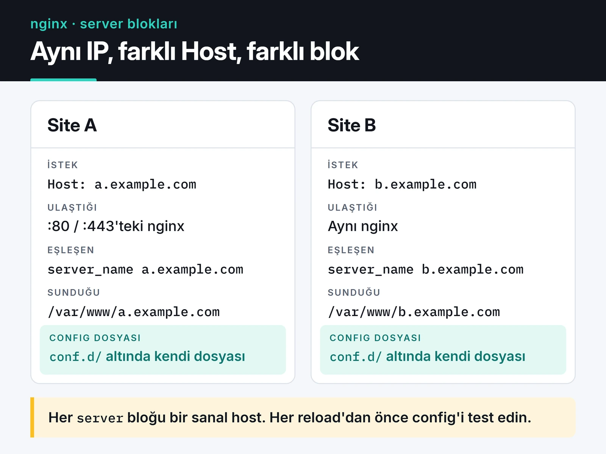

Çoğu sunucuda nginx, `apt install nginx` ile kurulup varsayılan ayarlarla bırakılıyor. Düşük trafikte sorun çıkmaz. Trafik artınca ya da bir backend yavaşlayınca varsayılan ayarlar darboğaz olmaya başlar. Bu yazıda nginx yük dengeleme, önbellekleme, rate limiting ve güvenlik ayarlarını, Python servislerimin önünde kullandığım haliyle anlatıyorum.

Örnekler nginx 1.30 (stable) için yazıldı. 1.30, önceki sürümlerden birkaç önemli varsayılanı değiştirdi, ilgili yerlerde belirttim. Konteyner ağırlıklı bir kurulumda dinamik yönlendirme istiyorsanız [Traefik v3 yazıma](/posts/traefik-reverse-proxy-ssl-yonetimi/) da bakabilirsiniz. Ben statik dosya, ince ayarlı cache ve karmaşık yönlendirme kuralları gereken yerlerde nginx'i tercih ediyorum.

## Dosya yapısı ve server blokları

Paketle gelen nginx'te ana dosya `/etc/nginx/nginx.conf`. Site tanımlarını genelde `/etc/nginx/conf.d/*.conf` altında ayrı dosyalarda tutuyorum. Her `server` bloğu bir sanal host: `server_name` ile eşleşen istekleri karşılıyor.

Aşağıdaki şemada aynı IP'ye gelen iki isteğin `Host` header'ına göre farklı bloklara düştüğü görülüyor.



Her değişiklikten sonra önce test, sonra reload:

```bash
sudo nginx -t && sudo systemctl reload nginx
```

`reload` çalışan bağlantıları koparmadan yeni worker'ları başlatıyor. Bozuk bir config'le reload denerseniz nginx eski config'le çalışmaya devam eder, ama `restart` derseniz hiç açılmaz. Bu yüzden `nginx -t` alışkanlık olmalı.

## Worker ayarları

nginx event tabanlı çalışır, her bağlantı için thread açmaz. Birkaç worker süreci, her biri binlerce bağlantıyı yönetir.

```nginx {title="/etc/nginx/nginx.conf"}
worker_processes auto;
worker_rlimit_nofile 65535;

events {
    worker_connections 8192;
}
```

`worker_processes auto` CPU çekirdeği sayısı kadar worker açar. `worker_connections` worker başına eşzamanlı bağlantı sayısı. Reverse proxy'de her istemci bağlantısı backend'e ikinci bir bağlantı açtığı için gerçek kapasite bunun yaklaşık yarısıdır. `worker_rlimit_nofile`, worker'ların açabileceği dosya tanımlayıcı sayısını yükseltir. Bu değer düşükse yük altında loglarda "too many open files" görürsünüz. Linux'ta en verimli event modeli (epoll) zaten otomatik seçildiği için `use epoll;` yazmaya gerek yok.

## Statik dosyalar

React veya Vue derlemesinin `dist` klasörünü, resimleri ve CSS dosyalarını Python sürecine sundurmak CPU israfı. nginx bunu `sendfile` ile çekirdek seviyesinde yapar.

```nginx
server {
    listen 80;
    server_name app.example.com;
    root /var/www/app/dist;

    location /assets/ {
        expires 1y;
        add_header Cache-Control "public, immutable";
    }

    location / {
        try_files $uri $uri/ /index.html;
    }
}
```

`/assets/` altındaki dosyaların adında içerik hash'i olduğu için (`main.3f9a1c.js`) tarayıcı bunları bir yıl saklayabilir. Dosya değişince adı da değişir. `index.html` ise önbelleğe alınmaz, her seferinde yeni hash'li dosyaları gösterir. `try_files` satırı, tek sayfalık uygulamalarda `/profil` gibi yolların 404 yerine `index.html`'e düşmesini sağlıyor.

## Reverse proxy ve doğru header'lar

Reverse proxy düzeninde TLS nginx'te sonlanıyor ve backend'ler yalnızca nginx'ten gelen düz HTTP isteklerini görüyor.

Backend'in gerçek istemci IP'sini ve protokolü bilmesi için bu header'ları iletmek gerekiyor:

```nginx
location / {
    proxy_pass http://app_backend;
    proxy_set_header Host $host;
    proxy_set_header X-Real-IP $remote_addr;
    proxy_set_header X-Forwarded-For $proxy_add_x_forwarded_for;
    proxy_set_header X-Forwarded-Proto $scheme;
}
```

FastAPI/uvicorn tarafında bu header'lara güvenmek için uvicorn'u `--proxy-headers --forwarded-allow-ips` ile çalıştırın, yoksa uygulama her isteği nginx'in IP'sinden gelmiş sayar.

WebSocket kullanan bir yol için `Upgrade` ve `Connection` header'larını da iletmeniz gerekir:

```nginx
map $http_upgrade $connection_upgrade {
    default upgrade;
    ''      close;
}

server {
    # ...
    location /ws/ {
        proxy_pass http://app_backend;
        proxy_set_header Upgrade $http_upgrade;
        proxy_set_header Connection $connection_upgrade;
        proxy_read_timeout 1h;
    }
}
```

`proxy_read_timeout` varsayılan olarak 60 saniye. Bu sürede hiç mesaj gelmeyen bir WebSocket bağlantısı kapanır. Uygulama tarafında ping/pong kullanmıyorsanız bu değeri uzatın.

## Yük dengeleme

```nginx
upstream app_backend {
    least_conn;
    server 10.0.0.11:8000 max_fails=3 fail_timeout=30s;
    server 10.0.0.12:8000 max_fails=3 fail_timeout=30s;
    server 10.0.0.13:8000 backup;
}
```

Varsayılan algoritma round robin: istekler sırayla dağıtılır. Seçenekler:

- `least_conn` isteği en az aktif bağlantısı olan sunucuya gönderir. İstek süreleri çok değişkense (kimi 10 ms, kimi 5 saniye) round robin'den daha dengeli dağıtır. API'lerde varsayılanım bu.
- `ip_hash` aynı istemci IP'sini hep aynı sunucuya gönderir. Oturumu bellekte tutan uygulamalar için bir çare ama bütün kullanıcılar aynı kurumsal NAT arkasındaysa yük tek sunucuya yığılır. Oturumu Redis gibi paylaşılan bir yerde tutmak daha iyi bir çözüm.
- `hash $request_uri consistent` aynı URL'yi aynı sunucuya gönderir. Backend'lerin kendi önbelleği varsa işe yarar.

`max_fails=3 fail_timeout=30s` pasif sağlık kontrolü: 30 saniye içinde 3 başarısız istek alan sunucu 30 saniyeliğine devreden çıkar. Açık kaynak nginx'te aktif sağlık kontrolü (backend'e periyodik istek atmak) yok, o NGINX Plus'ta. `backup` işaretli sunucu yalnızca diğerlerinin hepsi devre dışıyken trafik alır.

Backend bağlantılarını yeniden kullanmak (keepalive) her istekte yeni TCP bağlantısı açma maliyetini kaldırır. Eskiden bunun için upstream'e `keepalive 32;`, location'a `proxy_http_version 1.1;` ve `proxy_set_header Connection "";` yazmak gerekiyordu. nginx 1.29.7 ile bu üçü varsayılan oldu: upstream keepalive açık, `proxy_http_version` varsayılanı 1.1 ve `Connection` header'ı artık gönderilmiyor. 1.30 kullanıyorsanız bu satırlara gerek yok. Daha eski bir sürümdeyseniz hâlâ elle yazmanız gerekiyor.

## Mikro önbellekleme

Bir API endpoint'i her istekte aynı veritabanı sorgusunu çalıştırıyorsa ve verinin bir saniye eski olması sorun değilse, yanıtı bir saniyeliğine nginx'te tutmak backend yükünü ciddi biçimde azaltır. Bunun adı mikro önbellekleme.

```nginx
proxy_cache_path /var/cache/nginx/api levels=1:2 keys_zone=api_cache:10m
                 max_size=1g inactive=10m use_temp_path=off;

server {
    # ...
    location /api/news {
        proxy_pass http://app_backend;
        proxy_cache api_cache;
        proxy_cache_valid 200 1s;
        proxy_cache_lock on;
        proxy_cache_use_stale error timeout updating http_500 http_502 http_503 http_504;
        proxy_cache_background_update on;
        proxy_cache_bypass $http_authorization $cookie_session;
        proxy_no_cache $http_authorization $cookie_session;
        add_header X-Cache-Status $upstream_cache_status always;
    }
}
```

Satırların işlevi:

- `proxy_cache_lock on` olmazsa önbellek süresi dolduğu anda gelen 500 eşzamanlı isteğin hepsi backend'e gider. Kilit açıkken yalnızca ilki gider, diğerleri onun sonucunu bekler. "Saniyede binlerce istek gelse de backend'e bir istek gider" iddiası ancak bu satırla doğru.
- `proxy_cache_use_stale` backend hata verdiğinde veya zaman aşımına uğradığında kullanıcıya hata yerine son başarılı yanıtı gösterir. `updating` ile önbellek yenilenirken de eski yanıt dönülür.
- `proxy_cache_background_update` yenilemeyi arka planda yapar, kullanıcı beklemez.
- `proxy_cache_bypass` ve `proxy_no_cache` kimliği doğrulanmış istekleri önbellekten uzak tutar. Bu satırları unutursanız bir kullanıcının kişisel yanıtı başka bir kullanıcıya gidebilir. nginx, `Set-Cookie` içeren yanıtları varsayılan olarak önbelleğe almaz ve yalnızca GET ve HEAD isteklerini önbelleğe alır. Yine de oturum bilgisini cookie veya `Authorization` header'ında taşıyan her endpoint için açıkça yazıyorum.
- `X-Cache-Status` header'ı yanıtın `HIT`, `MISS`, `STALE` veya `UPDATING` olduğunu gösteriyor. Ayar yaparken `curl -I` ile kontrol etmek çok kolaylaştırıyor.

Uygulama seviyesinde daha esnek bir önbellek gerekiyorsa [Redis ile önbellekleme yazıma](/posts/redis-onbellekleme-oturum-yonetimi/) bakabilirsiniz.

## Rate limiting

nginx'in `limit_req` modülü, istekleri IP başına sınırlamak için leaky bucket algoritmasını kullanıyor. Login gibi brute-force'a açık endpoint'lerde ilk savunma hattı olarak kullanıyorum:

```nginx
http {
    limit_req_zone $binary_remote_addr zone=login:10m rate=5r/s;
    limit_req_status 429;

    server {
        # ...
        location /auth/login {
            limit_req zone=login burst=10 nodelay;
            proxy_pass http://app_backend;
        }
    }
}
```

`rate=5r/s` IP başına saniyede ortalama 5 istek. `burst=10` anlık 10 isteğe kadar fazlalığa izin veriyor. `nodelay` bu fazlalığı geciktirmeden işliyor, burst'ü aşan istekler 429 alıyor. `$binary_remote_addr` IP'yi metin yerine ikili tutar: IPv4 için 4, IPv6 için 16 bayt. 10 MB'lık bölge on binlerce IP'yi rahatça saklar.

nginx'in önünde Cloudflare gibi bir proxy varsa `$remote_addr` proxy'nin IP'si olur ve bütün kullanıcılar tek bir limiti paylaşır. Bu durumda `ngx_http_realip_module` ile gerçek IP'yi alın: `set_real_ip_from` ile proxy'nin IP aralıklarını, `real_ip_header CF-Connecting-IP;` ile header'ı belirtin. Uygulama seviyesinde, kullanıcı veya API anahtarı bazında rate limit için [API throttling yazımda](/posts/python-hiz-sinirla-api-throttling/) Python tarafını anlattım.

## TLS, HTTP/2 ve HTTP/3

```nginx
server {
    listen 443 ssl;
    listen 443 quic reuseport;
    http2 on;
    http3 on;
    server_name app.example.com;

    ssl_certificate     /etc/letsencrypt/live/app.example.com/fullchain.pem;
    ssl_certificate_key /etc/letsencrypt/live/app.example.com/privkey.pem;
    ssl_protocols TLSv1.2 TLSv1.3;

    add_header Alt-Svc 'h3=":443"; ma=86400' always;
}

server {
    listen 80;
    server_name app.example.com;
    return 301 https://$host$request_uri;
}
```

Eski config'lerde gördüğünüz `listen 443 ssl http2;` biçimi nginx 1.25.1'den beri kullanımdan kalktı, yerine ayrı bir `http2 on;` satırı geldi. HTTP/3 için `quic` dinleyicisi ve `http3 on;` gerekiyor. `Alt-Svc` header'ı tarayıcıya HTTP/3'ün kullanılabildiğini söyler. Güvenlik duvarında UDP 443'ü de açmayı unutmayın. `reuseport` parametresi aynı port için yalnızca bir `listen` satırında yazılabilir.

Let's Encrypt sertifikası kullanıyorsanız OCSP stapling ayarlarıyla uğraşmayın. Let's Encrypt [OCSP desteğini kaldırdı](https://letsencrypt.org/2024/12/05/ending-ocsp/), sertifikalarında artık OCSP adresi yok. Sertifikaların yenilendiğinden emin olmak için bitiş tarihini dışarıdan izliyorum, bunu [Uptime Kuma yazımda](/posts/uptime-kuma-servis-izleme/) anlattım.

## Güvenlik header'ları ve add_header tuzağı

```nginx
server_tokens off;

add_header Strict-Transport-Security "max-age=31536000; includeSubDomains" always;
add_header X-Content-Type-Options "nosniff" always;
add_header X-Frame-Options "SAMEORIGIN" always;
add_header Referrer-Policy "strict-origin-when-cross-origin" always;
add_header Content-Security-Policy "default-src 'self'" always;
```

Birkaç not:

- `server_tokens off` yanıt header'ından ve hata sayfalarından nginx sürümünü kaldırır.
- Eski rehberlerdeki `X-XSS-Protection "1; mode=block"` satırını eklemiyorum. Modern tarayıcılar bu filtreyi kaldırdı ve eski tarayıcılarda bu filtre kendi güvenlik sorunlarını yaratabiliyordu. XSS'e karşı gerçek koruma Content-Security-Policy. Yukarıdaki CSP çok katı bir başlangıç, uygulamanızın kullandığı kaynaklara göre genişletmeniz gerekecek.
- HSTS'e `preload` eklemeden önce iki kez düşünün. Domain'i tarayıcıların preload listesine girdiğinde HTTPS'siz bir alt alan adı kullanmanız aylarca mümkün olmaz.
- `always` parametresi olmadan header'lar 4xx/5xx yanıtlara eklenmez.

En sık takıldığım tuzak miras: bir `location` bloğunda tek bir `add_header` bile yazarsanız, o blok üst seviyedeki bütün `add_header` satırlarını kaybeder. Yukarıdaki mikro önbellek örneğindeki `X-Cache-Status` satırı, `server` seviyesindeki güvenlik header'larını o location için siler. Eskiden tek çözüm header'ları her blokta tekrar etmekti. nginx 1.29.3 ile gelen `add_header_inherit merge;` direktifi, alt bloğun kendi header'larını üsttekilere eklemesini sağlıyor. 1.30'da bunu `http` seviyesine yazıp sorundan kurtuluyorum.

## Sıkıştırma

```nginx
gzip on;
gzip_comp_level 5;
gzip_min_length 1024;
gzip_types text/css application/javascript application/json image/svg+xml text/plain;
```

`text/html` her zaman sıkıştırıldığı için listeye yazmaya gerek yok. Seviye 5, CPU ile boyut arasında iyi bir denge. 9 çok az ek kazanç için çok daha fazla CPU harcıyor. Brotli daha iyi sıkıştırıyor ama nginx çekirdeğinde yok, üçüncü parti `ngx_brotli` modülünü derlemeniz veya dağıtımınızın paketini kurmanız gerekiyor. Statik dosyalar için en verimli yol, build sırasında `.gz` dosyalarını üretip `gzip_static on;` ile hazır olanı sunmak.

## Zaman aşımları ve gövde boyutu

```nginx
client_max_body_size 10m;
client_body_timeout 15s;
client_header_timeout 15s;
keepalive_timeout 30s;
send_timeout 15s;
```

`client_max_body_size` varsayılanı 1 MB. Dosya yükleme varsa "413 Request Entity Too Large" hatasını buradan çözersiniz. Kısa `client_*_timeout` değerleri, bağlantıyı açıp veriyi çok yavaş göndererek worker'ları meşgul eden Slowloris tarzı saldırıların etkisini azaltır. `large_client_header_buffers` değerini ise küçültmüyorum. Bazı rehberler `2 1k` öneriyor ama bu, uzun cookie veya JWT taşıyan meşru istekleri "400 Request Header Too Large" ile reddeder. Varsayılan `4 8k` çoğu uygulama için doğru.

## JSON loglar

Düz metin access log'u parse etmek zahmetli. JSON formatında yazınca Loki, Elasticsearch veya herhangi bir log aracı doğrudan okuyabiliyor:

```nginx
log_format json_combined escape=json
  '{'
    '"time":"$time_iso8601",'
    '"remote_addr":"$remote_addr",'
    '"method":"$request_method",'
    '"uri":"$request_uri",'
    '"status":$status,'
    '"bytes":$body_bytes_sent,'
    '"request_time":$request_time,'
    '"upstream_time":"$upstream_response_time",'
    '"cache":"$upstream_cache_status",'
    '"user_agent":"$http_user_agent"'
  '}';

access_log /var/log/nginx/access.json json_combined;
```

`$request_time` isteğin nginx'te geçirdiği toplam süre, `$upstream_response_time` backend'in cevap süresi. İkisi arasındaki fark büyükse sorun ağda veya yavaş istemcide, küçükse backend'de. `$upstream_response_time` istek önbellekten dönerse `-` olabileceği ve birden fazla backend denendiğinde virgülle ayrılmış değerler içerebileceği için tırnak içinde tutuyorum.

## Sık görülen hatalar

- 502 Bad Gateway: nginx backend'e bağlanamadı. Backend çalışıyor mu, doğru porta mı bakılıyor? Unix socket kullanıyorsanız nginx kullanıcısının socket dosyasına erişim izni var mı?
- 504 Gateway Timeout: Bağlantı kuruldu ama cevap `proxy_read_timeout` içinde gelmedi. Süreyi artırmak işe yarar ama asıl sorun genelde yavaş bir sorgu.
- 413 Request Entity Too Large: `client_max_body_size` küçük.
- Değişiklik etkisiz görünüyorsa: `nginx -T` bütün include edilmiş dosyalarla birlikte çalışan config'i basar. İsteğin hangi `server` bloğuna düştüğünü buradan anlarsınız.

## Kontrol listesi

- `nginx -t` olmadan reload yapılmıyor mu?
- Worker ve dosya tanımlayıcı limitleri yükseltildi mi?
- Statik dosyalar nginx'ten, uzun süreli cache ile sunuluyor mu?
- Backend'e `X-Forwarded-*` header'ları gidiyor mu, uygulama bunlara güveniyor mu?
- Önbellekte `proxy_cache_lock` açık, kimliği doğrulanmış istekler önbellek dışında mı?
- Login gibi endpoint'lerde `limit_req` var mı, proxy arkasındaysanız gerçek IP alınıyor mu?
- `http2 on;` ve güncel TLS protokolleri kullanılıyor mu?
- Güvenlik header'ları alt bloklarda kayboluyor mu (`add_header_inherit merge`)?
- Loglar JSON ve `request_time` içeriyor mu?

## Sırada ne var

Kendi config'inizi `nginx -T` ile döküp bu listeyle karşılaştırın; en hızlı kazanç genelde `add_header` mirası ve eksik `proxy_cache_lock` oluyor. Her direktifin varsayılan değeri ve hangi sürümde geldiği [nginx dokümantasyonunda](https://nginx.org/en/docs/) yazıyor. Backend'ler Kubernetes'te çalışıyorsa cluster tarafı için [Kubernetes yazıma](/posts/kubernetes-container-orkestrasyon/), uygulama içi önbellek için [Redis yazıma](/posts/redis-onbellekleme-oturum-yonetimi/) bakabilirsiniz.
