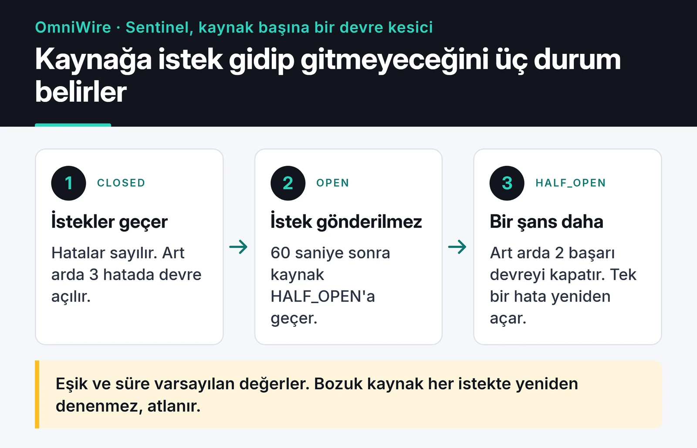

OmniWire-MCP, haber ve içerik kaynaklarını AI asistanlarına araç olarak sunan bir MCP sunucusu. RSS, Atom, JSON ve HTML kaynaklarını çekiyor, tek bir formata dönüştürüyor ve Claude gibi bir asistanın "bugün teknoloji dünyasında ne oldu?" sorusunu güncel veriyle cevaplamasını sağlıyor. TypeScript ile yazdım, npm'de `@furkankoykiran/omniwire-mcp` adıyla yayında.

Bu yazıda üç şeyi anlatıyorum: bozuk bir kaynağın diğerlerini etkilememesi için kurduğum kaynak başına circuit breaker, farklı formatları ayırt eden parser ve npm'e yayınlarken art arda düştüğüm hatalar. Kodu tekrar okurken bulduğum üç eksiği de ilgili bölümlerde anlatıyorum.

Proje sayfası: [OmniWire-MCP](https://furkankoykiran.com.tr/projeler/omniwire-mcp/) · Kaynak kod: [GitHub](https://github.com/furkankoykiran/OmniWire-MCP)

## Sunucu ne sunuyor

Sunucu stdio üzerinden çalışıyor ve dört araç sunuyor:

- `fetch-news`: etkin kaynaklardan haberleri çekiyor. İsteğe bağlı olarak anahtar kelimeye, tek bir kaynağa göre filtreliyor ve sonuç sayısını sınırlıyor.
- `check-health`: her kaynağın devre durumunu ve hata sayılarını gösteriyor.
- `refresh-config`: kaynak listesini uzak yapılandırmadan yeniden yüklüyor.
- `reset-source`: bir kaynağın devre kesicisini elle sıfırlıyor.

`fetch-news` sağlıklı bütün kaynakları `Promise.allSettled` ile paralel çekiyor, sonuçları birleştirip tarihe göre sıralıyor ve istenen sayıda haberi dönüyor. Bir kaynağın hata vermesi diğerlerinin sonucunu bozmuyor. `Promise.all` kullansaydım tek bir reddedilen istek bütün yanıtı düşürürdü.

Kaynak listesi `RSS_FEEDS` ortam değişkeninden geliyor. Bu değişken bir JSON dosyasının URL'si olabilir, o zaman sunucu dosyayı varsayılan olarak 60 saniyede bir yeniden okuyor ve kaynak eklemek için sunucuyu yeniden başlatmak gerekmiyor. Doğrudan JSON metni de olabilir. Hiç verilmezse Hacker News, Wired ve The Verge ile başlıyor.

## Kaynak başına circuit breaker

Haber kaynakları sık sık bozuluyor. Bir site RSS'ini kaldırıyor, bir diğeri birkaç dakikalığına 503 dönüyor, bir başkası cevap vermeden bekletiyor. Asistanın her istekte bozuk kaynakları yeniden denemesi yalnızca yanıtı yavaşlatıyor.

Bunun için her kaynağa ayrı bir circuit breaker koydum. Kod tabanında bu katmanın adı Sentinel. Desen bilinen üç durumlu devre kesici, geçişleri şemada:



CLOSED normal durum, istekler geçiyor ve hatalar sayılıyor. Hata sayısı eşiğe (varsayılan 3) ulaşınca devre OPEN oluyor ve o kaynak için istek hiç atılmıyor. Kurtarma süresi (varsayılan 60 saniye) dolunca HALF_OPEN'a geçiyor ve kaynağa tekrar şans veriliyor. Bu durumda iki başarılı istek devreyi kapatıyor, tek bir hata yeniden açıyor.

Karar veren metot şu:

```ts
public canExecute(): boolean {
  const currentState = this.getState();

  if (currentState === CircuitState.CLOSED) return true;
  if (currentState === CircuitState.HALF_OPEN) return true;

  if (this.shouldAttemptRecovery()) {
    this.transitionTo(CircuitState.HALF_OPEN);
    return true;
  }
  return false;
}
```

`fetch-news` önce `canRequest()` ile açık devreleri eliyor, sadece kalan kaynaklara istek atıyor. 20 kaynaktan 5'i bozuksa asistan diğer 15'in haberlerini istek zaman aşımı kadar beklemeden alıyor. Her isteğin 10 saniyelik bir zaman aşımı var, bu yüzden cevap vermeyen bir kaynak da sonsuza kadar beklemiyor, hata olarak sayılıyor.

Kodu tekrar okurken bir eksik gördüm. Yorum satırı "HALF_OPEN'da tek bir deneme isteğine izin ver" diyor ama kod HALF_OPEN'dayken her isteğe `true` dönüyor. Aynı anda birden fazla `fetch-news` çağrısı gelirse yarı açık bir kaynağa hepsi istek atıyor. Tek kullanıcılı bir stdio sunucusunda bu nadiren önemli. Doğru davranış için yine de uçuştaki deneme isteğini bir bayrakla takip edip ikinci isteği reddetmek gerekiyor.

## İçerik tipini algılamak

Kaynaklar her formatta geliyor: RSS 2.0, Atom, JSON API'leri ve feed'i hiç olmayan siteler için HTML. Her kaynağın yapılandırmasında `type` alanı var, varsayılanı `auto`. `auto` olduğunda parser tipi kendisi tahmin ediyor:

```ts
public detectContentType(content: string, contentTypeHeader?: string): ContentType {
  if (contentTypeHeader) {
    const lower = contentTypeHeader.toLowerCase();
    if (lower.includes('rss') || lower.includes('atom')) return ContentType.RSS;
    if (lower.includes('json')) return ContentType.JSON;
    if (lower.includes('html')) return ContentType.HTML;
    if (lower.includes('xml')) {
      return content.includes('<feed') ? ContentType.ATOM : ContentType.RSS;
    }
  }

  const trimmed = content.trim();
  if (trimmed.startsWith('<?xml') || trimmed.startsWith('<rss') || trimmed.startsWith('<feed')) {
    return trimmed.includes('<feed') ? ContentType.ATOM : ContentType.RSS;
  }
  if (trimmed.startsWith('[') || trimmed.startsWith('{')) return ContentType.JSON;
  if (trimmed.toLowerCase().startsWith('<!doctype') || trimmed.toLowerCase().startsWith('<html')) {
    return ContentType.HTML;
  }

  return ContentType.UNKNOWN;
}
```

Bu kod, XML'i yanlışlıkla `text/html` diye gönderen sunucuları tanımıyor. Header önce kontrol ediliyor ve `html` geçen bir header içeriğe hiç bakılmadan HTML olarak işaretleniyor. İçerik koklama sadece header yoksa ya da `application/octet-stream`, `text/plain` gibi tanınmayan bir değerse devreye giriyor.

Düzeltmesi sırayı tersine çevirmek: önce içeriğin ilk baytlarına bakmak, header'ı sadece içerik belirsiz kaldığında kullanmak. Gövdenin ilk baytları formatı güvenilir biçimde gösteriyor, header ise yanlış olabiliyor. O düzeltmeyi yapana kadar böyle bir kaynak için yapılandırmada `type: "rss"` vermek sorunu çözüyor.

## Zod ile tek bir haber şeması

Bütün adaptörler aynı şemaya göre çıktı üretiyor:

```ts
export const NewsItemSchema = z.object({
  id: z.string(),
  title: z.string(),
  link: z.string().url(),
  description: z.string().optional(),
  content: z.string().optional(),
  author: z.string().optional(),
  publishedAt: z.date().optional(),
  categories: z.array(z.string()).default([]),
});

export type NewsItem = z.infer<typeof NewsItemSchema>;
```

`z.infer` sayesinde TypeScript tipini ayrıca yazmıyorum, şema ile tip birbirinden kopamıyor.

Ancak bu şema bozuk kayıtları çalışma anında yakalamıyor. Adaptörler onu sadece tip için kullanıyor, ürettikleri kayıtları `parse` etmiyor. Geçersiz bir URL'si olan haber de asistana gidiyor. Düzeltmesi adaptör çıktısını şemadan geçirip geçersizleri ayıklamak:

```ts
const items = candidates.flatMap((candidate) => {
  const parsed = NewsItemSchema.safeParse(candidate);
  if (!parsed.success) {
    logger.warn(`Dropped invalid item from ${source.id}: ${parsed.error.message}`);
    return [];
  }
  return [parsed.data];
});
```

Kaynak yapılandırması ise gerçekten Zod ile doğrulanıyor. `RSS_FEEDS` içindeki JSON hatalıysa sunucu çökmüyor, hatayı logluyor ve varsayılan kaynaklara düşüyor.

## Repo standartları

Küçük bir proje de olsa repoyu başkalarının katkı verebileceği şekilde kurdum. `main` branch'i aktif bir ruleset ile korunuyor, değişiklikler PR üzerinden giriyor. Repoda `CONTRIBUTING.md`, `CODE_OF_CONDUCT.md`, `SECURITY.md`, issue ve PR şablonları var. CI testleri ve lint'i çalıştırıyor, CodeQL güvenlik taraması yapıyor. `stale.yml` 30 gün hareketsiz kalan issue ve PR'ları işaretliyor, 5 gün sonra kapatıyor.

Bu dosyaların hepsini ilk gün eklemek fazla gelebilir. Ancak sonradan kimse eklemiyor ve repoya yeni gelen biri ilk önce bunlara bakıyor.

## npm'e yayınlamak: dört başarısız çalıştırma

Hedefim basitti: GitHub'da bir release oluşturduğumda workflow testleri çalıştırsın, build alsın ve paketi npm'e göndersin. Pratikte ilk çalışan yayından önce bir, GitHub Packages'ı eklerken de üç başarısız workflow çalıştırması yaşadım. Workflow geçmişi hepsini gösteriyor:


Sorun eksik bir `environment: production` satırı değildi, bu workflow'da öyle bir satır hiç olmadı. Hataların asıl sebepleri şunlar.

### v1.0.2 düştü, v1.0.3 geçti

`package.json`'da `"provenance": true` vardı. npm provenance, paketin hangi workflow'da üretildiğini imzalı olarak kaydediyor ve bunun için GitHub Actions'tan bir OIDC token alması gerekiyor. Workflow bu izni vermiyordu. Ayrıca `files` alanı sadece `dist`'i paketliyordu ama publish adımından önce build çalışmıyordu, yani paket boş gidecekti. Düzeltme iki satırdı:

```yaml
permissions:
  contents: read
  id-token: write

# publish-npm job'ında
      - run: npm ci
      - run: npm run build
      - run: npm publish   # provenance bu noktada hâlâ package.json'dan geliyordu
        env:
          NODE_AUTH_TOKEN: ${{ secrets.npm_token }}
```

### v1.0.4 ve v1.0.5: npm geçti, GitHub Packages düştü

Mart'ta paketi GitHub Packages'a da göndermek için ikinci bir job ekledim. `"provenance": true` `package.json`'daki `publishConfig` içinde durduğu için iki kayıt defterine de uygulanıyordu, ama provenance sadece npmjs.com'da destekleniyor. v1.0.6'da ayarı `package.json`'dan kaldırıp `--provenance` bayrağını sadece npm job'ına koydum ve iki yayın da geçti.

`publishConfig` içindeki her ayar, paketi yayınladığınız her kayıt defterine uygulanıyor. Kayıt defterine özel davranışı komut satırı bayrağında tutmak daha güvenli.

### Bugün kursam

Bugün sıfırdan kursam token'ı tamamen bırakırdım. npm'in [trusted publishing](https://docs.npmjs.com/trusted-publishers) özelliği GitHub Actions'ın OIDC token'ıyla doğrudan yayın yapıyor ve provenance'ı otomatik ekliyor. Bunun için npmjs.com'da paketi repoya ve workflow dosyasına bağlamak, workflow'a `id-token: write` vermek ve npm CLI 11.5.1 veya üstünü kullanmak gerekiyor. Node 20 ile gelen npm 10 bunu desteklemiyor, bu yüzden ya Node 24'e geçmek ya da job'da `npm install -g npm@latest` çalıştırmak lazım. Böylece repoda süresi dolacak veya çalınabilecek bir `NPM_TOKEN` kalmıyor.

## Kurulum

Node.js 18 veya üstü yeterli. Claude Desktop için `claude_desktop_config.json` dosyasına şunu ekleyin:

```json
{
  "mcpServers": {
    "omniwire": {
      "command": "npx",
      "args": ["-y", "@furkankoykiran/omniwire-mcp"],
      "env": {
        "RSS_FEEDS": "https://example.com/my-feeds.json"
      }
    }
  }
}
```

Paket adının scoped olduğuna dikkat edin. Scope'suz `npx omniwire-mcp` komutu çalışmaz, çünkü npm'de o adla bir paket yok. `RSS_FEEDS` vermezseniz varsayılan üç kaynakla başlıyor.

Docker imajı bir registry'de yayında değil, repodaki Dockerfile ile kendiniz derlemeniz gerekiyor:

```bash
git clone https://github.com/furkankoykiran/OmniWire-MCP.git
cd OmniWire-MCP
docker build -t omniwire-mcp .
docker run -i --rm -e RSS_FEEDS="https://example.com/my-feeds.json" omniwire-mcp
```

`-i` bayrağı şart, çünkü sunucu stdio üzerinden konuşuyor ve stdin kapanırsa çıkıyor.

## Sırada ne var

Önce yukarıdaki üç düzeltme geliyor: HALF_OPEN'da tek deneme isteği, içerik koklamanın header'dan önce yapılması ve haberlerin Zod şemasından geçirilmesi. Ardından araçları SDK'daki `server.tool()` yerine `registerTool()` ile tanımlamak istiyorum, MCP TypeScript SDK'sı eski API'yi kullanımdan kaldırıyor. Dockerfile'daki `npm ci --only=production` de artık `npm ci --omit=dev` olmalı. Daha uzun vadede haberleri bir vektör veritabanına yazıp "geçen ay X hakkında ne çıktı?" gibi anlamsal sorguları desteklemek var.

Aynı serideki diğer sunucularım: [DevTo-MCP](/posts/devto-mcp-server-gelistirme-ve-yayinlama/), DEV Community API'si için, ve [freqtrade-mcp](/posts/freqtrade-mcp-server-tr/), trading botuna Claude üzerinden soru sormak için. CI tarafını kendi makinemde çalıştırmayı da [self-hosted runner yazısında](/posts/github-actions-self-hosted-runner-tr/) anlattım.
