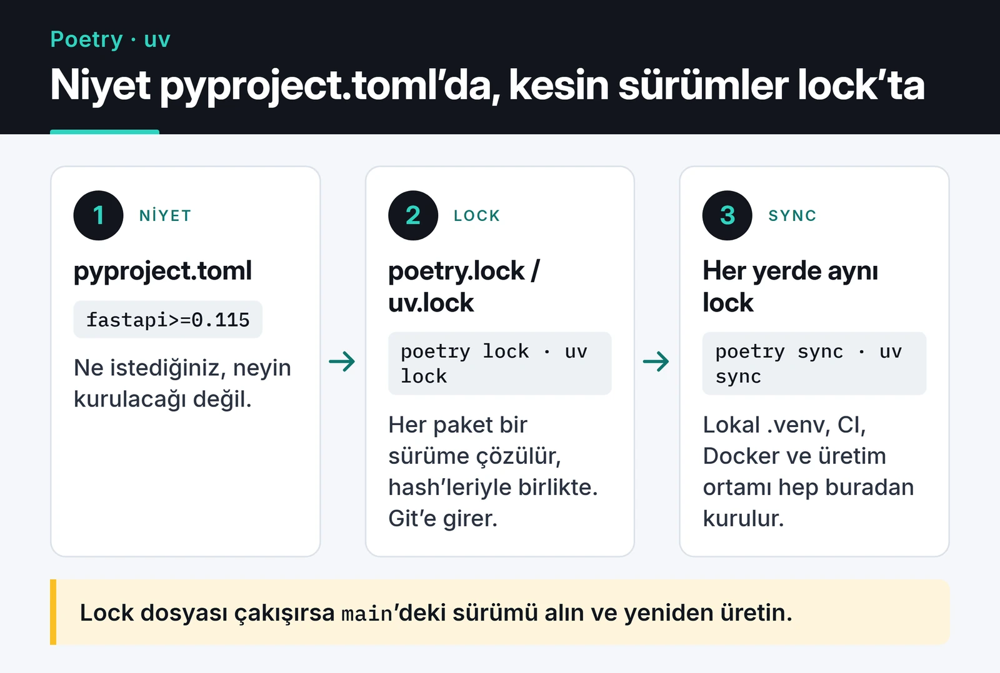

Poetry ile Python proje yönetimi, uzun süre `requirements.txt` karmaşasından kaçmanın standart yoluydu. Astral'ın geliştirdiği uv ise kısa sürede yayıldı ve yeni açılan projelerin önemli bir kısmı artık uv ile başlıyor. Benim tarafımda da durum bu: eski Telegram botlarımın çoğu Poetry ile, son projelerim uv ile yönetiliyor. Bu yazıda ikisini lock dosyası, Docker, CI ve paket yayınlama üzerinden yan yana koyuyorum. İkisi de iyi araç; hangisinin size uyduğu projenin türüne ve ekibin alışkanlıklarına bağlı.

## requirements.txt neden yetmiyor

`pip freeze > requirements.txt` o anki ortamda ne varsa yazar. Dosya bir paketin neden orada olduğunu söylemez: `urllib3`'ü siz mi eklediniz, yoksa `requests` mi getirdi? Bir şeyi silmek istediğinizde neyin kırılacağını bilemezsiniz. Elle yazılmış bir `requirements.txt` ise tersine sadece doğrudan bağımlılıkları sabitler, alt bağımlılıklar her kurulumda değişebilir. "Bende çalışıyor, sunucuda çalışmıyor" cümlesinin çoğu buradan çıkar.

Modern araçların hepsi aşağıdaki şemadaki ayrımı yapar:



`pyproject.toml` niyetinizi, lock dosyası o niyetin belirli bir andaki çözümünü tutar. Lock dosyası git'e girer. "Sürekli conflict çıkarıyor" diye `.gitignore`'a eklemek lock dosyasının bütün faydasını çöpe atar; conflict çıkınca `main`'in hâlini alıp lock'u yeniden üretmek yeterli.

## Aynı proje, iki araçla

Poetry 2.0 ile birlikte Poetry de standart `[project]` tablosunu (PEP 621) okuyor. Yani iki aracın `pyproject.toml` dosyaları artık birbirine çok benziyor. Bir FastAPI servisi için uv ile başlangıç:

```bash
uv init --app bildirim-servisi
cd bildirim-servisi
uv add fastapi "uvicorn[standard]" httpx
uv add --dev pytest ruff
uv run pytest
```

Ortaya çıkan dosya:

```toml
[project]
name = "bildirim-servisi"
version = "0.1.0"
requires-python = ">=3.12"
dependencies = [
    "fastapi>=0.115",
    "httpx>=0.28",
    "uvicorn[standard]>=0.34",
]

[dependency-groups]
dev = [
    "pytest>=8.3",
    "ruff>=0.12",
]
```

(Sürüm alt sınırları, `uv add` çalıştırdığınız günün sürümlerine göre yazılır; sizinkiler farklı olacak.)

Aynı işi Poetry ile:

```bash
mkdir bildirim-servisi && cd bildirim-servisi
poetry init --no-interaction
poetry add fastapi "uvicorn[standard]" httpx
poetry add --group dev pytest ruff
poetry run pytest
```

Poetry 2.x de bağımlılıkları `[project]` altına yazar. Dev grubu için hem kendi `[tool.poetry.group.dev.dependencies]` tablosunu hem de PEP 735 `[dependency-groups]` biçimini destekliyor. Bu da iki araç arasında geçişi eskiye göre çok kolaylaştırıyor. Yayınlamayacağınız bir uygulama için `pyproject.toml` içinde `[tool.poetry]` altına `package-mode = false` ekleyin; yoksa Poetry projenin kendisini de paket olarak kurmaya çalışır.

Poetry 2.0 bazı eski alışkanlıkları da değiştirdi. Şu komutlar artık eskisi gibi çalışmıyor:

- `poetry shell` Poetry 2.0'da çekirdekten çıktı. Yerine `eval $(poetry env activate)` var, ya da her komutu `poetry run` ile çalıştırırsınız.
- `poetry install --sync` yerine ayrı bir `poetry sync` komutu geldi. Lock'ta olmayan paketleri ortamdan siler.
- `poetry export` artık varsayılan olarak gelmiyor; `poetry self add poetry-plugin-export` ile eklemeniz gerekiyor.

## Hız gerçekten fark ediyor mu?

uv Rust ile yazılmış ve global bir önbellek ile hard link kullanıyor. Farkı görmek için yukarıdaki FastAPI projesinin bağımlılıklarını (29 paket) iki araçla da kurdum: uv 0.11.8 ve Poetry 2.3.0, Windows 11, önbellekler sıcak, `.venv` her denemeden önce silinmiş. Üç denemede `uv sync` 3,5 ile 5,5 saniye, `poetry sync` 13 ile 34 saniye sürdü.

Sayılar makineye, diske ve ağa göre değişir. Kendi projenizde `time poetry sync` ve `time uv sync` ile ölçün.

Lokal geliştirmede bu fark çoğu zaman önemsiz. CI'da her job sıfırdan ortam kuruyorsa, ya da Docker imajını sık build ediyorsanız fark birikiyor.

## Karşılaştırma

| | Poetry 2.x | uv |
|---|---|---|
| Hız | Yeterli, büyük projelerde çözümleme yavaşlayabiliyor | Çok hızlı |
| Python sürümü kurma | Deneysel `poetry python` komutları var; çoğu kişi pyenv ile birlikte kullanıyor | `uv python install 3.13`, yerleşik |
| Standartlar | `[project]`, PEP 735 grupları destekleniyor | `[project]`, PEP 735, PEP 723 script metadata, `pylock.toml` dışa aktarma |
| Eklentiler | Olgun eklenti sistemi (export, dinamik sürüm vb.) | Eklenti sistemi yok, çoğu özellik yerleşik |
| Monorepo | Doğrudan desteklemiyor | Workspace desteği var |
| Tek seferlik araçlar | pipx ile | `uvx ruff check .` |
| Yayınlama | `poetry build`, `poetry publish` | `uv build`, `uv publish` (trusted publishing destekli) |
| Yönetişim | Topluluk projesi, uzun geçmiş | Astral şirketi geliştiriyor, çok hızlı sürüm çıkarıyor |

Son satır önemli. uv'nin hızlı gelişmesi, davranışların sürümler arasında değişebilmesi demek; CI'da uv sürümünü sabitlemek iyi fikir. Poetry daha yavaş değişiyor ama daha öngörülebilir.

## Sürüm kısıtları: `^`, `~` ve `~=`

`[project]` tablosunda sadece standart PEP 440 sözdizimi geçerli: `>=1.2`, `>=1.2,<2`, `~=1.2.3`. Poetry'ye özgü `^` ve `~` operatörleri sadece `[tool.poetry.dependencies]` altında çalışır.

- `^1.2.3` (Poetry): `>=1.2.3,<2.0.0`
- `~1.2.3` (Poetry): `>=1.2.3,<1.3.0`
- `~=1.2.3` (PEP 440): `>=1.2.3,==1.2.*`, yani yine `<1.3.0`

Benim kuralım şu: uygulamalarda alt sınır yazıp gerisini lock dosyasına bırakıyorum. Kütüphanelerde üst sınır koymaktan kaçınıyorum, çünkü kütüphanenizi kullanan projede gereksiz çakışmalar yaratır. Sürekli `==` ile sabitlenmiş bir paket ise geçici bir çözümdür; neden sabitlendiğini yanına yorum olarak yazın.

## Docker'da kullanım

Paket yöneticisinin kendisi üretim imajında olmamalı. İki aşamalı build ile sanal ortamı ilk aşamada kurup sadece onu kopyalıyorum. uv ile:

```dockerfile
FROM python:3.13-slim AS builder
COPY --from=ghcr.io/astral-sh/uv:0.13.5 /uv /uvx /bin/
ENV UV_COMPILE_BYTECODE=1 UV_LINK_MODE=copy UV_PYTHON_DOWNLOADS=0
WORKDIR /app
COPY pyproject.toml uv.lock ./
RUN --mount=type=cache,target=/root/.cache/uv \
    uv sync --locked --no-dev --no-install-project
COPY . .

FROM python:3.13-slim
WORKDIR /app
COPY --from=builder /app /app
ENV PATH="/app/.venv/bin:$PATH"
# main.py içinde: app = FastAPI()
CMD ["uvicorn", "main:app", "--host", "0.0.0.0", "--port", "8000"]
```

Poetry ile aynı yapı:

```dockerfile
FROM python:3.13-slim AS builder
ENV POETRY_VIRTUALENVS_IN_PROJECT=1 POETRY_NO_INTERACTION=1
RUN pip install --no-cache-dir "poetry>=2.2,<3"
WORKDIR /app
COPY pyproject.toml poetry.lock ./
RUN poetry sync --only main --no-root
COPY . .

FROM python:3.13-slim
WORKDIR /app
COPY --from=builder /app /app
ENV PATH="/app/.venv/bin:$PATH"
# main.py içinde: app = FastAPI()
CMD ["uvicorn", "main:app", "--host", "0.0.0.0", "--port", "8000"]
```

İki dosyada da bağımlılıklar kaynak koddan önce kopyalanıyor. Kodu değiştirdiğinizde bağımlılık katmanı önbellekten geliyor. İki aşamanın da aynı base imajı kullanması şart, çünkü `.venv` içindeki yollar Python yorumlayıcısının konumuna bağlı. Docker tarafının geri kalanını [Docker ile Python yazısında](/posts/docker-ile-python-uygulamasi-containerization/) anlattım.

## CI'da lock dosyasını korumak

Birisi `pyproject.toml`'u değiştirip lock'u güncellemeyi unutursa CI kırılmalı. uv'de `--locked` bayrağı bunu yapar:

```yaml
# .github/workflows/test.yml
name: test
on: [push, pull_request]
jobs:
  test:
    runs-on: ubuntu-latest
    steps:
      - uses: actions/checkout@v7
      - uses: astral-sh/setup-uv@v10
        with:
          enable-cache: true
      - run: uv sync --locked
      - run: uv run pytest
```

Poetry'de karşılığı `poetry check --lock`, ardından `poetry sync`. Lock dosyası conflict'leri ve branch stratejisi için [Git iş akışı yazıma](/posts/git-is-akisi-branch-stratejileri/) bakabilirsiniz; testlerin kendisi için de [pytest yazısı](/posts/pytest-ile-ileri-seviye-test-teknikleri/) var.

## Kütüphane yayınlamak

Poetry'de akış oturmuş durumda:

```bash
poetry version patch     # 0.1.0 -> 0.1.1
poetry build             # dist/ altına wheel ve sdist
poetry publish           # önce: poetry config pypi-token.pypi <token>
```

uv'de karşılığı:

```bash
uv version --bump patch
uv build
uv publish               # GitHub Actions'ta trusted publishing ile token gerekmez
```

PyPI'a GitHub Actions'tan yayın yapıyorsanız trusted publishing kullanın. Uzun ömürlü bir API token'ını secret olarak saklamaktan daha güvenli.

## Poetry'den uv'ye geçiş

Geçişi denemek isterseniz [migrate-to-uv](https://github.com/mkniewallner/migrate-to-uv) aracı `[tool.poetry]` bölümünü standart tablolara çeviriyor:

```bash
uvx migrate-to-uv
uv lock
uv sync
```

Çevirdikten sonra testleri çalıştırın ve lock dosyasındaki sürümleri eskisiyle karşılaştırın. Çözümleyiciler farklı olduğu için bazı alt bağımlılıklar başka sürüme çözülebilir.

## Hangi durumda hangisi

- Yeni bir uygulama ya da script başlatıyorsanız uv. Python sürümünü de yönettiği için tek araçla iş bitiyor.
- Poetry ile sorunsuz çalışan, eklentilerine (dinamik sürüm, export, özel kaynaklar) dayanan bir projeniz varsa sırf moda diye taşımayın. Poetry 2.x standartlara yaklaştı, gerektiğinde geçiş kolay.
- Ekipte uv'yi bilen kimse yoksa ve CI süresi sorun değilse, bildiğiniz araçla devam etmek de makul bir karar.

İkisinden hangisini seçerseniz seçin, değişmeyen kısım aynı: lock dosyası git'te, CI lock'a sadık, üretim imajında paket yöneticisi yok. Ayrıntılar için [uv dokümanı](https://docs.astral.sh/uv/) ve [Poetry dokümanı](https://python-poetry.org/docs/) yeterince iyi.

Ortam tekrarlanabilir hâle geldikten sonra sıradaki adım, zamanın nereye gittiğini ölçmek; bunu [Python profiling yazısında](/posts/python-performans-profiling-optimizasyon/) anlattım.
