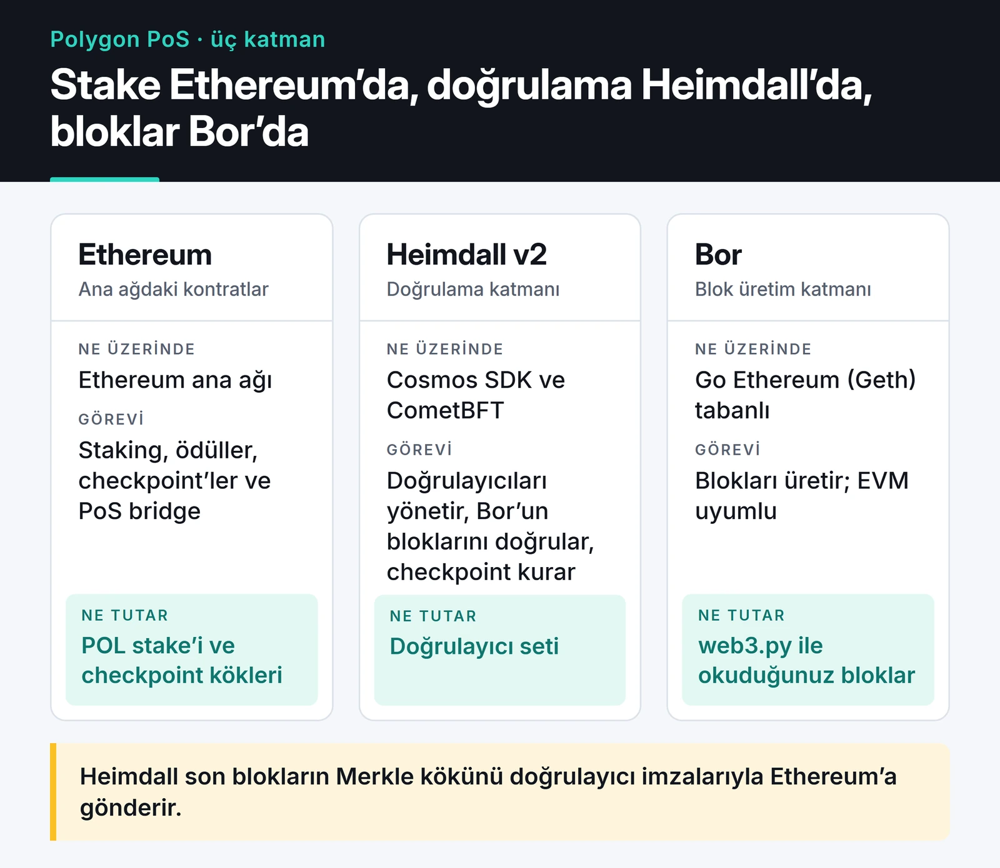
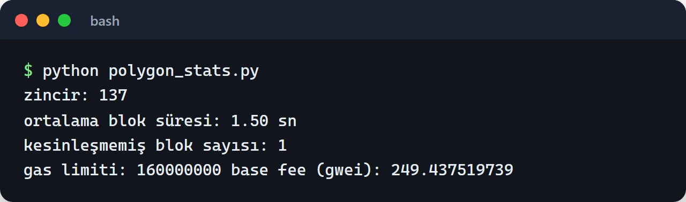

Polygon PoS, Ethereum'a ucuz ve hızlı bir alternatif arayan projelerin uzun süre ilk durağıydı. Ben de Web3 tarafında çalışırken kontratlarımı ve botlarımı önce Polygon'da denedim. Bu yazıda Polygon PoS mimarisini, Ethereum'un Layer 2 ölçekleme çözümleri arasında nerede durduğunu ve üzerinde geliştirirken nelere dikkat ettiğimi anlatıyorum.

Ekosistem kısa sürede çok değişti: MATIC'in yerini POL aldı, Heimdall baştan yazıldı, blok üretim modeli değişti ve Polygon zkEVM Mainnet Beta kapandı. Anlattıklarım bu değişikliklerden sonraki duruma göre.

## Önce büyük resim: Layer 2 ne demek?

Ethereum ana ağı her işlemi binlerce düğümde tekrar çalıştırdığı için hem pahalı hem yavaş. Ölçekleme çözümleri işlemleri ana ağın dışında çalıştırıp sonucu bir şekilde Ethereum'a bağlıyor. Fark, bu bağın ne kadar güçlü olduğunda.

| Tür | Örnekler | Güvenlik nereden geliyor? | Ethereum'a çekim |
| :--- | :--- | :--- | :--- |
| Optimistic rollup | Arbitrum One, OP Mainnet, Base | İşlem verisi Ethereum'da; hatalı durum fraud proof ile itiraz edilebilir | Genellikle 7 günlük itiraz süresi |
| ZK rollup | zkSync Era, Starknet, Scroll, Linea | İşlem verisi Ethereum'da; her paket geçerlilik kanıtıyla doğrulanıyor | Kanıt doğrulanınca, saatler mertebesinde |
| PoS zinciri + checkpoint | Polygon PoS | Kendi doğrulayıcı seti; Ethereum'a periyodik checkpoint | Checkpoint beklenir, genelde bir saat ya da daha fazla |

Polygon PoS teknik olarak bir rollup değil. İşlem verisini Ethereum'a yazmıyor ve geçerliliği Ethereum'da kanıtlanmıyor. Güvenliği büyük ölçüde kendi doğrulayıcılarının dürüstlüğüne dayanıyor. L2BEAT gibi kaynaklar da onu rollup olarak sınıflandırmıyor. Bu kötü bir şey değil, sadece farklı bir güven modeli ve uygulamanızın risk profiline göre seçmeniz gereken bir şey.

Rollup'ların maliyetinde en büyük değişiklik Mart 2024'teki Dencun güncellemesiyle gelen EIP-4844 "blob"ları oldu. Rollup'lar verilerini calldata yerine bu ucuz geçici alana yazmaya başladı ve L2 işlem ücretleri ciddi şekilde düştü. State channel ve Plasma gibi daha eski yaklaşımlar bugün genel amaçlı ölçekleme için pek kullanılmıyor.

Bir rollup seçerken baktığım şey L2BEAT'in "stage" sınıflandırması (Stage 0, 1, 2). Bu, kanıt sisteminin ne kadar olgun olduğunu ve bir güvenlik konseyinin kullanıcı fonlarını ne ölçüde kontrol edebildiğini özetliyor.

## Polygon PoS'un üç katmanı

Polygon PoS üç katmandan oluşuyor: Ethereum'daki kontratlar, doğrulayıcıların çalıştığı Heimdall ve blokları üreten Bor. Kart üçünü karşılaştırıyor.



### Ethereum katmanı

Polygon'un kökleri Ethereum ana ağındaki kontratlarda. Doğrulayıcı olmak isteyenler POL'u burada stake ediyor, ödüller burada dağıtılıyor, checkpoint'ler burada saklanıyor ve PoS bridge'in kilitleme kontratları burada duruyor.

### Heimdall v2: doğrulama katmanı

Heimdall, doğrulayıcı setini yöneten ve Bor'un ürettiği blokları doğrulayan katman. Heimdall v2 ile baştan yazıldı ve artık Cosmos SDK ile CometBFT üzerinde çalışıyor. Bu sürümün geliştiriciler için en görünür sonucu kesinlik (finality) süresinin yaklaşık 1-2 dakikadan 5 saniye civarına inmesi oldu.

Heimdall ayrıca periyodik olarak checkpoint oluşturuyor: son checkpoint'ten bu yana üretilen blokların hash'lerinden bir Merkle ağacı kuruyor ve kökünü doğrulayıcı imzalarıyla Ethereum'a gönderiyor. Bu checkpoint'ler PoS bridge'den Ethereum'a para çekerken kanıt olarak kullanılıyor.

### Bor: blok üretim katmanı

Bor, Go Ethereum (Geth) tabanlı yürütme katmanı. EVM uyumlu olduğu için Ethereum için yazılmış kontratlar değişmeden çalışıyor. Rio güncellemesiyle blok üretim modeli de değişti: Heimdall her "span" için, doğrulayıcıların stake ağırlıklı oylarıyla seçilen küçük bir havuzdan tek bir blok üreticisi belirliyor.

Bir sonraki bölümdeki script'i çalıştırdığımda ortalama blok süresi 1,5 saniye çıktı ve `finalized` etiketli blok en son bloğun yalnızca birkaç blok gerisindeydi. Polygon kapasiteyi de aşamalı olarak artırıyor: Bhilai güncellemesi blok gas limitini 30 milyondan 45 milyona çıkarmıştı, benim ölçümümde bu değer 160 milyondu. Bu sayılar değişmeye devam ediyor, kendi uygulamanız için güncel değerleri zincirden okuyun.

## Kesinliği kendiniz ölçmek

Python ile Polygon'a bağlanırken bir detaya dikkat etmek gerekiyor: Polygon blok başlıklarının `extraData` alanı 32 byte'tan uzun ve web3.py bunu varsayılan olarak kabul etmiyor. `ExtraDataToPOAMiddleware` eklemezseniz `ExtraDataLengthError` alıyorsunuz.

```python {title="polygon_stats.py"}
from web3 import Web3
from web3.middleware import ExtraDataToPOAMiddleware

w3 = Web3(Web3.HTTPProvider("https://polygon-bor-rpc.publicnode.com"))
w3.middleware_onion.inject(ExtraDataToPOAMiddleware, layer=0)

latest = w3.eth.get_block("latest")
finalized = w3.eth.get_block("finalized")
prev = w3.eth.get_block(latest["number"] - 100)

block_time = (latest["timestamp"] - prev["timestamp"]) / 100
print("zincir:", w3.eth.chain_id)
print(f"ortalama blok süresi: {block_time:.2f} sn")
print("kesinleşmemiş blok sayısı:", latest["number"] - finalized["number"])
print("gas limiti:", latest["gasLimit"], "base fee (gwei):", w3.from_wei(latest["baseFeePerGas"], "gwei"))
```

web3.py 7.16 ile çalıştırdığım bir örnek çıktı:



Bu, uygulama tarafında önemli bir soruya cevap veriyor: bir ödemeyi ya da depozitoyu ne zaman "kesin" saymalıyım? Eskiden Polygon'da reorg'lar yaşandığı için borsalar ve servisler yüzlerce blok onay bekliyordu. Bugün `finalized` etiketini kullanmak hem daha hızlı hem daha doğru. Ama Ethereum'a çekim gibi işlemler için Ethereum tarafındaki checkpoint'i beklemek hâlâ gerekiyor.

## PoS bridge ve state sync

Ethereum'dan Polygon'a varlık taşıdığınızda (deposit) tokenlar Ethereum'daki köprü kontratında kilitleniyor. Heimdall doğrulayıcıları bu olayı görüp "state sync" mekanizmasıyla Bor'a iletiyor ve Polygon tarafında karşılık gelen token mint ediliyor. Bu yön dakikalar sürüyor.

Ters yönde (withdraw) token Polygon'da yakılıyor, bu yakma işlemini içeren blok bir checkpoint'e girene kadar bekleniyor ve sonra Ethereum'da bu checkpoint'e karşı bir Merkle kanıtı sunularak kilit açılıyor. Süre bu yüzden checkpoint aralığına bağlı.

Köprüler kripto tarihinin en pahalı saldırılarına sahne oldu. Ronin'de doğrulayıcı anahtarlarının çoğunluğu ele geçirildi, başka köprülerde imza doğrulama hataları istismar edildi. Kendi "lock & mint" köprünüzü yazmayı düşünüyorsanız önce bu olayları okuyun. Sıfırdan köprü yazmayı öğretici bir örnek dışında önermiyorum. Bunun yerine zincirin resmi köprüsünü ya da yerleşik mesajlaşma protokollerini kullanmak daha güvenli.

## POL, zkEVM ve AggLayer

Polygon ekosisteminde 2024'ten bu yana üç büyük değişiklik oldu:

- MATIC'ten POL'a geçiş Eylül 2024'te başladı. POL artık Polygon PoS'ta hem gas hem staking tokenı. Eski kodunuzda "MATIC" geçen yerleri güncelleyin. Zincir kimliği aynı kaldı: ana ağ 137, test ağı Amoy 80002. Mumbai test ağı 2024'te kapatıldı.
- Polygon zkEVM Mainnet Beta kapandı. Polygon kararı duyurduktan sonra sequencer durduruldu, cüzdanlardaki bakiyeler bir anlık görüntüyle Ethereum'a taşındı ve oradan talep edilebiliyor. Yeni bir proje için "PoS mu zkEVM mi?" sorusu bu yüzden artık gündemde değil.
- AggLayer, farklı zincirleri ortak bir köprü ve kanıt katmanında birleştirmeyi hedefleyen bir birlikte çalışabilirlik katmanı. Polygon'un CDK ile kurulan zincirleri buna bağlanıyor. Ben bu tarafı üretimde kullanmadım, o yüzden ayrıntıya girmiyorum.

## Polygon'da geliştirirken dikkat ettiklerim

Kontratlar Ethereum ile aynı olsa da birkaç pratik fark var:

- Test için Amoy kullanın, faucet'ten test POL alın. Foundry ile deploy Ethereum'dakiyle aynı, sadece RPC adresi ve `--chain` değişiyor.
- Gas ucuz diye verimsiz kod yazmayın. Yoğun anlarda base fee sıçrayabiliyor ve döngüsü sınırsız büyüyen bir fonksiyon her ağda blok gas limitine takılır. [Solidity güvenliği ve gas yazısındaki](/posts/ethereum-smart-contract-security-best-practices/) kurallar burada da geçerli.
- Halka açık RPC'ler deneme için yeterli. Canlı bir uygulamada hız limitleri yüzünden ücretli bir sağlayıcı ya da kendi Bor düğümünüz gerekiyor.
- Event geçmişini doğrudan RPC'den büyük aralıklarla sorgulamayın. Bloklar hızlı üretildiği için aynı zaman aralığında Ethereum'dakinden çok daha fazla blok var. Parça parça okuyun ya da bir indexer kullanın.

## Sırada ne var

Polygon'a Python'dan bağlanmanın ayrıntıları [web3.py v7 rehberinde](/posts/web3py-ethereum-blockchain-etkilesimi/), ucuz bir ağda NFT koleksiyonu yayınlamak için örnek bir kontrat [ERC721A yazısında](/posts/nft-minting-ethereum-complete-tutorial/) var. Farklı bir ölçekleme yaklaşımını merak ediyorsanız [Rust ile Solana programı geliştirme](/posts/solana-program-development-rust/) yazısına bakabilirsiniz. Güncel teknik değerler için en iyi kaynak [Polygon'un resmi dokümantasyonu](https://docs.polygon.technology/).
