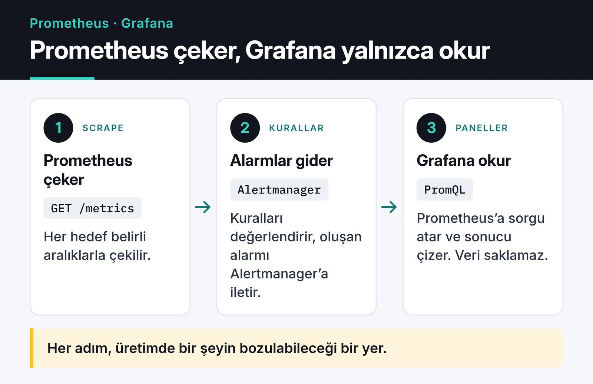

Prometheus ve Grafana ile izleme kurmak bugün bir Helm chart ve on dakikalık iş. Zor kısım sonradan geliyor: hangi metriği toplayacağınız, hangi label'ı asla eklemeyeceğiniz ve gece kimi uyandıracağınız. Bu yazıda kurulum adımlarını tekrar etmeyeceğim. Kendi servislerimi izlerken işime yarayan kuralları, PromQL kalıplarını ve sık düştüğüm hataları topladım.

## Parçalar nasıl birbirine bağlanıyor

Prometheus pull modeliyle çalışır: hedeflerin `/metrics` endpoint'ini belirli aralıklarla kendisi çeker (scrape). Kuralları değerlendirir, alarm koşulu oluşunca Alertmanager'a haber verir. Grafana ise sadece bir görselleştirme katmanıdır; veriyi Prometheus'a PromQL sorgusu atarak alır.



Yukarıdaki her adım, production'da bir şeyin bozulabileceği yer. Yazının geri kalanı kabaca bu sırayı izliyor.

## İlk tuzak: cardinality patlaması

Prometheus'ta her benzersiz label kombinasyonu ayrı bir zaman serisidir. `http_requests_total{method="GET", route="/users/:id", status="200"}` tek seri. Label'a sınırsız değer alabilen bir şey koyduğunuzda (kullanıcı ID'si, ham URL path'i, e-posta, User-Agent) seri sayısı kullanıcı sayınızla birlikte büyür. Prometheus her seriyi bellekte tuttuğu için sonunda OOM ile düşer. RAM eklemek sorunu sadece erteler.

Kural basit: label değerleri sonlu bir kümeden gelmeli. Path yerine route şablonunu kullanın. FastAPI'de bu şablon request scope'unda hazır duruyor:

```python
import time

from fastapi import FastAPI, Request
from prometheus_client import Counter, Histogram, make_asgi_app

REQUESTS = Counter(
    "http_requests_total", "HTTP istekleri", ["method", "route", "status"]
)
LATENCY = Histogram(
    "http_request_duration_seconds",
    "İstek süresi",
    ["method", "route"],
    buckets=(0.01, 0.025, 0.05, 0.1, 0.25, 0.5, 1, 2.5, 5),
)

app = FastAPI()
app.mount("/metrics", make_asgi_app())


@app.middleware("http")
async def prometheus_middleware(request: Request, call_next):
    start = time.perf_counter()
    response = await call_next(request)
    route = request.scope.get("route")
    path = route.path if route else "unmatched"  # /users/{user_id}, 42 değil
    REQUESTS.labels(request.method, path, str(response.status_code)).inc()
    LATENCY.labels(request.method, path).observe(time.perf_counter() - start)
    return response
```

Eşleşmeyen istekleri `unmatched` altında toplamak da önemli. Yoksa 404 tarayan bir bot her denediği URL için yeni seri açtırır.

Zaten şişmiş bir Prometheus'ta suçluyu bulmanın en hızlı yolu arayüzdeki **Status → TSDB Status** sayfası. Aşağıdaki görüntü Prometheus projesinin herkese açık demo sunucusundan: en çok seri üreten metriklerin başında histogram `_bucket` serileri geliyor, çünkü her bucket sınırı (`le`) ayrı bir seri demek.


Aynı bilgiye sorguyla da ulaşabilirsiniz:

```promql
topk(10, count by (__name__) ({__name__=~".+"}))
```

Bu sorgu pahalıdır, büyük bir kurulumda yoğun saatte çalıştırmayın.

## Neyi izlemeli: dört altın sinyal

[Google SRE kitabındaki dört altın sinyal](https://sre.google/sre-book/monitoring-distributed-systems/), her servis için iyi bir başlangıç noktası. Rastgele yüz metrik yerine önce bunları oturtun.

Trafik, sisteme gelen yük:

```promql
sum by (route) (rate(http_requests_total[5m]))
```

Hata oranı. 4xx çoğu zaman istemcinin hatasıdır, alarm için 5xx'e bakın:

```promql
sum(rate(http_requests_total{status=~"5.."}[5m]))
  /
sum(rate(http_requests_total[5m]))
```

Gecikme. Ortalama, en yavaş isteklerinizi gizler. P95 ve P99'a bakın; P99 en mutsuz yüzde birlik kullanıcınızın deneyimidir:

```promql
histogram_quantile(
  0.99,
  sum by (le, route) (rate(http_request_duration_seconds_bucket[5m]))
)
```

Doygunluk, kaynakların ne kadar dolu olduğu. CPU ile sınırlı değil: bağlantı havuzu, thread havuzu, disk I/O ve kuyruk derinliği de buraya girer. En sinsi sorunlar genelde burada çıkar.

```promql
1 - avg by (instance) (rate(node_cpu_seconds_total{mode="idle"}[5m]))
```

## rate, irate ve increase farkı

Üçü de counter üzerinde çalışır ve süreç yeniden başladığında counter'ın sıfırlanmasını kendisi düzeltir. Aralarındaki fark, pencereye nasıl baktıkları:

- `rate()` pencere boyunca saniye başına ortalama artışı verir. Dashboard ve alarm için varsayılan seçim budur.
- `irate()` sadece son iki örneğe bakar. Kısa sıçramaları görünür kılar ama grafik testere dişine döner; alarmda kullanmayın.
- `increase()` pencere içindeki toplam artıştır. "Son bir saatte kaç hata aldık" sorusunun cevabı.

Pencere boyu scrape aralığının en az dört katı olsun. 30 saniyelik scrape aralığıyla `[1m]` penceresi bazen tek örnek yakalar ve `rate()` boş döner.

Aynı ağır sorguyu on dashboard panelinde ve üç alarmda çalıştırıyorsanız recording rule yazın. Prometheus sonucu önceden hesaplayıp yeni bir seri olarak saklar:

```yaml
groups:
  - name: api-recording
    rules:
      - record: route:http_requests:rate5m
        expr: sum by (route) (rate(http_requests_total[5m]))
```

## Alarm: nöbetçiyi yakmamak

Her şeye alarm kurmak en yaygın hata. CPU yüzde 80, RAM yüzde 70, disk yüzde 85... Günde yüz bildirim gelince ekip hepsini gürültü olarak görmeye başlar ve gerçekten önemli olan "veritabanı düştü" mesajı kaybolur.

Benim kullandığım kurallar:

- Semptoma alarm kurun, nedene değil. CPU yüzde 99 ama gecikme 50 ms ve hata yoksa kullanıcı etkilenmiyordur. Tersine, CPU yüzde 10'dayken P99 iki saniyeyi geçtiyse sorun vardır.
- Sadece hemen insan müdahalesi gerekiyorsa telefon çalsın. Üç gün sonra dolacak disk bir Slack mesajı ya da ticket olarak kalabilir.
- `for:` kullanın. Tek bir scrape'te görülen sıçrama kimseyi uyandırmamalı.

```yaml
groups:
  - name: api-alerts
    rules:
      - alert: HighErrorRate
        expr: |
          sum(rate(http_requests_total{status=~"5.."}[5m]))
            / sum(rate(http_requests_total[5m])) > 0.05
        for: 10m
        labels:
          severity: page
        annotations:
          summary: "5xx oranı 10 dakikadır %5'in üzerinde"
```

Alertmanager tarafında yönlendirme ve bastırma (inhibition) işin yarısıdır. Veritabanı düştüyse ona bağlı elli servisin "bağlanamıyorum" alarmına gerek yok:

```yaml
route:
  receiver: slack-warnings
  group_by: ["alertname", "cluster"]
  routes:
    - matchers: ['severity="page"']
      receiver: pagerduty
inhibit_rules:
  - source_matchers: ['alertname="DatabaseDown"']
    target_matchers: ['severity="warning"']
    equal: ["cluster"]
# receivers bölümü (slack_configs, pagerduty_configs) kısaltıldı
```

Bir de "izleyeni kim izliyor" sorusu var. Her zaman ateşlenen bir `Watchdog` alarmı tanımlayıp bunu dışarıdaki bir dead man's switch servisine gönderin. Alarm gelmeyi keserse Prometheus ya da Alertmanager çökmüş demektir.

## Kubernetes'te service discovery

Pod'lar sürekli yeniden oluştuğu için IP'leri elle yazmak mümkün değil. `kubernetes_sd_configs` Kubernetes API'sini dinler ve hedefleri kendisi bulur. Ama cluster'daki her pod'u çekmek istemezsiniz. `relabel_configs` ile sadece işaretli olanları tutun:

```yaml
scrape_configs:
  - job_name: kubernetes-pods
    kubernetes_sd_configs:
      - role: pod
    relabel_configs:
      - source_labels: [__meta_kubernetes_pod_annotation_prometheus_io_scrape]
        action: keep
        regex: "true"
```

`prometheus.io/scrape` annotation'ı Prometheus'un yerleşik bir özelliği değil, topluluğun benimsediği bir gelenek; yukarıdaki relabel kuralı onu anlamlı kılıyor. Prometheus Operator kullanıyorsanız aynı işi `ServiceMonitor` ve `PodMonitor` kaynaklarıyla yaparsınız, ki çoğu ekip bugün o yolu seçiyor.

## Exporter'lar

`node_exporter` kurup bırakmayın. En çok işime yarayanlar:

- `blackbox_exporter`: servise dışarıdan HTTP, TCP, DNS veya ICMP ile istek atar. Endpoint erişilebilir mi, TLS sertifikasının kaç günü kaldı, buradan görürsünüz.
- `postgres_exporter`: aktif bağlantı sayısı, lock'lar, cache hit oranı, dead tuple'lar. Veritabanını sadece CPU ve RAM tüketen bir süreç olarak izlemek yetmiyor.
- JVM servisleri için JMX exporter: heap kullanımı ve GC süreleri.

Uygulama içi metrikler için de kendi exporter'ınızı yazmanıza gerek yok; dildeki resmi client kütüphanesi (`prometheus_client` gibi) yeterli.

## Uzun süreli saklama: Thanos, Mimir, VictoriaMetrics

Prometheus veriyi yerel diskte tutar ve retention süresi dolunca siler. Genelde 15 ile 30 gün arası saklanır. "Geçen yılın aynı haftasıyla karşılaştıralım" dendiğinde tek başına cevap veremez.

En sık gördüğüm çözüm Thanos'un sidecar modeli. Sidecar, Prometheus'un yanında çalışır ve iki saatlik TSDB bloklarını S3 uyumlu bir object storage'a yükler. Kendi sunucunuzda bunun için bir S3 uyumlu depolama kurmak isterseniz [MinIO ve object storage yazıma](/posts/minio-ile-object-storage-sistemi/) bakabilirsiniz. Thanos'un getirdikleri:

- Object storage'da ucuz ve pratikte sınırsız saklama.
- Birden fazla cluster'daki Prometheus'u tek bir sorgu katmanından görme.
- Downsampling: eski veriyi 5 dakikalık ya da 1 saatlik çözünürlükte tuttuğu için yıllık sorgular hızlı kalıyor.

Grafana Mimir ve VictoriaMetrics aynı problemi remote write ile çözer. Tek sunuculuk küçük bir kurulumda VictoriaMetrics'i işletmek bence daha kolay; çok cluster'lı büyük kurulumlarda Thanos ya da Mimir daha yaygın.

Prometheus 3.x serisi yeni bir arayüz, UTF-8 metrik ve label isimleri, OTLP ile metrik alma ve native histogram desteği getirdi. OpenTelemetry SDK'sı kullanan bir servisin metriklerini artık doğrudan Prometheus'a gönderebiliyorsunuz. Bayrakların sürüme göre değiştiğini unutmayın; kendi sürümünüzün [dokümanına](https://prometheus.io/docs/prometheus/latest/feature_flags/) bakın.

## Sahada karşılaşılan üç sorun

### "context deadline exceeded"

Prometheus scrape timeout süresi içinde `/metrics` cevabını alamıyor. Çoğu zaman sebep, metrik endpoint'inin her istekte veritabanı sorgusu yapması. Metrikler bellekten okunmalı. Timeout'u uzatmak sorunu gizler.

### Hedef "down" ama servis ayakta

Genelde NetworkPolicy ya da security group. Prometheus pod'unun içinden elle deneyin. Resmi Prometheus imajı busybox tabanlı olduğu için içinde `curl` yok, `wget` var:

```bash
kubectl exec -it <prometheus-pod> -- wget -qO- http://uygulama-servisi:8000/metrics
```

Buradan erişemiyorsanız Prometheus da erişemiyor.

### Grafiklerde boşluklar

Prometheus sunucusu yük altında (CPU throttling) ya da scrape süresi, scrape aralığına çok yakın. `rate(prometheus_tsdb_head_samples_appended_total[5m])` dalgalanıyorsa Prometheus'u büyütme ya da shard'lara bölme zamanı gelmiştir.

## Grafana tarafında işe yarayanlar

- Değişkenler: her sunucu için ayrı panel çizmeyin. `instance`, `cluster`, `service` gibi değişkenlerle tek dashboard yüzlerce hedefi kapsar.
- Annotation'lar: deploy anlarını grafiğe dikey çizgi olarak düşürün. "CPU neden arttı" sorusunun cevabı çoğu zaman o çizgidir. CI'dan Grafana API'sine bir istekle eklenebilir.
- Data link'ler: hata grafiğindeki bir sıçramaya tıklayınca aynı zaman aralığına filtrelenmiş log ekranına gidin. Logların JSON ve yapılandırılmış olması burada fark yaratır; bunu [Python loglama yazısında](/posts/python-loglama-en-iyi-uygulamalar/) anlattım.
- Dashboard'ları JSON olarak git'te tutun ve provisioning ile yükleyin. Arayüzde elle düzenlenen dashboard bir gün kaybolur.

## Production'a çıkmadan önce kontrol listesi

- `--storage.tsdb.retention.time` ve `--storage.tsdb.retention.size` diske göre ayarlı mı? Disk dolarsa Prometheus da durur.
- Alertmanager en az iki replika ile `--cluster.peer` kullanarak çalışıyor mu?
- Kritik alarmlar telefona, diğerleri kanala mı gidiyor?
- Scrape aralığı makul mü? 15 ya da 30 saniye çoğu iş için yeterli.
- Watchdog alarmı dışarıda bir yere bağlı mı?
- Kuyruk kullanan servislerde kuyruk derinliği ve bekleme süresi izleniyor mu? [Celery ve Arq yazısında](/posts/celery-arq-asenkron-gorev-kuyrugu/) hangi metriklere baktığımı yazdım.

## Sırada ne var

Başlamak için tek servis seçin, yukarıdaki middleware'i ekleyin, dört sinyal için birer panel ve tek bir `HighErrorRate` alarmı kurun. İlk hafta gelen alarmlara bakıp eşikleri ayarlamak, baştan yirmi alarm yazmaktan daha çok şey öğretiyor. Ayrıntılar için [Prometheus dokümanı](https://prometheus.io/docs/) ve [Alertmanager yapılandırma sayfası](https://prometheus.io/docs/alerting/latest/configuration/) iyi başlangıç noktaları.

Sakladığınız metriklerin yanına logları da koymak isterseniz [Python loglama yazısı](/posts/python-loglama-en-iyi-uygulamalar/) iyi bir sonraki adım. Uzun süreli saklama için kendi object storage'ınızı kuracaksanız [MinIO yazısına](/posts/minio-ile-object-storage-sistemi/) bakın.
