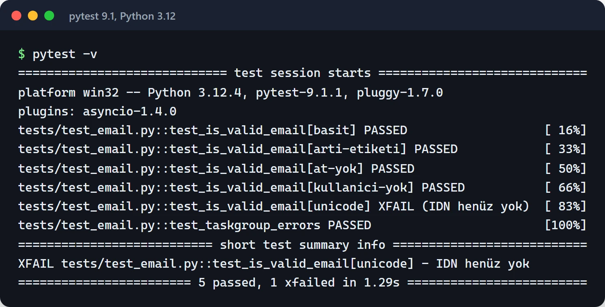

Yazdığım Python kütüphanelerinin ve servislerin hepsinde test aracı pytest. Bu yazıda pytest ile ileri seviye test yazarken gerçekten kullandığım teknikleri topladım: fixture scope'ları, parametrize, mock, async testler, Hypothesis ile property-based testing ve CI ayarları. Örnekler pytest 8 için yazıldı, parametrize ve `RaisesGroup` örneklerini pytest 9.1 ile de çalıştırdım.

Başlamadan bir not: `unittest` kötü değil, standart kütüphanede ve hâlâ çalışıyor. Ama sınıf yazmak, `self.assertEqual` hatırlamak, `setUp`/`tearDown` arasında gidip gelmek testi angarya hâline getiriyor. pytest düz fonksiyon ve düz `assert` ile aynı işi yapıyor, hata olduğunda da `assert` ifadesinin iki tarafını ayrıntılı gösteriyor. Mevcut `unittest` testlerini de değiştirmeden çalıştırabiliyor, yani geçiş kademeli olabilir.

## Projeyi baştan doğru ayarlamak

Ayarların hepsi `pyproject.toml` içinde duruyor:

```toml
[tool.pytest.ini_options]
minversion = "8.0"
testpaths = ["tests"]
addopts = ["-ra", "--strict-markers", "--strict-config"]
xfail_strict = true
markers = [
    "slow: uzun süren testler (CI'da ayrı koşar)",
]
```

`--strict-markers` yanlış yazılmış bir marker'ı (`@pytest.mark.slwo` gibi) sessizce yok saymak yerine hata verir. `xfail_strict` ise `xfail` olarak işaretlenmiş ama artık geçen testleri başarısız sayar, böylece düzelen hatalar unutulmaz. `-ra` test sonunda atlanan ve başarısız olan testlerin nedenlerini özetler.

## Fixture'lar ve scope

Fixture, testin ihtiyaç duyduğu ortamı hazırlayan ve iş bitince temizleyen bir fonksiyon. `yield` öncesi kurulum, sonrası temizlik. Scope ise fixture'ın ne kadar süre yaşayacağını belirliyor: `function` (varsayılan), `class`, `module`, `package` ve `session`. pytest dokümantasyonundaki şu şema, geniş scope'lu fixture'ların önce kurulduğunu gösteriyor:


Pahalı kaynakları (veritabanı motoru, Docker container'ı) `session` scope'unda bir kez açıp her teste ucuz ve izole bir parça vermek en çok işe yarayan kalıp. SQLAlchemy 2 ile her testi bir transaction içinde çalıştırıp sonunda geri almak şöyle:

```python
# tests/conftest.py
import os

import pytest
from sqlalchemy import create_engine
from sqlalchemy.orm import Session

from app.models import Base


@pytest.fixture(scope="session")
def engine():
    engine = create_engine(os.environ["TEST_DATABASE_URL"])
    Base.metadata.create_all(engine)
    yield engine
    Base.metadata.drop_all(engine)
    engine.dispose()


@pytest.fixture
def db_session(engine):
    with engine.connect() as connection:
        transaction = connection.begin()
        session = Session(bind=connection, join_transaction_mode="create_savepoint")
        yield session
        session.close()
        transaction.rollback()
```

`join_transaction_mode="create_savepoint"` sayesinde test edilen kod `session.commit()` çağırsa bile dış transaction bozulmuyor. Test bittiğinde her şey geri alınıyor ve bir sonraki test temiz bir veritabanı görüyor.

`conftest.py` içindeki fixture'lar import etmeden o klasördeki ve alt klasörlerdeki bütün testlerde kullanılabiliyor.

### Factory fixture

Bazen bir testte aynı türden birkaç nesne gerekir. Fixture'ın nesne yerine nesne üreten bir fonksiyon döndürmesi bu durumda temiz bir çözüm:

```python
@pytest.fixture
def make_user(db_session):
    def _make(name: str = "furkan", is_admin: bool = False) -> User:
        user = User(name=name, is_admin=is_admin)
        db_session.add(user)
        db_session.flush()
        return user

    return _make


def test_admin_can_delete(make_user):
    admin = make_user("admin", is_admin=True)
    target = make_user("hedef")
    assert admin.can_delete(target)
```

### Hazır gelen fixture'lar

Kendiniz yazmadan önce pytest'in yerleşik fixture'larına bakın. En çok kullandıklarım:

```python
def test_writes_report(tmp_path, monkeypatch, caplog):
    monkeypatch.setenv("REPORT_DIR", str(tmp_path))
    write_report({"ok": True})
    assert (tmp_path / "report.json").exists()
    assert "rapor yazıldı" in caplog.text
```

`tmp_path` her test için ayrı bir geçici klasör, `monkeypatch` ortam değişkenlerini ve nitelikleri test sonunda eski hâline döndürerek değiştiriyor, `caplog` log çıktısını yakalıyor.

## Parametrize ile tek test, çok senaryo

Aynı fonksiyonu farklı girdilerle test ederken kopyala-yapıştır yerine `parametrize` kullanın. `pytest.param` ile her senaryoya okunur bir ad ve gerekirse marker verebilirsiniz:

```python
import pytest


@pytest.mark.parametrize(
    ("email", "expected"),
    [
        pytest.param("test@example.com", True, id="basit"),
        pytest.param("user+tag@gmail.com", True, id="arti-etiketi"),
        pytest.param("plainaddress", False, id="at-yok"),
        pytest.param("@example.com", False, id="kullanici-yok"),
        pytest.param("ü@örnek.com", True, id="unicode", marks=pytest.mark.xfail(reason="IDN henüz yok")),
    ],
)
def test_is_valid_email(email, expected):
    assert is_valid_email(email) is expected
```

Hata çıktısında `test_is_valid_email[at-yok]` gibi anlamlı adlar görürsünüz. `pytest -k unicode` ile de tek bir senaryoyu çalıştırabilirsiniz.

Basit bir regex ile yazdığım `is_valid_email` ve aşağıdaki `RaisesGroup` testiyle, yukarıdaki `pyproject.toml` ayarlarında `pytest -v` çıktısı şöyle. Unicode senaryosu beklendiği gibi `XFAIL`, `-ra` da nedenini özette tekrar yazıyor:



## Mock: dış dünyayı testten çıkarmak

Unit test internete çıkmamalı. Ödeme API'sine gerçekten istek atan bir test hem yavaş hem kırılgan, en kötü ihtimalle de pahalı. `pytest-mock` eklentisinin `mocker` fixture'ı `unittest.mock`'u test sonunda otomatik geri alınan bir şekilde kullanmanızı sağlıyor:

```python
# app/payments.py
import httpx


def charge(amount: int) -> str:
    resp = httpx.post("https://api.payments.example/charge", json={"amount": amount}, timeout=10)
    resp.raise_for_status()
    return resp.json()["status"]


# tests/test_payments.py
from app.payments import charge


def test_charge_success(mocker):
    post = mocker.patch("app.payments.httpx.post", autospec=True)
    post.return_value.json.return_value = {"status": "success"}

    assert charge(100) == "success"
    post.assert_called_once_with(
        "https://api.payments.example/charge", json={"amount": 100}, timeout=10
    )
```

Patch'i fonksiyonun tanımlandığı yere değil, kullanıldığı yere uyguluyorsunuz (`app.payments.httpx.post`). `autospec=True` ise sahte nesnenin gerçek fonksiyonun imzasına uymasını zorluyor. Yanlış parametreyle çağırırsanız test patlıyor.

HTTP istemcisi olarak `httpx` kullanıyorsanız fonksiyon patch'lemek yerine ağ katmanını taklit eden `respx` daha temiz. [speedapi_lib](https://furkankoykiran.com.tr/projeler/speedapi_lib/) adlı Python SDK'mda testleri bu şekilde yazdım: `conftest.py` içindeki bir fixture API'nin taban adresi için bir `respx` router'ı açıyor, her test kendi cevabını tanımlıyor:

```python
import httpx
import pytest
import respx

BASE_URL = "https://api.example.com"


@pytest.fixture
def mock_router():
    with respx.mock(base_url=BASE_URL, assert_all_called=False) as router:
        yield router


def test_get_balance(mock_router):
    mock_router.get("/balance").mock(return_value=httpx.Response(200, json={"amount": 10}))
    resp = httpx.get(f"{BASE_URL}/balance")
    assert resp.json() == {"amount": 10}
```

Mock edilmemiş bir adrese istek giderse respx hata veriyor, yani bir test yanlışlıkla gerçek API'ye çıkamıyor.

## Async kodu test etmek

Async testler için `pytest-asyncio` kullanıyorum. Hem [speedapi_lib](https://github.com/furkankoykiran/speedapi_lib) hem de [Quorum](https://github.com/furkankoykiran/Quorum) projesinde ayar aynı:

```toml
[tool.pytest.ini_options]
asyncio_mode = "auto"
asyncio_default_fixture_loop_scope = "function"
```

`auto` modunda her `async def test_...` fonksiyonu marker gerekmeden çalışıyor, async fixture'lar da normal `@pytest.fixture` ile tanımlanıyor. pytest-asyncio 1.0 ile eski `event_loop` fixture'ı kaldırıldı. Daha geniş bir loop gerekiyorsa `@pytest.mark.asyncio(loop_scope="module")` kullanılıyor.

Async fonksiyonları taklit ederken `AsyncMock` kullanın. TaskGroup ve timeout gibi konular için [asyncio yazısına](/posts/python-asyncio-paralel-islem/) bakabilirsiniz.

## Pytest 8 ile gelen değişiklikler

pytest 8 serisinde dikkat etmeniz gereken birkaç değişiklik var:

- 8.4 ile birlikte async bir test fonksiyonu, onu çalıştıracak bir eklenti yoksa artık uyarı verip atlanmıyor, doğrudan başarısız oluyor. Eskiden sessizce atlanan async testleriniz varsa CI kırmızıya dönebilir.
- Yine 8.4 ile `None` dışında bir değer döndüren test fonksiyonları başarısız sayılıyor. `return` ile bir şey döndüren test genelde `assert` yazmayı unutmuş bir testtir.
- 8.4 ile `pytest.RaisesGroup` geldi. TaskGroup'un fırlattığı `ExceptionGroup`'ları test etmek için:

```python
import asyncio

import pytest


async def test_taskgroup_errors():
    async def boom():
        raise ValueError("bozuk veri")

    with pytest.RaisesGroup(ValueError, ValueError):
        async with asyncio.TaskGroup() as tg:
            tg.create_task(boom())
            tg.create_task(boom())
```

Tek bir istisna için `pytest.raises(ValueError, match="bozuk")` hâlâ doğru araç. `match` bir regex alıyor, mesajın da doğru olduğunu kontrol etmek için kullanın.

## Hypothesis ile property-based testing

Elle yazdığınız örnekler aklınıza gelen durumları test eder. Hypothesis ise bir kuralı tanımlamanızı istiyor ve o kuralı bozacak girdiyi kendisi arıyor. Boş string, sıfır, negatif sayı, garip Unicode karakterler gibi kenar durumları sizin yerinize deniyor. Bir hata bulduğunda girdiyi en küçük hâline indirip size gösteriyor.

En kullanışlı kural "gidiş-dönüş" (round-trip): serileştir, geri çöz, aynı şeyi elde et.

```python
import json

from hypothesis import given
from hypothesis import strategies as st


@given(st.dictionaries(st.text(), st.integers() | st.text() | st.none()))
def test_json_roundtrip(data):
    assert json.loads(json.dumps(data)) == data
```

Kendi kodunuzda `encode`/`decode`, `to_dict`/`from_dict` gibi çiftler varsa bu kalıp birkaç satırla ciddi hatalar yakalıyor. Fiyat hesaplama gibi yerlerde de "sonuç asla negatif olmamalı" veya "indirim tutarı fiyatı geçemez" gibi kurallar yazabilirsiniz.

## Snapshot testleri

Büyük bir JSON cevabını veya üretilmiş bir HTML'i satır satır `assert` etmek zahmetli. `syrupy` ilk çalıştırmada çıktıyı bir dosyaya kaydediyor, sonraki çalıştırmalarda karşılaştırıyor:

```python
def test_report_output(snapshot):
    assert build_report(month="2025-09") == snapshot
```

Çıktıyı bilerek değiştirdiğinizde `pytest --snapshot-update` ile kayıtları güncellersiniz. Değişiklik git diff'inde görünür, kod incelemesinde gözden kaçmaz. Tek risk, kimsenin bakmadan `--snapshot-update` çalıştırması.

## CI'da hız ve kapsam

Kullandığım eklentiler:

- `pytest-xdist`: `-n auto` ile testleri çekirdek sayısı kadar process'e dağıtır. Testleriniz birbirine bağımlıysa burada ortaya çıkar, ki bu iyi bir şey.
- `pytest-cov`: `--cov=src --cov-report=term-missing` ile hangi satırların test edilmediğini gösterir. Yüzde hedefinden çok, kritik dosyalarda eksik satırlara bakıyorum.
- `pytest-rerunfailures`: kararsız (flaky) bir testi geçici olarak `@pytest.mark.flaky(reruns=2)` ile tekrar dener. Bunu kalıcı çözüm olarak kullanmayın, kök nedeni (yarış durumu, sabit `sleep`, sıra bağımlılığı) bulun.

CI'da çalıştırdığım komut genelde şu:

```bash
pytest -n auto --cov=src --cov-report=term-missing --durations=10
```

`--durations=10` en yavaş on testi listeler. Birkaç saniye süren bir unit test çoğu zaman unutulmuş bir `sleep` veya gerçek bir ağ isteği demek. GitHub Actions üzerinde bunun nasıl kurulduğunu [CI/CD yazısında](/posts/github-actions-cicd-pipeline/) anlattım.

## Kaçındığım alışkanlıklar

- Test içinde `if` ile dallanmak. Dallanma gerekiyorsa iki ayrı test veya parametrize daha doğru.
- Birbirine bağlı testler. `test_2`, `test_1` çalışmadan geçemiyorsa testler rastgele sırada (`pytest-randomly`) veya paralel çalışınca patlar.
- Bir şeyin olmasını `time.sleep()` ile beklemek. Koşulu kontrol eden kısa bir döngü veya async kodda bir `Event` kullanın.
- Her şeyi mock'lamak. Kendi kodunuzun iç fonksiyonlarını mock'lamaya başladıysanız test artık davranışı değil uygulama detaylarını sınıyor.

## Nereden başlamalı?

Mevcut projenize yukarıdaki `pyproject.toml` ayarlarını ekleyip `pytest -ra --durations=10` çalıştırın. Hangi testlerin atlandığını ve hangilerinin yavaş olduğunu hemen göreceksiniz. Sonra kodunuzda bir `encode`/`decode` çifti bulup ona bir Hypothesis testi yazın.

Belgeler: [pytest](https://docs.pytest.org/), [pytest-asyncio](https://pytest-asyncio.readthedocs.io/), [Hypothesis](https://hypothesis.readthedocs.io/), [respx](https://lundberg.github.io/respx/), [syrupy](https://github.com/syrupy-project/syrupy).
