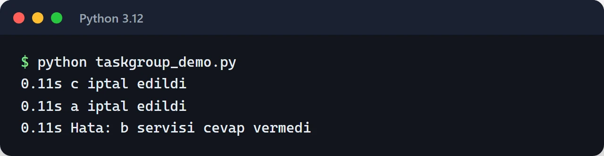
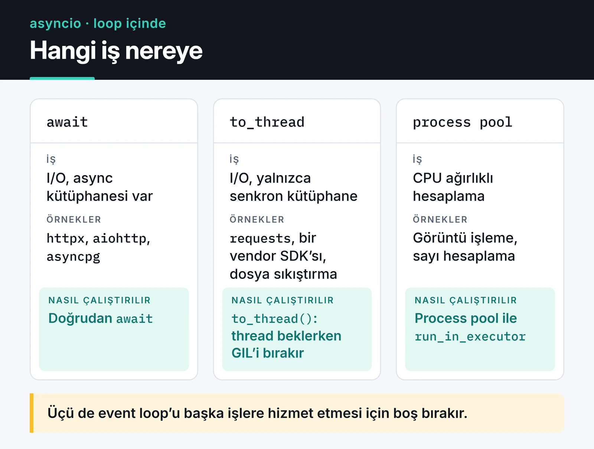

MCP sunucularımın ve trading botlarımın neredeyse hepsi Python asyncio üzerinde çalışıyor. Hepsinde iş aynı: birkaç API'ye istek at, cevapları bekle, bir yandan WebSocket dinle. asyncio ile `async/await` yazmak kolay. Asıl zor kısım, tek bir bloklayan çağrının bütün servisi dondurduğu anı fark etmek ve yarım kalan görevleri temizlemek.

Bu yazıda asyncio'yu bugün nasıl kullandığımı anlatıyorum: `TaskGroup`, `asyncio.timeout`, `Semaphore`, `to_thread` ve hata yönetimi. Örnekler Python 3.12 ve sonrası için yazıldı, 3.11'de de çoğu çalışır.

## asyncio ne yapar, ne yapmaz?

asyncio tek bir thread üzerinde çalışan bir event loop'tur. Bir görev `await` ile ağdan cevap beklerken loop başka bir göreve geçer. Bu yüzden asyncio eşzamanlılık (concurrency) sağlar, paralellik sağlamaz.

```text
Eşzamanlı (asyncio, tek thread):

  thread     | A A B A C C B A C B |   aynı anda tek görev çalışır,
                                       döngü her await'te görev değiştirir

Paralel (birden fazla çekirdek):

  çekirdek 1 | A A A A |
  çekirdek 2 | B B B B |               görevler gerçekten aynı anda çalışır
  çekirdek 3 | C C C C |
             ------------------------> zaman
```

Pratik sonucu şu: HTTP istekleri, veritabanı sorguları, soket okuma gibi I/O ağırlıklı işlerde asyncio binlerce bağlantıyı tek çekirdekte rahatça idare eder. Görüntü işleme veya büyük hesaplama gibi CPU ağırlıklı işlerde hiçbir şey kazandırmaz, hatta loop'u kilitler. O işler için process havuzu gerekir (aşağıda değineceğim).

## Görevleri TaskGroup ile başlatın

Yıllarca varsayılan yol `asyncio.gather()` oldu. Onun sorunu şu: görevlerden biri hata verince diğerleri arkada çalışmaya devam eder ve kimse onları iptal etmez. Python 3.11 ile gelen `asyncio.TaskGroup` bu işi structured concurrency ile çözüyor. Blok bitmeden hiçbir görev ortada kalmıyor.

```python
import asyncio


async def fetch(name: str, delay: float) -> str:
    await asyncio.sleep(delay)
    if name == "b":
        raise ValueError(f"{name} servisi cevap vermedi")
    return f"{name} tamam"


async def main() -> None:
    try:
        async with asyncio.TaskGroup() as tg:
            t1 = tg.create_task(fetch("a", 0.2))
            t2 = tg.create_task(fetch("b", 0.1))
            t3 = tg.create_task(fetch("c", 1.0))
    except* ValueError as eg:
        for exc in eg.exceptions:
            print("Hata:", exc)
    else:
        print(t1.result(), t2.result(), t3.result())


asyncio.run(main())
```

`b` hata verdiği anda TaskGroup kalan görevleri iptal eder, hepsinin bitmesini bekler ve hataları bir `ExceptionGroup` içinde fırlatır. `c` görevinin bir saniyelik uykusu yarıda kesilir.

`fetch` içine `CancelledError`'ı yakalayıp zaman damgasıyla yazdıran bir `except` ekleyip çalıştırdığımda sıralama açıkça görünüyor. `b` 0,1 saniyede patlıyor, `a` ve `c` aynı anda iptal ediliyor ve hata ancak ondan sonra dışarı çıkıyor:



`gather()` hâlâ işe yarıyor: `return_exceptions=True` ile "hepsini çalıştır, kim patlarsa patlasın, sonuçları topla" senaryosunda kullanıyorum. Hata olunca kalanların iptal edilmesini istediğim her yerde TaskGroup kullanıyorum.

## except* ile birden fazla hatayı yakalamak

TaskGroup içinde birkaç görev aynı anda hata verebilir. `except*` sözdizimi `ExceptionGroup`'u türüne göre ayırır:

```python
try:
    async with asyncio.TaskGroup() as tg:
        tg.create_task(call_payment_api())
        tg.create_task(call_inventory_api())
except* TimeoutError as eg:
    log.warning("Zaman aşımı: %d görev", len(eg.exceptions))
except* ConnectionError as eg:
    log.error("Bağlantı hatası: %s", eg.exceptions)
```

Birden fazla `except*` dalı aynı anda çalışabilir. Düz `except Exception` yazarsanız `ExceptionGroup` da yakalanır, ama içindeki hataları kendiniz açmanız gerekir.

## Her dış çağrıya timeout verin

Sonsuza kadar bekleyen bir soket bir worker'ı sessizce öldürür. Python 3.11'den beri `asyncio.timeout()` context manager'ı var ve `wait_for`'dan daha okunaklı:

```python
async def get_price(client, symbol: str) -> float:
    async with asyncio.timeout(5):
        resp = await client.get(f"/ticker/{symbol}")
        return float(resp.json()["price"])
```

Süre dolunca blok içindeki iş iptal edilir ve dışarıya `TimeoutError` çıkar. Süreyi çalışma anında uzatmak gerekirse `asyncio.timeout_at()` veya context manager'ın `reschedule()` metodu var.

## Semaphore ile aynı anda kaç istek gideceğini sınırlayın

asyncio o kadar hızlı istek üretir ki dikkat etmezseniz karşı tarafın rate limit'ine anında takılırsınız. Ben borsa API'lerinde bunu birkaç kez yaşadım. `Semaphore` aynı anda içeride kaç görev olabileceğini sınırlar:

```python
import asyncio
import httpx


async def fetch_all(urls: list[str], limit: int = 10) -> list[int]:
    sem = asyncio.Semaphore(limit)

    async with httpx.AsyncClient(timeout=10) as client:

        async def fetch(url: str) -> int:
            async with sem:
                resp = await client.get(url)
                return resp.status_code

        async with asyncio.TaskGroup() as tg:
            tasks = [tg.create_task(fetch(u)) for u in urls]

    return [t.result() for t in tasks]
```

Bin URL de verseniz aynı anda en fazla on istek açık olur. Saniye başına istek sınırı gerekiyorsa semaphore yetmez, token bucket gibi bir algoritma gerekir. Onu [API hız sınırlama yazısında](/posts/python-hiz-sinirla-api-throttling/) anlattım.

## Event loop'u bloklamayın

asyncio'daki en sık hata loop içinde senkron, bloklayan kod çalıştırmak:

```python
import time


async def bad():
    time.sleep(5)  # loop 5 saniye durur, kimseye cevap gitmez
```

Eski bir kütüphane kullanmak zorundaysanız (`requests`, senkron bir SDK, dosya sıkıştırma) çağrıyı `asyncio.to_thread()` ile ayrı bir thread'e atın:

```python
import asyncio
import requests


async def legacy_call() -> dict:
    resp = await asyncio.to_thread(requests.get, "https://httpbin.org/json", timeout=10)
    return resp.json()
```

Bu I/O için iyi çalışır, çünkü thread beklerken GIL'i bırakır. CPU ağırlıklı iş için `ProcessPoolExecutor` kullanın:

```python
import asyncio
from concurrent.futures import ProcessPoolExecutor


def crunch(n: int) -> int:
    return sum(i * i for i in range(n))


async def main() -> None:
    loop = asyncio.get_running_loop()
    with ProcessPoolExecutor() as pool:
        result = await loop.run_in_executor(pool, crunch, 10_000_000)
    print(result)


if __name__ == "__main__":
    asyncio.run(main())
```

Yeni bir proje başlıyorsanız doğrudan async kütüphaneleri seçin: HTTP için `httpx` veya `aiohttp`, PostgreSQL için `asyncpg` ya da SQLAlchemy'nin `AsyncSession`'ı. Aşağıdaki kart bir işin loop içinde nasıl çalıştırılacağına karar verirken baktığım üç durumu özetliyor.



## Büyük veriyi async generator ile akıtın

Sayfalı bir API'den milyonlarca kayıt çekerken hepsini belleğe yüklemek yerine `async for` ile parça parça işleyin:

```python
from collections.abc import AsyncIterator

import httpx


async def iter_pages(client: httpx.AsyncClient, url: str) -> AsyncIterator[list[dict]]:
    page = 1
    while True:
        resp = await client.get(url, params={"page": page})
        resp.raise_for_status()
        items = resp.json()
        if not items:
            return
        yield items
        page += 1


async def main() -> None:
    async with httpx.AsyncClient(timeout=10) as client:
        async for items in iter_pages(client, "https://api.example.com/trades"):
            print(len(items), "kayıt işlendi")
```

Bellekte aynı anda tek bir sayfa durur.

## Python 3.12, 3.13 ve 3.14 ile gelenler

Son sürümlerde asyncio tarafında işime yarayan değişiklikler:

- 3.12: `asyncio.eager_task_factory`. Görev, hemen sonuç dönebiliyorsa (örneğin cache'ten) loop'a hiç uğramadan senkron biter. Çok sayıda kısa görev açan kodda belirgin hız farkı yaratabiliyor. `loop.set_task_factory(asyncio.eager_task_factory)` ile açılıyor.
- 3.12: asyncio'nun genel performansı iyileştirildi; görev oluşturma ve `current_task()` daha hızlı.
- 3.13: `asyncio.Queue.shutdown()` geldi. Üretici-tüketici kuyruklarını kapatmak için artık "sentinel" değer göndermeye gerek yok.
- 3.13: `asyncio.as_completed()` artık `async for` ile kullanılabiliyor ve orijinal görev nesnelerini döndürüyor.
- 3.14: `python -m asyncio ps <PID>` ve `python -m asyncio pstree <PID>` komutları. Çalışan bir process'e bağlanıp hangi görevin neyi beklediğini gösteriyor. Eskiden bunun için `aiomonitor` gibi ek araçlar gerekiyordu.

## Takılan kodu bulmak: debug modu

Loop'u neyin blokladığını bulmanın en kolay yolu debug modu:

```python
asyncio.run(main(), debug=True)
```

Aynı şeyi `PYTHONASYNCIODEBUG=1` ortam değişkeni veya `python -X dev` ile de açabilirsiniz. Debug modunda 100 milisaniyeden uzun süren her callback loglanır (`Executing <Task ...> took 0.512 seconds`) ve `await` edilmeden unutulan coroutine'ler için uyarı çıkar. Bu satırı gördüğünüz fonksiyon ya `to_thread`'e taşınmalı ya da async bir kütüphaneyle yeniden yazılmalı.

Loop içinde `time.sleep(0.5)` çağıran tek satırlık bir coroutine'i `debug=True` ile çalıştırdığımda Python 3.12, görevin 0,500 saniye sürdüğünü bildirdi.

Profil çıkarırken `cProfile` async kodda yanıltıcı olabilir, çünkü `await` ile beklenen süreyi de fonksiyona yazar. `py-spy` veya `yappi` bu konuda daha iyi. Detaylar [profiling yazısında](/posts/python-performans-profiling-optimizasyon/).

## Event loop: uvloop

`uvloop`, libuv üzerine kurulu, standart loop'un yerine geçen hızlı bir event loop. Python 3.12 ve sonrasında eski `uvloop.install()` yerine şu kullanılıyor:

```python
import uvloop

uvloop.run(main())
```

Uvicorn, `uvicorn[standard]` ile kurulduğunda uvloop'u otomatik kullanır. Kazanç ağ trafiği yoğun servislerde belirgin, çoğu uygulamada ise darboğaz loop değil veritabanı oluyor. Önce ölçün, sonra değiştirin. Ayrıca uvloop Windows'ta çalışmıyor.

## Async kodu test etmek

Testler için `pytest-asyncio` kullanıyorum. `pyproject.toml` içinde modu `auto` yapınca her async test fonksiyonu kendiliğinden çalışıyor:

```toml
[tool.pytest.ini_options]
asyncio_mode = "auto"
```

```python
from unittest.mock import AsyncMock


async def test_get_price():
    client = AsyncMock()
    client.get.return_value.json = lambda: {"price": "42.5"}
    assert await get_price(client, "BTCUSDT") == 42.5
```

Async fonksiyonları taklit ederken `MagicMock` değil `AsyncMock` kullanın, yoksa `await` satırında hata alırsınız. Fixture'lar, mock'lar ve pytest 8 ile gelen değişiklikler için [pytest yazısına](/posts/pytest-ile-ileri-seviye-test-teknikleri/) bakabilirsiniz.

## Canlıya çıkmadan önce kontrol listesi

- Her dış çağrıda timeout var mı? (`asyncio.timeout` veya istemcinin kendi timeout'u)
- Sürücüler gerçekten async mi? `requests` veya senkron bir ORM loop içinde çağrılıyor mu?
- `create_task()` ile başlatılan görevlerin referansı tutuluyor mu? Referansı kaybedilen görev çöp toplayıcı tarafından yarıda silinebilir. TaskGroup bu sorunu kendiliğinden çözüyor.
- SIGTERM gelince görevler düzgün iptal ediliyor mu? Bunun için [zarif kapanış yazısına](/posts/zarif-kapanis-sinyal-isleme/) bakabilirsiniz.
- Yarıda kesilmemesi gereken işler (ödeme kaydı gibi) `asyncio.shield()` ile korunuyor mu?
- Loglar loop'u bloklamıyor mu? Yoğun loglamada `logging.handlers.QueueHandler` ile yazma işini ayrı bir thread'e verin.

## Sırada ne var?

Kendi kodunuzda `gather()` geçen yerleri arayın ve hata durumunda ne olması gerektiğini düşünün. Kalan görevlerin iptal edilmesi gerekiyorsa TaskGroup'a geçirin. Ardından `debug=True` ile bir kez çalıştırıp loop'u bloklayan satırları bulun. Arka plan işleri için kuyruk lazımsa [Celery ve ARQ yazısı](/posts/celery-arq-asenkron-gorev-kuyrugu/) iyi bir sonraki adım olur.

Resmi belgeler: [asyncio dokümantasyonu](https://docs.python.org/3/library/asyncio.html) ve [Python 3.14 yenilikleri](https://docs.python.org/3/whatsnew/3.14.html).
