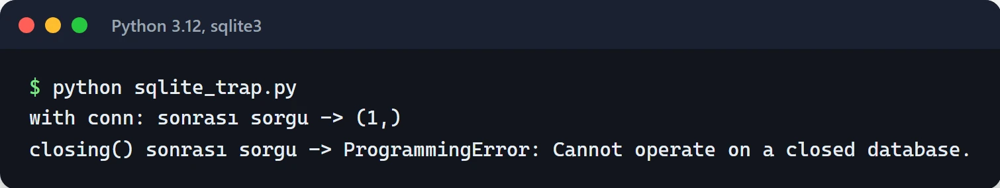

`with open("dosya.txt") as f:` satırını Python yazan herkes bilir. Bu satırın arkasındaki yapı, yani Python context manager, dosyalarla sınırlı değil. Veritabanı transaction'ları, kilitler, HTTP istemcileri, geçici dizinler, zaman ölçümü: başı ve sonu olan her iş için kullanılabilir.

Asıl faydası şu: blok içinde hata çıksa bile temizlik kodu çalışır. `close()` veya `rollback()` çağırmayı unutmak çok kolay, `with` bunu sizin yerinize garanti ediyor. Bu yazıda kendi context manager'larınızı nasıl yazacağınızı, `contextlib`'in hazır araçlarını ve async tarafını örneklerle anlatıyorum.

## with bloğu aslında ne yapıyor?

Şu kod:

```python
with manager as value:
    do_something(value)
```

kabaca şuna denk:

```python
value = manager.__enter__()
try:
    do_something(value)
except BaseException as exc:
    if not manager.__exit__(type(exc), exc, exc.__traceback__):
        raise
else:
    manager.__exit__(None, None, None)
```

`__enter__` kaynağı hazırlar ve `as` ile verilecek değeri döner. `__exit__` her durumda çağrılır. Hata olduysa hatanın türü, kendisi ve traceback'i parametre olarak gelir, olmadıysa üçü de `None` olur. `__exit__` `True` dönerse hata yutulur, başka bir şey dönerse hata yukarı fırlatılmaya devam eder.

## Sınıf ile context manager yazmak

Bir SQLite transaction'ı için örnek. Hata yoksa commit, varsa rollback, her durumda bağlantıyı kapat:

```python
import sqlite3


class Transaction:
    def __init__(self, path: str):
        self.path = path
        self.conn: sqlite3.Connection | None = None

    def __enter__(self) -> sqlite3.Cursor:
        self.conn = sqlite3.connect(self.path)
        return self.conn.cursor()

    def __exit__(self, exc_type, exc, tb) -> bool:
        try:
            if exc_type is None:
                self.conn.commit()
            else:
                self.conn.rollback()
        finally:
            self.conn.close()
        return False  # hatayı yutma, yukarı ilet


with Transaction("app.db") as cur:
    cur.execute("CREATE TABLE IF NOT EXISTS users (name TEXT)")
    cur.execute("INSERT INTO users VALUES ('furkan')")
```

`close()` çağrısını `finally` içine koymak önemli. Rollback sırasında da hata çıkabilir. O durumda bile bağlantı açık kalmamalı.

### sqlite3 ile ilgili bir tuzak

`sqlite3.Connection` nesnesinin kendisi de bir context manager, ama çoğu kişinin beklediğini yapmıyor:

```python
conn = sqlite3.connect("app.db")
with conn:
    conn.execute("INSERT INTO users VALUES ('x')")
# Burada transaction commit edildi, ama bağlantı HÂLÂ AÇIK.
```

`with conn:` sadece transaction'ı yönetiyor, bağlantıyı kapatmıyor. Kapatılmasını da istiyorsanız `contextlib.closing` kullanın:

```python
from contextlib import closing

with closing(sqlite3.connect("app.db")) as conn:
    with conn:
        conn.execute("INSERT INTO users VALUES ('y')")
```

İki durumu yan yana çalıştırdığımda fark açıkça görünüyor. `with conn:` bloğundan sonra bağlantı sorgu almaya devam ediyor, `closing()` sonrasında ise aynı sorgu hata veriyor:



Bir kütüphanenin context manager'ının tam olarak neyi kapattığını belgeden kontrol etmek iyi bir alışkanlık.

## contextlib.contextmanager ile kısa yol

Her şey için sınıf yazmak gereksiz. `@contextmanager` dekoratörü tek `yield` içeren bir generator'ı context manager'a çeviriyor. `yield` öncesi `__enter__`, sonrası `__exit__` gibi çalışıyor:

```python
import sqlite3
from contextlib import contextmanager


@contextmanager
def transaction(path: str):
    conn = sqlite3.connect(path)
    try:
        yield conn
    except BaseException:
        conn.rollback()
        raise
    else:
        conn.commit()
    finally:
        conn.close()
```

Blok içindeki hata `yield` satırında fırlatılır. Bu yüzden `yield`'i `try` içine almazsanız hata durumunda temizlik kodu hiç çalışmaz. En sık gördüğüm hata bu.

`@contextmanager` ile yazılan nesneler dekoratör olarak da kullanılabiliyor:

```python
import time
from contextlib import contextmanager


@contextmanager
def timer(label: str):
    start = time.perf_counter()
    try:
        yield
    finally:
        print(f"[{label}] {time.perf_counter() - start:.3f} sn")


with timer("rapor"):
    build_report()


@timer("gece işi")
def nightly_job():
    ...
```

Dekoratör olarak kullanıldığında her çağrıda yeni bir context manager oluşturuluyor, yani fonksiyonu defalarca çağırabilirsiniz.

## Sayısı belli olmayan kaynaklar: ExitStack

Kaç kaynak açacağınızı çalışma anında öğreniyorsanız iç içe `with` yazamazsınız. `ExitStack` burada işe yarıyor:

```python
from contextlib import ExitStack

paths = ["a.log", "b.log", "c.log"]

with ExitStack() as stack:
    files = [stack.enter_context(open(p, "a", encoding="utf-8")) for p in paths]
    for f in files:
        f.write("deploy tamamlandı\n")
# Bloktan çıkınca açılan bütün dosyalar ters sırayla kapanır.
```

Üçüncü dosya açılırken hata çıkarsa ilk ikisi yine kapanır. `stack.callback(fn, *args)` ile context manager olmayan bir temizlik fonksiyonunu da kayda alabilirsiniz.

İşe yarayan bir kalıp daha: kurulum yarıda kalırsa her şeyi geri al, başarılı olursa kaynakları sahiplenip devam et.

```python
with ExitStack() as stack:
    db = stack.enter_context(open_db())
    cache = stack.enter_context(open_cache())
    resources = stack.pop_all()  # buraya kadar hata yoksa temizliği devral
# resources.close() artık sizin sorumluluğunuzda
```

## async with

Async kodda bağlantı açmak ve kapatmak da `await` gerektirir. Bunun için `__aenter__` ve `__aexit__` metotları ve `async with` var. Kısa yol olarak da `asynccontextmanager`:

```python
from contextlib import asynccontextmanager

import httpx


@asynccontextmanager
async def api_client(base_url: str):
    client = httpx.AsyncClient(base_url=base_url, timeout=10)
    try:
        yield client
    finally:
        await client.aclose()


async def main():
    async with api_client("https://api.example.com") as client:
        resp = await client.get("/health")
        print(resp.status_code)
```

Bunu en çok FastAPI'nin `lifespan` parametresinde kullanıyorum. Uygulama başlarken bağlantı havuzunu açıp kapanırken kapatmak için:

```python
from contextlib import asynccontextmanager

import httpx
from fastapi import FastAPI


@asynccontextmanager
async def lifespan(app: FastAPI):
    app.state.http = httpx.AsyncClient(timeout=10)
    yield
    await app.state.http.aclose()


app = FastAPI(lifespan=lifespan)
```

Kapanmayan bağlantılar yoğun trafik altındaki async servislerde en sık karşılaştığım sorunlardan biri. Havuz dolunca yeni istekler bekler ve servis yavaşlar. Havuz ayarları için [bağlantı havuzu yazısına](/posts/veritabani-baglanti-havuzu-optimizasyon/), FastAPI iskeleti için [FastAPI yazısına](/posts/python-fastapi-restful-api-gelistirme/) bakabilirsiniz.

Birden fazla async kaynağı dinamik açmak için `AsyncExitStack` var, `ExitStack` ile aynı mantık. Ayrıca asyncio'nun kendi araçlarından `asyncio.timeout()` ve `asyncio.TaskGroup` da birer async context manager. Onları [asyncio yazısında](/posts/python-asyncio-paralel-islem/) anlattım.

## contextlib'in hazır araçları

Kendinizinkini yazmadan önce standart kütüphaneye bakın:

```python
import os
import threading
from contextlib import chdir, nullcontext, redirect_stdout, suppress
from io import StringIO

# Belirli bir hatayı bilerek yok saymak
with suppress(FileNotFoundError):
    os.remove("gecici.tmp")

# Çalışma dizinini geçici olarak değiştirmek (Python 3.11+)
with chdir("/tmp"):
    run_build()

# print çıktısını yakalamak
buffer = StringIO()
with redirect_stdout(buffer):
    legacy_function_that_prints()

# Koşula göre "hiçbir şey yapmayan" bir context manager
use_lock = os.environ.get("THREADED") == "1"
lock = threading.Lock() if use_lock else nullcontext()
with lock:
    update_counter()
```

`suppress` yalnızca adını verdiğiniz hatayı yutar ve niyeti `try/except: pass`'ten daha açık gösterir. `except Exception: pass` gibi geniş bir yakalama yerine bunu kullanın. `chdir` thread'ler arasında güvenli değil, çünkü çalışma dizini bütün process için ortak.

Python 3.10'dan beri birden fazla context manager'ı parantez içinde, satır satır yazabilirsiniz:

```python
with (
    open("girdi.csv", encoding="utf-8") as src,
    open("cikti.csv", "w", encoding="utf-8") as dst,
):
    dst.write(src.read())
```

## Kilitler

Kilitler de context manager. `lock.acquire()` ve `lock.release()` yazmak yerine `with` kullanın, yoksa hata çıktığında kilit hiç bırakılmaz ve program kilitlenir:

```python
import threading

lock = threading.Lock()
shared_counter = 0

with lock:
    shared_counter += 1
```

Async kodda `asyncio.Lock` aynı şekilde `async with` ile kullanılıyor. Farklı process'ler aynı dosyaya yazıyorsa `filelock` paketi bir kilit dosyası üzerinden aynı işi yapıyor:

```python
from filelock import FileLock

with FileLock("data.txt.lock", timeout=10):
    with open("data.txt", "a", encoding="utf-8") as f:
        f.write("güvenli satır\n")
```

`timeout` vermezseniz kilit hiç bırakılmadığında process sonsuza kadar bekler.

## Sık yapılan hatalar

- `__exit__` içinde koşulsuz `return True`. Bu, bloktaki her hatayı sessizce yok eder. Sadece bilerek yutmak istediğiniz hata türleri için `True` dönün.
- `@contextmanager` içinde `yield`'i `try/finally` dışında bırakmak. Hata çıkınca temizlik çalışmaz.
- Generator'da birden fazla `yield`. `@contextmanager` tam olarak bir kez `yield` bekler, ikincisinde `RuntimeError` verir.
- Kaynağı `with` bloğu dışında kullanmaya devam etmek. `with` bitince dosya kapanmıştır, bağlantı havuza dönmüştür.
- Kurulumu `__init__`'te yapmak. Nesne oluşturulup `with`'e hiç girilmezse kaynak açık kalır. Kaynağı `__enter__` içinde açın.

Testlerde aynı fikrin bir başka hâlini kullanıyorsunuz: pytest'te `yield` içeren fixture'lar da kurulum ve temizliği aynı şekilde ayırıyor. Detaylar [pytest yazısında](/posts/pytest-ile-ileri-seviye-test-teknikleri/).

## Sırada ne var?

Kodunuzda tekrar eden `try ... finally` bloklarını arayın. Aynı kurulum ve temizlik iki üç yerde tekrar ediyorsa onu bir `@contextmanager` fonksiyonuna taşıyın. FastAPI kullanıyorsanız `on_event("startup")` ve `on_event("shutdown")` yerine `lifespan`'e geçin.

Belgeler: [contextlib](https://docs.python.org/3/library/contextlib.html), [with ifadesi](https://docs.python.org/3/reference/compound_stmts.html#the-with-statement), [PEP 343](https://peps.python.org/pep-0343/).
