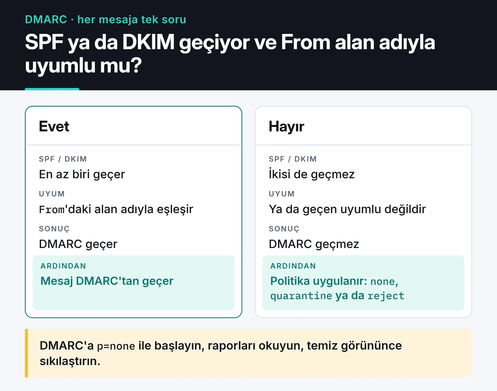

Python ile e-posta otomasyonu ilk bakışta beş satırlık bir iş gibi görünür: `smtplib` ile bağlan, mesajı gönder. Raporların, uyarıların ve bildirimlerin gerçekten gelen kutusuna düşmesi ise ayrı bir konu. Kimlik bilgilerini nerede tuttuğunuz, mesajı nasıl oluşturduğunuz ve alan adınızın DNS kayıtları en az kod kadar önemli.

Bu yazıda kendi otomasyonlarımda kullandığım yapıyı anlatıyorum: `EmailMessage` ile mesaj oluşturmak, uygulama şifresiyle `smtplib`, çok sayıda mesaj için `aiosmtplib`, Jinja2 şablonları ve teslim edilebilirlik için SPF, DKIM ve DMARC.

## Mesajı EmailMessage ile oluşturun

Eski örneklerde `MIMEMultipart` ve `MIMEText` ile elle parça birleştirilir. Python 3.6'dan beri `email.message.EmailMessage` aynı işi çok daha az kodla yapıyor:

```python
from email.message import EmailMessage
from email.utils import formataddr, formatdate, make_msgid
from pathlib import Path


def build_message(to: str, subject: str, text: str, html: str, attachment: Path | None = None) -> EmailMessage:
    msg = EmailMessage()
    msg["From"] = formataddr(("Rapor Botu", "rapor@example.com"))
    msg["To"] = to
    msg["Subject"] = subject
    msg["Date"] = formatdate(localtime=True)
    msg["Message-ID"] = make_msgid(domain="example.com")

    msg.set_content(text)                    # düz metin sürümü
    msg.add_alternative(html, subtype="html")  # HTML sürümü

    if attachment:
        msg.add_attachment(
            attachment.read_bytes(),
            maintype="application",
            subtype="pdf",
            filename=attachment.name,
        )
    return msg
```

Hem düz metin hem HTML sürümü eklemek önemli. HTML'i göstermeyen istemciler ve bazı kurumsal filtreler düz metne bakıyor, sadece HTML içeren mesajlar da spam puanını artırıyor. Türkçe karakterli konu ve isimleri `EmailMessage` kendisi kodluyor, ekstra bir şey yapmanıza gerek yok.

## Gerçek şifre değil, uygulama şifresi

Gmail veya Outlook hesabınızın asıl şifresini bir betiğe yazmayın. Google, şifreyle SMTP girişine izin veren "daha az güvenli uygulamalar" seçeneğini kaldırdı. Kişisel bir Gmail hesabından betikle mail atacaksanız:

1. Hesapta iki adımlı doğrulamayı açın.
2. Google hesap ayarlarından bir uygulama şifresi (app password) oluşturun. 16 karakterlik bu şifre sadece bu betik için geçerli ve istediğiniz an iptal edilebiliyor.
3. Şifreyi koda değil ortam değişkenine veya bir secret yöneticisine koyun.

Microsoft 365 ve Outlook.com tarafında Basic Auth ile SMTP girişi kapatılıyor. Orada OAuth2 (XOAUTH2) veya Microsoft Graph API kullanmanız gerekiyor. Uzun ömürlü bir servis yazıyorsanız Gmail için de OAuth2 daha sağlam bir seçenek, uygulama şifresi kişisel otomasyonlar için pratik bir orta yol.

```python
import os
import smtplib
import ssl

SMTP_HOST = "smtp.gmail.com"
SMTP_USER = os.environ["SMTP_USER"]
SMTP_APP_PASSWORD = os.environ["SMTP_APP_PASSWORD"]


def send(msg) -> None:
    context = ssl.create_default_context()
    with smtplib.SMTP(SMTP_HOST, 587, timeout=30) as smtp:
        smtp.starttls(context=context)
        smtp.login(SMTP_USER, SMTP_APP_PASSWORD)
        smtp.send_message(msg)
```

`ssl.create_default_context()` sertifikayı ve sunucu adını doğruluyor. `starttls()` çağrısına context vermezseniz `smtplib` sertifikayı doğrulamayan bir varsayılan kullanıyor: bağlantı şifreli olur ama karşıdaki sunucunun gerçekten Gmail olduğunu kontrol etmez. Context'i her zaman açıkça verin.

## Port 587 mi, 465 mi?

- 587 (STARTTLS): bağlantı düz başlar, `STARTTLS` komutuyla şifreliye geçer. `smtplib.SMTP` + `starttls()`.
- 465 (implicit TLS): bağlantı baştan TLS ile açılır. `smtplib.SMTP_SSL`. RFC 8314 mesaj gönderimi için bunu öneriyor, yani "eski port" değil.
- 25: sunucular arası trafik içindir. AWS ve Google Cloud gibi bulut sağlayıcılar dışarı giden 25 portunu varsayılan olarak engelliyor, uygulamanızdan bu portu kullanmayın.

İkisi de güvenli. Sağlayıcınızın belgelediği portu kullanın.

## Çok sayıda mesaj: aiosmtplib

Her mesaj için ayrı bağlantı açmak yavaş. Yüzlerce bildirim gönderecekseniz tek bağlantıyı yeniden kullanın. Kodunuz zaten asyncio üzerindeyse `aiosmtplib` loop'u bloklamadan gönderiyor:

```python
import asyncio
import os

import aiosmtplib

SMTP_USER = os.environ["SMTP_USER"]
SMTP_APP_PASSWORD = os.environ["SMTP_APP_PASSWORD"]


async def send_batch(messages) -> None:
    async with aiosmtplib.SMTP(hostname="smtp.gmail.com", port=587, start_tls=True) as smtp:
        await smtp.login(SMTP_USER, SMTP_APP_PASSWORD)
        for msg in messages:
            try:
                await smtp.send_message(msg)
            except aiosmtplib.SMTPRecipientsRefused as exc:
                print("Reddedilen alıcı:", exc.recipients)
            await asyncio.sleep(0.5)  # sağlayıcıyı zorlamayın
```

Tek bir SMTP bağlantısı aynı anda tek mesaj gönderebilir, bu yüzden döngü sıralı. Daha fazla hız gerekiyorsa birkaç bağlantı açıp işi aralarında bölebilirsiniz, ama önce sağlayıcının limitlerine bakın. Kişisel Gmail hesapları günde yaklaşık 500 alıcıyla, Google Workspace hesapları 2000 alıcıyla sınırlı. Bunu aşan bir hacminiz varsa Gmail yerine Amazon SES, Postmark veya Mailgun gibi bir transactional e-posta servisi kullanın.

Tek seferlik bir gönderim için kısa yol da var:

```python
await aiosmtplib.send(
    msg,
    hostname="smtp.gmail.com",
    port=587,
    start_tls=True,
    username=SMTP_USER,
    password=SMTP_APP_PASSWORD,
)
```

asyncio tarafında TaskGroup ve timeout kullanımını [asyncio yazısında](/posts/python-asyncio-paralel-islem/) anlattım.

## HTML şablonları: Jinja2

HTML'i Python string'i olarak kodun içine gömmek kısa sürede yönetilemez hâle geliyor. Şablonları ayrı dosyalarda tutup Jinja2 ile dolduruyorum:

```python
from jinja2 import Environment, FileSystemLoader, select_autoescape

env = Environment(loader=FileSystemLoader("templates"), autoescape=select_autoescape())


def render(name: str, **context) -> tuple[str, str]:
    html = env.get_template(f"{name}.html").render(**context)
    text = env.get_template(f"{name}.txt").render(**context)
    return text, html
```

`autoescape` açık olmalı. Kullanıcı adı gibi dışarıdan gelen bir değer HTML içine kaçışsız yazılırsa mesajın içine istenmeyen HTML veya link sokulabilir.

E-posta istemcilerindeki HTML desteği tarayıcılardan çok geride. Gmail'de `<style>` blokları kısmen destekleniyor, Outlook'un masaüstü sürümü ise hâlâ Word'ün render motorunu kullanıyor. Flexbox ve grid'e güvenmeyin. Tablo tabanlı bir yerleşim ve satır içi (inline) CSS en güvenli yol. Elle tablo yazmak istemiyorsanız MJML ile tasarlayıp HTML'e derleyebilir, CSS'i de `css-inline` gibi bir kütüphaneyle satır içine taşıyabilirsiniz.

## Mesaj gelen kutusuna neden düşmüyor?

Kodunuz hatasız çalışıp mesaj spam'e düşüyorsa sorun büyük ihtimalle alan adınızın kimlik doğrulamasında. Alıcı sunucu üç DNS kaydına bakıyor:

- SPF: alan adınız adına hangi sunucuların mail gönderebileceğini listeler. Örnek: `v=spf1 include:_spf.google.com ~all`.
- DKIM: gönderen sunucu mesajı özel anahtarıyla imzalar, alıcı DNS'teki açık anahtarla doğrular. Mesajın yolda değiştirilmediğini kanıtlar.
- DMARC: SPF veya DKIM'den biri geçse bile `From` adresindeki alan adıyla uyumlu (aligned) olmasını şart koşar ve başarısız mesajlara ne yapılacağını söyler (`p=none`, `quarantine`, `reject`). Rapor adresi de içerir.

Aşağıdaki şema DMARC'ın karar adımını özetliyor:



Gmail ve Yahoo, Şubat 2024'ten beri günde 5000'den fazla mesaj gönderen göndericilerden SPF, DKIM ve DMARC'ın üçünü, tek tıkla abonelikten çıkmayı ve yüzde 0,3'ün altında bir spam şikâyet oranını istiyor. Daha az gönderenlerin de en azından SPF veya DKIM kurması gerekiyor. Kendi alan adınızdan gönderiyorsanız DMARC'a `p=none` ile başlayın, raporlarda sorun görmeyince sıkılaştırın.

Bu kapsamdaki pazarlama ve toplu bildirim mesajlarında tek tıkla abonelikten çıkma başlıkları zorunlu:

```python
msg["List-Unsubscribe"] = "<https://example.com/unsubscribe?token=abc123>, <mailto:unsubscribe@example.com>"
msg["List-Unsubscribe-Post"] = "List-Unsubscribe=One-Click"
```

`List-Unsubscribe-Post` başlığı (RFC 8058) Gmail'in mesajın üstünde gösterdiği "Abonelikten çık" düğmesini çalıştırıyor. URL'deki token tahmin edilemez olmalı ve tek bir alıcıya ait olmalı.

Bir mesajın gerçekten kimlik doğrulamasından geçip geçmediğini görmenin en kolay yolu, Gmail'de mesajı açıp "Orijinali göster" demek. SPF, DKIM ve DMARC sonuçları en üstte yazıyor.

## Geri dönen mesajları takip edin

Var olmayan adreslere göndermeye devam etmek gönderici itibarınızı düşürür. Kalıcı hata (hard bounce, `5xx`) alan adresleri listenizden çıkarın. Geçici hatalarda (soft bounce, `4xx`, örneğin kutu dolu) birkaç kez tekrar deneyin. Transactional servisler bounce ve spam şikâyetlerini webhook ile bildiriyor. Bunları karşılayan bir uç noktayı nasıl yazdığımı [webhook yazısında](/posts/webhook-handler-olay-gudumlu-mimari/) anlattım.

## Gerçek posta kutusuna göndermeden test edin

Geliştirme sırasında gerçek adreslere mail atmayın. Python 3.12 ile standart kütüphanedeki `smtpd` modülü kaldırıldı, yerine `aiosmtpd` kullanılıyor. Gelen her mesajı terminale basan yerel bir sunucu:

```bash
pip install aiosmtpd
python -m aiosmtpd -n -l localhost:1025
```

Kodunuzu `localhost:1025`'e yönlendirin (bu sunucuda TLS ve giriş yok, o adımları geliştirme ortamında atlayın). `build_message` ile kurduğum bir mesajı bu sunucuya gönderdiğimde Türkçe konu satırı `=?utf-8?b?...?=` biçiminde kodlanmış, düz metin ve HTML sürümleri de `multipart/alternative` altında iki ayrı parça olarak geldi.

HTML'in nasıl göründüğünü de görmek istiyorsanız Mailpit gibi web arayüzü olan bir yakalayıcı Docker ile tek komutla ayağa kalkıyor. Unit testlerde ise SMTP sınıfını mock'layıp `send_message`'ın doğru mesajla çağrıldığını kontrol etmek yeterli. Mock ve fixture kullanımı [pytest yazısında](/posts/pytest-ile-ileri-seviye-test-teknikleri/).

## Kontrol listesi

- Şifre kodda değil ortam değişkeninde mi, gerçek şifre yerine uygulama şifresi veya OAuth2 mi kullanılıyor?
- Bağlantı TLS ile ve sertifika doğrulanarak mı kuruluyor?
- Mesajda hem düz metin hem HTML sürümü var mı?
- Alan adında SPF, DKIM ve DMARC kayıtları tanımlı mı?
- Toplu gönderimlerde `List-Unsubscribe` ve `List-Unsubscribe-Post` başlıkları var mı?
- Hard bounce alan adresler listeden çıkarılıyor mu?
- Gönderim, sağlayıcının günlük limitinin altında mı?

## Sırada ne var?

Kendinize bir test maili gönderin ve Gmail'de "Orijinali göster" ile SPF, DKIM ve DMARC sonuçlarına bakın. Üçü de `PASS` değilse ilk iş DNS kayıtlarını düzeltmek. Ekine PDF rapor koyacaksanız raporu nasıl ürettiğimi [Python ile PDF işlemleri yazısında](/posts/python-ile-pdf-islemleri/) anlattım.

Belgeler: [email paketi](https://docs.python.org/3/library/email.html), [smtplib](https://docs.python.org/3/library/smtplib.html), [aiosmtplib](https://aiosmtplib.readthedocs.io/), [Google'ın gönderici yönergeleri](https://support.google.com/a/answer/81126).
