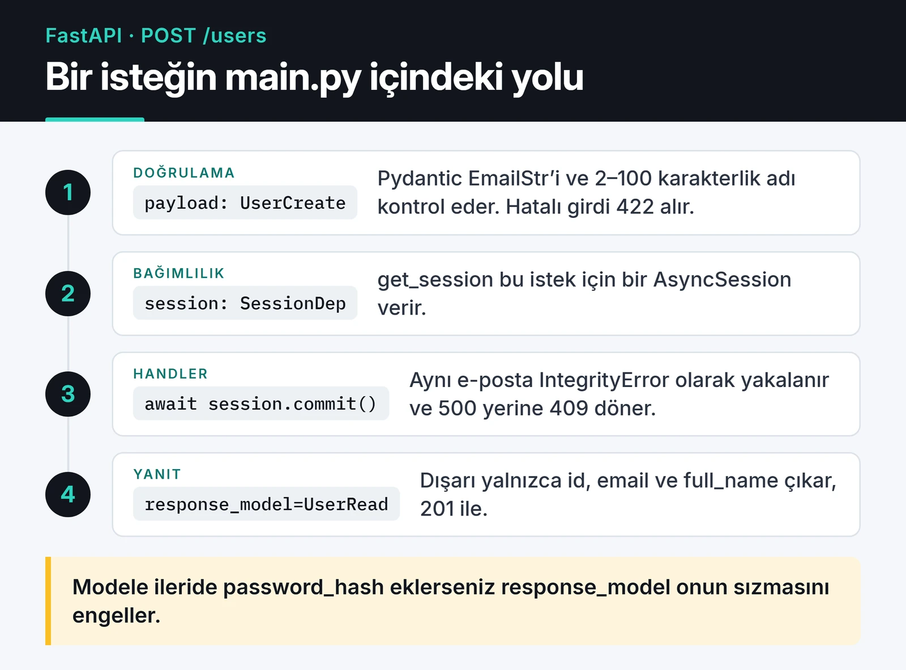

Python'da yeni bir servis yazacaksam ilk açtığım şey artık FastAPI. Bu yazıda FastAPI ile REST API geliştirirken kullandığım iskeleti anlatıyorum: Pydantic v2 ile şemalar, `Annotated` ile bağımlılıklar, async SQLAlchemy oturumu, test ve Docker. Kodların hepsi tek dosyada çalışacak şekilde yazıldı; kopyalayıp deneyebilirsiniz.

Kod, FastAPI'nin güncel kalıplarını kullanıyor: `on_event` yerine `lifespan`, Pydantic v2 ve Gunicorn'a olan ihtiyacı büyük ölçüde ortadan kaldıran `fastapi` komut satırı aracı.

## FastAPI neden hızlı ve neyin üzerine kurulu?

FastAPI kendi başına çok ince bir katman. HTTP ve ASGI tarafını Starlette, veri doğrulama ve serileştirmeyi Pydantic yapıyor. Pydantic v2'nin çekirdeği (`pydantic-core`) Rust ile yazıldığı için doğrulama v1'e göre belirgin şekilde hızlı. Uygulamayı çalıştıran sunucu ise Uvicorn.

Pratikte "hızlı" dediğimiz şeyin çoğu async I/O'dan geliyor. Bir endpoint veritabanını ya da başka bir API'yi beklerken event loop başka istekleri karşılayabiliyor. Bu yüzden FastAPI'den gerçekten verim almak için I/O yapan her kütüphanenin async olması gerekiyor. Bunu aşağıda `def` ve `async def` farkında tekrar konuşacağım.

## Kurulum

Bağımlılıkları uv ile yönetiyorum. `fastapi[standard]` paketi Uvicorn'u, `fastapi` CLI'ı ve e-posta doğrulaması için `email-validator`'ı birlikte getiriyor.

```bash
uv init users-api && cd users-api
uv add "fastapi[standard]" "sqlalchemy[asyncio]" aiosqlite
uv add --dev pytest
```

Geliştirme sırasında `uv run fastapi dev main.py` otomatik yeniden yüklemeyle çalışır. `/docs` adresinde Swagger arayüzü hazır gelir.

## Tek dosyada çalışan bir REST API

Aşağıdaki `main.py` kullanıcı oluşturan ve getiren küçük bir API. Örnekte SQLite kullandım; PostgreSQL için sadece bağlantı adresini `postgresql+asyncpg://...` yapmak yeterli.

```python {title="main.py"}
import os
from collections.abc import AsyncIterator
from contextlib import asynccontextmanager
from typing import Annotated

from fastapi import Depends, FastAPI, HTTPException, status
from pydantic import BaseModel, ConfigDict, EmailStr, Field
from sqlalchemy import String
from sqlalchemy.exc import IntegrityError
from sqlalchemy.ext.asyncio import AsyncSession, async_sessionmaker, create_async_engine
from sqlalchemy.orm import DeclarativeBase, Mapped, mapped_column

DATABASE_URL = os.getenv("DATABASE_URL", "sqlite+aiosqlite:///./app.db")

engine = create_async_engine(DATABASE_URL)
SessionLocal = async_sessionmaker(engine, expire_on_commit=False)


class Base(DeclarativeBase):
    pass


class User(Base):
    __tablename__ = "users"

    id: Mapped[int] = mapped_column(primary_key=True)
    email: Mapped[str] = mapped_column(String(255), unique=True)
    full_name: Mapped[str] = mapped_column(String(100))


class UserCreate(BaseModel):
    email: EmailStr
    full_name: str = Field(min_length=2, max_length=100)


class UserRead(BaseModel):
    model_config = ConfigDict(from_attributes=True)

    id: int
    email: EmailStr
    full_name: str


@asynccontextmanager
async def lifespan(app: FastAPI) -> AsyncIterator[None]:
    # Demo için tabloları burada oluşturuyorum; gerçek projede Alembic kullanın.
    async with engine.begin() as conn:
        await conn.run_sync(Base.metadata.create_all)
    yield
    await engine.dispose()


app = FastAPI(title="Users API", lifespan=lifespan)


async def get_session() -> AsyncIterator[AsyncSession]:
    async with SessionLocal() as session:
        yield session


SessionDep = Annotated[AsyncSession, Depends(get_session)]


@app.post("/users", response_model=UserRead, status_code=status.HTTP_201_CREATED)
async def create_user(payload: UserCreate, session: SessionDep):
    user = User(**payload.model_dump())
    session.add(user)
    try:
        await session.commit()
    except IntegrityError:
        await session.rollback()
        raise HTTPException(status.HTTP_409_CONFLICT, "Bu e-posta zaten kayıtlı")
    return user


@app.get("/users/{user_id}", response_model=UserRead)
async def get_user(user_id: int, session: SessionDep):
    user = await session.get(User, user_id)
    if user is None:
        raise HTTPException(status.HTTP_404_NOT_FOUND, "Kullanıcı bulunamadı")
    return user
```

Bir `POST /users` isteğinin bu dosyada izlediği yol şöyle:



Bu kısa dosyada birkaç bilinçli tercih var.

Girdi ve çıktı şemaları ayrı. `UserCreate` istemciden gelen veriyi doğrular; `UserRead` ise dışarı ne çıkacağını belirler. Modele ileride `password_hash` gibi bir alan eklerseniz `response_model` sayesinde yanlışlıkla dışarı sızmaz.

`ConfigDict(from_attributes=True)` Pydantic v2'deki adıyla eski `orm_mode`. SQLAlchemy nesnesini doğrudan döndürebilmemizi sağlıyor. v1'den gelen kodlarda `.dict()` ve `.parse_obj()` görürseniz karşılıkları `.model_dump()` ve `.model_validate()`.

Bağımlılığı `Annotated` ile bir kere tanımlayıp `SessionDep` olarak her yerde kullanmak, FastAPI dokümantasyonunun da artık önerdiği yol. İmzalar kısalıyor ve testte tek noktadan değiştirilebiliyor.

`lifespan` uygulama açılırken ve kapanırken çalışan kodun yeri. Eski `@app.on_event("startup")` hâlâ çalışıyor ama kullanımdan kaldırıldı.

Benzersizlik ihlalini yakalayıp 409 dönmek de küçük ama önemli bir ayrıntı. Yakalamazsanız istemci 500 görür ve sorunun kendisinde olduğunu anlayamaz.

## `def` mi `async def` mi?

Bu konuda en sık gördüğüm hata, async endpoint içinde senkron I/O yapmak. `async def` bir fonksiyonun içinde `requests.get()` ya da senkron bir veritabanı sürücüsü çağırırsanız, o çağrı bitene kadar bütün event loop durur. O süre boyunca sunucu başka hiçbir isteğe cevap veremez.

Kuralım basit:

- Kullandığınız kütüphane async ise (`httpx.AsyncClient`, `asyncpg`, `redis.asyncio`) endpoint'i `async def` yapın ve `await` edin.
- Senkron bir kütüphaneye mecbursanız endpoint'i düz `def` yapın. FastAPI onu bir thread pool'da çalıştırır ve loop bloklanmaz.
- CPU yoğun işler (büyük PDF üretimi, görüntü işleme) ikisine de uygun değil. Onları bir görev kuyruğuna verin.

## Kimlik doğrulama ve CORS

Kimlik doğrulamayı da bir bağımlılık olarak yazıyorum. `OAuth2PasswordBearer` header'dan token'ı alır, siz de doğrulayıp kullanıcıyı döndürürsünüz:

```python
import jwt  # PyJWT
from fastapi.security import OAuth2PasswordBearer

oauth2_scheme = OAuth2PasswordBearer(tokenUrl="token")
SECRET_KEY = os.environ["JWT_SECRET"]


async def current_user_id(token: Annotated[str, Depends(oauth2_scheme)]) -> int:
    try:
        claims = jwt.decode(
            token,
            SECRET_KEY,
            algorithms=["HS256"],
            options={"require": ["exp", "sub"]},
        )
    except jwt.InvalidTokenError:
        raise HTTPException(status.HTTP_401_UNAUTHORIZED, "Geçersiz token")
    return int(claims["sub"])
```

FastAPI dokümantasyonu birkaç yıl önce `python-jose` yerine PyJWT'ye geçti; ben de öyle yaptım. `algorithms` listesini her zaman açıkça verin. JWT'nin tuzaklarını, API key saklamayı ve passkey'leri [API kimlik doğrulama stratejileri](/posts/api-kimlik-dogrulama-stratejileri/) yazısında ayrıntılı anlattım.

Örneklerde sık görülen `allow_origins=["*"]` ayarını üretimde kullanmayın; frontend'inizin adreslerini tek tek yazın:

```python
from fastapi.middleware.cors import CORSMiddleware

app.add_middleware(
    CORSMiddleware,
    allow_origins=["https://app.example.com"],
    allow_credentials=True,
    allow_methods=["GET", "POST", "PUT", "DELETE"],
    allow_headers=["Authorization", "Content-Type"],
)
```

## Arka plan işleri: `BackgroundTasks` nerede yetmez?

`BackgroundTasks` yanıt gönderildikten sonra aynı süreçte çalışan küçük işler için uygun: bir hoş geldin e-postası, bir log satırı. Ama işler bellekte tutulur. Süreç yeniden başlarsa ya da çökerse kaybolurlar, tekrar denenmezler.

Kaybolmaması gereken her iş (ödeme sonrası fatura, webhook işleme) için Celery, ARQ gibi kalıcı bir kuyruk kullanıyorum. Farklarını [Celery ve ARQ ile asenkron görev kuyruğu](/posts/celery-arq-asenkron-gorev-kuyrugu/) yazısında karşılaştırdım.

## Test: `TestClient` ve ayrı bir veritabanı

`TestClient` bir context manager olarak kullanıldığında `lifespan`'i de çalıştırır. Testler için `DATABASE_URL`'i geçici bir dosyaya yönlendirmek, yukarıdaki kodda hiçbir şeyi değiştirmeden yetiyor:

```python {title="conftest.py"}
import os
import tempfile

os.environ["DATABASE_URL"] = f"sqlite+aiosqlite:///{tempfile.mkdtemp()}/test.db"
```

```python {title="test_users.py"}
from fastapi.testclient import TestClient

from main import app


def test_create_and_get_user():
    with TestClient(app) as client:
        created = client.post(
            "/users", json={"email": "ada@example.com", "full_name": "Ada Lovelace"}
        )
        assert created.status_code == 201

        user_id = created.json()["id"]
        fetched = client.get(f"/users/{user_id}")
        assert fetched.json()["email"] == "ada@example.com"

        duplicate = client.post(
            "/users", json={"email": "ada@example.com", "full_name": "Ada"}
        )
        assert duplicate.status_code == 409


def test_rejects_invalid_email():
    with TestClient(app) as client:
        response = client.post("/users", json={"email": "nope", "full_name": "Ada"})
        assert response.status_code == 422
```

Belirli bir bağımlılığı (örneğin `current_user_id`) sahtesiyle değiştirmek için `app.dependency_overrides[current_user_id] = lambda: 1` yeterli.

## Üretime çıkış: tek süreç, tek konteyner

Uzun süre standart kurulum Gunicorn ile `uvicorn.workers.UvicornWorker` idi. Bu worker sınıfı Uvicorn içinde artık kullanımdan kaldırılmış durumda ve çoğu durumda Gunicorn'a gerek de yok. `fastapi run` komutu Uvicorn'u üretim ayarlarıyla başlatıyor, `--workers` ile birden fazla süreç açabiliyor.

Kubernetes ya da Docker Compose gibi bir orkestratör kullanıyorsanız konteyner başına tek süreç çalıştırıp ölçeklemeyi replika sayısıyla yapmak daha sade. Konteynerin çökmesini orkestratör zaten yakalıyor.

```dockerfile {title="Dockerfile"}
FROM python:3.13-slim

COPY --from=ghcr.io/astral-sh/uv:latest /uv /uvx /bin/

WORKDIR /app
COPY pyproject.toml uv.lock ./
RUN uv sync --frozen --no-dev --no-install-project

COPY . .
ENV PATH="/app/.venv/bin:$PATH"

CMD ["fastapi", "run", "main.py", "--port", "8000"]
```

Üretimde `uv:latest` yerine sabit bir sürüm etiketi yazmanızı öneririm. Uygulama Nginx ya da Traefik gibi bir reverse proxy'nin arkasındaysa istemcinin gerçek IP'si `X-Forwarded-For` header'ında gelir. `fastapi run` proxy header'larını okur, ama Uvicorn varsayılan olarak yalnızca `127.0.0.1`'e güvenir. Proxy'nizin adresini `FORWARDED_ALLOW_IPS` ortam değişkeniyle vermeniz gerekir. Bunu atlarsanız IP tabanlı rate limit gibi her şey proxy'nin IP'sini görür.

## Sırada ne var?

Bu iskeleti büyütürken sırayla şunları ekliyorum: Alembic ile migration, router'lara bölünmüş bir `app/` dizini ve Redis tabanlı rate limit. Veritabanı katmanını [SQLAlchemy 2.0 rehberinde](/posts/mysql-sqlalchemy-veritabani-yonetimi/), istek sınırlamayı da [API rate limiting yazısında](/posts/python-hiz-sinirla-api-throttling/) ayrıntılı anlattım. Resmi referans için [FastAPI dokümantasyonu](https://fastapi.tiangolo.com/) ve [Pydantic v2 dokümantasyonu](https://docs.pydantic.dev/latest/) en güvenilir kaynaklar.
