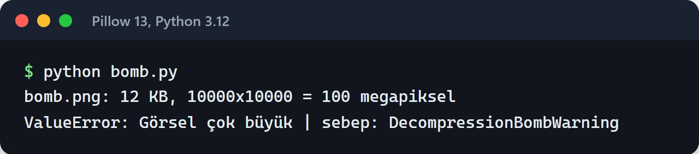

Python ile görüntü işleme denince akla iki kütüphane geliyor: Pillow ve OpenCV. İkisi de resim açar, boyutlandırır, kaydeder, ama farklı işler için yapılmışlar. Kullanıcıların fotoğraf yüklediği bir web uygulamasında ikisinden hangisini seçtiğiniz kadar, yüklenen dosyaya ne kadar güvendiğiniz de önemli.

Bu yazıda iki kütüphaneyi nerede kullandığımı, yükleme akışını nasıl güvenli hâle getirdiğimi ve işlemeyi neden HTTP isteğinden ayırdığımı anlatıyorum. Örnekler Pillow 11 ve sonrası ile OpenCV 4.x için yazıldı. Yükleme ve OCR örneklerini Pillow 13 ve OpenCV 5.0 ile de çalıştırdım.

## Kısaca fark

| | Pillow | OpenCV (`cv2`) |
| :--- | :--- | :--- |
| Veri yapısı | `PIL.Image.Image` nesnesi | `numpy.ndarray` |
| Renk sırası | RGB | BGR |
| Güçlü olduğu yer | Format dönüşümü, boyutlandırma, kırpma, metadata | Filtreler, kenar bulma, eşikleme, video, bilgisayarlı görü |
| Kurulum | Küçük wheel | Büyük wheel, ek sistem kütüphaneleri |
| Öğrenme | Pythonic, hızlı başlanır | Daha matematiksel, C++ API'sinin yansıması |

Benim kuralım basit. Web tarafındaki işlerin çoğu (thumbnail, WebP'ye çevirme, filigran) Pillow ile çözülüyor. Görüntünün içeriğiyle ilgilenmem gerektiğinde, yani kenar bulma, gürültü temizleme, OCR öncesi hazırlık veya yüz algılama gerektiğinde OpenCV'ye geçiyorum. İkisi aynı projede rahatça yan yana duruyor.

## Pillow ile güvenli yükleme

Kullanıcıdan gelen dosya bir saldırı aracı olabilir. En bilineni "decompression bomb": birkaç yüz KB'lık bir PNG, açıldığında on binlerce piksel genişliğinde bir görüntüye dönüşür ve belleği bitirir.

Pillow'un bunun için bir koruması var ama varsayılan davranışını bilmek gerekiyor. `Image.MAX_IMAGE_PIXELS` varsayılan olarak yaklaşık 179 megapiksel. Bu sınırı aşan bir dosya sadece `DecompressionBombWarning` uyarısı üretir. Hata (`DecompressionBombError`) ancak sınırın iki katı aşılınca fırlatılır. Yani varsayılan ayarlarla 300 megapiksellik bir resim uyarı verip açılır.

Ben sınırı düşürüyorum ve uyarıyı hataya çeviriyorum:

```python
import io
import warnings

from PIL import Image, ImageOps

Image.MAX_IMAGE_PIXELS = 50_000_000  # ihtiyacınıza göre
warnings.simplefilter("error", Image.DecompressionBombWarning)

MAX_BYTES = 15 * 1024 * 1024
ALLOWED = {"JPEG", "PNG", "WEBP"}


def process_upload(data: bytes) -> bytes:
    if len(data) > MAX_BYTES:
        raise ValueError("Dosya çok büyük")

    try:
        # 1. Format ve bütünlük kontrolü
        with Image.open(io.BytesIO(data)) as probe:
            if probe.format not in ALLOWED:
                raise ValueError(f"Desteklenmeyen format: {probe.format}")
            probe.verify()

        # 2. verify() sonrası dosya yeniden açılmalı
        with Image.open(io.BytesIO(data)) as img:
            img = ImageOps.exif_transpose(img)
            img.thumbnail((1600, 1600), Image.Resampling.LANCZOS)
            out = io.BytesIO()
            img.save(out, "WEBP", quality=80, method=6)
            return out.getvalue()
    except (Image.DecompressionBombError, Image.DecompressionBombWarning) as exc:
        raise ValueError("Görsel çok büyük") from exc
```

Burada birkaç şeye dikkat edin:

- Formatı dosya uzantısından değil, Pillow'un dosyanın içeriğinden okuduğu `format` değerinden kontrol ediyorum. `.jpg` uzantılı bir PHP dosyası bu kontrolden geçemez.
- `verify()` dosyayı kullanılamaz hâle getirir, bu yüzden ikinci kez açıyorum.
- `Image.open()` tembeldir. Pikseller `thumbnail()` gibi bir işlem çağrılana kadar belleğe alınmaz, boyut kontrolü bu sayede ucuz.
- Dosya boyutu sınırını Nginx gibi ters vekil sunucuda da koyun (`client_max_body_size`).

Korumayı denemek için 10.000×10.000 piksellik siyah bir PNG ürettim. Dosya sadece 12 KB, ama açıldığında 100 megapiksel ediyor. `process_upload` onu boyut kontrolünden geçirip piksel sınırında durduruyor:



## Yan duran telefon fotoğrafları: EXIF orientation

Telefonlar fotoğrafı çoğu zaman fiziksel olarak döndürmez. Pikselleri olduğu gibi kaydedip EXIF'e "bu resim 90 derece döndürülerek gösterilsin" etiketini yazar. Tarayıcı ve galeri bu etiketi okur. `Image.open()` okumaz, bu yüzden boyutlandırdığınız thumbnail yan yatmış çıkar.

Yukarıdaki koddaki `ImageOps.exif_transpose(img)` satırı bunu çözüyor. EXIF'teki yönü piksellere uygular ve etiketi kaldırır. Bunu işleme hattının en başında, bir kez yapın. OpenCV'nin `imread` fonksiyonu da varsayılan olarak EXIF yönünü uygular, ama iki kütüphaneyi karıştırdığınızda tutarlı kalmak için yönü girişte Pillow ile sabitlemek daha güvenli.

## Konum bilgisini silmek

Telefon fotoğraflarının EXIF verisinde çoğu zaman GPS koordinatları olur. Kullanıcının yüklediği bir profil fotoğrafını olduğu gibi yayınlarsanız ev adresini de yayınlamış olabilirsiniz. KVKK ve GDPR açısından da sorun.

Pillow, `save()` çağrısına `exif=` parametresi vermediğiniz sürece EXIF verisini yeni dosyaya yazmaz. Yani yukarıdaki gibi yeniden kodlanan bir dosyada GPS bilgisi kalmaz. Orijinal dosyayı saklıyorsanız ona erişimi kısıtlayın. Bir kez `exiftool` ile çıktı dosyasını kontrol etmek de iyi bir alışkanlık.

## WebP (ve AVIF)

WebP, Google'ın kendi ölçümlerine göre aynı görsel kalitede JPEG'den yüzde 25 ile 34 arasında daha küçük dosya üretiyor ve bütün güncel tarayıcılar destekliyor. Pillow ile tek satır:

```python
img.save("photo.webp", "WEBP", quality=80, method=6)
```

`method=6` en yavaş ama en iyi sıkıştırmayı seçer. Thumbnail'ler bir kez üretilip defalarca servis edildiği için bu yavaşlık genelde sorun değil. Güncel Pillow sürümleri AVIF de yazabiliyor, kurulumunuzda destek olup olmadığını `PIL.features.check("avif")` ile kontrol edebilirsiniz.

## OpenCV'yi nerede kullanıyorum?

OpenCV, C++ ile yazılmış büyük bir kütüphanenin Python bağlantısı. Görüntüleri NumPy dizisi olarak tutar, bu yüzden piksel düzeyindeki işlemler hem hızlı hem de NumPy ile birleştirilebilir.

En sık kullandığım iş, OCR öncesi görüntüyü temizlemek. Tesseract düz, yüksek kontrastlı siyah-beyaz görüntülerde çok daha iyi sonuç veriyor:

```python
import cv2
import numpy as np


def decode(data: bytes) -> np.ndarray:
    img = cv2.imdecode(np.frombuffer(data, dtype=np.uint8), cv2.IMREAD_COLOR)
    if img is None:
        raise ValueError("Görüntü çözülemedi")
    return img


def prepare_for_ocr(img: np.ndarray) -> np.ndarray:
    gray = cv2.cvtColor(img, cv2.COLOR_BGR2GRAY)
    gray = cv2.fastNlMeansDenoising(gray, h=10)
    _, binary = cv2.threshold(gray, 0, 255, cv2.THRESH_BINARY + cv2.THRESH_OTSU)
    return binary
```

Otsu bütün görüntü için tek bir eşik seçer. Kâğıt eşit aydınlanmışsa bu yeterli. Telefonla çekilmiş, bir kenarı gölgede kalan bir belgede ise karanlık taraf tamamen siyaha gömülür. O durumda eşiği her bölge için ayrı hesaplayan `adaptiveThreshold` kullanıyorum:

```python
def prepare_uneven(img: np.ndarray) -> np.ndarray:
    gray = cv2.cvtColor(img, cv2.COLOR_BGR2GRAY)
    gray = cv2.fastNlMeansDenoising(gray, h=15)
    return cv2.adaptiveThreshold(gray, 255, cv2.ADAPTIVE_THRESH_GAUSSIAN_C,
                                 cv2.THRESH_BINARY, 31, 15)
```

Aşağıdaki görselde üstte gürültülü ve sol tarafı karanlık bir örnek fatura var. Ortada aynı görüntü `prepare_for_ocr` (Otsu) ile, altta `prepare_uneven` ile işlenmiş hâli duruyor:


Dosyayı diskten değil bellekten `imdecode` ile açıyorum. Bu hem yüklenen dosyalar için doğal hem de `cv2.imread`'in Windows'ta Türkçe karakterli dosya yollarında `None` döndürme sorununu ortadan kaldırıyor. `imdecode` başarısız olduğunda hata fırlatmaz, `None` döner. Kontrol etmezseniz hata çok daha ileride, anlamsız bir yerde çıkar.

Pillow ile OpenCV arasında geçiş yaparken renk sırasını unutmayın:

```python
from PIL import Image

bgr = cv2.cvtColor(np.asarray(pil_img.convert("RGB")), cv2.COLOR_RGB2BGR)
pil_again = Image.fromarray(cv2.cvtColor(bgr, cv2.COLOR_BGR2RGB))
```

Dönüşümü atlarsanız mavi ve kırmızı yer değiştirir, yüzler mavimsi görünür.

## Docker'da libGL hatası ve headless paket

OpenCV yerelde çalışır, slim bir Docker imajında ise şu hatayı verir:

```text
ImportError: libGL.so.1: cannot open shared object file: No such file or directory
```

`opencv-python` paketi pencere açma gibi GUI özellikleri için OpenGL kütüphanelerine bağlı. Sunucuda ekran olmadığı için bunlara ihtiyacınız yok. Çözüm sisteme `libgl1` kurmak değil, headless paketi kullanmak:

```text
opencv-python-headless>=4.10
```

Aynı ortamda `opencv-python`, `opencv-python-headless` ve `opencv-contrib-python` paketlerinden sadece birini kurun. Hepsi aynı `cv2` modülünü sağlıyor ve birlikte kurulunca birbirinin dosyalarını eziyor. Başka bir bağımlılık arkadan `opencv-python` çekiyorsa `pip list | grep opencv` ile kontrol edin.

## Görüntü işlemeyi istekten ayırın

5 MB'lık bir fotoğrafı boyutlandırmak yüzlerce milisaniye sürebilir. Pillow ve OpenCV bu işlemlerin çoğunda GIL'i bıraktığı için thread'ler bir miktar paralel çalışabiliyor, ama işlem yine de CPU'yu yiyor. Bunu API sunucusunun isteği içinde yaparsanız yoğun anlarda bütün uç noktalarınız yavaşlar.

Kurduğum akış şu:

1. API dosyayı alır, boyut ve format kontrolünü yapar, ham hâliyle depolamaya yazar.
2. Kuyruğa bir görev bırakır ve kullanıcıya hemen cevap döner.
3. Worker görüntüyü işler, sonucu ayrı bir klasöre yazar ve veritabanını günceller.
4. Kullanıcılar sadece işlenmiş dosyaları CDN üzerinden görür. Ham dosyalar private kalır.

Kuyruk için [Celery veya ARQ](/posts/celery-arq-asenkron-gorev-kuyrugu/), depolama için [MinIO](/posts/minio-ile-object-storage-sistemi/) kullanabilirsiniz. Worker'ları birden fazla process olarak çalıştırıyorsanız `cv2.setNumThreads(1)` ile OpenCV'nin kendi thread havuzunu kapatın. Aksi hâlde her process çekirdek sayısı kadar thread açar ve CPU'lar birbirini bekler.

## Aynı resmi tekrar yakalamak: perceptual hash

Kullanıcılar aynı görseli farklı adlarla, farklı boyutlarda tekrar yükleyebilir. MD5 bunu yakalamaz, tek bir piksel değişince hash tamamen değişir. `imagehash` kütüphanesinin perceptual hash'i ise görüntünün genel yapısından bir parmak izi çıkarır. Boyutlandırma veya hafif sıkıştırma sonrasında da parmak izi çok az değişir:

```python
import imagehash
from PIL import Image

with Image.open("kedi.jpg") as a, Image.open("kedi-kucuk.png") as b:
    distance = imagehash.phash(a) - imagehash.phash(b)

if distance <= 5:
    print("Büyük ihtimalle aynı görsel")
```

İki hash arasındaki fark Hamming mesafesi. Eşik değerini kendi verinizle deneyerek seçin. Çok düşük tutarsanız kopyaları kaçırır, çok yüksek tutarsanız benzer ama farklı fotoğrafları birleştirirsiniz.

## Canlıya çıkmadan önce

- `MAX_IMAGE_PIXELS` ayarlı mı, `DecompressionBombWarning` hataya çevrildi mi?
- Format, uzantıdan değil dosyanın içeriğinden mi kontrol ediliyor?
- EXIF yönü uygulanıyor, GPS verisi çıktıdan siliniyor mu?
- Docker imajında `opencv-python-headless` mı var?
- İşleme bir kuyrukta mı yapılıyor, API sadece dosyayı mı alıyor?
- Ham dosyalar private, işlenmiş dosyalar CDN arkasında mı?

## Sırada ne var?

Kendi yükleme uç noktanıza büyük bir PNG ve EXIF'i döndürülmüş bir telefon fotoğrafı gönderip ne olduğuna bakın. Bu iki test çoğu sorunu hemen gösteriyor. OCR tarafıyla devam edecekseniz [Python ile PDF işlemleri yazısında](/posts/python-ile-pdf-islemleri/) OCRmyPDF'i anlattım.

Belgeler: [Pillow](https://pillow.readthedocs.io/), [OpenCV Python paketleri](https://github.com/opencv/opencv-python), [imagehash](https://github.com/JohannesBuchner/imagehash).
