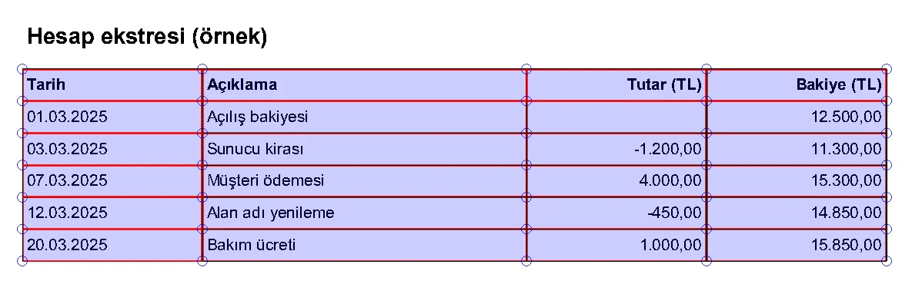

Python ile PDF işlemleri iki yöne ayrılıyor: elinizdeki PDF'ten veri çıkarmak ya da sıfırdan PDF üretmek. Ben ikisini de otomasyon işlerinde sık yapıyorum: banka ekstresinden tablo okumak, raporları birleştirmek, fatura şablonundan PDF basmak. Her iş için ayrı bir kütüphane var ve yanlış olanı seçince saatler gidiyor.

Bu yazıda bugün kullandığım araç setini anlatıyorum: okuma ve düzenleme için `pypdf`, tablo ve konumlu metin için `pdfplumber`, üretim için `WeasyPrint`, taranmış belgeler için `OCRmyPDF` ve imza için `pyHanko`.

## Hangi iş için hangi kütüphane?

Kütüphaneyi yapmak istediğiniz iş belirliyor. Benim kullandığım eşleştirme şöyle: metin okuma, birleştirme, bölme ve şifreleme için pypdf; tablolar ve konumlu metin için pdfplumber; metin katmanı olmayan taranmış belgeler için OCRmyPDF; HTML/CSS şablonundan üretim için WeasyPrint; dijital imza için pyHanko.

Eski eğitimlerde ve Stack Overflow cevaplarında hâlâ `PyPDF2` görürsünüz. PyPDF2 geliştirmesi durdu ve proje `pypdf` adıyla devam ediyor. `PdfFileReader`, `PdfFileMerger` gibi eski isimler kaldırıldı. Yeni kodda sadece `pypdf` kullanın:

```bash
pip install "pypdf[crypto]" pdfplumber
```

`[crypto]` eki AES şifreleme için `cryptography` paketini de kurar.

PyMuPDF (`fitz`) de çok hızlı ve yetenekli bir seçenek. Ama AGPL lisanslı. Kapalı kaynak bir üründe kullanacaksanız ticari lisans gerekebilir, o yüzden ben varsayılan olarak yukarıdaki MIT/BSD lisanslı araçlarla başlıyorum.

## pypdf ile PDF okumak ve metin çıkarmak

```python
from pypdf import PdfReader

reader = PdfReader("rapor.pdf")
print("Sayfa sayısı:", len(reader.pages))
print("Başlık:", reader.metadata.title if reader.metadata else None)

for number, page in enumerate(reader.pages, start=1):
    text = page.extract_text(extraction_mode="layout")
    print(f"--- {number}. sayfa ---")
    print(text)
```

`extraction_mode="layout"` metni sayfadaki yerleşime yakın bir şekilde döndürür. Sütunlu belgelerde varsayılan moddan daha okunaklı sonuç veriyor. Boş string dönüyorsa PDF büyük ihtimalle taranmış bir görüntüdür, içinde metin katmanı yoktur. O durumda OCR bölümüne geçin.

Şifreli bir dosyayı okumak için:

```python
reader = PdfReader("ekstre.pdf")
if reader.is_encrypted:
    reader.decrypt("parola")
```

## Birleştirme, bölme ve döndürme

Eski `PdfMerger` sınıfı kaldırıldı. Artık her şey `PdfWriter` üzerinden yapılıyor:

```python
from pypdf import PdfReader, PdfWriter

# Birleştirme
writer = PdfWriter()
writer.append("kapak.pdf")
writer.append("rapor.pdf", pages=(0, 3))  # sadece ilk 3 sayfa
writer.add_metadata({"/Title": "Aylık rapor", "/Author": "Furkan Köykıran"})
writer.write("birlesik.pdf")

# Her sayfayı ayrı dosyaya bölme
reader = PdfReader("birlesik.pdf")
for number, page in enumerate(reader.pages, start=1):
    single = PdfWriter()
    single.add_page(page)
    single.write(f"sayfa-{number:03}.pdf")
```

Döndürme sayfa nesnesi üzerinde: `page.rotate(90)`. Açı 90'ın katı olmalı.

## Filigran eklemek ve dosyayı küçültmek

Filigranı tek sayfalık ayrı bir PDF olarak hazırlayıp her sayfanın altına yerleştirmek en temiz yöntem:

```python
from pypdf import PdfReader, PdfWriter

stamp = PdfReader("filigran.pdf").pages[0]
writer = PdfWriter(clone_from="rapor.pdf")

for page in writer.pages:
    page.merge_page(stamp, over=False)  # içeriğin altına yerleştir
    page.compress_content_streams()

writer.compress_identical_objects()
writer.write("rapor-filigranli.pdf")
```

`over=False` filigranı metnin arkasına koyar, böylece yazılar okunur kalır. `compress_content_streams()` ve `compress_identical_objects()` özellikle çok sayfalı ve tekrar eden logolu dosyalarda boyutu belirgin şekilde düşürüyor.

## Şifreleme

Müşteriye giden ekstre veya bordro gibi belgelerde açılış parolası istenebiliyor:

```python
from pypdf import PdfWriter

writer = PdfWriter(clone_from="bordro.pdf")
writer.encrypt(
    user_password="1234",
    owner_password="cok-gizli-yonetici-parolasi",
    algorithm="AES-256",
)
writer.write("bordro-sifreli.pdf")
```

`user_password` dosyayı açmak için, `owner_password` izinleri değiştirmek için. Parola olarak T.C. kimlik numarasının son haneleri gibi tahmin edilebilir değerler kullanmak yaygın ama zayıf bir pratik. Kısa bir parola birkaç dakikada kırılabilir, gerçek gizlilik gerekiyorsa belgeyi e-posta eki yerine yetkili bir indirme linkiyle verin.

## pdfplumber ile tablo çıkarmak

pypdf metni verir ama hangi kelimenin nerede durduğunu söylemez. Tablolar ve form alanları için `pdfplumber` kullanıyorum. Her karakterin koordinatını bilir ve çizgilerden tablo yapısını çıkarabilir:

```python
import pdfplumber

with pdfplumber.open("ekstre.pdf") as pdf:
    rows = []
    for page in pdf.pages:
        for table in page.extract_tables():
            header, *body = table
            rows.extend(dict(zip(header, row)) for row in body)

print(rows[:3])
```

Çizgisiz tablolarda varsayılan ayar boş döner. O zaman stratejiyi metne göre değiştirin:

```python
settings = {"vertical_strategy": "text", "horizontal_strategy": "text"}
table = page.extract_table(table_settings=settings)
```

Doğru ayarı bulmak deneme yanılma işi. pdfplumber'ın görsel hata ayıklaması bu konuda çok yardımcı:

```python
im = page.to_image(resolution=150)
im.debug_tablefinder(settings)
im.save("debug.png")
```

Çizgili tablosu olan örnek bir ekstrede varsayılan ayarlarla aldığım `debug.png` şöyle. Kırmızı çizgiler bulunan kenarlar, mavi daireler kesişimler, açık mavi alanlar da tablo hücreleri:



Belgenin sadece bir bölgesi lazımsa sayfayı kırpın. Koordinatlar `(x0, top, x1, bottom)` sırasıyla, birim PDF noktası:

```python
header_text = page.crop((0, 0, page.width, 120)).extract_text()
```

## Taranmış belgeler: OCRmyPDF

Fotoğrafı çekilmiş veya taranmış bir PDF'te metin katmanı yoktur. `pytesseract` ile görüntüleri tek tek okumak mümkün ama PDF için `OCRmyPDF` çok daha az iş çıkarıyor. Sayfaları düzeltir, Tesseract ile okur ve orijinal görüntünün üstüne aranabilir bir metin katmanı ekler:

```bash
sudo apt install ocrmypdf tesseract-ocr-tur
ocrmypdf -l tur+eng --deskew --rotate-pages taranmis.pdf aranabilir.pdf
```

Python içinden de çağrılabiliyor:

```python
import ocrmypdf

ocrmypdf.ocr("taranmis.pdf", "aranabilir.pdf", language=["tur", "eng"], deskew=True)
```

Çıktı varsayılan olarak PDF/A formatında. Sonrasında dosyayı pdfplumber ile normal bir PDF gibi okuyabilirsiniz. Tesseract'ın başarısı görüntü kalitesine çok bağlı. Kötü taramalarda önce görüntüyü gri tonlamaya çevirip eşikleme yapmak işe yarıyor, bunun detayları [Pillow ve OpenCV yazısında](/posts/python-goruntu-isleme-pillow-opencv/).

## HTML ve CSS'ten PDF üretmek: WeasyPrint

ReportLab ile `canvas.drawString(100, 700, ...)` yazarak fatura çizmek mümkün ama her tasarım değişikliği koordinat hesabı demek. WeasyPrint HTML ve CSS'i alıp PDF'e çeviriyor. Şablonu Jinja2 ile dolduruyorsunuz, sayfa düzenini CSS'in `@page` kurallarıyla yönetiyorsunuz.

```python
from pathlib import Path

from jinja2 import Environment, FileSystemLoader, select_autoescape
from weasyprint import HTML

TEMPLATES = Path(__file__).parent / "templates"
env = Environment(loader=FileSystemLoader(TEMPLATES), autoescape=select_autoescape())

html = env.get_template("fatura.html").render(
    musteri="Örnek A.Ş.",
    kalemler=[{"ad": "Sunucu", "tutar": 4000}, {"ad": "Bakım", "tutar": 1000}],
)

HTML(string=html, base_url=str(TEMPLATES)).write_pdf("fatura.pdf")
```

`base_url` parametresini atlamayın. HTML'i string olarak verdiğinizde WeasyPrint `logo.png` veya `style.css` gibi göreli yolları neye göre çözeceğini bilemez, sonuçta görselsiz ve stilsiz bir PDF alırsınız.

Ortak üst bilgi, alt bilgi ve sayfa numarasını tek bir taban şablona koyup diğer şablonları ondan türetin:

```html
<!-- templates/base.html -->
<!DOCTYPE html>
<html lang="tr">
<head>
  <meta charset="utf-8">
  <link rel="stylesheet" href="style.css">
  <style>
    @page {
      size: A4;
      margin: 2cm;
      @bottom-center { content: "Sayfa " counter(page) " / " counter(pages); }
    }
  </style>
</head>
<body>
  <header></header>
  <main></main>
</body>
</html>
```

```html
<!-- templates/fatura.html -->


  <h1>Fatura</h1>
  <p>Müşteri: {{ musteri }}</p>
  <ul>
    <li>{{ k.ad }}: {{ k.tutar }} TL</li>
  </ul>

```

Logo değiştiğinde tek dosyaya dokunursunuz.

### Uzun süre saklanacak belgeler: PDF/A

Belgeyi yıllarca arşivleyecekseniz PDF/A gerekebilir. PDF/A, fontların dosyanın içine gömülmesini ve dış kaynaklara referans verilmemesini şart koşar. WeasyPrint bunu bir parametreyle üretiyor:

```python
HTML(string=html, base_url=str(TEMPLATES)).write_pdf("arsiv.pdf", pdf_variant="pdf/a-3b")
```

Uyumluluk sizin için önemliyse çıktıyı [veraPDF](https://verapdf.org/) gibi bir doğrulayıcıdan geçirin. Parametrenin verilmiş olması dosyanın her doğrulayıcıdan geçeceği anlamına gelmiyor.

## Docker'da font ve bağımlılık sorunu

WeasyPrint yerelde sorunsuz çalışır, slim bir Docker imajında ise iki sorun çıkar. Birincisi Pango kütüphaneleri eksik olduğu için import aşamasında hata alırsınız. İkincisi sunucuda uygun font yoksa Türkçe karakterler kutu olarak görünür.

```dockerfile
FROM python:3.13-slim

RUN apt-get update \
 && apt-get install -y --no-install-recommends \
      libpango-1.0-0 libpangoft2-1.0-0 libharfbuzz-subset0 fontconfig \
 && rm -rf /var/lib/apt/lists/*

# Kullandığınız fontları projeyle birlikte taşıyın
COPY fonts/ /usr/share/fonts/truetype/app/
RUN fc-cache -f
```

Sistem fontlarına güvenmeyin. Kullandığınız fontu projenin içine koyup imaja kopyalayın. Python imajlarını küçük tutmanın diğer yolları [Docker yazısında](/posts/docker-ile-python-uygulamasi-containerization/).

## Dijital imza: pyHanko

Bir imza görselini PDF'e yapıştırmak imza değildir. Belgenin sonradan değiştirilmediğini kanıtlamak için kriptografik bir imza (PAdES) gerekir. Python'da bunun için `pyHanko` kullanılıyor:

```python
import os

from pyhanko.pdf_utils.incremental_writer import IncrementalPdfFileWriter
from pyhanko.sign import signers

signer = signers.SimpleSigner.load_pkcs12(
    pfx_file="sertifika.p12",
    passphrase=os.environ["P12_PASSPHRASE"].encode(),
)

with open("sozlesme.pdf", "rb") as inf, open("sozlesme-imzali.pdf", "wb") as outf:
    writer = IncrementalPdfFileWriter(inf)
    signers.sign_pdf(
        writer,
        signers.PdfSignatureMetadata(field_name="Imza1"),
        signer=signer,
        output=outf,
    )
```

İmza alanı yoksa pyHanko onu görünmez bir alan olarak oluşturur. Sertifika parolasını koda yazmayın, ortam değişkeninden veya bir secret yöneticisinden okuyun.

Bir uyarı: Adobe Reader'daki yeşil "geçerli imza" işareti sertifikanın güvenilir bir köke bağlanmasına bağlı. Kendi ürettiğiniz bir sertifikayla imzaladığınız belge teknik olarak imzalıdır, ama okuyucu imzalayanı doğrulayamaz. Türkiye'de hukuki geçerliliği olan e-imza için de bir elektronik sertifika hizmet sağlayıcısından alınmış nitelikli sertifika gerekiyor.

## PDF üretimini istek içinde yapmayın

Çok sayfalı bir raporu render etmek saniyeler sürebilir ve CPU yoğun bir iş. Bunu HTTP isteğinin içinde yaparsanız worker o süre boyunca başka isteğe bakamaz. Benim kurduğum akış şöyle:

1. Kullanıcı raporu ister, API bir görev kuyruğa atıp hemen `202 Accepted` döner.
2. Arka plandaki worker PDF'i üretir ve object storage'a yükler.
3. Kullanıcıya süreli bir indirme linki gider.

Kuyruk tarafı için [Celery ve ARQ yazısına](/posts/celery-arq-asenkron-gorev-kuyrugu/), dosyaları saklamak için [MinIO yazısına](/posts/minio-ile-object-storage-sistemi/) bakabilirsiniz.

## Nereden başlamalı?

Elinizde okumanız gereken bir PDF varsa önce `pdfplumber` ile `page.to_image().debug_tablefinder()` çıktısına bakın, belgenin yapısını hızlıca anlarsınız. Üretim tarafında ise tek bir Jinja2 taban şablonu ve WeasyPrint ile başlayın, Docker imajına fontları ilk günden ekleyin.

Belgeler: [pypdf](https://pypdf.readthedocs.io/), [pdfplumber](https://github.com/jsvine/pdfplumber), [WeasyPrint](https://doc.courtbouillon.org/weasyprint/stable/), [OCRmyPDF](https://ocrmypdf.readthedocs.io/), [pyHanko](https://pyhanko.readthedocs.io/).
