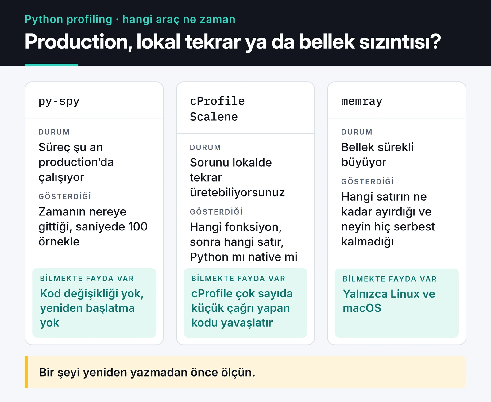

Python performans sorunlarında en pahalı hata, ölçmeden tahmin etmek. "Şurası yavaş olmalı" deyip bir fonksiyonu yeniden yazarsınız, hiçbir şey değişmez, çünkü zaman başka yerde gidiyordur. Python performans profiling bu tahmini ölçümle değiştirir. Bu yazıda üç aracı ne zaman kullandığımı anlatıyorum: geliştirme sırasında cProfile, çalışan süreçte py-spy, satır bazlı ve bellek dahil analiz için Scalene. Sonunda düzeltmenin gerçekten işe yaradığını nasıl kanıtladığıma geliyorum.

## Hangi araç ne zaman

Hangi araçla başlayacağınız iki soruya bağlı: süreç şu an production'da mı çalışıyor, ve sorun CPU mu bellek mi? Aşağıdaki kart bunu özetliyor.



## Örnek: yavaş bir rapor fonksiyonu

Araçları gerçek bir çıktı üzerinden göstermek için küçük bir script yazdım. JSON log satırlarını okuyup, 500 ms'den yavaş istekleri endpoint başına benzersiz kullanıcı sayısıyla raporluyor:

```python
# slow_report.py
import json
import random
import re


def make_lines(n: int) -> list[str]:
    rnd = random.Random(42)
    return [
        json.dumps(
            {
                "user": f"u{rnd.randint(1, 5000)}",
                "ms": rnd.randint(1, 900),
                "path": f"/api/items/{rnd.randint(1, 50)}",
            }
        )
        for _ in range(n)
    ]


def slow_endpoints(lines: list[str]) -> dict[str, int]:
    users_by_path: dict[str, list[str]] = {}
    for line in lines:
        rec = json.loads(line)
        if re.match(r"^/api/items/\d+$", rec["path"]) and rec["ms"] > 500:
            users = users_by_path.setdefault(rec["path"], [])
            if rec["user"] not in users:  # listede arama: O(n)
                users.append(rec["user"])
    return {path: len(users) for path, users in users_by_path.items()}


if __name__ == "__main__":
    lines = make_lines(300_000)
    result = slow_endpoints(lines)
    print(len(result), sum(result.values()))
```

Hatayı yorum satırında ele verdim ama gerçek kodda bu kadar belirgin olmuyor.

## cProfile: hangi fonksiyon?

`cProfile` standart kütüphanede gelir ve deterministiktir: her fonksiyon çağrısını sayar ve süresini ölçer. Kodu değiştirmeden çalıştırabilirsiniz:

```bash
python -m cProfile -s tottime slow_report.py
```

Benim makinemde (Python 3.12) çıktının en üst satırları şöyleydi (kısalttım):

```text
         13758639 function calls (13758494 primitive calls) in 40.434 seconds

   Ordered by: internal time

   ncalls  tottime  percall  cumtime  percall filename:lineno(function)
        1   20.674   20.674   28.907   28.907 slow_report.py:21(slow_endpoints)
   300000    2.176    0.000    2.176    0.000 encoder.py:205(iterencode)
   900000    2.004    0.000    5.139    0.000 random.py:291(randrange)
   900000    1.610    0.000    1.610    0.000 {method 'match' of 're.Pattern' objects}
        1    1.489    1.489   11.443   11.443 slow_report.py:7(make_lines)
   300000    0.941    0.000    5.686    0.000 __init__.py:299(loads)
```

İki sütunu ayırt etmek önemli. `tottime`, fonksiyonun kendi içinde geçen süre; `cumtime`, çağırdığı her şey dahil süre. `slow_endpoints` toplam 29 saniyenin yaklaşık 21'ini kendi içinde harcıyor. Kalanın çoğu JSON parse (`loads`, 5,7 saniye) ve regex (1,6 saniye). Yani suçlu ne `json` ne `re`; fonksiyonun kendi gövdesindeki bir şey. cProfile satır göstermez ama nereye bakacağımı söyledi.

Sonucu dosyaya kaydedip sonradan incelemek ya da görsel olarak açmak da mümkün:

```bash
python -m cProfile -o profile.prof slow_report.py
python -c "import pstats; pstats.Stats('profile.prof').sort_stats('cumulative').print_stats(15)"
uvx snakeviz profile.prof   # tarayıcıda interaktif görünüm
```

cProfile'ın bir bedeli var: her çağrıyı ölçtüğü için çok sayıda küçük fonksiyon çağıran kodu belirgin şekilde yavaşlatır ve küçük fonksiyonların payını olduğundan büyük gösterebilir. Lokal analiz için iyi, production'a bağlamak için uygun değil.

Python 3.15 ile standart kütüphaneye bir `profiling` paketi geldi. `cProfile` yerinde duruyor (`profiling.tracing` olarak da erişilebilir), yanına bir de örnekleme yapan profiler eklendi; ona aşağıda değiniyorum.

## py-spy: çalışan sürece dokunmadan

py-spy örnekleme (sampling) yapan bir profiler. Hedef sürecin belleğini dışarıdan okur, varsayılan olarak saniyede 100 kez stack'e bakar. Kodu değiştirmeniz, süreci yeniden başlatmanız gerekmez ve ek yük çok düşüktür. Production'daki bir FastAPI ya da Django sürecine bu yüzden onu bağlıyorum.

```bash
# top benzeri canlı görünüm: şu an en çok vakit alan fonksiyonlar
py-spy top --pid 12345

# 60 saniye örnekle, flame graph olarak kaydet
py-spy record -o profile.svg --pid 12345 --duration 60

# speedscope formatında (https://www.speedscope.app ile açılır)
py-spy record -o profile.json --format speedscope -- python slow_report.py

# takılı kalmış bir sürecin her thread'i şu an nerede?
py-spy dump --pid 12345
```

`dump` komutu bence en az bilinen ama en kullanışlı olanı. Bir worker cevap vermeyi kestiğinde, hangi satırda beklediğini (bir lock, bir socket okuması, sonsuz döngü) saniyeler içinde gösterir.

Flame graph'ı okurken genişliğe bakın: bir kutu ne kadar genişse o fonksiyonda o kadar çok örnek yakalanmıştır. Y ekseni çağrı derinliği, renkler anlamsız. Varsayılan olarak py-spy boşta bekleyen thread'leri göstermez; I/O beklemesini de görmek istiyorsanız `--idle` ekleyin. NumPy gibi C eklentilerinin içini görmek için `--native` var.

Örnek script için `py-spy record -o flame.svg -- python slow_report.py` ile bir flame graph aldım. py-spy satır numarasını da kaydediyor: en geniş kutu `slow_endpoints (slow_report.py:27)`, yani listede `not in` kontrolünün yapıldığı satır.

Birkaç pratik not:

- Linux'ta başka bir sürecin belleğini okumak yetki ister. Genelde `sudo` ile çalıştırırsınız. Container içinde `SYS_PTRACE` yetkisi gerekir (`docker run --cap-add SYS_PTRACE`, Kubernetes'te `securityContext.capabilities.add`).
- py-spy her yeni Python sürümünün iç yapılarını tanımak zorunda. Yeni bir Python sürümüne geçtiyseniz py-spy'ın o sürümü desteklediğini [sürüm notlarından](https://github.com/benfred/py-spy/releases) kontrol edin.
- Gunicorn ya da Celery gibi çok süreçli yapılarda ana sürece `--subprocesses` ile bağlanın.

Python 3.15 kullanıyorsanız benzer bir aracı artık standart kütüphanede de bulabilirsiniz:

```bash
python -m profiling.sampling attach --flamegraph -d 30 -o profile.html 12345
```

Hedef süreçle profiler'ın aynı Python minor sürümünü çalıştırması gerekiyor. Ek bir paket kurmadan çalışması, kısıtlı production ortamlarında işe yarıyor.

## Scalene: hangi satır, Python mu native mi?

cProfile bana `slow_endpoints`'i gösterdi ama satırı göstermedi. Scalene tam bu boşluğu dolduruyor: satır bazında CPU süresini Python kodu, native kod (C eklentileri) ve sistem (I/O) olarak ayırır, bellek ayırmalarını da aynı satırlarda gösterir.

```bash
pip install scalene
scalene run slow_report.py      # profili scalene-profile.json'a kaydeder
scalene view                    # tarayıcıda açar
scalene view --cli              # ya da terminalde
scalene run --cpu-only slow_report.py   # sadece CPU, daha hızlı
```

Bu örnekte bakılacak satır `if rec["user"] not in users`: cProfile'ın `slow_endpoints` için gösterdiği 21 saniyelik `tottime` orada, saf Python tarafında harcanıyor. Aşağıdaki düzeltmeden sonra o sürenin kaybolması da bunu doğruluyor. Satır bazlı ayrımın faydası şurada: süre "native" sütununda birikiyorsa (NumPy, regex motoru, JSON parser), Python kodunu mikro-optimize etmek boşuna; algoritmayı ya da çağırdığınız kütüphaneyi değiştirmeniz gerekir. "System" sütunu yüksekse sorun CPU değil, I/O'dur.

Bellek sürekli artıyor ve süreç OOM ile ölüyorsa Bloomberg'in [memray](https://github.com/bloomberg/memray) aracı daha ayrıntılı: hangi satırın ne kadar bellek ayırdığını ve neyin serbest bırakılmadığını gösterir.

```bash
memray run -o memory.bin slow_report.py
memray flamegraph memory.bin    # HTML rapor
```

memray Linux ve macOS'ta çalışır, Windows'ta çalışmaz.

## Düzeltme ve kanıt

Örnekteki sorun, büyüyen bir listede `in` ile arama yapmak. Her kontrol listenin tamamını tarar; endpoint başına iki bin kullanıcıya ulaşınca bu satır her şeyi yiyor. Liste yerine set kullanmak aramayı ortalama sabit zamana indirir:

```python
def slow_endpoints(lines: list[str]) -> dict[str, int]:
    users_by_path: dict[str, set[str]] = {}
    for line in lines:
        rec = json.loads(line)
        if re.match(r"^/api/items/\d+$", rec["path"]) and rec["ms"] > 500:
            users_by_path.setdefault(rec["path"], set()).add(rec["user"])
    return {path: len(users) for path, users in users_by_path.items()}
```

Aynı 300 bin satırla, profiler olmadan ölçtüğümde fonksiyonun süresi benim makinemde 21,3 saniyeden 2,3 saniyeye indi. Kesin sayılar makineye göre değişir; önemli olan yaklaşık dokuz katlık fark. Kalan sürenin çoğu artık `json.loads`'ta; daha da hızlanmak gerekirse sıradaki adım `orjson` gibi daha hızlı bir parser olur. Yine profil alarak karar verin.

"Daha hızlı oldu" hissi yetmez, ölçümü teste bağlamak gerekir. [pytest-benchmark](https://pytest-benchmark.readthedocs.io/) bu iş için:

```python
# test_report.py
from slow_report import make_lines, slow_endpoints

LINES = make_lines(50_000)


def test_slow_endpoints_speed(benchmark):
    result = benchmark(slow_endpoints, LINES)
    assert len(result) == 50
```

```bash
pytest test_report.py --benchmark-autosave
# değişiklikten sonra kaydedilen son sonuçla karşılaştır
pytest test_report.py --benchmark-compare
```

Size min, max, ortalama ve standart sapma verir. Ortalama düştü ama sapma çok arttıysa ölçüm gürültülüdür; makinedeki diğer işleri kapatıp tekrarlayın. Testleri düzenlemeye dair daha fazlası [pytest yazısında](/posts/pytest-ile-ileri-seviye-test-teknikleri/).

## Sık işe yarayan düzeltmeler

Profil size neyin yavaş olduğunu söyledikten sonra, en sık karşılaştığım düzeltmeler:

- Doğru veri yapısı: üyelik kontrolü için `set` ya da `dict`, kuyruk için `collections.deque`. Yukarıdaki örnekteki gibi tek satır, büyük fark.
- Aynı işi tekrar yapmamak: aynı girdiyle aynı sonucu veren pahalı fonksiyonlar için `functools.lru_cache` ya da `functools.cache`. Önbelleğin sınırsız büyümemesine ve argümanların hashable olmasına dikkat edin; metotlara uygulandığında `self`'i de önbellekte tutar.
- I/O'yu toplu yapmak: döngü içinde tek tek veritabanı sorgusu ya da HTTP isteği yerine toplu sorgu, ya da asyncio ile eş zamanlı istek. Bunu [asyncio yazısında](/posts/python-asyncio-paralel-islem/) anlattım.
- Vektörleştirmek: sayısal işlerde Python döngüsü yerine NumPy ya da pandas işlemleri. [Pandas yazısında](/posts/python-pandas-kripto-para-piyasa-analizi/) gerçek bir örnek var.
- Çok sayıda küçük nesne bellek sorunu yaratıyorsa `@dataclass(slots=True)` ya da `__slots__`, her nesnedeki `__dict__` yükünü kaldırır.

List comprehension'ın döngüden hızlı olması gibi mikro-optimizasyonlar gerçek ama genelde küçük. Profil o satırı göstermiyorsa okunabilirliği bozmaya değmez; emin değilseniz `python -m timeit` ile ölçün.

## Sürekli profiling

Kriz anında profil almak yerine sürekli düşük frekanslı profil toplamak da mümkün. Grafana Pyroscope gibi araçlar, "dünkü deploy'dan sonra login servisi daha fazla CPU harcamaya başladı" gibi değişiklikleri sürüm sürüm gösterir. Küçük bir projede gerekmez; birden fazla servisiniz ve düzenli deploy'larınız varsa bakmaya değer. Logları ve metrikleri bunun yanına nasıl koyduğumu [Python loglama yazısında](/posts/python-loglama-en-iyi-uygulamalar/) anlattım.

## Sırada ne var

Bir sonraki yavaşlık şikâyetinde kodu değiştirmeden önce bir profil alın: lokaldeyse `python -m cProfile -s tottime`, production'daysa `py-spy top --pid`. İlk on satır genelde nereye bakmanız gerektiğini söyler.

Ölçümü tekrarlanabilir kılmak için bağımlılıkları sabitlemek şart; bunu [Poetry ve uv yazısında](/posts/poetry-python-proje-yonetimi/) anlattım. I/O ağırlıklı darboğazlar için de [asyncio yazısı](/posts/python-asyncio-paralel-islem/) iyi bir sonraki adım.
