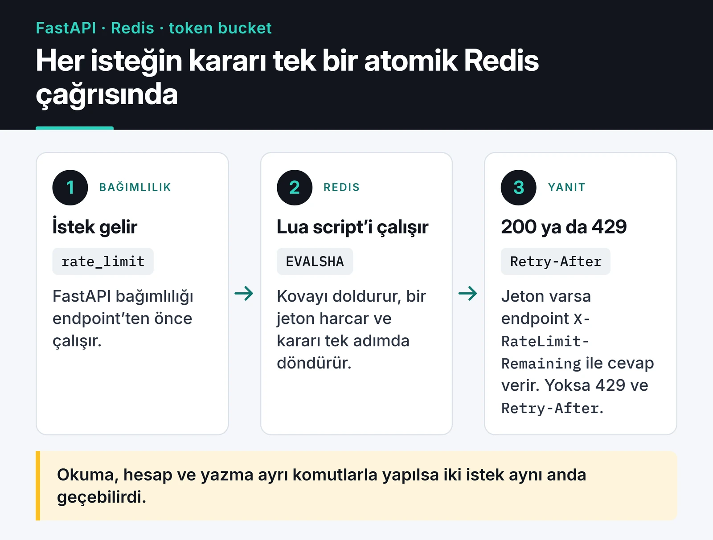

Bir API'yi dışarı açtığınız gün, birinin onu sizin beklemediğiniz hızda çağıracağını kabul etmiş olursunuz. Bu bazen kötü niyetli bir tarayıcı, çoğu zaman da bir hata yüzünden sonsuz döngüye girmiş kendi istemcinizdir. Bu yazıda Python ile hız sınırını (rate limit) baştan kuruyorum: algoritmalar, Redis üzerinde Lua ile atomik bir token bucket, FastAPI bağımlılığı ve istemcinin 429 aldığında ne yapması gerektiği. Kodu FastAPI ile çalıştırıp çıktısını da gösteriyorum.

Uygulama seviyesindeki hız sınırı DDoS'a karşı korumaz. Gerçek bir saldırıda istekler uygulamanıza ulaşmadan ağı ve proxy'yi doldurur, o iş CDN ve kenar katmanınındır. Uygulama içindeki limit adil kullanımı sağlar, maliyeti kontrol altında tutar ve kaba kuvvet (brute force) denemelerini yavaşlatır.

## Algoritmalar ve ödünleşimleri

| Algoritma | Nasıl çalışır | Artısı | Eksisi |
|---|---|---|---|
| Sabit pencere | Her dakika sıfırlanan bir sayaç | Tek `INCR`, çok ucuz | Pencere sınırında 2 katı patlama |
| Kayan pencere log'u | Her isteğin zamanını bir sorted set'te tut | Kesin | İstek başına bellek |
| Kayan pencere sayacı | Önceki ve şimdiki pencereyi ağırlıklı topla | Ucuz ve yeterince doğru | Yaklaşık sonuç |
| Token bucket | Kova sabit hızla dolar, her istek jeton harcar | Kontrollü patlamaya izin verir | Biraz daha fazla durum |

Sabit pencerenin sorunu sınırda. Dakikada 100 istek limiti varsa, biri 12:00:59'da 100, 12:01:00'da 100 istek daha atarak iki saniyede 200 istek geçirebilir.

```text
limit: dakikada 5 istek

      önceki dakika (5 istek)         şimdiki dakika (şu ana kadar 3)
  |  x   x   x   x   x           |  x   x   x                      |
           |<---------- son 60 saniye ----------->|
           önceki dakikanın %70'i   + geçen %30   ^ şimdi

  tahmin = şimdiki + önceki x 0,70
         = 3 + 5 x 0,70 = 6,5   > 5   -> reddet
```

Kayan pencere sayacı bunu ucuz bir tahminle düzeltiyor. Şimdiki dakikanın %30'u geçmişse, önceki dakikadaki isteklerin %70'ini şimdiki sayıya ekleyip limitle karşılaştırırsınız. Ben çoğu API için token bucket kullanıyorum. Kullanıcı bir süre sessiz kaldıysa kısa bir patlamaya izin verir, uzun vadede ortalamayı da sabit tutar. Stripe da API'sinde token bucket kullandığını [rate limiter yazısında](https://stripe.com/blog/rate-limiters) anlatıyor.

## Redis ve Lua ile atomik token bucket

Birden fazla sunucu veya worker'ınız varsa sayaç bellekte duramaz, ortak bir yerde olmalı. Redis bunun için uygun. Ama "oku, hesapla, yaz" adımlarını ayrı komutlarla yaparsanız iki istek aynı anda okuyup ikisi de limitin altında olduğunu sanabilir. Lua script'leri Redis içinde atomik çalışır ve bu yarışı ortadan kaldırır.

Bir isteğin yolu şöyle: FastAPI bağımlılığı script'i çağırır, script kovayı günceller ve kararı döndürür.



Script'te üç ayrıntı önemli:

1. Zamanı uygulama sunucusundan (`time.time()`) değil, Redis'in `TIME` komutundan alır. Birden fazla sunucunun saatleri birkaç yüz milisaniye kayabilir ve bu kova hesabını bozar.
2. Durumu iki ayrı anahtar yerine tek bir hash'te tutar.
3. Anahtara süre koyar. Süre olmazsa her IP için bir anahtar oluşur ve hiç silinmez, Redis belleği yavaş yavaş dolar.

```python {title="limiter.py"}
import hashlib
import logging

import redis.asyncio as redis
from fastapi import Depends, FastAPI, HTTPException, Request, Response

log = logging.getLogger(__name__)

TOKEN_BUCKET_LUA = """
-- KEYS[1]: bucket key
-- ARGV[1]: capacity, ARGV[2]: refill rate (tokens/second), ARGV[3]: cost
local capacity = tonumber(ARGV[1])
local rate = tonumber(ARGV[2])
local cost = tonumber(ARGV[3])

local t = redis.call("TIME")
local now = tonumber(t[1]) + tonumber(t[2]) / 1000000

local bucket = redis.call("HMGET", KEYS[1], "tokens", "ts")
local tokens = tonumber(bucket[1]) or capacity
local ts = tonumber(bucket[2]) or now

tokens = math.min(capacity, tokens + math.max(0, now - ts) * rate)

local allowed = 0
local retry_after = 0
if tokens >= cost then
  tokens = tokens - cost
  allowed = 1
else
  retry_after = math.ceil((cost - tokens) / rate)
end

redis.call("HSET", KEYS[1], "tokens", tokens, "ts", now)
redis.call("EXPIRE", KEYS[1], math.ceil(capacity / rate) + 1)
return {allowed, math.floor(tokens), retry_after}
"""

r = redis.Redis.from_url("redis://localhost:6379/0")
token_bucket = r.register_script(TOKEN_BUCKET_LUA)
```

`register_script` script'i `EVALSHA` ile çağırır. Redis script'i önbelleğinde bulamazsa `redis-py` onu otomatik olarak tekrar yükler. Kova tamamen dolunca anahtar silinebilir, çünkü anahtarın yokluğu "kova dolu" ile aynı anlama gelir. `EXPIRE` süresi bu yüzden kovanın dolma süresine göre hesaplanıyor.

## FastAPI bağımlılığı

Limit kontrolünü bir bağımlılık olarak yazıyorum. Endpoint'in içi temiz kalır ve hangi endpoint'in limitli olduğu imzasından okunur:

```python
# tier -> (kapasite, saniyedeki jeton)
TIERS = {"anonymous": (20, 0.2), "free": (60, 1.0), "pro": (600, 10.0)}


async def lookup_tier(api_key: str) -> str:
    return "free"  # gerçek uygulamada veritabanından ya da cache'ten


async def rate_limit(request: Request, response: Response) -> None:
    api_key = request.headers.get("X-API-Key")
    if api_key:
        identity = "key:" + hashlib.sha256(api_key.encode()).hexdigest()[:32]
        tier = await lookup_tier(api_key)
    else:
        identity = f"ip:{request.client.host}"
        tier = "anonymous"

    capacity, rate = TIERS[tier]
    try:
        allowed, remaining, retry_after = await token_bucket(
            keys=[f"rl:{identity}"], args=[capacity, rate, 1]
        )
    except redis.RedisError:
        log.warning("rate limiter unavailable, allowing request")
        return  # fail open

    headers = {"X-RateLimit-Limit": str(capacity), "X-RateLimit-Remaining": str(remaining)}
    if not allowed:
        # HTTPException yeni bir yanıt üretir; header'ları buraya da ekleyin
        headers["Retry-After"] = str(retry_after)
        raise HTTPException(status_code=429, detail="Too many requests", headers=headers)
    response.headers.update(headers)


app = FastAPI()


@app.get("/api/reports", dependencies=[Depends(rate_limit)])
async def reports():
    return {"ok": True}
```

Bu kodu `limiter.py` ve küçük bir `demo.py` ile çalıştırdım. Demo, `httpx.ASGITransport` üzerinden aynı IP'den 22 istek atıyor. Redis yerine Lua destekli `fakeredis` kullandım, script aynı. Anonim katmanda kova 20 jetonla başladığı için ilk 20 istek geçiyor, 21. istek 429 ve `Retry-After: 5` alıyor. Saniyede 0,2 jetonla bir jetonun dolması tam 5 saniye sürüyor.

Bu çalıştırma bir ayrıntıyı da gösterdi. Header'ları yalnızca `response` nesnesine yazarsanız 429 yanıtında kaybolurlar, çünkü `HTTPException` kendi yanıtını üretir. Yukarıdaki kod bu yüzden onları istisnaya da veriyor.

Bu kodda üzerinde düşündüğüm birkaç karar var.

Kimliği mümkün olduğunca API anahtarından ya da kullanıcı kimliğinden çıkarıyorum, IP'den değil. Bir üniversite ya da şirket ağında yüzlerce kişi aynı dış IP'yi paylaşır. IP'yi sınırlarsanız masum kullanıcıları cezalandırırsınız. Saldırgan ise IP'sini kolayca değiştirir. IP'yi sadece giriş sayfası gibi kimliksiz endpoint'lerde kullanıyorum. API anahtarını Redis anahtarına ham hâliyle koymamak için de hash'liyorum.

Uygulama bir reverse proxy'nin arkasındaysa `request.client.host` proxy'nin IP'sini döndürür ve herkes aynı kovayı paylaşır. Uvicorn'a proxy'nin adresini `FORWARDED_ALLOW_IPS` ile verdiğinizde `X-Forwarded-For`'daki gerçek IP kullanılır. Bu header'a her kaynaktan güvenmeyin, yoksa istemci header'ı kendisi yazıp limiti atlatır.

Redis çökerse ne olacağı bir ürün kararı. Ben çoğu API'de "fail open" seçiyorum: limit geçici olarak devre dışı kalıyor ama servis çalışmaya devam ediyor. Giriş denemesi gibi güvenlik amaçlı limitlerde ise "fail closed" daha doğru olabilir.

Katmanlı limitler (`free`, `pro`) koda gömülü `if` blokları yerine bir tabloda duruyor. Gerçek uygulamada `lookup_tier` sonucu da kısa bir süre önbelleğe alınmalı, yoksa her istekte veritabanına gidersiniz.

## 429 alan istemci Retry-After'a uymalı

`429 Too Many Requests` ve `Retry-After` header'ı standarttır ([RFC 6585](https://www.rfc-editor.org/rfc/rfc6585#section-4)). `X-RateLimit-*` header'ları yaygın bir gelenek, IETF'te bunları standartlaştıran `RateLimit` header taslağı da var. İstemci tarafında en kötü davranış hemen tekrar denemek. Binlerce istemci aynı anda tekrar denerse sunucu toparlanamaz. Önce `Retry-After`'a uyuyorum, yoksa üstel artan ve rastgele dağıtılmış (full jitter) bir bekleme kullanıyorum:

```python
import asyncio
import random

import httpx


async def get_with_backoff(client: httpx.AsyncClient, url: str, max_attempts: int = 6) -> httpx.Response:
    for attempt in range(max_attempts):
        resp = await client.get(url)
        if resp.status_code != 429 and resp.status_code < 500:
            return resp
        retry_after = resp.headers.get("Retry-After", "")
        if retry_after.isdigit():
            delay = int(retry_after)
        else:
            delay = random.uniform(0, min(30, 2**attempt))  # full jitter
        await asyncio.sleep(delay)
    resp.raise_for_status()
    return resp
```

Full jitter'da bekleme süresi sıfır ile üst sınır arasında rastgele seçiliyor. Sabit `1, 2, 4` saniyelik beklemelerde bütün istemciler aynı anlarda tekrar dener, rastgelelik onları zamana yayar.

## Katmanlı savunma ve hazır kütüphaneler

Limiti tek bir yere koymuyorum. En dışta Nginx'in `limit_req` modülü kaba bir IP limiti uyguluyor ve uygulamaya hiç ulaşmaması gereken trafiği ucuza kesiyor. İçeride FastAPI ve Redis ile kullanıcı ve plan bazlı ince ayarlı limit var.

Bu kodu kendiniz yazmak istemiyorsanız [`limits`](https://github.com/alisaifee/limits) kütüphanesi Redis destekli sabit ve kayan pencere uygulamaları sunuyor, [`slowapi`](https://github.com/laurentS/slowapi) da onu FastAPI ve Starlette'e bağlıyor. Ben burada kendim yazdım çünkü planlara göre değişen kapasite ve `Retry-After` hesabı üzerinde tam kontrol istiyordum.

Son olarak limitleri izleyin. 429 sayısını kimlik ve endpoint bazında bir metrik olarak tutarsanız (örneğin Prometheus'ta bir sayaç), hem saldırıları hem de limiti yanlış ayarladığınız için takılan gerçek kullanıcıları görürsünüz.

## Sırada ne var

İlk adım olarak en pahalı endpoint'inize bu bağımlılığı ekleyin ve bir hafta boyunca 429 sayısını izleyin. Lua'nın temelini oluşturan atomik sayaç ve Redis'in diğer veri yapıları [Redis ile önbellekleme ve oturum yönetimi](/posts/redis-onbellekleme-oturum-yonetimi/) yazısında. Limiti kimlik doğrulamayla birleştirmek için [API kimlik doğrulama stratejileri](/posts/api-kimlik-dogrulama-stratejileri/) yazısına bakabilirsiniz. Redis tarafındaki ayrıntılar için [Redis scripting dokümantasyonu](https://redis.io/docs/latest/develop/programmability/eval-intro/) en iyi kaynak.
