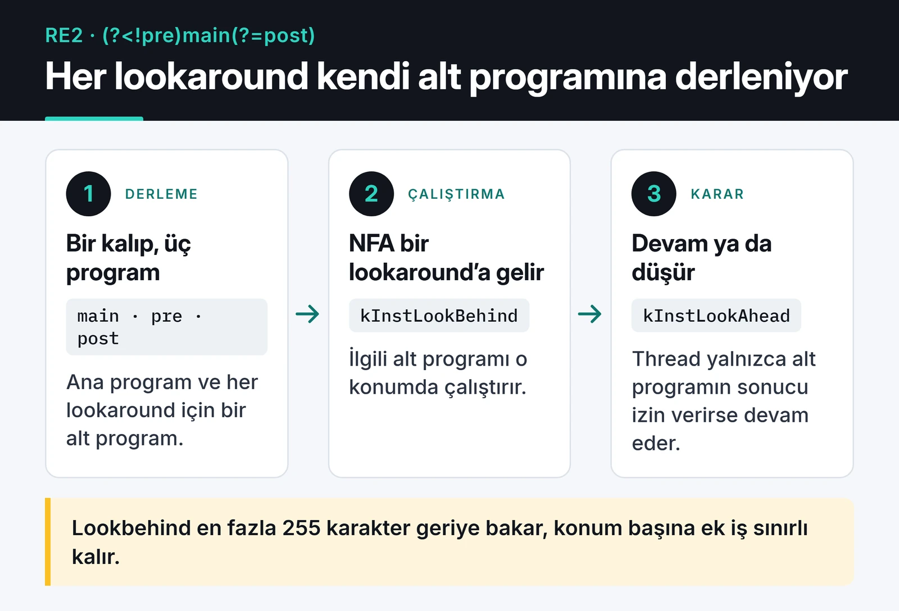

Google RE2, girdinin uzunluğuyla doğrusal sürede çalışmayı garanti eden bir regex kütüphanesi. Bu garantinin bedeli olarak bazı özellikleri desteklemiyor, lookaround (`(?=...)`, `(?!...)`, `(?<=...)`, `(?<!...)`) da bunlardan biri. Kasım 2025'te kendi fork'umda RE2'ye sınırlı bir lookaround desteği ekledim ve bunu bir proof of concept olarak [#585](https://github.com/google/re2/issues/585) numaralı issue ile paylaştım. Bu yazıda o denemeyi, tasarım tercihlerimi, kendi karmaşıklık iddiamda sonradan bulduğum açığı ve EPFL'den gelen bir yorumun bana gösterdiklerini anlatıyorum. RE2'ye PR açmadım, upstream'e de bir şey girmedi: elimde bir fork, bir commit ve açık bir tartışma var.

## RE2 neden lookaround desteklemiyor

PCRE, Python'un `re` modülü ve JavaScript motorları gibi geri izlemeli (backtracking) motorlar bazı kalıplarda üstel sürede çalışabiliyor. Klasik örnek `(a+)+$` kalıbını `aaaaaaaaaaaaaaaaaaaaaaaaaaaaX` gibi bir girdide çalıştırmak. Eşleşme başarısız olana kadar motor `a`'ları iki grup arasında bölmenin bütün yollarını deniyor.

Bu gerçek sistemleri durdurdu. Stack Overflow 2016'da satır sonundaki boşlukları kırpan bir regex yüzünden yaklaşık yarım saat erişilemez oldu ([kesinti raporu](https://stackstatus.tumblr.com/post/147710624694/outage-postmortem-july-20-2016)). Cloudflare'in Temmuz 2019 kesintisinin sebebi de WAF kurallarındaki bir regex'in CPU'yu tüketmesiydi ([Cloudflare'in açıklaması](https://blog.cloudflare.com/details-of-the-cloudflare-outage-on-july-2-2019/)). Kullanıcıdan gelen kalıbı ya da girdiyi regex'e veren her sistem bu riski taşıyor. Buna ReDoS deniyor.

RE2 bu sorunu otomat teorisiyle çözüyor. Kalıbı bir otomata çeviriyor ve girdiyi tek geçişte, aynı anda olası bütün durumları takip ederek okuyor. Geri dönüş olmadığı için süre girdi uzunluğuyla doğrusal kalıyor. Google Sheets'teki `REGEXMATCH` RE2 kullanıyor, Go'nun `regexp` paketi de aynı tasarımı izliyor. Prometheus sorgularındaki regex'lerin güvenle çalışmasının sebebi bu.

Geri referanslar (`\1`) ve lookaround bu modele doğrudan uymuyor. 2017'de açılan [#156](https://github.com/google/re2/issues/156) numaralı negatif lookahead isteği aynı gün kapatıldı. Maintainer'ın cevabı kısaydı: RE2 geri izleme gerektiren yapıları desteklemiyor. Issue kapalı olmasına rağmen 61 kişi onu beğeniyle işaretlemiş.

## Lookaround neyi çözüyor

Lookaround, bir konumda bir şeyin var olup olmadığına bakıyor ama baktığı metni eşleşmeye katmıyor. Pratikte en çok şu durumlarda lazım oluyor:

```text
(?<!old_)password    "new_password" içindeki password'ü bulur, "old_password" içindekini bulmaz
test(?!\d)           "test" kelimesini, arkasından rakam gelmiyorsa bulur
(?=.*\d)(?=.*[a-z]).{8,}   en az bir rakam ve bir küçük harf içeren 8+ karakter
```

Son örnek klasik şifre kuralı. RE2 kullanan bir sistemde bunu tek regex ile yazamıyorsunuz, iki üç ayrı kontrol yapmanız gerekiyor. Çoğu zaman sorun olmuyor. Yine de başka bir motordan RE2'ye geçiyorsanız bütün kalıpları yeniden yazmanız gerekiyor.

## Benim yaklaşımım: sınırlı alt programlar

EPFL'den çıkan ve JavaScript regex'lerinin lookaround dahil doğrusal zamanda eşleştirilebileceğini gösteren bir makale okumuştum ([Barrière ve Pit-Claudel, PLDI 2024](https://doi.org/10.1145/3656431)). Oradan aldığım fikir şuydu: lookaround için geri izleme şart değil. Ben daha basit ve daha kaba bir yol denedim.

Her lookaround ayrı bir alt programa (subprogram) derleniyor. Ana program NFA üzerinde çalışırken bir lookaround talimatına geldiğinde ilgili alt programı o konumda çalıştırıyor ve sonuca göre o iş parçacığını (thread) devam ettiriyor ya da düşürüyor. Aşağıdaki kart bunu `(?<!pre)main(?=post)` kalıbı üzerinde gösteriyor.



Lookbehind'ı 255 karakterle sınırladım. Alt program her konumda en fazla 255 karakter geriye bakıyor, böylece her konumdaki ek iş sabit bir üst sınıra sahip oluyor. Sınır küçük olduğu için bellekte de az yer tutuyor, gerçek kalıplardaki lookbehind'lerin neredeyse hepsi zaten birkaç karakterlik.

Değişiklik tek bir commit'te, 14 dosyada 569 satır ekleme:

- `re2/parse.cc`: dört lookaround sözdiziminin ayrıştırılması
- `re2/regexp.h`: dört yeni `RegexpOp` değeri
- `re2/prog.h` ve `re2/prog.cc`: `kInstLookBehind` ve `kInstLookAhead` talimatları, alt program saklama
- `re2/compile.cc`: alt programların derlenmesi
- `re2/nfa.cc`: NFA'nın talimatlara geldiğinde alt programı çalıştırması
- `re2/testing/lookbehind_test.cc`: testler

Fork'ta şu kod derlenip çalışıyor:

```cpp
#include <re2/re2.h>
#include <cassert>

int main() {
  RE2 not_after_digit("(?<!\\d)test");
  assert(RE2::PartialMatch("hello test", not_after_digit));
  assert(!RE2::PartialMatch("123test", not_after_digit));

  RE2 after_hello("(?<=hello )world");
  assert(RE2::PartialMatch("hello world", after_hello));
  assert(!RE2::PartialMatch("goodbye world", after_hello));

  RE2 not_before_digit("test(?!\\d)");
  assert(RE2::PartialMatch("test hello", not_before_digit));
  assert(!RE2::PartialMatch("test123", not_before_digit));
}
```

Bu kod upstream RE2 ile derlenir ama çalışma anında kalıplar geçersiz sayılır, ilk `assert` düşer. Sadece fork'ta geçiyor.

Sınırlamaları issue'da açıkça yazdım. Lookaround içeren kalıplar her zaman NFA'ya düşüyor, DFA ve OnePass optimizasyonları devre dışı. Yani sabit çarpanlar ciddi şekilde büyüyor.

## Sonradan gördüğüm zayıflık

Issue'da zaman karmaşıklığını O(n × m × k) olarak yazdım: n girdi uzunluğu, m lookaround sayısı, k ise 255 ile sınırlı alt kalıp maliyeti. Lookbehind için bu doğru. Lookahead için değil.

Lookahead'ı sınırlamadım, "kalan metin uzunluğuyla doğal olarak sınırlı" dedim. Ama kalan metin n kadar uzun olabilir. `(?=.*\d)` gibi bir lookahead her konumda metnin sonuna kadar tarayabiliyor ve bu en kötü durumda O(n²) eder. Yani benim prototipim, lookahead kullanıldığında RE2'nin asıl vaat ettiği şeyi tam olarak tutmuyor. Bunu düzeltmenin yolu ya lookahead'ı da sınırlamak ya da aynı alt programı her konumda yeniden çalıştırmak yerine sonuçları paylaşan bir yöntem kullanmak.

## EPFL'den gelen yorum

Issue'yu açtıktan yaklaşık iki hafta sonra, 9 Aralık 2025'te, okuduğum makalenin yazarlarından Aurèle Barrière yorum yazdı. Kısaca sınırsız lookbehind'ın da doğrusal zamanda desteklenebileceğini söylüyordu. Bir yıl önce ekipten Erik Giorgis, onların algoritmasını RE2'nin bir fork'unda uygulamış. Kod [epfl-systemf/re2-lookbehinds](https://github.com/epfl-systemf/re2-lookbehinds) reposunda, açıklaması [EPFL'in blog yazısında](https://systemf.epfl.ch/blog/re2-lookbehinds/). Bunu RE2 posta listesinde de paylaşmışlar. Yaklaşımları aynı lookbehind farklı konumlarda denendiğinde gereksiz hesaplama yapmıyor ve yakalama grubu içermeyen her lookbehind'ı sınırsız olarak destekliyor.


Yani aynı problem üzerinde yarışan iki ekip yoktu. EPFL bu işi benden bir yıl önce, daha sağlam bir teoriyle yapmıştı ve ben bunu issue'yu açmadan önce bulamamıştım. İki yaklaşımı yan yana koyunca durum şu:

| | Benim fork'um | EPFL fork'u |
|---|---|---|
| Lookbehind | 255 karakterle sınırlı | Sınırsız (yakalamasız) |
| Lookahead | Var, ama en kötü durumda doğrusal değil | Lookbehind'a odaklı |
| Tekrarlı hesaplama | Her konumda alt program yeniden çalışıyor | Paylaşılıyor |
| Teorik temel | Mühendislik kestirmesi | Yayımlanmış algoritma |

Benim tarafımda tek artı lookahead'ı da denemiş olmam, o da yukarıdaki açık yüzünden yarım bir artı.

## Bu denemeden aldıklarım

Kod yazmadan önce literatürü ve posta listesini tarayın. Ben makaleyi okumuştum ama aynı ekibin RE2 fork'unu aramamıştım. Bir arama, bana birkaç haftalık tekrarı ve yanlış "ilk ben yaptım" hissini kazandırırdı.

Karmaşıklık iddiasını her yapı için ayrı ayrı kontrol edin. Lookbehind'ı sınırlayıp lookahead'ı "doğal olarak sınırlı" diye geçmek, kâğıt üzerinde makul görünen ama tam da RE2'nin kaçındığı türden bir açık bıraktı.

Upstream'e girmemesi de anlaşılır. RE2 Google'ın kendi servislerinin altında çalışıyor ve küçük, öngörülebilir bir kod tabanı olarak kalması bilinçli bir tercih. Böyle bir değişiklik, maintainer'ların uzun süre bakımını üstlenmek isteyeceği kadar olgun olmalı. Benim prototipim o seviyede değil.

Yine de Google ölçeğinde kullanılan bir C++ regex motorunu parser'ından NFA'sına kadar okumak bana çok şey öğretti.

## Kod ve sonraki adım

Sıradaki adımım EPFL'in fork'unu inceleyip onların fikrini lookahead tarafında denemek. Fork'taki kod ve deneysel özelliklerin açıklaması [furkankoykiran/re2](https://github.com/furkankoykiran/re2) reposunda, tartışma ise [#585](https://github.com/google/re2/issues/585) numaralı issue'da. Aynı serideki diğer yazılar: [github-mcp-server'a açtığım iki PR](/posts/github-mcp-server-acik-kaynak-katki/) ve [Keploy'a Go katkılarım](/posts/keploy-acik-kaynak-katkim/).
