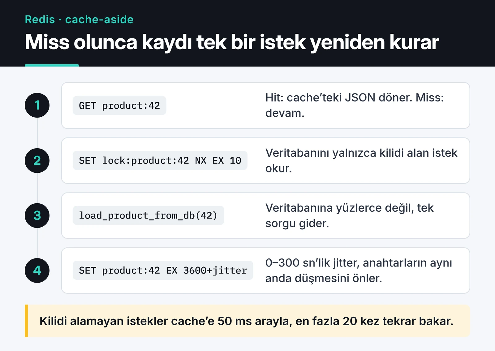
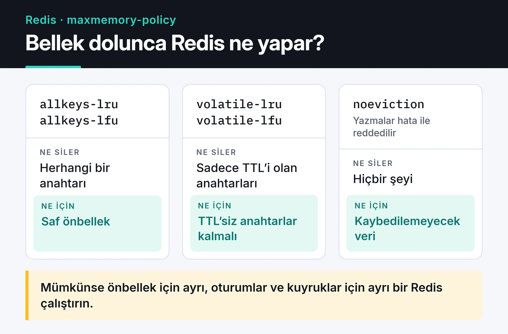

Redis'i projelerin çoğuna önce önbellek olarak eklerim. Birkaç ay sonra oturumlar, kuyruklar ve hız sınırı sayaçları da aynı yerde durur. Bu yazıda Redis ile önbellekleme ve oturum yönetimini anlatıyorum: stampede korumalı cache-aside, sunucu tarafı oturumlar ve bellek dolunca ne olacağını belirleyen eviction ayarı. Örnekler `redis-py` 5 ve sonrasındaki `redis.asyncio` istemcisiyle yazıldı, FastAPI gibi async bir uygulamaya doğrudan taşınabilir.

## Hangi veri yapısı ne işe yarar

Tek bir anahtarın arkasında bu yapılardan herhangi biri durabilir:

| Tip | Örnek değer | Tipik kullanım |
|---|---|---|
| String | `"42"`, bir JSON | Önbellek kayıtları, `INCR` ile sayaçlar |
| Hash | `{name: "Ada", plan: "pro"}` | Oturumlar, alanları olan nesneler |
| List | `[job3, job2, job1]` | Basit kuyruklar |
| Set | `{python, redis}` | Tekil etiketler, üyelik kontrolü |
| Sorted set | `{alice: 120, bob: 95}` | Sıralama tabloları, kayan pencereli rate limit |
| Bitmap | `0110 1001` | Kullanıcı ya da gün başına tek bir bayrak |
| HyperLogLog | 12 KB'lık özet | Yaklaşık tekil sayımı |
| Geo | `(28.97, 41.01)` | "Bana en yakın" sorguları |
| Stream | `1700000000000-0 -> {event: "login"}` | Consumer grupları olan olay günlükleri |

Lisans tarafında bilmeniz gereken şu: Redis 7.4 ile kaynak açık olmayan bir lisansa geçti, bunun üzerine Linux Foundation altında Valkey çatallandı. Redis 8 ile AGPLv3 seçeneği geri geldi. Buradaki komutların hepsi Valkey'de de aynı çalışıyor ve `redis-py` ikisine de bağlanıyor.

## İstemciyi bir kez oluşturun

```python
import redis.asyncio as redis

r = redis.Redis.from_url("redis://localhost:6379/0", decode_responses=True)

# Uygulama kapanırken:
# await r.aclose()
```

`decode_responses=True` byte yerine `str` döndürür. İstemci kendi içinde bir bağlantı havuzu tutar, o yüzden her istekte yeni istemci açmayın. FastAPI'de `lifespan` içinde bir kez oluşturup kapanışta `aclose()` çağırmanız yeterli.

## Cache-aside ve stampede koruması

Cache-aside'da uygulama önce Redis'e bakar. Veri yoksa veritabanından okur, sonucu Redis'e TTL ile yazar ve döner. Basit görünür ama iki yerde sorun çıkarır.

İlki stampede: popüler bir anahtarın süresi dolduğu anda yüzlerce istek aynı anda veritabanına koşar. İkincisi, aynı anda oluşturulmuş binlerce anahtarın aynı saniyede düşmesi. Birincisi için kısa bir kilit, ikincisi için TTL'e rastgele bir pay (jitter) ekliyorum:

```python
import asyncio
import json
import random


async def load_product_from_db(product_id: int) -> dict:
    await asyncio.sleep(0.1)  # gerçek sorgunun yerine
    return {"id": product_id, "name": "Mekanik klavye", "price": 2499}


async def get_product(product_id: int) -> dict:
    key = f"product:{product_id}"
    if (cached := await r.get(key)) is not None:
        return json.loads(cached)

    lock_key = f"lock:{key}"
    if await r.set(lock_key, "1", nx=True, ex=10):
        try:
            product = await load_product_from_db(product_id)
            ttl = 3600 + random.randint(0, 300)  # jitter
            await r.set(key, json.dumps(product), ex=ttl)
            return product
        finally:
            await r.delete(lock_key)

    # Kilidi başka bir istek aldı; kısa aralıklarla cache'e tekrar bak.
    for _ in range(20):
        await asyncio.sleep(0.05)
        if (cached := await r.get(key)) is not None:
            return json.loads(cached)
    return await load_product_from_db(product_id)
```

Aşağıdaki adımlar iki yolu gösteriyor. Hit'te Redis tek başına yanıt verir. Miss'te kilidi alan istek veritabanına gider ve değeri jitter'lı TTL ile geri yazar.



### Geçersiz kılma: yazınca sil

Veri değiştiğinde cache'teki kopyayı güncellemek yerine siliyorum. Bir sonraki okuma taze veriyi yükler.

```python
async def update_product(product_id: int, data: dict) -> None:
    await save_product_to_db(product_id, data)  # önce veritabanı
    await r.delete(f"product:{product_id}")       # sonra cache
```

Silmenin avantajı yarış durumlarında ortaya çıkıyor. İki istek aynı anda yazarsa, cache'e son yazanın değeri veritabanındakiyle çelişebilir. Silmede en kötü ihtimalle bir cache miss yaşanır.

Write-through, yani her yazmada cache'i de güncellemek, okumanın çok yoğun ve verinin az olduğu yerlerde mantıklı. Okunmayacak veriyi de belleğe doldurduğu için varsayılan tercihim değil.

## Oturumları Redis'te tutmak

Sunucu tarafında oturum tutmanın en büyük artısı, bir oturumu anında iptal edebilmeniz. JWT ile bu zor, Redis'te tek bir `DEL`. Her oturumu bir hash olarak tutuyorum. Kullanıcının oturum kimliklerini de ayrı bir sette topluyorum ki "tüm cihazlardan çıkış" çalışsın.

Kodu şöyle:

```python
import secrets

SESSION_TTL = 60 * 60 * 24 * 7  # 7 gün


async def create_session(user_id: int, user_agent: str) -> str:
    sid = secrets.token_urlsafe(32)
    async with r.pipeline(transaction=True) as pipe:
        pipe.hset(f"session:{sid}", mapping={"user_id": user_id, "ua": user_agent})
        pipe.expire(f"session:{sid}", SESSION_TTL)
        pipe.sadd(f"user_sessions:{user_id}", sid)
        await pipe.execute()
    return sid


async def get_session(sid: str) -> dict | None:
    data = await r.hgetall(f"session:{sid}")
    if not data:
        return None
    await r.expire(f"session:{sid}", SESSION_TTL)  # kayan süre
    return data


async def logout_everywhere(user_id: int) -> None:
    sids = await r.smembers(f"user_sessions:{user_id}")
    if sids:
        await r.delete(*(f"session:{sid}" for sid in sids))
    await r.delete(f"user_sessions:{user_id}")
```

Oturum kimliğini çereze `HttpOnly`, `Secure` ve `SameSite=Lax` ile koyun. `user_sessions` setinde süresi dolmuş kimlikler birikebilir. Giriş sırasında `EXISTS` ile kontrol edip temizlemek ya da sete de bir TTL vermek yeterli oluyor.

Oturumlar kaybolmaması gereken veridir. Aynı Redis'i önbellek olarak da kullanıyorsanız ve bellek dolunca anahtar silen bir politika açıksa, oturumlar da silinebilir. Bunu aşağıdaki eviction bölümünde açıyorum.

## Önbellek dışında işe yarayan yapılar

Sorted set ile liderlik tablosu birkaç satır. Ekleme ve sıra sorgusu O(log N):

```python
await r.zadd("leaderboard", {"ahmet": 500, "ayse": 720})
await r.zincrby("leaderboard", 50, "ahmet")
top10 = await r.zrange("leaderboard", 0, 9, desc=True, withscores=True)
```

`ZREVRANGE` hâlâ çalışıyor ama Redis 6.2'den beri kullanımdan kaldırılmış durumda. Yerine `ZRANGE ... REV` geldi, `redis-py`'de bu `desc=True` demek.

HyperLogLog tekil sayım içindir. Her anahtar en fazla 12 KB yer kaplar ve yaklaşık %0,81 standart hatayla milyonlarca tekil değeri sayar. Kesin sayıya ihtiyacınız yoksa günlük tekil ziyaretçi sayısı için tam yerinde.

```python
await r.pfadd("visitors:2024-12-10", "user:42")
count = await r.pfcount("visitors:2024-12-10")
```

Coğrafi sorgularda `GEORADIUS` kullanımdan kaldırıldı, yerine `GEOSEARCH` var:

```python
await r.geoadd("restaurants", [28.9784, 41.0082, "kofteci"])
nearby = await r.geosearch(
    "restaurants", longitude=28.98, latitude=41.01, radius=2, unit="km", sort="ASC", count=5
)
```

## Pub/Sub mı, Streams mi?

Pub/Sub ateşle ve unut mantığında çalışır: o anda dinleyen yoksa mesaj kaybolur. Canlı bildirimler için bu yeterli. İşlenmesi gereken olaylar için Streams kullanıyorum. Consumer group'lar mesajları tüketicilere dağıtır, onaylanmayan mesajlar bekleyenler listesinde kalır.

```python
from redis.exceptions import ResponseError


async def consume(consumer: str) -> None:
    try:
        await r.xgroup_create("orders", "billing", id="0", mkstream=True)
    except ResponseError as e:
        if "BUSYGROUP" not in str(e):
            raise

    while True:
        resp = await r.xreadgroup("billing", consumer, {"orders": ">"}, count=10, block=5000)
        for _stream, messages in resp or []:
            for msg_id, fields in messages:
                await handle_order(fields)
                await r.xack("orders", "billing", msg_id)


# Üretici tarafı:
# await r.xadd("orders", {"order_id": "1001", "total": "249.90"}, maxlen=100_000, approximate=True)
```

Streams için "mesajları diske yazar, kaybetmez" denir, ama bu eksik bir tarif. Stream de Redis belleğinde yaşar. Kalıcılık AOF veya RDB ayarınıza bağlıdır ve `appendfsync everysec` ile son bir saniyeyi kaybedebilirsiniz. Çöken bir tüketicinin onaylamadığı mesajları `XAUTOCLAIM` ile başka bir tüketiciye devredin. Kayıpsız ve uzun süre saklanan bir olay günlüğü gerekiyorsa Kafka veya RabbitMQ daha uygun.

## Redis kilidini yalnızca verimlilik için kullanın

`redis-py`'nin `lock()` metodu tek bir Redis üzerinde `SET NX PX` ile çalışan bir kilit verir. Bu Redlock değil. Redlock birden fazla bağımsız Redis'e dayanan ayrı bir algoritma ve doğruluğu tartışmalı.

```python
async with r.lock("daily-report", timeout=60, blocking_timeout=1):
    await build_daily_report()
```

Bu kilit "aynı cron işini iki sunucu birden çalıştırmasın" gibi verimlilik amaçlı işlerde yeterli. Aynı ödemeyi iki kez çekmemek gibi doğruluk gerektiren yerlerde kilide güvenmiyorum. GC duraklaması ya da ağ gecikmesi yüzünden kilidin süresi dolduğunda iş hâlâ çalışıyor olabilir. Orada veritabanında benzersiz kısıt ya da idempotency anahtarı kullanıyorum.

## Bellek dolunca ne olacağını eviction politikası seçer

`maxmemory-policy`, `maxmemory` sınırına gelindiğinde Redis'in ne yapacağını belirler. [Resmî doküman](https://redis.io/docs/latest/develop/reference/eviction/) tüm seçenekleri listeliyor. Pratikte üç gruba bakmanız yeterli:



- `allkeys-lru` / `allkeys-lfu`: herhangi bir anahtarı siler. Saf önbellek için doğru seçim.
- `volatile-lru` / `volatile-lfu`: sadece TTL'i olan anahtarlardan siler.
- `noeviction`: yazmaları hata ile reddeder. Oturum, kuyruk ve sayaç tutan bir Redis için doğru seçim.

Listedeki LRM çeşitleri daha yeni ve son okumaya değil son yazmaya bakıyor. Önbelleği ve kalıcı olması gereken veriyi aynı örnekte karıştırdığınızda bu ihtiyaçlar çatışır. Bu yüzden mümkünse önbellek için ayrı, oturumlar ve kuyruklar için ayrı bir Redis çalıştırıyorum.

## Güvenlik ve yüksek erişilebilirlik

Redis'i internete açık bırakmayın. Her kurulumda yaptığım ayarlar şunlar:

1. `bind` ile sadece iç ağ adresinden dinlemek ve `protected-mode yes`.
2. ACL ile servis başına kullanıcı açmak: `ACL SETUSER cache on >uzun-rastgele-parola ~cache:* +@read +@write -@dangerous`. Bu kullanıcı sadece `cache:` ile başlayan anahtarlara dokunabilir ve `FLUSHALL`, `KEYS` gibi komutları çalıştıramaz. Eskiden bunun için `rename-command` kullanılırdı; ACL daha temiz.
3. Ağ güvenilir değilse TLS. `redis-py`'de bağlantı adresini `rediss://` yapmak yeterli.

Yüksek erişilebilirlikte iki seçenek var. Sentinel bir primary'yi ve replikalarını izler, primary düşerse bir replikayı terfi ettirir. Cluster ise veriyi anahtar slotlarına göre birden fazla primary'ye böler ve yazma kapasitesini artırır. Veriniz tek bir makinenin belleğine sığıyorsa Sentinel çok daha az operasyonel yük getirir.

## Sırada ne var

İlk adım olarak kendi Redis'inizde `CONFIG GET maxmemory-policy` çalıştırın ve aynı örnekte hem önbellek hem oturum tutup tutmadığınıza bakın. Buradaki atomik sayaç fikrini [Python ile API rate limiting](/posts/python-hiz-sinirla-api-throttling/) yazısında Lua script ile bir token bucket'a çevirdim. Redis'i bir FastAPI servisine bağlamak için [FastAPI ile REST API geliştirme](/posts/python-fastapi-restful-api-gelistirme/) yazısındaki `lifespan` kalıbını kullanabilirsiniz. Oturum mu token mı sorusunun devamı [API kimlik doğrulama stratejileri](/posts/api-kimlik-dogrulama-stratejileri/) yazısında.

Komutların ayrıntıları için [Redis komut referansı](https://redis.io/docs/latest/commands/) ve [redis-py dokümantasyonu](https://redis.readthedocs.io/en/stable/) en doğru kaynaklar.
