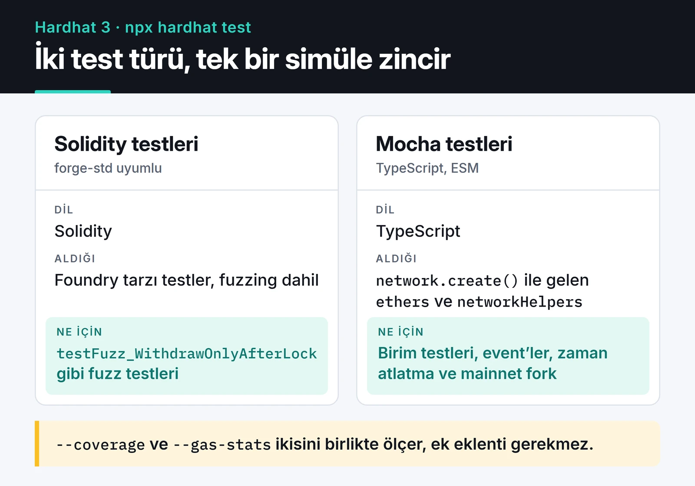

Akıllı kontratlarla uğraştığım dönemden aklımda kalan en net ders, testin kontratın kendisi kadar önemli olduğu. Normal bir backend'de hatayı bulup yeni sürüm çıkarırsınız. Deploy edilmiş bir kontratta ise (proxy kullanmıyorsanız) kod değişmez, hatanın bedelini de genellikle kullanıcının parası öder.

Bu yazıda zaman kilitli küçük bir kasa kontratını Hardhat 3 ile baştan sona test ediyorum: Mocha ve ethers v6 ile birim testleri, Solidity ile fuzz testi, coverage, gas raporu, mainnet fork ve CI. Her şeyi Hardhat 3.21, ethers 6.17 ve Solidity 0.8.28 ile sıfırdan kurup çalıştırdım, kodu olduğu gibi kopyalayabilirsiniz.

## Hardhat 2'den gelenler için ne değişti?

- Proje artık ESM ve TypeScript ile kuruluyor. `npx hardhat init` yerine `npx hardhat --init` var.
- Config dosyası `defineConfig` ile yazılıyor ve eklentiler `import` edilip `plugins` dizisine açıkça ekleniyor. Sadece import etmek artık yetmiyor.
- `hre.ethers` global olarak gelmiyor. Testte önce `network.create()` ile bir ağ bağlantısı açıp `ethers` ve `networkHelpers` nesnelerini oradan alıyorsunuz. Aynı test dosyasında birden fazla ağa (örneğin yerel simülasyon ve mainnet fork) bağlanmak bu sayede mümkün.
- `changeEtherBalance` gibi matcher'lar ilk argüman olarak `ethers` nesnesini istiyor.
- Coverage ve gas raporu için ayrı eklenti kurmaya gerek kalmadı: `--coverage` ve `--gas-stats` bayrakları yerleşik.
- Solidity ile test yazılabiliyor. Foundry'nin `forge-std` kütüphanesiyle uyumlu, fuzz testi de destekleniyor.

Aşağıdaki kart tek bir `npx hardhat test` komutunun neleri çalıştırdığını gösteriyor. İki test türü de aynı simüle zincirde koşuyor, coverage ve gas raporu da ikisini birlikte ölçüyor.



## Kurulum

```bash
mkdir vault-tests && cd vault-tests
npx hardhat --init
```

Sihirbazda Hardhat 3'ü ve Mocha ile ethers.js kullanan şablonu seçiyorum. Elle kurmak isterseniz `@nomicfoundation/hardhat-toolbox-mocha-ethers` paketini ve onun istediği eş bağımlılıkları (`ethers`, `chai`, `mocha` ve `@nomicfoundation/hardhat-*` eklentileri) yüklemeniz gerekiyor. Config dosyası şu kadar:

```typescript {title="hardhat.config.ts"}
import { configVariable, defineConfig } from "hardhat/config";
import hardhatToolboxMochaEthers from "@nomicfoundation/hardhat-toolbox-mocha-ethers";

export default defineConfig({
  plugins: [hardhatToolboxMochaEthers],
  solidity: {
    version: "0.8.28",
    settings: { optimizer: { enabled: true, runs: 200 } },
  },
  networks: {
    mainnetFork: {
      type: "edr-simulated",
      forking: {
        url: configVariable("MAINNET_RPC_URL"),
        blockNumber: 23_000_000,
      },
    },
  },
});
```

`configVariable` RPC adresini dosyaya yazmadan ortam değişkeninden ya da Hardhat'in keystore'undan okuyor. Fork ağına sadece o ağa bağlanan testlerde ihtiyaç duyuluyor, diğer testler bu değişken olmadan da çalışıyor.

## Test edeceğimiz kontrat

Kullanıcının ETH yatırıp yedi gün sonra çekebildiği basit bir kasa:

```solidity {title="contracts/TimeLockVault.sol"}
// SPDX-License-Identifier: MIT
pragma solidity ^0.8.28;

contract TimeLockVault {
    uint256 public constant LOCK_TIME = 7 days;

    mapping(address => uint256) public balanceOf;
    mapping(address => uint256) public unlockAt;

    event Deposited(address indexed user, uint256 amount, uint256 unlockAt);
    event Withdrawn(address indexed user, uint256 amount);

    error ZeroDeposit();
    error NothingToWithdraw();
    error StillLocked(uint256 unlockAt);
    error TransferFailed();

    function deposit() external payable {
        if (msg.value == 0) revert ZeroDeposit();
        balanceOf[msg.sender] += msg.value;
        unlockAt[msg.sender] = block.timestamp + LOCK_TIME;
        emit Deposited(msg.sender, msg.value, unlockAt[msg.sender]);
    }

    function withdraw() external {
        uint256 amount = balanceOf[msg.sender];
        if (amount == 0) revert NothingToWithdraw();
        if (block.timestamp < unlockAt[msg.sender]) revert StillLocked(unlockAt[msg.sender]);

        balanceOf[msg.sender] = 0; // önce durum, en son dış çağrı
        (bool ok, ) = msg.sender.call{value: amount}("");
        if (!ok) revert TransferFailed();
        emit Withdrawn(msg.sender, amount);
    }
}
```

`require(..., "Henuz kilitli")` gibi string mesajlar yerine custom error kullanıyorum. Hem daha az gas harcıyor hem de testte hatanın türünü ve parametresini kontrol edebiliyorum. `withdraw` içinde bakiyeyi ETH göndermeden önce sıfırlamak da reentrancy'ye karşı temel önlem (checks-effects-interactions).

## Mocha ve ethers v6 ile testler

```typescript {title="test/TimeLockVault.ts"}
import { expect } from "chai";
import { network } from "hardhat";
import { anyValue } from "@nomicfoundation/hardhat-ethers-chai-matchers/withArgs";

const { ethers, networkHelpers } = await network.create();
const { time, loadFixture } = networkHelpers;

describe("TimeLockVault", function () {
  async function deployVaultFixture() {
    const [owner, alice] = await ethers.getSigners();
    const vault = await ethers.deployContract("TimeLockVault");
    return { vault, owner, alice };
  }

  it("records the deposit and emits an event", async function () {
    const { vault, alice } = await loadFixture(deployVaultFixture);
    const amount = ethers.parseEther("1");

    await expect(vault.connect(alice).deposit({ value: amount }))
      .to.emit(vault, "Deposited")
      .withArgs(alice.address, amount, anyValue);

    expect(await vault.balanceOf(alice.address)).to.equal(amount);
  });

  it("rejects zero deposits", async function () {
    const { vault } = await loadFixture(deployVaultFixture);
    await expect(vault.deposit({ value: 0n })).to.be.revertedWithCustomError(vault, "ZeroDeposit");
  });

  it("blocks withdrawals before the lock expires", async function () {
    const { vault, alice } = await loadFixture(deployVaultFixture);
    await vault.connect(alice).deposit({ value: ethers.parseEther("1") });
    const unlockAt = await vault.unlockAt(alice.address);

    await expect(vault.connect(alice).withdraw())
      .to.be.revertedWithCustomError(vault, "StillLocked")
      .withArgs(unlockAt);
  });

  it("pays out after seven days", async function () {
    const { vault, alice } = await loadFixture(deployVaultFixture);
    const amount = ethers.parseEther("1");
    await vault.connect(alice).deposit({ value: amount });

    await time.increase(7 * 24 * 60 * 60);

    await expect(vault.connect(alice).withdraw()).to.changeEtherBalances(
      ethers,
      [alice, vault],
      [amount, -amount],
    );
    expect(await vault.balanceOf(alice.address)).to.equal(0n);
  });
});
```

Burada dikkat ettiğim birkaç nokta var:

- `loadFixture` kontratı ilk testte deploy edip zincirin o anki durumunun snapshot'ını alıyor. Sonraki testler her seferinde yeniden deploy etmek yerine bu snapshot'a dönüyor. `beforeEach` içinde deploy etmekten hem hızlı hem de testler arasında durum sızıntısı yok.
- ethers v6'da miktarlar `BigNumber` değil, yerel `bigint`. Karşılaştırmalarda `0n` gibi bigint sabitleri kullanmak gerekiyor; `ethers.utils.parseEther` da artık doğrudan `ethers.parseEther`.
- `time.increase` bir sonraki bloğun zaman damgasını ileri alıp blok üretiyor. Yedi gün beklemek yerine bir satır.
- `changeEtherBalances` gas ücretlerini varsayılan olarak hesaba katmıyor. Bu yüzden Alice'in bakiyesindeki değişim tam olarak `amount` çıkıyor.

`npx hardhat test` hepsini çalıştırıyor. Sadece Mocha testleri için `npx hardhat test mocha` kullanabilirsiniz.

## Solidity ile fuzz testi

Elle yazdığım testler sadece aklıma gelen senaryoları kapsıyor. Fuzz testi aynı özelliği rastgele girdilerle yüzlerce kez deniyor. Hardhat 3 Solidity testlerini doğrudan çalıştırıyor; `forge-std` kütüphanesini `npm install --save-dev "github:foundry-rs/forge-std#v1.9.7"` ile ekledikten sonra:

```solidity {title="contracts/TimeLockVault.t.sol"}
// SPDX-License-Identifier: MIT
pragma solidity ^0.8.28;

import {Test} from "forge-std/Test.sol";
import {TimeLockVault} from "./TimeLockVault.sol";

contract TimeLockVaultTest is Test {
    TimeLockVault vault;
    address alice = makeAddr("alice");

    function setUp() public {
        vault = new TimeLockVault();
    }

    // Fuzz: rastgele miktar ve rastgele bekleme süresi
    function testFuzz_WithdrawOnlyAfterLock(uint96 amount, uint32 wait) public {
        vm.assume(amount > 0);
        vm.deal(alice, amount);

        vm.prank(alice);
        vault.deposit{value: amount}();

        uint256 lockTime = vault.LOCK_TIME(); // vm.prank'ten önce oku
        vm.warp(block.timestamp + wait);

        vm.prank(alice);
        if (wait < lockTime) {
            vm.expectRevert();
            vault.withdraw();
        } else {
            vault.withdraw();
            assertEq(alice.balance, amount);
            assertEq(address(vault).balance, 0);
        }
    }
}
```

Bu test ilk çalıştırdığımda başarısız oldu ve hata kontratta değil testteydi. `vm.prank(alice)` sadece bir sonraki çağrıyı Alice adına yapıyor. İlk sürümde `vm.prank` ile `vault.withdraw()` arasında `vault.LOCK_TIME()` çağrısı vardı; prank o view çağrısında harcandı, `withdraw` test kontratının adresinden geldi ve `NothingToWithdraw` ile revert etti. Fuzzer da hemen bir karşı örnek buldu. `LOCK_TIME` değerini prank'ten önce okumak sorunu çözdü.

Aynı dosya Foundry'de `forge test` ile de çalışıyor. Ağır fuzz ve invariant testleri için Foundry'yi tercih eden ekipler çok; Hardhat 3 iki dünyayı aynı projede kullanmayı kolaylaştırdı.

## Coverage ve gas istatistikleri

```bash
npx hardhat test --coverage
npx hardhat test mocha --gas-stats
```

Bu kontratta coverage satırların %81,82'sini, ifadelerin %86,67'sini kapsıyor. Kendi çalıştırmamda beş testin hepsi geçiyor, kapsanmayan satırlar 27 ve 32.

Kapsanmayan iki satır öğretici: `NothingToWithdraw` için bakiyesi olmayan bir hesabın çekim denemesi gerekiyor, `TransferFailed` için de ETH kabul etmeyen bir kontratın çekim yapması. İkincisi için test klasörüne `receive` fonksiyonu revert eden küçük bir saldırgan kontrat eklemek gerekiyor. Coverage raporu, hiç denenmemiş hata yollarını bu şekilde ortaya çıkarıyor.

`--gas-stats` her fonksiyonun minimum, ortalama ve maksimum gas tüketimini tablo olarak veriyor. Bu kontratta `deposit` 67.524, `withdraw` 32.108 gas harcıyor. Bir refaktörden sonra `deposit` maliyetinin artıp artmadığını görmek için bu tablo yeterli.


## Mainnet fork ile entegrasyon testi

Kontratınız Uniswap, Aave veya Chainlink gibi canlı protokollerle konuşuyorsa, onları mock'lamak yerine mainnet'in belirli bir bloktaki kopyasında test etmek çok daha gerçekçi:

```typescript {title="test/fork.ts"}
import { expect } from "chai";
import { network } from "hardhat";

const { ethers } = await network.create("mainnetFork");

const USDC = "0xA0b86991c6218b36c1d19D4a2e9Eb0cE3606eB48";

describe("mainnet fork", function () {
  it("reads real USDC state", async function () {
    const usdc = await ethers.getContractAt(
      ["function decimals() view returns (uint8)", "function totalSupply() view returns (uint256)"],
      USDC,
    );
    expect(await usdc.decimals()).to.equal(6n);
    expect(await usdc.totalSupply()).to.be.greaterThan(0n);
  });
});
```

`blockNumber` sabitlemek önemli. Sabitlemezseniz her çalıştırmada farklı bir zincir durumuyla test edersiniz ve RPC sağlayıcısı önbellekleme yapamadığı için testler yavaşlar. Büyük bakiyeli bir adres gibi davranmanız gerekiyorsa `networkHelpers.impersonateAccount(...)` ile o hesabın private key'i olmadan işlem gönderebilirsiniz.

## CI'da otomatik test

Her pull request'te testlerin koşması için GitHub Actions'ta kısa bir workflow yeterli:

```yaml {title=".github/workflows/test.yml"}
name: test
on: [push, pull_request]

jobs:
  test:
    runs-on: ubuntu-latest
    steps:
      - uses: actions/checkout@v6
      - uses: actions/setup-node@v6
        with:
          node-version: 24
          cache: npm
      - run: npm ci
      - run: npx hardhat test --coverage
```

Fork testleri için `MAINNET_RPC_URL` değerini repo secret'ı olarak tanımlayıp ortam değişkeni olarak geçmek gerekiyor. [GitHub Actions ile CI/CD yazımda](/posts/github-actions-cicd-pipeline/) secret ve cache yönetimini daha ayrıntılı anlattım.

## Testler neyi kanıtlamaz?

Testler sadece aklınıza gelen senaryoların çalıştığını gösterir. Fuzz testi bu boşluğu biraz kapatır, Slither gibi statik analiz araçları bilinen hata kalıplarını yakalar. Gerçek para tutacak bir kontrat için bağımsız bir denetim (audit) hâlâ gerekli. Sık karşılaşılan açıkları [Ethereum akıllı kontrat güvenliği yazımda](/posts/ethereum-smart-contract-security-best-practices/) topladım. Aynı test disiplininin Rust ve Anchor tarafındaki karşılığını merak ediyorsanız [Solana program geliştirme yazıma](/posts/solana-program-development-rust/) bakabilirsiniz.

Bu yazıdaki örnek projeyi kurup `npx hardhat test` ile çalıştırarak başlayın, sonra `TransferFailed` satırını kapsayan testi kendiniz yazmayı deneyin. Güncel API için [Hardhat 3 belgeleri](https://hardhat.org/docs) en doğru kaynak.
