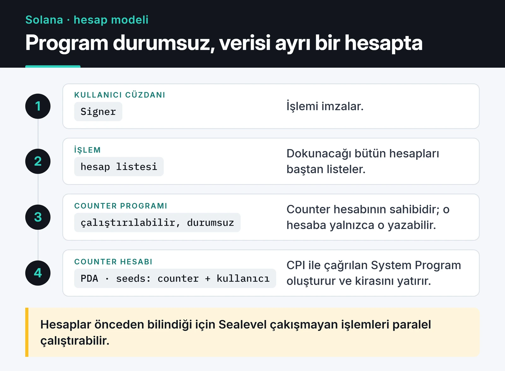

Ethereum tarafından gelen biri için Solana'nın en zor kısmı Rust değil, hesap modeli. Solidity'de kontrat kendi verisini kendi içinde tutar. Solana'da program durumsuzdur; veri ayrı hesaplarda durur ve her işlem dokunacağı hesapları baştan söylemek zorundadır. Bu farkı kavradıktan sonra Solana program geliştirme çok daha mantıklı gelmeye başladı.

Bu yazıda Rust ve Anchor 1.x ile kullanıcı başına sayaç tutan küçük bir program yazıyor, test ediyor ve deploy ediyorum. Solana'daki son pratik deneyimim, SWARM Hackathon için yazdığım [Quorum](https://furkankoykiran.com.tr/projeler/quorum/) projesinde Squads V4 multisig ile devnet'te kasa işlemleri yapmaktı.

## Hesap modeli

Solana'da her şey bir hesap: programın derlenmiş kodu, kullanıcı cüzdanları, token bakiyeleri, sizin programınızın verisi. Her hesabın bir sahibi (owner) var ve sadece sahibi olan program o hesabın verisini değiştirebiliyor.



Bu tasarımın iki sonucu var. Birincisi paralellik: Solana'nın çalışma zamanı (Sealevel), aynı hesaba yazmayan işlemleri aynı anda çalıştırabiliyor, çünkü hangi işlemin hangi hesaba dokunacağı önceden belli. İkincisi güvenlik yükü: programınıza dışarıdan verilen her hesabın gerçekten beklediğiniz hesap olduğunu kontrol etmek sizin işiniz. Solana'daki açıkların büyük kısmı bu kontrollerin eksikliğinden çıkıyor.

## PDA: özel anahtarı olmayan adresler

Program Derived Address (PDA), bir program ID'si ve sizin seçtiğiniz "seed" değerlerinden türetilen, eğri dışında kalan bir adres. Özel anahtarı yok, bu yüzden onun adına sadece türeten program imza atabiliyor.

Pratikte PDA'yı bir veritabanı anahtarı gibi kullanıyorum. `["counter", kullanıcı_adresi]` seed'leri her kullanıcı için her zaman aynı adresi üretiyor. İstemci, hesabın adresini bir yerde saklamadan hesaplayabiliyor.

## Proof of History: dün ve bugün

Solana'nın başlangıçtaki fikri dağıtık sistemlerdeki saat problemine bir çözümdü. Proof of History (PoH), SHA-256'nın art arda uygulanmasıyla oluşan bir zincir: her hash bir öncekinin çıktısını girdi olarak alıyor. Bu hesaplama paralelleştirilemiyor, yani zincirin uzunluğu geçen zamanın kanıtı oluyor. Araya bir işlem eklendiğinde, o işlemin hangi hash'ten önce ve sonra geldiği kesin olarak biliniyor.

Mantığı görmek için basit bir simülasyon:

```python {title="poh_sim.py"}
import hashlib
import time


def simulate_poh(iterations: int) -> str:
    current = hashlib.sha256(b"genesis").digest()
    start = time.perf_counter()
    for _ in range(iterations):
        current = hashlib.sha256(current).digest()  # bir önceki çıktı, bir sonraki girdi
    elapsed = time.perf_counter() - start
    print(f"{iterations} hash, {elapsed:.3f} sn")
    return current.hex()


simulate_poh(1_000_000)
```

Bu kod tek bir CPU çekirdeğini doldurur ve daha fazla çekirdek eklemek onu hızlandırmaz. PoH'un "zaman kanıtı" iddiası bu sıralılığa dayanıyordu.

PoH tek başına bir konsensüs algoritması değildi. Solana bir Proof of Stake ağıydı ve hangi çatalın doğru olduğuna Tower BFT ile oylanarak karar veriliyordu; PoH bu oylamaya ortak bir saat sağlıyordu.

Anza'nın geliştirdiği [Alpenglow konsensüs protokolü](https://solana.com/upgrades/alpenglow) (SIMD-0326) bu tabloyu değiştiriyor. Votor adlı yeni oylama mekanizması Tower BFT'nin yerini alıyor ve kesinleşme (finality) süresinde hedef, yaklaşık 12,8 saniyeden 150 milisaniyeye inmek. Alpenglow tasarımında PoH artık konsensüsün parçası değil. Program geliştiren biri için iyi haber şu: çalışma zamanı, işlemler, programlar ve ücretler aynı kalıyor, yani bu yazıdaki kodun hiçbir satırı değişmiyor. Değişen, işleminizin ne kadar sürede geri alınamaz hâle geldiği.

## Kurulum ve Anchor 1.x ile değişenler

Rust, Solana CLI ve Anchor'ı tek komutla kurmanın en kolay yolu Solana'nın resmi kurulum scripti:

```bash
curl --proto '=https' --tlsv1.2 -sSfL https://solana-install.solana.workers.dev | bash
anchor --version
```

Anchor sürümlerini değiştirmek için `avm` (Anchor Version Manager) kullanıyorum. Sürüm uyumsuzlukları Solana geliştirmede en çok zaman kaybettiren şeylerden biri.

Anchor 1.0 ile gelen ve eski örnekleri bozan değişiklikler:

- TypeScript istemci paketi `@coral-xyz/anchor` yerine artık `@anchor-lang/core`.
- `anchor init` varsayılan olarak Rust tabanlı LiteSVM test şablonu oluşturuyor. TypeScript ve Mocha için `--test-template mocha` vermek gerekiyor.
- `anchor test` varsayılan olarak `solana-test-validator` yerine Surfpool kullanıyor. Eski davranış için `--validator legacy` var.
- Aynı hesabın iki kez `mut` olarak verilmesi varsayılan olarak reddediliyor; bilerek izin vermek için `dup` kısıtı gerekiyor.
- Bir programda sadece bir `#[error_code]` bloğu olabiliyor.
- Anchor 1.x Solana 3.x hedefliyor.

Projeyi oluşturmak için:

```bash
anchor init counter --test-template mocha
cd counter
anchor build
```

## Program: kullanıcı başına sayaç

Her kullanıcının kendi PDA'sında bir sayacı olan küçük bir program. Anchor'ın kendi şablonundaki sayaca benziyor, ama sayaç kullanıcı başına ve yetki kontrolü kısıtlarla yapılıyor:

```rust {title="programs/counter/src/lib.rs"}
use anchor_lang::prelude::*;

// anchor init / anchor keys sync bu satırı kendi program ID'nizle doldurur
declare_id!("3ynNB373Q3VAzKp7m4x238po36hjAGFXFJB4ybN2iTyg");

#[program]
pub mod counter {
    use super::*;

    pub fn initialize(ctx: Context<Initialize>) -> Result<()> {
        let counter = &mut ctx.accounts.counter;
        counter.authority = ctx.accounts.authority.key();
        counter.count = 0;
        counter.bump = ctx.bumps.counter;
        Ok(())
    }

    pub fn increment(ctx: Context<Increment>) -> Result<()> {
        let counter = &mut ctx.accounts.counter;
        counter.count = counter.count.checked_add(1).ok_or(CounterError::Overflow)?;
        Ok(())
    }
}

#[derive(Accounts)]
pub struct Initialize<'info> {
    #[account(mut)]
    pub authority: Signer<'info>,
    #[account(
        init,
        payer = authority,
        space = 8 + Counter::INIT_SPACE,
        seeds = [b"counter", authority.key().as_ref()],
        bump
    )]
    pub counter: Account<'info, Counter>,
    pub system_program: Program<'info, System>,
}

#[derive(Accounts)]
pub struct Increment<'info> {
    #[account(
        mut,
        seeds = [b"counter", authority.key().as_ref()],
        bump = counter.bump,
        has_one = authority,
    )]
    pub counter: Account<'info, Counter>,
    pub authority: Signer<'info>,
}

#[account]
#[derive(InitSpace)]
pub struct Counter {
    pub authority: Pubkey,
    pub count: u64,
    pub bump: u8,
}

#[error_code]
pub enum CounterError {
    #[msg("Counter overflow")]
    Overflow,
}
```

`declare_id!` içindeki adresi `anchor init` ve `anchor keys sync` kendisi dolduruyor. Anchor 1.x, kaynak koddaki ID ile keypair uyuşmazsa `anchor build` sırasında hata veriyor.

Satır satır önemli olanlar:

- `space = 8 + Counter::INIT_SPACE`: ilk 8 bayt Anchor'ın hesap türünü ayırt etmek için kullandığı discriminator. `InitSpace` derive'ı struct'ın geri kalanının boyutunu hesaplıyor; elle bayt saymak hata kaynağı.
- `ctx.bumps.counter`: `init` sırasında bulunan bump değerini hesapta saklıyorum. `Increment` içinde `bump = counter.bump` diyerek bump'ı her seferinde yeniden aramak yerine kayıtlı değeri kullanıyorum, bu da compute unit tasarrufu sağlıyor.
- `has_one = authority`: sayaçtaki `authority` alanının, işlemi imzalayan `authority` hesabıyla aynı olmasını zorunlu kılıyor. Seed'ler zaten kullanıcıya bağlı olduğu için burada iki kat kontrol var; seed'leri kullanıcıdan bağımsız bir hesapta tek koruma `has_one` olurdu.
- `checked_add`: Anchor'ın workspace şablonu release profilinde `overflow-checks` ayarını açıyor, yani taşma bir panik olarak işlemi düşürür. Bu ayara güvenmek yerine taşmayı açıkça kontrol edip anlamlı bir hata döndürmeyi tercih ediyorum; ayar bir gün kapanırsa sessizce sıfıra dönen bir bakiye istemem.

## Test

`--test-template mocha` ile oluşturulan projede test dosyası TypeScript:

```typescript {title="tests/counter.ts"}
import * as anchor from "@anchor-lang/core";
import { Program } from "@anchor-lang/core";
import { assert } from "chai";
import { Counter } from "../target/types/counter";

describe("counter", () => {
  const provider = anchor.AnchorProvider.env();
  anchor.setProvider(provider);

  const program = anchor.workspace.counter as Program<Counter>;
  const authority = provider.wallet.publicKey;
  const [counterPda] = anchor.web3.PublicKey.findProgramAddressSync(
    [Buffer.from("counter"), authority.toBuffer()],
    program.programId,
  );

  it("initializes and increments", async () => {
    await program.methods.initialize().accountsPartial({ counter: counterPda }).rpc();
    await program.methods.increment().accountsPartial({ counter: counterPda }).rpc();

    const state = await program.account.counter.fetch(counterPda);
    assert.equal(state.count.toNumber(), 1);
    assert.ok(state.authority.equals(authority));
  });

  it("rejects another signer", async () => {
    const other = anchor.web3.Keypair.generate();
    try {
      await program.methods
        .increment()
        .accountsPartial({ counter: counterPda, authority: other.publicKey })
        .signers([other])
        .rpc();
      assert.fail("increment should have been rejected");
    } catch (err) {
      assert.match(String(err), /ConstraintSeeds|ConstraintHasOne/);
    }
  });
});
```

`anchor test` programı derleyip yerel bir ağa deploy ediyor ve testleri çalıştırıyor. İkinci test benim için birincisinden daha önemli: başarılı senaryoyu test etmek kolay, asıl değerli olan yetkisiz bir imzacının reddedildiğini görmek.

Varsayılan LiteSVM şablonu ise testleri Rust içinde, programı süreç içinde çalışan hafif bir Solana sanal makinesine yükleyerek koşuyor. Validator başlatmadığı için çok daha hızlı; çok sayıda test yazacaksanız tercih edilebilir.

## Güvenlik kontrol listem

Solana'daki tipik açıklar Ethereum'dakilerden farklı. Reentrancy daha az konuşuluyor, hesap doğrulama ise çok daha fazla. Kendi kontrol listem:

- `AccountInfo` ya da `UncheckedAccount` gördüğüm her yerde sahiplik ve tür kontrolünün nerede yapıldığını soruyorum. `Account<'info, T>` bu kontrolleri Anchor'a yaptırıyor.
- Yetki gerektiren her talimatta bir `Signer` ve onu veriye bağlayan bir kısıt (`has_one`, seed veya `constraint`) var mı?
- Başka bir programa CPI yapılıyorsa, o programın adresi `Program<'info, T>` ile doğrulanıyor mu? Kullanıcının verdiği rastgele bir program ID'sine çağrı yapmak klasik bir hata.
- Aritmetik `checked_*` ile mi yapılıyor?
- Kapatılan hesaplar Anchor'ın `close` kısıtıyla mı kapatılıyor? Lamport'ları elle boşaltmak, hesabın aynı işlem içinde yeniden kullanılmasına yol açabiliyor.

## Compute, kira ve deploy

Her işlemin bir compute unit (CU) bütçesi var. `msg!` logları geliştirmede çok işe yarıyor ama her biri CU harcıyor; sık çağrılan talimatlarda gereksiz logları kaldırıyorum. Bump'ı saklamak da aynı amaca hizmet ediyor.

Bir hesabın ağda kalması için içinde kira muafiyeti (rent-exempt) kadar SOL bulunması gerekiyor. `init` sırasında bu tutarı `payer` ödüyor. Kullanıcıların her yeni hesap için ne ödeyeceğini tasarım aşamasında düşünmek gerekiyor.

Deploy için önce devnet:

```bash
solana config set --url devnet
solana airdrop 2
anchor deploy --provider.cluster devnet
```

Solana programları varsayılan olarak güncellenebilir (upgradeable). Güncelleme yetkisinin tek bir kişisel anahtarda durması kullanıcılar için büyük bir risk. Bu yetkiyi Squads gibi bir multisig'e devretmek ya da program olgunlaştığında tamamen kaldırmak gerekiyor. Quorum'da kasa işlemlerini 5 operatörden 3'ünün onayına bağlamak için Squads V4 kullanmamın nedeni de buydu.

## İstemci tarafı

Anchor'ın ürettiği IDL sayesinde TypeScript tarafında `program.methods.increment()` gibi tipli çağrılar yapabiliyorsunuz. Anchor dışı istemci kodu için Solana'nın yeni JavaScript SDK'sı `@solana/kit`; eski `@solana/web3.js` 1.x API'si yerine yeni projelerde onu tercih ediyorum. İşlem onayında `processed`, `confirmed` ve `finalized` seviyelerinin farkını bilmek önemli. Alpenglow ile `finalized` beklemek eskisinden çok daha kısa sürüyor, ama kullanıcı arayüzünde işlemin "gönderildi" ve "kesinleşti" durumlarını ayrı göstermek hâlâ iyi bir pratik.

## Sırada ne var?

Sayaç programını kurup `anchor test` ile çalıştırın, sonra `Increment` içindeki `has_one` kısıtını silip ikinci testin hâlâ geçip geçmediğine bakın. Seed'ler kullanıcıya bağlı olduğu için geçecek. Ardından iki yapıda da seed'leri `[b"counter"]` yapıp `has_one` olmadan tekrar deneyin: bu kez yetkisiz imzacı sayacı artırabilecek. Kısıtların neden önemli olduğunu en iyi bu deney anlatıyor.

EVM tarafında aynı test disiplinini [Hardhat 3 ile akıllı kontrat testi](/posts/smart-contract-testing-hardhat-ethers/) yazımda, sık görülen açıkları da [Ethereum akıllı kontrat güvenliği](/posts/ethereum-smart-contract-security-best-practices/) yazımda anlattım. Solana üzerinde çalışan LLM ajanları denememi [yapay zekâ destekli trading yazımda](/posts/yapay-zeka-destekli-trading-stratejileri/) bulabilirsiniz. Güncel API için [Anchor belgeleri](https://www.anchor-lang.com/docs) en doğru kaynak.
