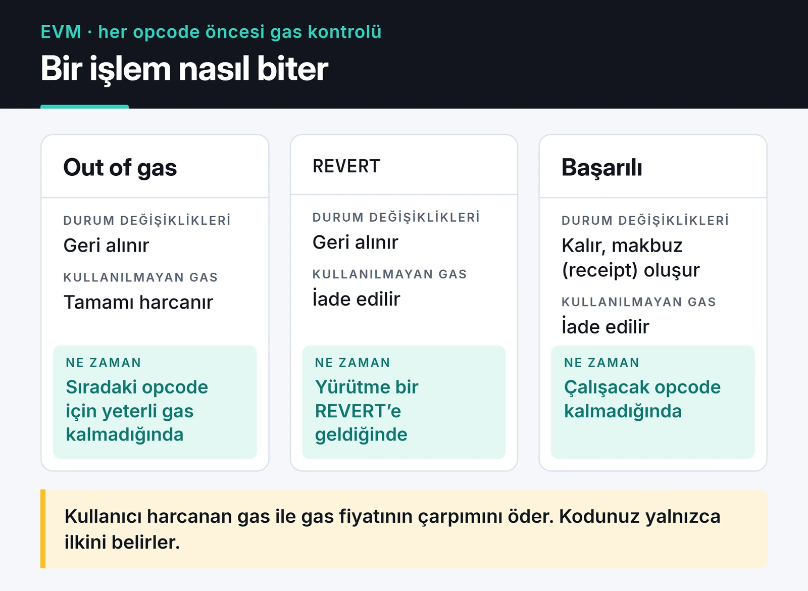

Akıllı kontrat güvenliği, Web2'den gelen biri için en zor alışılan konu. Sunucuda bir hata yaptığınızda deploy'u geri alırsınız. Ethereum'da kontrat bir kere yayına girdikten sonra kod orada kalıyor ve içindeki parayı kimin çekebileceğini o kod belirliyor.

Bu yazı Web3 tarafında çalışırken tuttuğum notların derlenmiş hali. Güvenlik ve gas optimizasyonunu aynı yerde anlatıyorum, çünkü ikisi aynı koda dokunuyor. Kullanılamayacak kadar pahalı bir kontrat da, ucuz ama boşaltılabilen bir kontrat da işe yaramaz. Örnekler Solidity 0.8.x ve OpenZeppelin Contracts 5 ile derleniyor, testler forge-std formatında ve hepsi geçiyor.

## Reentrancy

2016'daki DAO saldırısının sebebi buydu ve bugün hâlâ denetim raporlarında çıkıyor. Kontrat dışarıya ETH gönderdiğinde ya da başka bir kontratı çağırdığında kontrolü karşı tarafa vermiş oluyor. Karşı taraf bir kontratsa, çağrı bitmeden aynı fonksiyona geri girebiliyor.

Hatalı desen şöyle:

```solidity
contract VulnerableVault {
    mapping(address => uint256) public balances;

    function deposit() external payable {
        balances[msg.sender] += msg.value;
    }

    function withdraw() external {
        uint256 amount = balances[msg.sender];
        require(amount > 0, "nothing to withdraw");

        // Hata: ETH, bakiye sıfırlanmadan gönderiliyor
        (bool ok, ) = msg.sender.call{value: amount}("");
        require(ok, "transfer failed");

        balances[msg.sender] = 0;
    }
}
```

Saldırgan kontratın `receive()` fonksiyonu tekrar `withdraw()` çağırıyor. Bakiye henüz sıfırlanmadığı için her seferinde aynı miktar ödeniyor.

Düzeltme iki katmanlı. Birincisi Checks-Effects-Interactions sırası: önce kontroller, sonra durum güncellemesi, en son dış çağrı. Solidity dokümantasyonu da reentrancy bölümünde aynı deseni öneriyor:


İkinci katman OpenZeppelin'in `ReentrancyGuard`'ı:

```solidity
import {ReentrancyGuard} from "@openzeppelin/contracts/utils/ReentrancyGuard.sol";

contract SafeVault is ReentrancyGuard {
    mapping(address => uint256) public balances;

    error NothingToWithdraw();
    error TransferFailed();

    function deposit() external payable {
        balances[msg.sender] += msg.value;
    }

    function withdraw() external nonReentrant {
        uint256 amount = balances[msg.sender];
        if (amount == 0) revert NothingToWithdraw();   // Checks

        balances[msg.sender] = 0;                       // Effects

        (bool ok, ) = msg.sender.call{value: amount}(""); // Interactions
        if (!ok) revert TransferFailed();
    }
}
```

Cancun sonrası ağlarda `ReentrancyGuardTransient` de var. Kilidi transient storage'da (EIP-1153) tuttuğu için daha ucuz. Bunu kullanmadan önce hedef ağın Cancun opcode'larını desteklediğinden emin olun.

Bunu sözle anlatmak yerine test ile göstermek daha ikna edici. Aşağıdaki saldırgan kontrat 1 ETH yatırıp geri çekmeye çalışıyor ve kasada para kaldıkça tekrar giriyor:

```solidity {title="test/Reentrancy.t.sol"}
// SPDX-License-Identifier: MIT
pragma solidity ^0.8.24;

import {Test} from "forge-std/Test.sol";
import {VulnerableVault, SafeVault} from "../src/Vaults.sol";

interface IVault {
    function deposit() external payable;
    function withdraw() external;
}

contract Attacker {
    IVault public immutable vault;

    constructor(IVault vault_) {
        vault = vault_;
    }

    function attack() external payable {
        vault.deposit{value: msg.value}();
        vault.withdraw();
    }

    receive() external payable {
        if (address(vault).balance >= 1 ether) {
            vault.withdraw();
        }
    }
}

contract ReentrancyTest is Test {
    function _fund(IVault vault) internal {
        address victim = makeAddr("victim");
        vm.deal(victim, 10 ether);
        vm.prank(victim);
        vault.deposit{value: 10 ether}();
    }

    function test_VulnerableVaultGetsDrained() public {
        VulnerableVault vault = new VulnerableVault();
        _fund(IVault(address(vault)));

        Attacker attacker = new Attacker(IVault(address(vault)));
        attacker.attack{value: 1 ether}();

        assertEq(address(vault).balance, 0);
        assertEq(address(attacker).balance, 11 ether);
    }

    function test_SafeVaultBlocksReentrancy() public {
        SafeVault vault = new SafeVault();
        _fund(IVault(address(vault)));

        Attacker attacker = new Attacker(IVault(address(vault)));
        vm.expectRevert(SafeVault.TransferFailed.selector);
        attacker.attack{value: 1 ether}();

        assertEq(address(vault).balance, 10 ether);
    }

    function testFuzz_DepositThenWithdraw(uint96 amount) public {
        vm.assume(amount > 0);
        SafeVault vault = new SafeVault();
        address user = makeAddr("user");
        vm.deal(user, amount);

        vm.startPrank(user);
        vault.deposit{value: amount}();
        vault.withdraw();
        vm.stopPrank();

        assertEq(user.balance, amount);
        assertEq(vault.balances(user), 0);
    }
}
```

İlk testte saldırgan 1 ETH ile girip 11 ETH ile çıkıyor. İkincisinde içerideki çağrı `nonReentrant` yüzünden revert ediyor, dıştaki `call` başarısız oluyor ve kasa 10 ETH ile kalıyor. Sonuncusu bir fuzz testi: Foundry `amount` için 256 farklı değer deniyor.

Reentrancy sadece ETH gönderiminde olmuyor. ERC-777 hook'ları, `safeTransferFrom` ile tetiklenen `onERC721Received` ve farklı kontratlar arasındaki "read-only reentrancy" (bir kontrat yarı güncellenmiş durumdayken başka bir kontratın onun view fonksiyonunu okuması) da aynı aileden.

## Erişim kontrolü

`onlyOwner` küçük kontratlar için yeterli. Ama tek bir sahip anahtarının çalınması bütün protokolün kaybı demek. Benim tercih ettiğim düzen rolleri ayırmak ve kritik rolleri bir multisig'e (Safe) vermek:

```solidity
import {AccessControl} from "@openzeppelin/contracts/access/AccessControl.sol";
import {ERC20} from "@openzeppelin/contracts/token/ERC20/ERC20.sol";
import {Pausable} from "@openzeppelin/contracts/utils/Pausable.sol";

contract GameToken is ERC20, AccessControl, Pausable {
    bytes32 public constant MINTER_ROLE = keccak256("MINTER_ROLE");
    bytes32 public constant PAUSER_ROLE = keccak256("PAUSER_ROLE");

    constructor(address admin, address minter, address pauser) ERC20("Game", "GAME") {
        _grantRole(DEFAULT_ADMIN_ROLE, admin);
        _grantRole(MINTER_ROLE, minter);
        _grantRole(PAUSER_ROLE, pauser);
    }

    function mint(address to, uint256 amount) external onlyRole(MINTER_ROLE) {
        _mint(to, amount);
    }

    function pause() external onlyRole(PAUSER_ROLE) {
        _pause();
    }

    function unpause() external onlyRole(DEFAULT_ADMIN_ROLE) {
        _unpause();
    }

    // OpenZeppelin 5: transfer, mint ve burn hepsi _update'ten geçer
    function _update(address from, address to, uint256 value) internal override whenNotPaused {
        super._update(from, to, value);
    }
}
```

OpenZeppelin 5'e geçerken iki şey dikkatimi çekti. `Pausable` artık `security/` değil `utils/` altında. ERC20'deki `_beforeTokenTransfer` hook'u kaldırıldı, yerine bütün bakiye değişikliklerinin geçtiği `_update` geldi. Eski bir rehberden kopyalanan kod bu yüzden derlenmeyebiliyor.

Durdurma yetkisini (pause) hızlı tepki verebilecek bir adrese, geri açma yetkisini daha yavaş ama daha güvenli admin multisig'ine vermek mantıklı. Yönetici işlemlerini bir `TimelockController` arkasına koymak da kullanıcılara kötü bir güncellemeden önce çıkma şansı tanıyor.

## Aritmetik: 0.8 sonrası ne değişti?

Solidity 0.8.0'dan önce `SafeMath` olmadan `uint8(255) + 1` sessizce `0` oluyordu. 0.8 ile taşma ve alt taşma kontrolleri dile gömüldü ve böyle bir işlem artık revert ediyor. Bu kontrolü bilerek kapatmak için `unchecked` bloğu var:

```solidity
unchecked {
    uint256 i = 0;
    i--; // revert etmez, 2**256 - 1 olur
}
```

`unchecked`'i sadece taşmanın matematiksel olarak imkânsız olduğunu kanıtlayabildiğiniz yerde kullanın. Döngü sayaçları için sık önerilen `unchecked { ++i; }` numarasına artık gerek yok: Solidity 0.8.22'den beri derleyici basit `for` döngülerinde sayaç artışını zaten kontrolsüz yapıyor.

Hâlâ dikkat edilmesi gereken yerler: bölmede önce bölüp sonra çarpmak (hassasiyet kaybı), farklı ondalıklı tokenları (USDC 6, çoğu ERC-20 18) aynı formülde kullanmak ve daha küçük tiplere dönüştürmek. `uint128(x)` gibi açık dönüşümler taşmada revert etmez, değeri keser. Bunun için OpenZeppelin'in `SafeCast` kütüphanesi var.

## Rastgelelik

`block.timestamp`, `blockhash` ya da `block.prevrandao` ile üretilen "rastgele" sayılar güvenli değil. Blok üreticisi bunları belli ölçüde etkileyebiliyor ve aynı blok içindeki bir kontrat sonucu önceden hesaplayıp sadece kazanacağı durumda işlem yapabiliyor.

```solidity
// Yapmayın: aynı bloktaki bir saldırgan bu değeri hesaplayabilir
uint256 random = uint256(keccak256(abi.encodePacked(block.timestamp, msg.sender)));
```

Para dağıtan bir çekiliş için Chainlink VRF gibi doğrulanabilir bir rastgelelik kaynağı ya da commit-reveal şeması kullanın.

## Proxy, delegatecall ve storage çakışması

Yükseltilebilir kontratlar `delegatecall` ile çalışıyor: proxy, logic kontratının kodunu kendi storage'ı üzerinde çalıştırıyor. İki kontrattaki değişken sırası uyuşmazsa logic kontratı yanlış slota yazıyor ve örneğin proxy'nin admin adresini eziyor.

Bugünkü pratikler:

- Proxy'yi elle yazmayın. OpenZeppelin'in UUPS ya da Transparent proxy'lerini kullanın. Bunlar implementation ve admin adresini ERC-1967'nin tanımladığı sabit slotlarda tutuyor.
- OpenZeppelin 5'in upgradeable kontratları değişkenlerini ERC-7201 "namespaced storage" ile ayrı bir yapıda saklıyor. Bu, kalıtım sırası değiştiğinde oluşan çakışmaları büyük ölçüde engelliyor.
- Logic kontratının constructor'ında `_disableInitializers()` çağırın. Aksi halde biri implementation kontratını doğrudan initialize edip sahibi olabilir.
- Yükseltme öncesi `@openzeppelin/upgrades-core` veya Foundry eklentisiyle storage düzenini doğrulayın.

## Oracle manipülasyonu ve flash loan

DeFi'de en çok para kaybettiren hatalardan biri fiyatı bir DEX havuzunun anlık rezervlerinden okumak. Bir saldırgan flash loan ile aynı işlem içinde milyonlarca dolarlık borç alıp havuzu dengesizleştirebilir, sizin kontratınız da bu sahte fiyatla teminat hesaplar.

Önlemler: Chainlink gibi zincir dışı fiyat beslemeleri (ve `updatedAt` ile bayatlık kontrolü), Uniswap v3 TWAP gibi zaman ağırlıklı ortalamalar ve tek bir kaynağa güvenmemek. Flash loan'ların arbitraj tarafını [flash loan arbitraj botu yazısında](/posts/building-flash-loan-arbitrage-bot/) ayrıca anlattım.

## İmzalar ve tekrar saldırısı

Off-chain imzalı mesaj kabul eden her kontrat (permit, meta-transaction, köprü mesajları) aynı imzanın ikinci kez kullanılmasını engellemeli. Bunun için imzanın içinde bir nonce, zincir kimliği ve kontrat adresi olmalı. EIP-712 ve OpenZeppelin'in `EIP712` ile `Nonces` yardımcıları bunu standart hale getiriyor. Ronin köprüsü saldırısında 9 doğrulayıcı anahtarının 5'i ele geçirilmişti. Yani imza mantığı doğru olsa bile anahtar yönetimi zayıfsa köprü korunamıyor.

## Gas optimizasyonu: önce ölç

Gas, EVM'de her opcode'un bir maliyeti olduğu için ortaya çıkıyor. Kullanıcının ödediği ücret gas miktarı ile gas fiyatının çarpımı. Biz kodda sadece miktarı etkileyebiliyoruz.

EVM bir işlemi opcode opcode yürütür ve her opcode'dan önce gas'ı kontrol eder. Aşağıdaki kart gas bittiğinde ya da REVERT geldiğinde işlemin nasıl bittiğini gösteriyor.



Opcode maliyetlerine bakmak için [evm.codes](https://www.evm.codes/) en kullanışlı referans. Bu yazıda en çok işimize yarayanlar:

| Opcode | Ne yapar | Gas |
|---|---|---|
| `ADD`, `SUB` | Aritmetik | 3 |
| `MUL`, `DIV` | Aritmetik | 5 |
| `MLOAD`, `MSTORE` | Memory okuma ve yazma | 3, artı memory genişlemesi |
| `KECCAK256` | Hash | 30 + 32 baytlık her word için 6 |
| `SLOAD` | Storage okuma | cold 2.100, warm 100 |
| `SSTORE` | Storage yazma | sıfırdan sıfır olmayana 20.000, sıfır olmayandan başka bir değere 2.900, slot cold ise +2.100 |
| `LOG1` | Tek topic'li event | 750 + veri baytı başına 8 |

Kabaca sıralama şöyle: aritmetik birkaç gas, memory ucuz ama büyüdükçe pahalılaşıyor, storage ise açık ara en pahalısı. EIP-2929'dan beri bir storage slotunu işlem içinde ilk kez okumak (cold `SLOAD`) 2.100 gas, aynı slotu tekrar okumak 100 gas. Sıfır olan bir slota sıfırdan farklı değer yazmak 20.000 gas civarında.

Optimizasyon yapmadan önce mutlaka ölçün. `forge test --gas-report` fonksiyon bazında, `forge snapshot` ise test bazında gas tüketimini kaydediyor. Değişiklikten sonra `forge snapshot --diff` ile neyin kazandırdığını görüyorsunuz.

### Storage paketleme

Her storage slotu 32 byte. Yan yana tanımlanan küçük tipler tek slota sığıyorsa derleyici onları paketliyor:

```solidity
// Kötü: 3 slot
struct Bad {
    uint128 a;
    uint256 b;
    uint128 c;
}

// İyi: 2 slot (a ve c aynı slotu paylaşır)
struct Good {
    uint128 a;
    uint128 c;
    uint256 b;
}
```

Paketleme sadece aynı slottaki değerler birlikte okunup yazılıyorsa kazandırır. Memory ve stack'te her değer 32 byte yer kaplar, orada küçük tipler maskeleme yüzünden biraz daha pahalı bile olabilir.

### constant ve immutable

Deploy sonrası değişmeyecek değerleri storage'da tutmayın:

```solidity
contract Fees {
    uint256 public constant FEE_BPS = 30;   // bytecode'a gömülür
    address public immutable treasury;      // constructor'da bir kez yazılır

    constructor(address treasury_) {
        treasury = treasury_;
    }
}
```

İkisi de bytecode'dan okunduğu için bir `SLOAD`'dan çok daha ucuz.

### calldata, custom error ve kısa devre

- Fonksiyon içinde değiştirmeyeceğiniz dizi ve struct parametrelerini `memory` yerine `calldata` ile alın. Kopyalama maliyeti ortadan kalkıyor.
- `require(cond, "uzun mesaj")` yerine `error InsufficientBalance(uint256 have, uint256 want)` tanımlayıp `revert` edin. Bytecode küçülüyor, hata parametre de taşıyabiliyor. 0.8.27'den beri `require(cond, CustomError())` yazımı her iki derleme hattında da destekleniyor.
- `&&` ve `||` kısa devre yapıyor. Ucuz ve sık başarısız olan kontrolü başa koyun.

### Döngüler ve storage önbelleği

Döngü içinde storage'a tekrar tekrar yazmak yerine sonucu yerel değişkende toplayıp sonda bir kere yazın:

```solidity
contract Airdrop {
    mapping(address => uint256) public credits;
    uint256 public totalCredits;

    error LengthMismatch();

    function grant(address[] calldata users, uint256[] calldata amounts) external {
        uint256 len = users.length;
        if (len != amounts.length) revert LengthMismatch();

        uint256 sum;                         // storage yerine yerel değişken
        for (uint256 i; i < len; ++i) {      // 0.8.22+: sayaç artışı zaten unchecked
            credits[users[i]] += amounts[i];
            sum += amounts[i];
        }
        totalCredits += sum;                 // tek SSTORE
    }
}
```

Sınırsız büyüyebilen bir dizi üzerinde döngü kurmak ayrıca bir güvenlik sorunu. Dizi yeterince büyüdüğünde fonksiyon blok gas limitine takılır ve bir daha çağrılamaz. Büyük dağıtımlarda kullanıcının kendi payını çektiği (pull) bir model, örneğin Merkle tabanlı claim, daha güvenli.

### Assembly'yi en sona bırakın

Inline assembly (Yul) derleyicinin eklediği kontrolleri atlamanıza izin veriyor ve bu kontrolleri sizin yerinize kimse yapmıyor. `extcodesize` ile yapılan "adres kontrat mı?" kontrolü iyi bir örnek: kontrat constructor'ı çalışırken `extcodesize` sıfır döner, yani bu kontrol atlatılabiliyor. OpenZeppelin bu yüzden 5. sürümde `Address.isContract` fonksiyonunu kaldırdı. Assembly'yi sadece ölçülmüş, sıcak bir yolda ve testleri hazırken kullanıyorum.

## Yayından önce kontrol listesi

Kendi kontratlarımda yayından önce şu adımlardan geçiyorum:

1. Foundry ile birim testleri, fuzz testleri ve kritik değişmezler (örneğin "toplam bakiye kasa bakiyesine eşit") için invariant testleri.
2. [Slither](https://github.com/crytic/slither) ile statik analiz. Yüksek ve orta seviyeli bulguları ya düzeltiyorum ya da neden yanlış alarm olduğunu yazıyorum. CI'a eklemek kolay.
3. Ana ağ fork'u üzerinde entegrasyon testleri (`forge test --fork-url`). Gerçek Uniswap veya Aave kontratlarıyla konuşan kod için şart.
4. Sepolia testnet'te en az birkaç gün gerçek kullanım. Goerli kapandı, Ethereum için güncel testnet'ler Sepolia ve Hoodi.
5. Kullanıcı parası tutacak her şey için bağımsız bir denetim. Denetim hata olmadığını kanıtlamaz, sadece bulunma ihtimalini azaltır.

Yayından sonra da iş bitmiyor. Şüpheli işlemleri izleyen bir alarm sistemi, `pause` yetkisi olan bir multisig ve önceden yazılmış bir olay müdahale planı (kim karar veriyor, kullanıcılara nereden duyuru yapılıyor) olmadan büyük bir protokol çalıştırmak istemem.

## Sırada ne var

Buradaki desenlerin bir NFT kontratına nasıl uygulandığını [ERC721A ve Merkle allowlist yazısında](/posts/nft-minting-ethereum-complete-tutorial/) görebilirsiniz. Daha kapsamlı test teknikleri için [Hardhat ve ethers ile akıllı kontrat testi](/posts/smart-contract-testing-hardhat-ethers/) yazısına, kullanıcı fonlarını yönlendiren bir kontratın riskleri için [DEX aggregator yazısına](/posts/building-dex-aggregator-web3/) bakabilirsiniz.
