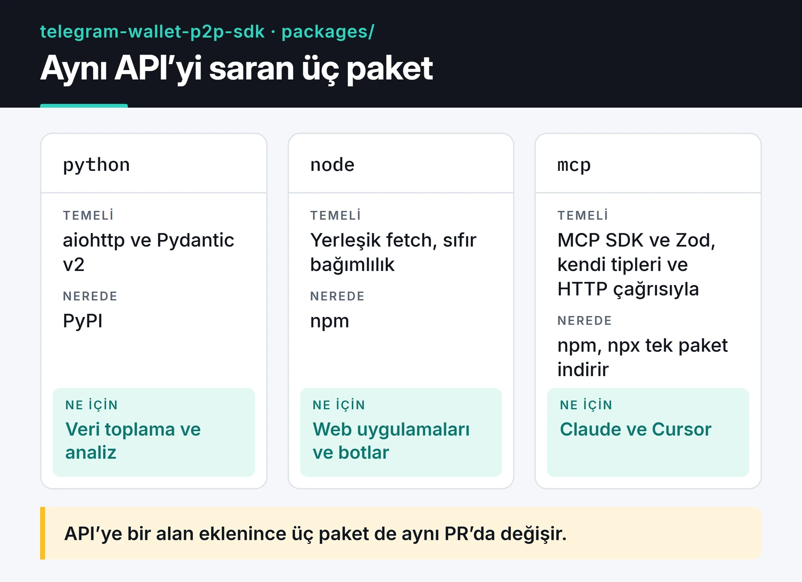

Telegram'ın cüzdanı Wallet, P2P pazarındaki ilanlara bir API üzerinden erişim açtı. Aktif ilanları, alış ve satış fiyatlarını, fiat ve kripto birimlerini, satıcı bilgilerini ve ödeme yöntemlerini uygulamayı açmadan çekebiliyorsunuz. Bu API için Python ve Node.js'te iki resmi olmayan SDK ve Claude gibi asistanlar için bir MCP sunucusu yazdım. Üçü de aynı monorepoda, MIT lisanslı.

Proje sayfası: [telegram-wallet-p2p-sdk](https://furkankoykiran.com.tr/projeler/telegram-wallet-p2p-sdk/) · Kaynak kod: [GitHub](https://github.com/furkankoykiran/telegram-wallet-p2p-sdk)

Bu proje Telegram ya da Wallet ile bağlantılı değil. API de tamamen salt okunur: ilan listeleyebiliyorsunuz, ilan açamıyor ya da işlem yapamıyorsunuz. Yani bu bir trading botu değil, piyasa verisi toplama ve analiz aracı.

## API neye benziyor

Tek bir uç nokta var. `https://p2p.walletbot.me/p2p/integration-api/v1/item/online` adresine `X-API-Key` header'ıyla POST atıyorsunuz:

```json
{
  "cryptoCurrency": "USDT",
  "fiatCurrency": "TRY",
  "side": "SELL",
  "page": 1,
  "pageSize": 50
}
```

Cevap `{"status": "SUCCESS", "data": [...]}` biçiminde. Her ilanda fiyat, kalan miktar, minimum ve maksimum tutar, ödeme yöntemleri, satıcının tamamladığı işlem sayısı ve tamamlama oranı, satıcı seviyesi (normal kullanıcı, merchant, trusted merchant) ve otomatik kabul bilgisi var. Sayfa başına en fazla 50 ilan geliyor.

API anahtarını Telegram içinde Wallet → P2P Market → profiliniz → API Keys yolundan oluşturuyorsunuz. Anahtar tarayıcı DevTools'undan alınmıyor, bu menüden oluşturuluyor.

## Neden monorepo

Aynı API'yi üç pakette sarıyordum ve modeller birbirine bağlıydı. API'ye bir alan eklendiğinde Python modeli, TypeScript tipi ve MCP sunucusu aynı PR'da güncellenmeli. Ayrı repolarda bu senkronizasyon kolayca kayıyor. Aşağıdaki kart üç paketi ve her birinin nerede kullanıldığını gösteriyor.



Paketler şu adlarla yayında:

- PyPI: `telegram-wallet-p2p`
- npm: `@furkankoykiran/telegram-wallet-p2p`
- npm: `@furkankoykiran/telegram-wallet-p2p-mcp`

Üçü de reponun `packages` klasöründe duruyor.

Kartta da görüldüğü gibi MCP sunucusu Node SDK'sına bağımlı değil; tipleri ve HTTP çağrısını kendi içinde tutuyor. Bunu bilerek yaptım: `npx` ile tek paket indirilsin, workspace bağımlılığı yayın sırasını karıştırmasın. Bedeli, aynı tiplerin iki yerde durması.

## Fiyatlar neden string

API fiyat, miktar ve oranları string olarak dönüyor ve iki SDK da bunları string olarak saklıyor:

```ts
export interface OnlineItem {
  id: string;
  price: string;          // birim fiyat
  lastQuantity: string;   // kalan miktar
  minAmount: string;
  maxAmount: string | null;
  executeRate: string;    // 0-1 arası tamamlama oranı
  payments: string[];
  merchantLevel: MerchantLevel;
  isAutoAccept: boolean;
  // ...
}
```

`0.1 + 0.2` işleminin JavaScript'te `0.30000000000000004` vermesi tanıdık bir şaka. Fiyatı bir kez `number`'a çevirirseniz bu hata toplama ve karşılaştırmalara sızıyor. String olarak saklayıp hesabı ondalık bir türle yapmak daha doğru.

Python tarafında analiz fonksiyonları bunu gerçekten yapıyor, bütün hesaplar `decimal.Decimal` ile. Node tarafında ise bir tutarsızlık var: `priceSpread` ve `bestPrice` gibi analiz fonksiyonları fiyatları `parseFloat` ile sayıya çeviriyor. Ortalama ve medyan gibi istatistikler için bu kabul edilebilir, sonuçlar zaten dört basamağa yuvarlanıyor. Yine de bu fonksiyonların çıktısını muhasebe ya da emir tutarı hesabı için kullanmayın. Node SDK'sında bir ondalık kütüphanesine geçmek yapılacaklar listemde.

Node SDK'sı API cevaplarını Zod ile doğrulamıyor. Zod'u hiç kullanmıyor; tipler düz TypeScript interface'leri ve çalışma anında doğrulama yapılmıyor. Zod sadece MCP sunucusunda, araç parametrelerini doğrulamak için kullanılıyor. Python tarafında ise Pydantic v2 modelleri cevabı gerçekten doğruluyor ve camelCase alanları snake_case'e çeviriyor.

## Node.js SDK

Node SDK'sının çalışma zamanı bağımlılığı yok. Node 18'den beri gelen yerleşik `fetch` kullanıyor:

```ts
import { WalletP2PClient, TradeSide, bestPrice, priceSpread } from "@furkankoykiran/telegram-wallet-p2p";

const client = new WalletP2PClient({ apiKey: process.env.WALLET_P2P_API_KEY! });

const { data } = await client.getOnlineItems({
  cryptoCurrency: "USDT",
  fiatCurrency: "TRY",
  side: TradeSide.SELL,
  pageSize: 50,
});

console.log(priceSpread(data));
console.log(bestPrice(data, TradeSide.SELL)?.price);
```

Üst seviye `await` için dosyanın ES modülü olması gerekiyor (`.mjs`, `.mts` ya da `package.json`'da `"type": "module"`).

İstemci 429 ve 5xx cevaplarında kendisi yeniden deniyor. Varsayılan olarak 3 deneme, 1, 2 ve 4 saniyelik üstel bekleme ile. Diğer hatalar tiplenmiş istisnalar olarak geliyor: geçersiz anahtar için `AuthenticationError`, desteklenmeyen para birimi için `BadRequestError`, retry'lar tükenince `RateLimitError`. Zaman aşımı `AbortController` ile 30 saniyede.

## Python SDK

Python SDK'sı `aiohttp` üzerine kurulu ve asenkron context manager olarak kullanılıyor. Birden fazla para birimini aynı anda taramak için `asyncio.gather` yeterli:

```python
import asyncio
import os

from telegram_wallet_p2p import TradeSide, WalletP2PClient
from telegram_wallet_p2p.analytics import price_spread


async def scan(client: WalletP2PClient, fiat: str):
    resp = await client.get_online_items("USDT", fiat, TradeSide.SELL, page_size=50)
    return fiat, price_spread(resp.data)


async def main() -> None:
    async with WalletP2PClient(api_key=os.environ["WALLET_P2P_API_KEY"]) as client:
        results = await asyncio.gather(*(scan(client, f) for f in ["TRY", "EUR", "USD"]))

    for fiat, stats in results:
        print(fiat, stats)


if __name__ == "__main__":
    asyncio.run(main())
```

İstemci tek bir `aiohttp.ClientSession` paylaşıyor, `async with` bloğundan çıkınca kapatıyor. Her istek için yeni bir session açmak bağlantı havuzunu boşa harcar, bu yüzden istemciyi bir kez oluşturup tekrar kullanmak gerekiyor.

Bu "yüksek frekanslı veri toplama" değil. Üç dört paralel istek atıyorsunuz ve API'nin hız sınırına (rate limit) uymanız gerekiyor. Dakikada bir ya da birkaç dakikada bir çekip sonucu bir zaman serisi veritabanına yazmak, P2P makaslarının gün içinde nasıl değiştiğini görmek için fazlasıyla yeterli.

## Sayfalama ve hız sınırı

Sayfa başına 50 ilanla bütün tahtayı almak için sayfaları sırayla gezmek gerekiyor. 429 için ayrıca bir şey yazmanıza gerek yok, istemci zaten yeniden deniyor. Sayfalar arasında kısa bir bekleme koymak limite hiç yaklaşmamak için yeterli. Döngü şöyle:


```ts
import { WalletP2PClient, TradeSide, type OnlineItem } from "@furkankoykiran/telegram-wallet-p2p";

const client = new WalletP2PClient({ apiKey: process.env.WALLET_P2P_API_KEY! });
const sleep = (ms: number) => new Promise((resolve) => setTimeout(resolve, ms));

async function fetchAll(crypto: string, fiat: string, side: TradeSide): Promise<OnlineItem[]> {
  const all: OnlineItem[] = [];
  for (let page = 1; ; page++) {
    const { data } = await client.getOnlineItems({
      cryptoCurrency: crypto,
      fiatCurrency: fiat,
      side,
      page,
      pageSize: 50,
    });
    all.push(...data);
    if (data.length < 50) break; // son sayfa
    await sleep(500);
  }
  return all;
}
```

429'u `error.message.includes('429')` ile yakalamaya çalışmayın: bu SDK'da hata mesajı durum kodunu içermiyor, o kontrol hiç tetiklenmez. Gerekirse `error instanceof RateLimitError` kullanın. Bir de `while` döngüsünde her sayfada `[...allOrders, ...pageData]` ile yeni dizi oluşturmak yerine `push` kullanmak, uzun tahtalarda gereksiz kopyalamayı önlüyor.

## MCP sunucusu

MCP sunucusu üç araç sunuyor:

- `get_p2p_ads`: kripto, fiat ve tarafa göre ilanları listeliyor.
- `get_market_summary`: fiyat istatistikleri, ödeme yöntemi ve satıcı seviyesi dağılımı, ortalama tamamlama oranı.
- `get_best_price`: seçilen taraf için en iyi fiyatlı ilan.

Claude Desktop için yapılandırma:

```json
{
  "mcpServers": {
    "telegram-wallet-p2p": {
      "command": "npx",
      "args": ["-y", "@furkankoykiran/telegram-wallet-p2p-mcp"],
      "env": {
        "WALLET_P2P_API_KEY": "anahtarınız"
      }
    }
  }
}
```

Bundan sonra "Şu an TRY ile alınabilecek en ucuz USDT ilanı hangisi?" ya da "TON/USD pazarının özetini ver, satıcıların ne kadarı merchant?" gibi sorular sorabiliyorsunuz. Asistan veriyi kendisi çekiyor ve filtrelemeyi kendisi yapıyor.

`side` alanının anlamı paketler arasında tutarlı belgelenmemiş. MCP aracının açıklaması tarafı "ilanı açanın bakış açısından" tanımlıyor, analiz fonksiyonlarının dokümanı ise "işlemi alanın bakış açısından". `bestPrice` BUY için en düşük, SELL için en yüksek fiyatı seçiyor. Kendi verinizle birkaç ilanı uygulamadaki görünümle karşılaştırıp hangi tarafın neyi ifade ettiğini doğrulamadan bu fonksiyonların "en iyi" sonucuna güvenmeyin. Bunu netleştirip üç paketi aynı tanıma çekmek sıradaki işim.

## Sırada ne var

Kısa vadede yukarıdaki iki düzeltme var: `side` tanımını tek bir yerde netleştirmek ve Node analizlerinde ondalık hesaba geçmek. Python paketindeki `__version__` değeri de `pyproject.toml` ile uyuşmuyor, onu da düzelteceğim.

Wallet API'ye yazma yetkisi gelirse SDK'lara emir oluşturma eklemek mantıklı olur, ama bugün öyle bir uç nokta yok ve olmayan bir API için kod yazmıyorum. Sık sorgulanan pariteler için kısa ömürlü bir önbellek de hız sınırını korumanın kolay bir yolu.

asyncio'da paralel istekleri, zaman aşımlarını ve sınırlamayı daha ayrıntılı [Python asyncio rehberinde](/posts/python-asyncio-paralel-islem/) anlattım. Aynı serideki diğer MCP sunucularım [freqtrade-mcp](/posts/freqtrade-mcp-server-tr/) ve [DevTo-MCP](/posts/devto-mcp-server-gelistirme-ve-yayinlama/).
