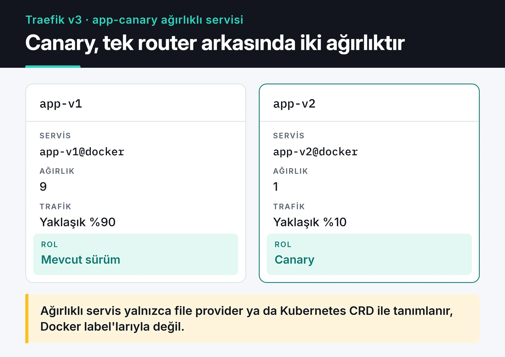

Tek sunucuda birkaç Docker servisi çalıştırdığımda önlerine Traefik koyuyorum. Traefik v3 bir reverse proxy: Docker'ı izler, yeni bir konteyner ayağa kalktığında onun label'larını okuyup routing kuralını kendisi oluşturur ve Let's Encrypt'ten sertifikayı otomatik alır. Yeni bir servis eklemek için proxy config dosyasını düzenleyip reload etmem gerekmiyor. Servisin `compose.yaml` dosyasına birkaç label yazmam yetiyor.

Bu yazıda kullandığım kurulumu, middleware örneklerini, canary dağıtımı ve v2'den gelenlerin takıldığı noktaları anlatıyorum. Örnekler Traefik v3.7 ile yazıldı.

## Traefik ne zaman, nginx ne zaman?

İkisini de kullanıyorum. Konteynerler sık değişiyorsa, her servisin kendi domain'i varsa ve sertifika işini düşünmek istemiyorsam Traefik seçiyorum. Statik dosya sunmak, ince ayarlı cache veya karmaşık rewrite kuralları gerekiyorsa nginx daha rahat. nginx tarafını [nginx yük dengeleme ve önbellekleme yazımda](/posts/nginx-yuk-dengeleme-onbellekleme/) anlattım.

## Dört temel parça

Traefik'te bir istek dört parçadan geçer:

1. EntryPoint: Traefik'in dinlediği port. Genelde `web` (80) ve `websecure` (443).
2. Router: İsteği bir kurala göre eşleştirir, örneğin `Host(`api.example.com`)`.
3. Middleware: İstek servise gitmeden önce üzerinde çalışan adımlar. Kimlik doğrulama, hız sınırı (rate limit), header ekleme gibi.
4. Service: İsteğin gideceği konteyner veya konteynerler. Yük dengeleme burada yapılır.

Ayarlar da ikiye ayrılır. Static config Traefik açılırken okunur: hangi portlar dinlenecek, hangi provider kullanılacak, sertifika çözücü ne olacak. Değiştirmek için Traefik'i yeniden başlatmak gerekir. Dynamic config ise router, middleware ve service tanımlarıdır. Docker label'larından veya izlenen dosyalardan gelir ve Traefik bunları çalışırken yeniden yükler.

## Static config: traefik.yml

```yaml {title="traefik.yml"}
entryPoints:
  web:
    address: ":80"
    http:
      redirections:
        entryPoint:
          to: websecure
          scheme: https
  websecure:
    address: ":443"
    http:
      tls:
        certResolver: le

api:
  dashboard: true

providers:
  docker:
    exposedByDefault: false
    network: proxy
  file:
    directory: /etc/traefik/dynamic
    watch: true

certificatesResolvers:
  le:
    acme:
      email: ops@example.com
      storage: /letsencrypt/acme.json
      httpChallenge:
        entryPoint: web

log:
  level: INFO
accessLog: {}
```

Burada önemli birkaç karar var. `web` entrypoint'i tüm HTTP isteklerini HTTPS'e yönlendiriyor. `websecure` üzerinde varsayılan sertifika çözücüyü tanımladığım için her router'a ayrıca `tls.certresolver` label'ı yazmam gerekmiyor. `exposedByDefault: false` ile yalnızca `traefik.enable=true` label'ı olan konteynerler yayına çıkıyor. Bunu kapatmazsanız sunucudaki veritabanı konteyneri dahil her şey için otomatik router oluşur. `network: proxy` ise birden fazla Docker ağına bağlı konteynerlerde Traefik'in hangi IP'yi kullanacağını belirliyor.

## Docker Compose ile kurulum

```yaml {title="compose.yaml"}
services:
  traefik:
    image: traefik:v3.7
    restart: unless-stopped
    ports:
      - "80:80"
      - "443:443"
    volumes:
      - /var/run/docker.sock:/var/run/docker.sock:ro
      - ./traefik.yml:/etc/traefik/traefik.yml:ro
      - ./dynamic:/etc/traefik/dynamic:ro
      - ./letsencrypt:/letsencrypt
    networks:
      - proxy
    labels:
      - "traefik.enable=true"
      - "traefik.http.routers.dashboard.rule=Host(`traefik.example.com`)"
      - "traefik.http.routers.dashboard.entrypoints=websecure"
      - "traefik.http.routers.dashboard.service=api@internal"
      - "traefik.http.routers.dashboard.middlewares=dashboard-auth"
      - "traefik.http.middlewares.dashboard-auth.basicauth.users=admin:$$2y$$05$$REPLACE_WITH_HTPASSWD_HASH"

  api:
    image: ghcr.io/example/api:1a2b3c4
    restart: unless-stopped
    networks:
      - proxy
    labels:
      - "traefik.enable=true"
      - "traefik.http.routers.api.rule=Host(`api.example.com`)"
      - "traefik.http.routers.api.entrypoints=websecure"
      - "traefik.http.services.api.loadbalancer.server.port=8000"

networks:
  proxy:
    name: proxy
```

Dashboard'u `--api.insecure=true` ile 8080 portundan açmak yerine `api@internal` servisine bağlı bir router arkasına alıyorum ve basic auth ekliyorum. Şifre hash'ini `htpasswd -nB admin` ile üretiyorum. Compose dosyasında `$` karakteri değişken anlamına geldiği için hash'teki her `$` işaretini `$$` olarak yazmak gerekiyor. En sık yapılan hata bu.

Docker socket'i `:ro` ile bağlamak dosyanın kendisini salt okunur yapar ama Docker API'sine erişimi kısıtlamaz. Socket'e erişen Traefik, teoride konteyner başlatıp durdurabilir. Daha sıkı bir kurulum istiyorsanız Traefik ile socket arasına yalnızca okuma isteklerine izin veren bir socket proxy koyabilirsiniz.

API servisinin `compose.yaml` dosyasında tek bir port, tek bir domain var. Konteyner `proxy` ağına katıldığı anda Traefik label'ları okur, router'ı oluşturur ve sertifikayı ister. Servisin kendisi 8000 portunu dışarıya açmıyor, trafik yalnızca Traefik üzerinden geliyor.

## Let's Encrypt: HTTP challenge, DNS challenge

Yukarıdaki yapılandırma HTTP-01 challenge kullanıyor. Let's Encrypt domain'inize 80 portundan bir istek atar, Traefik doğru cevabı verir ve sertifika çıkar. Bunun için 80 portunun internetten erişilebilir olması gerekiyor.

Wildcard sertifika (`*.example.com`) istiyorsanız veya sunucu dışarıya kapalıysa DNS-01 challenge gerekir. Traefik, DNS sağlayıcınızın API'si üzerinden geçici bir TXT kaydı oluşturur:

```yaml
certificatesResolvers:
  le-dns:
    acme:
      email: ops@example.com
      storage: /letsencrypt/acme.json
      dnsChallenge:
        provider: cloudflare
```

Cloudflare için API token'ı `CF_DNS_API_TOKEN` ortam değişkeniyle verilir. Token'a yalnızca ilgili zone'da DNS düzenleme yetkisi verin.

Üç pratik not:

- Denemeler sırasında `caServer: https://acme-staging-v02.api.letsencrypt.org/directory` kullanın. Üretim ortamının rate limit'lerine takılırsanız bir süre aynı domain için sertifika alamazsınız.
- `acme.json` dosyasının bulunduğu klasörü volume olarak saklayın. Konteyner her yeniden oluştuğunda sertifikaları baştan istemek rate limit'e giden en kısa yol.
- Traefik sertifikaları süresi dolmadan kendisi yeniler. Let's Encrypt artık [süre dolum hatırlatma e-postası göndermediği](https://letsencrypt.org/docs/expiration-emails/) için yenileme bir sebeple başarısız olursa kimse size haber vermez. Ben sertifika bitiş tarihini [Uptime Kuma ile izliyorum](/posts/uptime-kuma-servis-izleme/).

## Middleware'ler

Middleware'leri label olarak bir kez tanımlıyorum, sonra istediğim router'a bağlıyorum. Birkaç örnek:

```yaml
labels:
  # Yalnızca VPN ağından gelen isteklere izin ver
  - "traefik.http.middlewares.vpn-only.ipallowlist.sourcerange=10.8.0.0/24"
  # IP başına ortalama 50 istek/sn, 100'lük patlamaya izin ver
  - "traefik.http.middlewares.api-ratelimit.ratelimit.average=50"
  - "traefik.http.middlewares.api-ratelimit.ratelimit.burst=100"
  # Güvenlik header'ları
  - "traefik.http.middlewares.secure-headers.headers.stsSeconds=31536000"
  - "traefik.http.middlewares.secure-headers.headers.contentTypeNosniff=true"
  - "traefik.http.middlewares.secure-headers.headers.frameDeny=true"
  # Router'a sırayla bağla
  - "traefik.http.routers.api.middlewares=secure-headers,api-ratelimit"
```

Middleware'ler yazıldığı sırayla çalışır. Rate limit, isteğin kaynak IP'sine göre sayar. Traefik'in önünde Cloudflare gibi başka bir proxy varsa bütün istekler aynı birkaç IP'den geliyormuş gibi görünür. Bu durumda `ratelimit.sourcecriterion.ipstrategy.depth` ile `X-Forwarded-For` başlığından gerçek istemci IP'sini seçmeniz gerekir. Uygulama seviyesinde rate limit'in nasıl kurulduğuna [API throttling yazımda](/posts/python-hiz-sinirla-api-throttling/) bakabilirsiniz.

## Yük dengeleme, sticky session ve canary

Aynı servisten birden fazla konteyner çalıştırırsanız (`docker compose up --scale api=3`) Traefik hepsini aynı service altında toplar ve varsayılan olarak weighted round robin ile dağıtır. Konteyner sayısını değiştirdiğinizde Traefik'te hiçbir şeyi değiştirmeniz gerekmez.

Uygulama oturum bilgisini bellekte tutuyorsa kullanıcının hep aynı konteynere gitmesi gerekir. Bunun için cookie tabanlı sticky session açılabilir:

```yaml
labels:
  - "traefik.http.services.api.loadbalancer.sticky.cookie=true"
  - "traefik.http.services.api.loadbalancer.sticky.cookie.name=api_affinity"
  - "traefik.http.services.api.loadbalancer.sticky.cookie.secure=true"
  - "traefik.http.services.api.loadbalancer.sticky.cookie.httponly=true"
```

Yine de oturumu Redis gibi paylaşılan bir yerde tutmak daha sağlam. Sticky session, bir konteyner düştüğünde o kullanıcıların oturumunu kaybettirir.

Yeni sürümü önce trafiğin küçük bir kısmına açmak (canary) için Traefik'in `weighted` servis tipini kullanıyorum. Şemadaki örnekte istekler 9'a 1 oranında iki sürüme bölünüyor.



İnternette bunu Docker label'larıyla yapan örnekler dolaşıyor ama çalışmazlar: `weighted` servisler yalnızca file provider veya Kubernetes CRD ile tanımlanabiliyor. Ben konteynerleri yine label'larla tanımlayıp ağırlıklı servisi dosyada kuruyorum:

```yaml {title="dynamic/canary.yml"}
http:
  routers:
    app:
      rule: Host(`app.example.com`)
      entryPoints:
        - websecure
      service: app-canary
  services:
    app-canary:
      weighted:
        services:
          - name: app-v1@docker
            weight: 9
          - name: app-v2@docker
            weight: 1
```

`app-v1` ve `app-v2` konteynerlerinde yalnızca `traefik.enable=true` ve `traefik.http.services.app-v1.loadbalancer.server.port=8000` gibi service label'ları olması yeterli. `@docker` son eki, servisin Docker provider'dan geldiğini söyler. Dosyadaki ağırlıkları değiştirip kaydettiğinizde Traefik yeni oranı hemen uygular.

## v2'den v3'e geçerken takıldığım yerler

v2 için yazılmış label'lar v3'te çoğunlukla çalışır ama birkaç şey değişti:

- `ipWhiteList` middleware'i `ipAllowList` oldu.
- Kural sözdizimi değişti. `HostRegexp` artık doğrudan Go regex alıyor: `HostRegexp(`^.+\.example\.com$`)`. `Headers` eşleyicisi `Header` oldu.
- Bir eşleyiciye virgülle birden fazla domain yazmak yerine `Host(`a.example.com`) || Host(`b.example.com`)` yazmak gerekiyor.

Geçişi kademeli yapmak isterseniz static config'te `core.defaultRuleSyntax: v2` ile eski sözdizimini geçici olarak açık tutabilir, router bazında `ruleSyntax` ile yenisine geçebilirsiniz. Resmi [v2'den v3'e geçiş rehberi](https://doc.traefik.io/traefik/migrate/v2-to-v3/) tüm listeyi veriyor.

## Sorun giderme

404 alıyorsanız router hiçbir kurala eşleşmiyor demektir. Önce dashboard'a bakıyorum: router listede var mı, hata işareti var mı? Yoksa çoğunlukla `traefik.enable=true` label'ı unutulmuştur ya da `Host` kuralındaki domain yanlıştır (`www` farkı sık görülür).

502 veya 504 alıyorsanız router çalışıyor ama Traefik konteynere ulaşamıyor. Konteyner `proxy` ağında mı, `loadbalancer.server.port` uygulamanın gerçekten dinlediği port mu, uygulama `127.0.0.1` yerine `0.0.0.0` üzerinde mi dinliyor? Bu üç soru vakaların çoğunu çözüyor.

Sertifika alınamıyorsa (tarayıcıda Traefik'in varsayılan sertifikasını görürsünüz) `docker logs traefik` çıktısında ACME hatasını arayın. DNS kaydının sunucuyu göstermemesi veya 80 portunun kapalı olması en yaygın iki sebep.

## Sırada ne var

Traefik'in metriklerini görmek isterseniz static config'e `metrics: prometheus: {}` ekleyip [Prometheus ve Grafana ile](/posts/prometheus-grafana-ile-izleme/) istek sayısı, hata oranı ve gecikmeyi izleyebilirsiniz. Arkasında çalışacak Python servisinin imajını hazırlamak için de [Docker ile Python uygulaması yazıma](/posts/docker-ile-python-uygulamasi-containerization/) göz atabilirsiniz.
